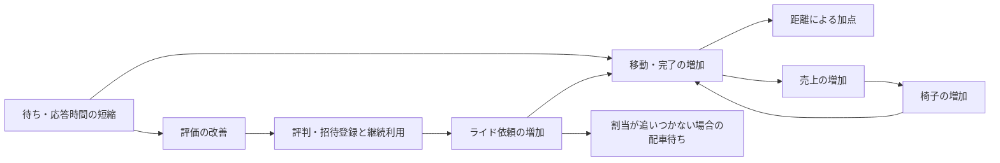

# ISURIDEベンチの得点構造分析

2026-10-11更新。最新finalized RUNは [20261011-061703](../../runs/20261011-061703/bench.log)。
保存済みの `20261011-035537` から `20261011-061703` までの24 RUNを比較し、
成長と待ちの分析は直近3 RUN、特に最新RUNを基準にする。
旧版の最終RUNは `20261011-042043` だった。今回は3ホストへの配置変更後も含める。

## 結論

得点の中心は移動距離である。APIの高速化は、移動開始・ライド完了・次のライドを早めることで得点に効く。
完了から売上・椅子増加へ、評価から評判・招待登録・継続利用へ進む成長が、その後の移動量を増やす。

最新RUNは279,537点・成功で、直前RUNの231,056点から21.0%増えた。
評価API成功は3,628→4,434件、最終椅子数は631→759台。
最終登録／アクティブ人数は1,240／1,163人から3,788／3,787人へ増えた。
旧版で目立った低評価離脱は最新の進捗では1人で、需要の成長は主に招待登録による。

一方、後半には未割当ライドと配車可能な椅子が同時に増えた。
1回64件の配車バッチが続いても依頼の増加に追いついていない。
次の改善候補は配車の起動間隔・処理量であり、利用者数や椅子数を増やすだけで回転が増えるとは判断できない。
資源計測では最新RUNの各ホストにCPU容量の余りがあるが、配車・評価など個別の待ちは残る。
アプリ計測には取得失敗があるため、残存サンプルで確認できた範囲の判断である。

## 公式の得点式と直接の加点

[当日マニュアルの得点式](../official/manual.md#スコアの計算)は次のとおり。

```text
得点 = 迎車距離の合計 × 0.1
     + 乗車中の移動距離の合計
     + ライド完了数 × 5
```

同じ距離なら乗車中の移動は迎車の10倍の加点になる。
通知・検索の件数自体には加点がない。ライドに割り当てられていない椅子の移動も、この式の距離加点には含まれない。

最新RUNの評価API成功4,434件を仮に採点対象の完了数とすると、完了ボーナスは22,170点、総得点の約7.9%になる。
これはRUN全期間のHTTP件数を使った概算であり、確定した得点内訳ではない。
旧版の `20261011-042043` では同じ概算が約5.4%だった。
距離加点が大部分を占めることを示す目安として使い、残りを迎車・乗車それぞれの距離へ分解しない。

完了には直接の5点に加え、次のライドへ進む、売上を発生させる、評価を確定する役割がある。
ユーザーも椅子も、ライドが完了するまで次のライドを要求・受理できない。
これらの仕様は[アプリケーションマニュアル](../official/ISURIDE.md#ライドride)に記載されている。

## RUN比較

得点・合否・最終人数・椅子数は各RUNの `bench.log`、評価API成功件数は `alp.json` が出典。
評価APIは `POST /api/app/rides/{ride_id}/evaluation` の2xx件数である。
人数は最終地域情報の2地域合計、椅子数は最終オーナー情報の5社合計。

| RUN | 得点 | 合否 | 評価API成功件数 | 最終登録／アクティブ人数 | 最終椅子数 |
| --- | ---: | --- | ---: | ---: | ---: |
| [20261011-035537](../../runs/20261011-035537/bench.log) | 671 | PASS | 6 | 10／10 | 20 |
| [20261011-040258](../../runs/20261011-040258/bench.log) | 1,244 | PASS | 13 | 17／17 | 22 |
| [20261011-041159](../../runs/20261011-041159/bench.log) | 1,204 | PASS | 13 | 14／14 | 21 |
| [20261011-041530](../../runs/20261011-041530/bench.log) | 2,565 | PASS | 26 | 37／26 | 26 |
| [20261011-042043](../../runs/20261011-042043/bench.log) | 3,732 | PASS | 40 | 55／26 | 32 |
| [20261011-042630](../../runs/20261011-042630/bench.log) | 8,288 | PASS | 90 | 99／78 | 51 |
| [20261011-043341](../../runs/20261011-043341/bench.log) | 16,687 | PASS | 184 | 128／61 | 80 |
| [20261011-043850](../../runs/20261011-043850/bench.log) | 19,688 | PASS | 218 | 139／66 | 89 |
| [20261011-044454](../../runs/20261011-044454/bench.log) | 24,015 | PASS | 296 | 140／69 | 106 |
| [20261011-045005](../../runs/20261011-045005/bench.log) | 18,089 | PASS | 220 | 143／69 | 85 |
| [20261011-045602](../../runs/20261011-045602/bench.log) | 29,450 | PASS | 452 | 202／105 | 150 |
| [20261011-050014](../../runs/20261011-050014/bench.log) | 35,117 | PASS | 503 | 203／137 | 154 |
| [20261011-050820](../../runs/20261011-050820/bench.log) | 48,731 | FAIL | 684 | 325／316 | 177 |
| [20261011-051222](../../runs/20261011-051222/bench.log) | 40,795 | PASS | 607 | 214／139 | 179 |
| [20261011-051806](../../runs/20261011-051806/bench.log) | 45,032 | PASS | 678 | 224／137 | 194 |
| [20261011-052401](../../runs/20261011-052401/bench.log) | 185,859 | PASS | 2,736 | 822／635 | 497 |
| [20261011-052957](../../runs/20261011-052957/bench.log) | 206,466 | PASS | 3,146 | 867／646 | 548 |
| [20261011-053536](../../runs/20261011-053536/bench.log) | 225,300 | PASS | 3,526 | 1,010／924 | 614 |
| [20261011-054248](../../runs/20261011-054248/bench.log) | 126,305 | PASS | 1,664 | 693／477 | 343 |
| [20261011-054939](../../runs/20261011-054939/bench.log) | 217,486 | PASS | 3,364 | 1,031／925 | 592 |
| [20261011-055518](../../runs/20261011-055518/bench.log) | 175,935 | PASS | 2,414 | 760／532 | 445 |
| [20261011-055959](../../runs/20261011-055959/bench.log) | 227,629 | PASS | 3,593 | 1,268／1,213 | 626 |
| [20261011-060837](../../runs/20261011-060837/bench.log) | 231,056 | PASS | 3,628 | 1,240／1,163 | 631 |
| [20261011-061703](../../runs/20261011-061703/bench.log) | 279,537 | PASS | 4,434 | 3,788／3,787 | 759 |

FAILのRUNに出力された数値を、有効な成功スコアとして扱わない。
最新RUNもエラーなしではなく、結果行は `pass=true`、`map[17:4]`。
参加者WARNにはユーザー登録APIの期待201に対する500が4件あり、`alp.json` の同APIの5xx件数とも一致する。

`20261011-061703` のmanifestでは、Goは `isucon-1`、nginx入口は `isucon-2`、MySQLは `isucon-3`。
直前2 RUNでは入口・Go・MySQLが `isucon-1` に同居していた。
配置以外の取り込み差分やRUNごとの条件もあるため、21.0%の増点を配置変更単独の効果と断定しない。

## 得点を増やす成長と、成長を抑える待ち

公式仕様と参加者INFOから、次の流れが確認できる。
評価・売上の判定閾値や、増加量を決める内部式は未確認である。



図は得点につながる経路を整理したもの。個々の変更がすべての効果を発生させたと断定するものではない。
低評価離脱も成長を抑えるが、最新RUNでは後半の配車待ちの増加と利用者の継続が同時に観測されている。

### 供給側：早い椅子増加と、追加後の稼働を分ける

旧版の `20261011-041530` → `20261011-042043` では、椅子一覧APIの平均応答が2,529→38ms、
最初の椅子増加がINFO開始後39.4→16.2秒、追加台数が6→12台だった。
一覧の高速化で売上確認が進み、椅子増加が早まったという経路が有力だった。

直近3 RUNでは、最初の椅子増加はすでにほぼ同じ時刻である。

| 指標 | 20261011-055959 | 20261011-060837 | 20261011-061703 |
| --- | ---: | ---: | ---: |
| 最初の椅子増加（INFO開始から） | 7.199秒 | 7.185秒 | 7.213秒 |
| 椅子増加イベントの追加台数合計 | 606台 | 611台 | 739台 |
| 最終オーナー売上合計 | 21,338,400円 | 21,667,800円 | 26,545,700円 |
| 椅子一覧APIの2xx件数／平均応答 | 166件／16ms | 166件／21ms | 166件／1ms |
| 売上APIの2xx件数／平均応答 | 164件／20ms | 164件／29ms | 164件／6ms |
| 同一セッションの一覧→売上確認の平均開始間隔 | 756.9ms | 766.3ms | 826.1ms |
| 上記遷移の観測件数 | 163 | 163 | 163 |
| 座標APIの2xx件数／平均応答 | 77,504件／20ms | 79,550件／21ms | 81,192件／4ms |

API集計は `alp.json`、セッション遷移は `user-transitions.json`、売上と増加イベントは `bench.log` が出典。
開始間隔は一覧リクエスト開始から次の売上リクエスト開始までの時間で、API応答時間とは異なる。

最新では一覧・売上APIが速くなっても、確認件数は変わらず、最初の追加も早まっていない。
今回の増点を旧版と同じ「最初の椅子増加の前倒し」で説明することはできない。
追加量と売上は増えたが、追加された椅子が実際に割り当てられ、移動できたかまで見る必要がある。

### 需要側：招待登録が増え、離脱が小さくなった

最新RUNの登録と離脱を同一報告時刻で結合した。
人数は累計、椅子追加はその報告時刻までの増加イベント合計である。

| INFO開始から | 評判による登録 | 招待による登録 | 低評価による離脱 | 椅子追加 |
| --- | ---: | ---: | ---: | ---: |
| 9.040秒 | 6人 | 35人 | 未報告 | 9台 |
| 19.840秒 | 30人 | 106人 | 未報告 | 50台 |
| 30.640秒 | 54人 | 530人 | 未報告 | 179台 |
| 36.039秒 | 66人 | 979人 | 1人 | 276台 |
| 41.439秒 | 78人 | 1,515人 | 1人 | 372台 |
| 46.839秒 | 90人 | 2,012人 | 1人 | 462台 |
| 52.239秒 | 102人 | 2,514人 | 1人 | 551台 |
| 57.639秒 | 114人 | 3,024人 | 1人 | 644台 |
| 63.040秒 | 126人 | 3,533人 | 1人 | 739台 |

離脱行がない時刻は「未報告」とし、0人に補わない。
最終報告の新規登録3,659人のうち招待経由が3,533人で、招待が増加の中心だった。
直前RUNの最終報告は評判129人・招待1,034人・離脱77人。
評判経由の人数が増えたために最新の需要が増えた、と説明することはできない。

最新の最終登録／アクティブ人数の差は1人で、旧版の55／26人とは継続の状態が異なる。
ただし登録の最終報告と最終地域情報には時刻差がある。
新規登録累計へ初期人数を足して最終登録数と一致させる補正は行わない。
また、終了直前に増えた利用者が残り時間で完了・移動へ寄与できる量は限られる。

## 最新RUNで残る配車待ちと評価待ち

椅子は、座標更新リクエストの成功を確認するまで次の移動へ進まない。
この仕様は[アプリケーションマニュアル](../official/ISURIDE.md#椅子chair)に記載されている。
直前→最新RUNで座標APIの平均応答は21→4msとなり、最終移動不満率は31.6→0.4%になった。
一方、最終マッチング不満率は91.8→88.8%、迎車不満率は14.9→9.2%だった。
割合の母数と判定閾値は不明であり、不満率だけから資源の律速や損失時間を決めない。

### 未割当と配車可能な椅子が同時に増える

最新RUNの分析窓は `06:17:10〜06:18:14 JST` の64秒。
その中の10秒窓で、HTTPの依頼成功件数とアプリの配車計測を比較した。
アプリ差分は計測間隔全体が窓に収まるものだけを使い、境界をまたぐ差分を除外した。
そのためHTTPは各10秒、配車は各約9秒の観測量を、それぞれ件／秒へ換算している。
未割当・配車可能数は同じサンプル時刻の値である。

| 比較窓（JST） | 依頼成功件数／秒 | 配車件数／観測秒数 | 配車件数／秒 | 窓内最後のサンプル時刻 | 未割当ライド | 配車可能な椅子 | 最古の未割当の待ち |
| --- | ---: | ---: | ---: | --- | ---: | ---: | ---: |
| 06:17:40〜06:17:50 | 209.6 | 1,024件／9.001秒 | 113.8 | 06:17:49.849 | 1,505 | 262 | 7.026秒 |
| 06:17:50〜06:18:00 | 204.6 | 960件／9.001秒 | 106.7 | 06:17:59.848 | 2,472 | 426 | 11.883秒 |
| 06:18:00〜06:18:10 | 208.5 | 1,024件／9.001秒 | 113.8 | 06:18:09.848 | 3,382 | 576 | 16.479秒 |

各窓の観測配車はそれぞれ16・15・16バッチで、すべて1回64件だった。
現行実装の上限も [matchingBatchSize = 64](../../webapp/go/internal_handlers.go) であり、
[外部matcher](../../etc/systemd/system/isuride-matcher.service)はAPI完了後にsleepして次の呼び出しへ進む。
未割当と配車可能な椅子が同時に残り、配車の観測処理率が依頼率を下回ることから、
このRUNでは配車の起動間隔と1回の処理量が成長を抑える要因という仮説が有力である。
単純な椅子不足だけでは、この同時残留を説明できない。

`dispatch_available` は、アクティブ・未完了ライドなし・椅子向け未送信通知なしの椅子数。
`dispatch_waiting` は未割当ライド数で、利用者の継続率や配車待ち不満の母数とは異なる。
アプリ計測の取得失敗と観測境界の違いがあるため、依頼と配車の件数差をそのまま全期間の未割当数へ換算しない。
配車頻度を上げる場合も、[イベント起動の過去の比較](event-driven-matching.md)と併せて、
迎車・乗車の質、完了数、離脱、得点を確認する必要がある。

### 評価APIは決済の待ちが大きい

同じ64秒分析窓に収まる完全な計測間隔を使うと、最新RUNの成功評価4,434件の平均は次のとおり。

| アプリ計測の段階 | 平均時間 |
| --- | ---: |
| 評価全体 | 574.39ms |
| 同期SQL | 0.95ms |
| 決済 | 572.74ms |
| 完了処理 | 0.48ms |

各段階は同じ成功評価件数を母数にしているが、計測範囲の境界があるため厳密な足し算の内訳とは扱わない。
HTTP側の評価API平均576msとも近く、現行の評価待ちの大部分は決済である。
完了までユーザー・椅子が次へ進めないため、回転に関係する待ちとして追う。
これは待ち時間であり、CPU消費時間へ加算しない。決済先の処理や短縮可能量は本資料では未確認。

## 資源の容量と得点経路を併せて見る

最新RUNの同じ64秒分析窓で、各ホストは2 CPU、各64サンプルである。
CPU秒は既存の `resource_demand` が1サンプルを1秒として積分した値。

| ホスト・役割 | ホストCPU秒／容量CPU秒 | 容量の余り | 主なサービスCPU秒 | ホストbusyの最大値 |
| --- | ---: | ---: | --- | ---: |
| isucon-1：Go | 44.04／128.00 | 83.96 CPU秒 | Go 33.78 | 62.76% |
| isucon-2：nginx・matcher | 59.86／128.00 | 68.14 CPU秒 | nginx 50.70、matcher 5.86 | 76.14% |
| isucon-3：MySQL | 27.89／128.00 | 100.11 CPU秒 | MySQL 26.25 | 38.89% |

ホスト・サービスのCPU秒を重ねて足さない。サービスはホスト消費の内訳である。
このサンプル範囲では、どのホストもbusy 80%以上のサンプルはなかった。
ホスト全体のCPU飽和を得点の主因とする根拠はないが、短時間の競合や個別処理の待ちを否定するものではない。
配車待ちと空き椅子の残留、決済待ちを併せて、実際に移動へ進めない時間を減らす候補を選ぶ。

## 次のRUNで追う指標

| 得点への経路 | 既存成果物で見る指標 | 判断上の注意 |
| --- | --- | --- |
| 配車待ちの解消 | 同じ時間窓の依頼率・配車率、バッチ件数、未割当数・最古待ち、配車可能数 | 配車率だけを増やして迎車・移動の質や得点を悪化させない |
| 移動量と回転 | 座標APIの応答時間・件数、評価API成功件数、評価段階別の待ち | HTTP件数を距離や採点対象の完了数と同一視しない |
| 需要の成長・維持 | 評判・招待登録、低評価離脱の時系列、最終アクティブ人数 | 最新は招待が中心。登録時刻と離脱、完了へ進めた量を併せて見る |
| 供給の成長と使用 | 椅子追加時刻・台数、売上、配車可能数と配車件数 | 最終椅子数だけで稼働時間・供給不足を判断しない |
| 資源の制約 | 同じ観測窓のホスト・Go・nginx・MySQL CPU秒、待ち、容量 | SQL延べ時間・API延べ時間をCPU秒に足さない |
| 正当性 | 合否、種別エラー、登録5xx、決済完了、通知順序 | PASSでも最新RUNには登録失敗4件がある |

SSEの通知HTTP件数・平均応答時間は、状態通知件数・通知遅延とは異なる。
接続の長さや件数の減少を処理量の悪化と判断せず、移動・完了・成長へつながったかで評価する。

## 出典、確認方法、未確定点

数値集計と時系列結合は `task q` の読み取り専用DuckDBを使った。
分析DBは対象24 RUNへ同期済みで、今回のための同期・成果物再生成・ベンチ実行・計測変更は行っていない。
主に以下の既存ビュー・保存成果物を参照した。

- [参加者ログ解釈ビュー](../../tools/contest/analysis-schema/bench-summary.sql)：最終地域・オーナー、登録、不満率、椅子増加、結果。
- [進捗ビュー](../../tools/contest/analysis-schema/bench-progress.sql)：原文・報告時刻。離脱行は未対応のため原文から累計人数を取得。
- [API集計](../../tools/analysis/schema/endpoints.sql)と[セッション遷移](../../tools/analysis/schema/user-transitions.sql)：RUN全期間の集計。
- [HTTP・資源のビュー](../../tools/analysis/schema/semantic.sql)：`http_traffic_series`、`resource_demand`、`host_saturation`、`load_windows`。
- [アプリの配車・評価計測ビュー](../../tools/contest/analysis-schema/ride-metrics.sql)と[確認クエリ](../../tools/contest/queries/ride-metrics.sql)：epoch・ready・version、差分の成立条件、計測間隔を確認。
- 最新RUNの [run.json](../../runs/20261011-061703/run.json)、[bench.log](../../runs/20261011-061703/bench.log)、[alp.json](../../runs/20261011-061703/alp.json)。

基本情報は以下で再確認できる。後続RUNが増えても本資料の対象範囲を変えない。

```shell
task q -- "SELECT run_id, score, passed FROM bench_results WHERE run_id <= '20261011-061703' ORDER BY run_id"
task q -- "SELECT run_id, sum(registered_users) registered, sum(active_users) active FROM bench_final_regions WHERE run_id <= '20261011-061703' GROUP BY run_id ORDER BY run_id"
task q -- "SELECT run_id, sum(chairs) chairs, sum(sales) sales FROM bench_final_owners WHERE run_id <= '20261011-061703' GROUP BY run_id ORDER BY run_id"
task q -- "SELECT run_id, status_2xx, avg_time_sec FROM endpoints WHERE contains(uri, '/evaluation') AND run_id <= '20261011-061703' ORDER BY run_id"
task q -- "SELECT reported_at, line FROM bench_log_lines WHERE run_id = '20261011-061703' AND line LIKE '%level=INFO msg=これまでに低評価なライド%' ORDER BY line_number"
task q -- "SELECT run_id, started_at, ended_at, duration_seconds, source, reason FROM load_windows WHERE run_id >= '20261011-055959' AND run_id <= '20261011-061703' ORDER BY run_id"
task q -- "SELECT name, status, reason, quality_status FROM artifacts WHERE run_id = '20261011-061703' AND name LIKE '%sql-pool-metrics.tsv'"
task artifacts-run RUN=runs/20261011-061703
```

進捗の経過秒は、同RUNの参加者INFO「負荷走行を開始します」と報告行の時刻差をミリ秒単位で求めた。
登録・離脱は同じ `reported_at` で結合し、椅子追加は報告時刻までのイベントを累積した。
配車の10秒表は `load_windows.started_at` から窓を作り、HTTPは `ts >= 窓開始 AND ts < 窓終了`、
アプリヒストグラムは `interval_start >= 窓開始 AND ts <= 窓終了` で絞った。
配車率の分母は残存計測間隔の `sum(interval_ms) / 1000`。
未割当・配車可能数は各窓内最後の同一時刻サンプルである。

限界は次のとおり。

- `task artifacts-run` は直近3 RUNで必須captureの内容検査に成功した。
  ただし `20261011-060837` と `20261011-061703` の `isucon-1-sql-pool-metrics.tsv` は
  manifestで `status=failed`・`quality.status=invalid`。取得タイムアウトが各2回あり、manifestの収集窓では67／69サンプル。
  最新の64秒分析窓にはreadyの配車ゲージ65サンプルと、表に使ったヒストグラムの完全な64差分間隔が残る。
  「完全な間隔」は差分の各フィールドが揃うという意味であり、RUN全期間の計測が完全だったという意味ではない。
  欠損を0に補わず、配車・評価分析は残存する有効差分へ限定した。
- 旧版対象の `20261011-041530`・`20261011-042043` は、manifestのaccess artifactはokでもローカルに圧縮生accessログがない。
  今回も `task artifacts-run RUN=runs/20261011-042043` はその欠損を検出した。
  旧RUNのHTTP時系列を0件にせず、残っているAPI・遷移集計を使う。トップレベル `missing` は未記録でも実ファイルを確認する。
- 公式の負荷テストは60秒だが、INFO開始から終了までは最新RUNで68.641秒。
  manifestの収集窓は69.502秒、分析DBのtraffic-threshold窓は64.000秒である。
  直前2 RUNの分析窓は66.612／66.992秒で、終了閾値を検出できず収集終了を使っている。
  これらを採点60秒の厳密な境界と扱わず、INFO経過・収集窓・分析窓・RUN全期間を区別する。
- API・遷移集計には採点区間外や再試行が含まれる可能性がある。評価API成功件数を正確な完了加点へ置き換えない。
  迎車・乗車それぞれの採点距離、進行中ライドの加点、端数の扱いも復元していない。
  全座標件数やオーナー売上を距離へそのまま換算しない。
- 不満率の母数、評判・招待・離脱・売上による成長の閾値と内部式は不明。
  DEBUGの `tick`・`reqs`・`score`・`criteria` 配列は解釈していない。
- ベンチマーカーのソース解析、インターネット調査、サーバーの変更は行っていない。
