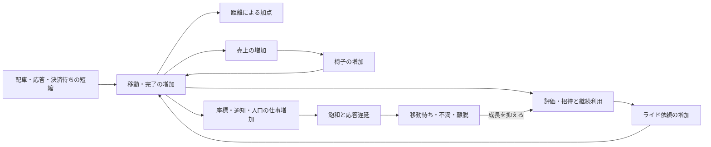

# ISURIDEベンチの得点構造分析

2026-10-11更新。最新finalized RUNは [20261011-070058](../../runs/20261011-070058/bench.log)。
分析DBに保存済みの `20261011-035537` から `20261011-070058` までの28 RUNを比較する。
直近の構造変化はWAL投影削減後の `062549`、2バッチ化後の `064138`、
決済変更後の `064927`、広い配車計画後の `070058` を基準にする。
本資料のRUN一覧は分析DBの収録範囲であり、他worktreeだけにあるRUNまで網羅した一覧ではない。

## 結論

得点の中心は移動距離である。配車・移動・完了を増やし、売上から椅子を増やす成長が得点に効く。
最新RUNは510,296点・PASSで、直前458,824点から11.2%増えた。
評価API成功は7,320→7,830件、売上は43,678,600→46,173,700円へ増えた。
一方、最終椅子数は1,173→1,183台とほぼ同じで、最終アクティブ人数は3,701→1,736人へ減った。
今回の増点を利用者・椅子の総数増加だけで説明することはできない。

2バッチ化では289,926→447,849点、54.5%増。配車量・完了・椅子供給が増え、
従来の「待機ライドと空き椅子が残るのに64件ずつしか処理しない」制約を緩和した。
決済変更では平均決済待ちが短くなったが、増点は2.5%にとどまった。
広い配車計画では後半の配車率が187.6→213.5件/秒、平均作成→割当が6.60→4.51秒へ改善した。
ただし後半の依頼率も268.2→214.7件/秒へ減っており、待機減少を処理能力増だけに帰属させない。

資源の制約も変わった。最新のINFO開始後30〜60秒では入口nginxホストが平均94.3%、
Goホストが平均86.0%・最大99.5%。従来の「各ホストにCPU余力がある」という判断を維持できない。
座標APIの同窓平均応答は20.74→44.27ms、最終移動不満率は20.2→43.1%、
最後の低評価離脱報告は45→246人。配車量をさらに増やす前に、入口とGoの応答遅延を抑える優先度が高い。
不満率の母数・内部判定式は不明であり、これらだけから因果や失点量は確定しない。

## 公式の得点式と直接の加点

[当日マニュアルの得点式](../official/manual.md#スコアの計算)は次のとおり。

```text
得点 = 迎車距離の合計 × 0.1
     + 乗車中の移動距離の合計
     + ライド完了数 × 5
```

同じ距離なら乗車中の移動は迎車の10倍の加点になる。
通知・検索の件数自体には加点がない。未割当椅子の移動も、この式の距離加点には含まれない。
最新の評価API成功7,830件を仮に採点対象の完了数とすると、完了ボーナスは39,150点、総得点の約7.7%。
RUN全期間のHTTP件数からの概算で、確定した得点内訳ではない。
距離加点が大部分を占める目安として使い、残りを迎車・乗車の距離へ分解しない。

完了には直接の5点に加え、次のライドへ進む、売上を発生させる、評価を確定する役割がある。
ユーザーも椅子もライド完了まで次のライドを要求・受理できない。
これらは[アプリケーションマニュアル](../official/ISURIDE.md#ライドride)の仕様である。

## RUN比較

得点・合否・最終人数・椅子数は各RUNの `bench.log`、評価API成功件数は `alp.json` が出典。
評価APIは `POST /api/app/rides/{ride_id}/evaluation` の2xx件数。
人数は最終地域情報の2地域合計、椅子数は最終オーナー情報の5社合計。

| RUN | 得点 | 合否 | 評価API成功件数 | 最終登録／アクティブ人数 | 最終椅子数 |
| --- | ---: | --- | ---: | ---: | ---: |
| [20261011-035537](../../runs/20261011-035537/bench.log) | 671 | PASS | 6 | 10／10 | 20 |
| [20261011-040258](../../runs/20261011-040258/bench.log) | 1,244 | PASS | 13 | 17／17 | 22 |
| [20261011-041159](../../runs/20261011-041159/bench.log) | 1,204 | PASS | 13 | 14／14 | 21 |
| [20261011-041530](../../runs/20261011-041530/bench.log) | 2,565 | PASS | 26 | 37／26 | 26 |
| [20261011-042043](../../runs/20261011-042043/bench.log) | 3,732 | PASS | 40 | 55／26 | 32 |
| [20261011-042630](../../runs/20261011-042630/bench.log) | 8,288 | PASS | 90 | 99／78 | 51 |
| [20261011-043341](../../runs/20261011-043341/bench.log) | 16,687 | PASS | 184 | 128／61 | 80 |
| [20261011-043850](../../runs/20261011-043850/bench.log) | 19,688 | PASS | 218 | 139／66 | 89 |
| [20261011-044454](../../runs/20261011-044454/bench.log) | 24,015 | PASS | 296 | 140／69 | 106 |
| [20261011-045005](../../runs/20261011-045005/bench.log) | 18,089 | PASS | 220 | 143／69 | 85 |
| [20261011-045602](../../runs/20261011-045602/bench.log) | 29,450 | PASS | 452 | 202／105 | 150 |
| [20261011-050014](../../runs/20261011-050014/bench.log) | 35,117 | PASS | 503 | 203／137 | 154 |
| [20261011-050820](../../runs/20261011-050820/bench.log) | 48,731 | FAIL | 684 | 325／316 | 177 |
| [20261011-051222](../../runs/20261011-051222/bench.log) | 40,795 | PASS | 607 | 214／139 | 179 |
| [20261011-051806](../../runs/20261011-051806/bench.log) | 45,032 | PASS | 678 | 224／137 | 194 |
| [20261011-052401](../../runs/20261011-052401/bench.log) | 185,859 | PASS | 2,736 | 822／635 | 497 |
| [20261011-052957](../../runs/20261011-052957/bench.log) | 206,466 | PASS | 3,146 | 867／646 | 548 |
| [20261011-053536](../../runs/20261011-053536/bench.log) | 225,300 | PASS | 3,526 | 1,010／924 | 614 |
| [20261011-054248](../../runs/20261011-054248/bench.log) | 126,305 | PASS | 1,664 | 693／477 | 343 |
| [20261011-054939](../../runs/20261011-054939/bench.log) | 217,486 | PASS | 3,364 | 1,031／925 | 592 |
| [20261011-055518](../../runs/20261011-055518/bench.log) | 175,935 | PASS | 2,414 | 760／532 | 445 |
| [20261011-055959](../../runs/20261011-055959/bench.log) | 227,629 | PASS | 3,593 | 1,268／1,213 | 626 |
| [20261011-060837](../../runs/20261011-060837/bench.log) | 231,056 | PASS | 3,628 | 1,240／1,163 | 631 |
| [20261011-061703](../../runs/20261011-061703/bench.log) | 279,537 | PASS | 4,434 | 3,788／3,787 | 759 |
| [20261011-062549](../../runs/20261011-062549/bench.log) | 289,926 | PASS | 4,580 | 3,906／3,906 | 778 |
| [20261011-064138](../../runs/20261011-064138/bench.log) | 447,849 | PASS | 7,120 | 3,770／3,689 | 1,147 |
| [20261011-064927](../../runs/20261011-064927/bench.log) | 458,824 | PASS | 7,320 | 3,746／3,701 | 1,173 |
| [20261011-070058](../../runs/20261011-070058/bench.log) | 510,296 | PASS | 7,830 | 1,986／1,736 | 1,183 |

FAILのRUNに出力された数値を、有効な成功スコアとして扱わない。
最新RUNの結果行は `pass=true`、`map[17:2]`。ユーザー登録APIの期待201に対する500が2件あり、
`alp.json` の同APIの5xxとも一致する。PASSはエラーなしという意味ではない。

### 直近の変更と測定commit

| RUN | 測定commit／branch | 主な変更 | 直前からの得点変化 |
| --- | --- | --- | ---: |
| 061703 | `115fd36`／thu | Go・入口nginx・MySQLの3台分離 | +21.0% |
| 062549 | `d7ed815`／sat | 状態WALのMySQL投影を削除 | +3.7% |
| 064138 | `539a75d`／mon | 飽和時に64件を最大2バッチ配車 | +54.5% |
| 064927 | `7aeda02`／tue | 決済をライド単位の冪等POST再試行へ変更、履歴GET照合を削除 | +2.5% |
| 070058 | `4023fad`／wed | FIFO計画上限256、solverを共通状態ロック外へ移動 | +11.2% |

`062549` 以降はGoが1号機、入口nginx・matcherが2号機、MySQLが3号機。
`062549→064138` の実装差分は2バッチ化、`064138→064927` は決済変更。
`064927→070058` は配車計画・solver・ロック範囲と、その既存計測契約の変更で、nginx設定は同じ。
保存commitの `webapp`・`nginx`・Taskfile・競技設定の差分を確認した。
各比較は1 RUNずつで、需要・候補供給も実行に伴って変わるため、将来の期待倍率とは扱わない。
3台分離前後には配置以外の差分もあり、`061703` の21.0%を配置単独の効果とは断定しない。

最新の実装は [matchingPlanLimit = 256](../../webapp/go/internal_handlers.go) と
[ロック外計画・確定処理](../../webapp/go/runtime_matching.go)。
飽和時の2計画処理は維持されるが、追加計画の条件も待機・配車可能数が各256以上へ変わっている。
最新RUNを「従来64件の2バッチに品質改善だけを加えた比較」とは扱わない。
TLS終端分散や事前圧縮の効果を、このRUNへ帰属させない。

## 得点を増やす成長と、成長を抑える待ち

公式仕様と参加者INFOから、次の流れが確認できる。
評価・売上の判定閾値や増加量を決める内部式は未確認である。



図は得点と制約への経路を整理したもの。最新は回転増による加点と、遅延・離脱の悪化が同時に起きている。
個々の変更が全経路の原因になったと断定するものではない。

### 供給側：最初の椅子増加は早まらず、完了と売上が増えた

| 指標 | 062549 | 064138 | 064927 | 070058 |
| --- | ---: | ---: | ---: | ---: |
| 最初の椅子増加（INFO開始から） | 7.292秒 | 7.139秒 | 7.196秒 | 7.145秒 |
| 椅子増加イベントの追加台数合計 | 758 | 1,127 | 1,153 | 1,163 |
| 最終椅子数 | 778 | 1,147 | 1,173 | 1,183 |
| 最終売上合計（円） | 27,458,000 | 42,551,000 | 43,678,600 | 46,173,700 |
| 評価API成功件数（RUN全期間） | 4,580 | 7,120 | 7,320 | 7,830 |
| 椅子一覧APIの2xx件数／平均応答 | 166／2ms | 164／9ms | 157／12ms | 133／11ms |
| 売上APIの2xx件数／平均応答 | 164／6ms | 164／10ms | 164／13ms | 149／18ms |

APIは `alp.json` のRUN全期間集計、売上・追加は `bench.log`。
最初の椅子増加は約7.2秒で変わらず、今回の増点を増加開始の前倒しでは説明できない。
旧版 `041530→042043` では椅子一覧API高速化と最初の追加39.4→16.2秒が同時に起きたが、
直近はすでにその待ちが小さい。オーナーAPIの件数も減っており、最終台数だけで成長速度を判断しない。
最新と直前の椅子数差は10台。追加された椅子が割当・移動・完了へ進めた量を見る必要がある。

### 需要側：最新は後半の招待増加が鈍り、離脱が増えた

最新RUNの累計登録・離脱を同じ報告時刻で結合した。
椅子追加はその報告時刻までのイベント累計である。

| INFO開始から | 評判登録 | 招待登録 | 低評価離脱 | 椅子追加 |
| --- | ---: | ---: | ---: | ---: |
| 8.971秒 | 6 | 33 | 未報告 | 10 |
| 19.771秒 | 30 | 189 | 未報告 | 72 |
| 30.571秒 | 54 | 803 | 1 | 242 |
| 35.972秒 | 66 | 1,295 | 10 | 331 |
| 41.372秒 | 78 | 1,608 | 48 | 463 |
| 46.771秒 | 94 | 1,750 | 86 | 612 |
| 52.172秒 | 112 | 1,798 | 158 | 780 |
| 57.571秒 | 129 | 1,813 | 210 | 957 |
| 62.971秒 | 147 | 1,818 | 246 | 1,094 |

離脱行がない時刻を0に補わない。最後の登録報告と最終地域情報には時刻差があり、
初期人数を加えて一致させる補正も行わない。最後の離脱246人と最終登録−アクティブ250人も別時点の値である。

直前 `064927` は同じ約36秒で招待1,386・離脱1人、約47秒で招待2,175・離脱42人、
最後の約63秒で招待3,466・離脱45人だった。最新は約36秒以降に招待の増加が鈍り、離脱が増えている。
最終アクティブ人数は3,701→1,736人。以前の `061703`・`062549` のように
需要の成長・継続が強い状態ではなくなった。配車待ちの減少には依頼率の低下も寄与している。

## 配車量の増加と、残る待ち

### 比較する時間窓

以下の横断表は、各RUNの参加者INFO「負荷走行を開始します」の `reported_at` を起点に30〜60秒。
開始時刻は `062549=06:25:54.345`、`064138=06:41:42.568`、
`064927=06:49:31.732`、`070058=07:01:02.553 JST`。
manifestの収集開始や `load_windows.started_at` とは異なる起点で、採点60秒の厳密な境界ではない。
過去の会話の丸め値を転記せず、このINFO起点で再集計した。

HTTPは時間バケットの `ts >= 窓開始 AND ts < 窓終了`、分母30秒。
アプリ差分は `interval_start >= 窓開始 AND ts <= 窓終了` の完全に収まる有効差分だけを使う。
アプリの率は残存差分の観測秒数で割るため、HTTPと件数を直接引き算して待機増加を復元しない。
HTTPバケットは開始時刻で選択するので、ミリ秒境界に対して端のバケットを含み得る。

| 指標（INFO開始後30〜60秒） | 062549 | 064138 | 064927 | 070058 |
| --- | ---: | ---: | ---: | ---: |
| 依頼成功件数/秒（HTTP） | 207.4 | 266.0 | 268.2 | 214.7 |
| 割当件数／有効観測秒数 | 3,259／28.999 | 5,376／29.047 | 5,440／29.001 | 6,191／29.000 |
| 割当件数/秒 | 112.4 | 185.1 | 187.6 | 213.5 |
| 配車バッチ数／平均件数 | 51／63.9 | 84／64.0 | 85／64.0 | 39／158.7 |
| 平均作成→割当 | 9.24秒 | 6.38秒 | 6.60秒 | 4.51秒 |
| 評価成功件数／有効観測秒数（アプリ） | 3,247／28.999 | 5,173／29.047 | 5,298／29.001 | 5,567／29.000 |
| 評価成功件数/秒（アプリ） | 112.0 | 178.1 | 182.7 | 192.0 |
| 窓内最後のサンプル時刻（JST） | 06:26:54.292 | 06:42:41.803 | 06:50:30.868 | 07:02:01.653 |
| その時刻の未割当件数 | 3,274 | 2,716 | 2,863 | 846 |
| 同時刻の配車可能椅子数 | 551 | 633 | 758 | 141 |
| 同時刻の最古の未割当の待ち | 15.990秒 | 9.750秒 | 10.298秒 | 3.331秒 |
| 同時刻の椅子向け通知待ちによる除外数 | 0 | 29 | 4 | 36 |

`dispatch_available` はactive・未完了ライドなし・椅子向け未送信通知なしの椅子数。
`dispatch_waiting` は未割当数で、不満率の母数とは異なる。
バッチの件数とHTTP呼出し数は別で、2バッチ化後もカウンターはバッチ単位。
`064138` の84バッチ、`064927` の85バッチは全て64件。
最新の39バッチは全て64件超（`_inf - _b3 = 39`）、平均158.7件で、全て256件という意味ではない。

以前は依頼率が割当率を大きく上回り、待機と空き椅子が同時に増えた。
最新は割当率が上がっただけでなく需要も減り、待機・最古待ち・空き椅子が減っている。
この両方を評価し、待機減少を配車方式の改善だけの証拠にしない。

最新を10秒ごとに見ると次のとおり。

| INFO経過の窓 | 依頼成功/秒 | 割当件数／観測秒数 | 割当/秒 | 窓末未割当 | 同時刻の空き椅子 | 最古待ち |
| --- | ---: | ---: | ---: | ---: | ---: | ---: |
| 30〜40秒 | 236.8 | 1,596／8.999 | 177.4 | 1,080 | 59 | 4.513秒 |
| 40〜50秒 | 215.8 | 2,163／9.007 | 240.1 | 977 | 43 | 4.780秒 |
| 50〜60秒 | 191.4 | 2,115／9.001 | 235.0 | 846 | 141 | 3.331秒 |

ゲージ時刻は順に `07:01:41.652`、`07:01:51.659`、`07:02:01.653 JST`。
10秒表は内部境界をまたぐ差分も除外するため、件数・観測秒数の合計は30秒表と一致しない。
後半に割当率が依頼率を上回る一方、依頼自体も236.8→191.4件/秒へ低下した。

### 広い計画の割当品質と処理量を分ける

後半の推定迎車時間は `064927` の平均3.60秒（5,440件、9〜64件バッチ）に対し、
最新は8.30秒（6,191件、9件以上の計画）。位置・モデル速度からの推定値で、実測迎車時間ではない。
既存計測はv1の `pickup_b9_64` からv2の `pickup_b9_plus` へ変わったため、
同じコホートの比較ではなく、需要・椅子供給・計画件数の分布も異なる。
これだけでsolverの品質が悪化したと断定しないが、今回の実負荷で迎車負担が減った証拠でもない。

最新は計画上限64→256、solver置換、共通ロック外計算、追加計画の閾値変更が同時に入る。
増点や配車件数増を「広い集合での組合せ改善単独の効果」と切り分けることはできない。
確定時のWAL・状態公開・通知処理は共通ロック内に残る。
CPU・計算時間・候補の移動・確定処理の増加も、回転と遅延へ影響する候補である。

### 評価待ち：決済は短縮したが、SQL・完了段階の時間が増えた

同じINFO開始後30〜60秒、有効差分内の成功評価を母数とする。

| 平均時間 | 062549（3,247件） | 064138（5,173件） | 064927（5,298件） | 070058（5,567件） |
| --- | ---: | ---: | ---: | ---: |
| 評価全体 | 580.63ms | 590.57ms | 355.48ms | 394.04ms |
| 同期SQL段階 | 0.99ms | 6.14ms | 7.57ms | 14.62ms |
| 決済段階 | 578.50ms | 572.12ms | 332.05ms | 343.10ms |
| 完了段階 | 0.79ms | 8.03ms | 10.36ms | 21.85ms |
| 決済再試行数 | 3,061 | 4,669 | 11,444 | 11,935 |

段階の境界があり、厳密に足し合わせた内訳ではない。各時間はCPU秒ではなく処理の経過時間。
決済変更では履歴GET照合を削除し、同じ冪等キーのPOSTを再試行する。
再試行カウンターが増えても平均決済時間は短くなっており、再試行数だけで負荷悪化と判断しない。
決済の短縮が得点へ比例して効くわけでもなく、入口・配車・移動の制約が残る。
最新は決済以外の段階も長くなっているが、これをMySQL CPU飽和や共通ロック待ちの時間と同一視しない。

## 資源の制約：入口の飽和に加え、Go側も限界へ近づいた

同じINFO開始後30〜60秒で、各ホスト2 CPU・30サンプル、容量は60 CPU秒。
CPU秒は既存ビューと同じく1サンプルを1秒として積分した値。
ホストbusyは2 CPU全体の割合、serviceの `cpu_pct` は1 core=100%のため、割合を混ぜない。

| RUN | Goホスト CPU秒／容量 | busy p95／最大 | 入口ホスト CPU秒／容量 | busy p95／最大 | MySQLホスト CPU秒／容量 |
| --- | ---: | ---: | ---: | ---: | ---: |
| 062549 | 29.98／60 | 56.69／58.16% | 42.30／60 | 77.33／78.61% | 14.46／60 |
| 064138 | 43.83／60 | 83.58／85.86% | 56.74／60 | 100／100% | 18.01／60 |
| 064927 | 43.08／60 | 79.52／80.61% | 57.01／60 | 99.50／100% | 18.82／60 |
| 070058 | 51.60／60 | 98.77／99.50% | 56.57／60 | 99.78／100% | 15.39／60 |

| サービスCPU秒（同じ30秒窓） | 062549 | 064138 | 064927 | 070058 |
| --- | ---: | ---: | ---: | ---: |
| Go | 23.30 | 34.78 | 34.33 | 41.57 |
| nginx | 36.87 | 52.74 | 53.05 | 52.89 |
| matcher | 3.27 | 3.14 | 3.08 | 2.73 |
| MySQL | 13.33 | 17.00 | 17.78 | 14.56 |

サービスCPU秒はホスト消費の内訳で、ホストへ足さない。
最新のGoホストCPU pressure平均は28.62%、入口は7.69%。圧力は待ちの指標で、CPU消費へ足さない。
RUN全体のtraffic-threshold窓63秒ではGoホスト72.26／126 CPU秒、入口81.31／126 CPU秒だが、
成長前を含む平均だけでは後半の飽和を見落とす。旧版のCPU余力を現行の判断へそのまま持ち込まない。

### 移動への応答と入口の仕事

椅子は座標更新の成功を確認するまで次の移動へ進まない。
[椅子の仕様](../official/ISURIDE.md#椅子chair)から、座標APIの遅延は距離加点と回転を抑える経路になる。

| 指標 | 062549 | 064138 | 064927 | 070058 |
| --- | ---: | ---: | ---: | ---: |
| 座標API成功/秒（同じ30秒窓） | 1,539.2 | 3,168.9 | 2,811.0 | 4,816.1 |
| 座標API平均応答（同じ30秒窓） | 5.72ms | 19.18ms | 20.74ms | 44.27ms |
| 座標API p99（alp全期間） | 23ms | 100ms | 103ms | 189ms |
| 依頼API平均応答（同じ30秒窓） | 6.15ms | 34.12ms | 42.88ms | 83.05ms |
| 配車API平均応答（同じ30秒窓） | 4.96ms | 31.59ms | 28.59ms | 133.77ms |
| 最終配車待ち不満率 | 83.8% | 91.5% | 91.1% | 91.0% |
| 最終迎車不満率 | 10.6% | 10.8% | 7.8% | 15.7% |
| 最終実移動不満率 | 0.5% | 18.7% | 20.2% | 43.1% |

p99は同じ30秒窓の値ではなく、平均応答・資源と厳密に同窓の比較とは扱わない。
不満率も待機ゲージと母数が異なる。平均待機が短くなっても累計配車不満率が下がるとは限らない。

同じ30秒窓の入口の仕事も変わっている。

| 入口HTTP集計 | 064927 | 070058 |
| --- | ---: | ---: |
| APIリクエスト | 149,387 | 201,174 |
| API本文 | 120.46MB | 54.38MB |
| 静的リクエスト | 490,513 | 414,482 |
| 静的本文 | 1,480.63MB | 547.10MB |
| nginx CPU秒 | 53.05 | 52.89 |

MBは1,000,000 bytes。静的は正規化routeが `^/api/` で始まらないもの。
静的本文が減ってもnginx CPU消費はほぼ同じで、API、特に座標の仕事が増えた。
最新の入口CPU飽和を静的転送量だけで説明できない。TLS暗号化・接続・HTTP・proxyなどへのCPU帰属は未確定。
入口負荷の削減・分散は有力だが、同時にGo側の余力と確定・通知処理の費用も評価する必要がある。

## 次のRUNで追う指標

| 得点への経路 | 既存成果物で見る指標 | 判断上の注意 |
| --- | --- | --- |
| 移動量・回転 | 座標APIの同窓応答、評価成功/秒、得点 | HTTP件数を距離や採点対象完了数と同一視しない |
| 配車能力と需要 | 依頼/秒、割当/秒、有効観測秒数、待機/最古待ち、空き椅子 | 需要が減ったための待機短縮も分ける |
| 割当品質 | 推定迎車、計画件数分布、迎車・移動不満、離脱 | v1/v2のpickupコホートと候補・需要の違いを明記する |
| 成長・維持 | 招待登録と離脱の同時刻推移、売上、椅子増加 | 最終人数・台数だけで成長速度を判断しない |
| 入口とGoの容量 | 同じ窓のCPU秒／容量、p95/最大、pressure、応答 | 全体平均で後半飽和を隠さず、CPU内訳は重複加算しない |
| 決済と完了 | 成功評価の段階別時間、再試行、完了後の椅子再利用 | 再試行数とHTTP試行数・完了数を混ぜない |
| 正当性 | PASS、登録5xx、決済完了、通知順序、通常再起動 | 最新も登録500が2件ある |

最新RUNを比較基準に、入口分散なら両入口のログ・CPUを合わせて扱い、Go・MySQLへ移した仕事も含める。
入口応答が改善してもGoが飽和して得点が伸びない可能性があるため、両方を同時に追う。
SSEのHTTP件数・平均応答は状態通知件数・通知遅延ではなく、接続の長さである。

## 出典、確認方法、未確定点

数値集計と時系列結合は `task q` の読み取り専用DuckDBを使った。
分析DBは対象28 RUNを収録済み。今回のための同期・成果物再生成・ベンチ実行・計測変更は行っていない。
参照した既存ビュー・成果物は以下。

- [参加者ログ解釈](../../tools/contest/analysis-schema/bench-summary.sql)と[進捗](../../tools/contest/analysis-schema/bench-progress.sql)：地域・売上・登録・不満・椅子増加・結果。離脱は原文から取得。
- [API集計](../../tools/analysis/schema/endpoints.sql)：RUN全期間の `alp.json`。
- [HTTP・資源](../../tools/analysis/schema/semantic.sql)：`http_traffic_series`、`metrics`、`resource_demand`、`load_windows`。
- [アプリ計測](../../tools/contest/analysis-schema/ride-metrics.sql)：ready・epoch・version・単調増加・各フィールドの成立条件を満たす差分。
- 最新の [run.json](../../runs/20261011-070058/run.json)、[bench.log](../../runs/20261011-070058/bench.log)、[alp.json](../../runs/20261011-070058/alp.json)。

基本情報は以下で再確認できる。後続RUNが増えても本資料の対象範囲を変えない。

```shell
task q -- "SELECT run_id, score, passed FROM bench_results WHERE run_id <= '20261011-070058' ORDER BY run_id"
task q -- "SELECT run_id, sum(registered_users) registered, sum(active_users) active FROM bench_final_regions WHERE run_id >= '20261011-062549' AND run_id <= '20261011-070058' GROUP BY run_id ORDER BY run_id"
task q -- "SELECT run_id, sum(chairs) chairs, sum(sales) sales FROM bench_final_owners WHERE run_id >= '20261011-062549' AND run_id <= '20261011-070058' GROUP BY run_id ORDER BY run_id"
task q -- "SELECT run_id, status_2xx, avg_time_sec, p99_time_sec FROM endpoints WHERE contains(uri, '/coordinate') AND run_id >= '20261011-062549' AND run_id <= '20261011-070058' ORDER BY run_id"
task q -- "SELECT reported_at, line FROM bench_log_lines WHERE run_id = '20261011-070058' AND contains(line, '低評価なライド') ORDER BY line_number"
task q -- "SELECT run_id, started_at, ended_at, duration_seconds, reason FROM load_windows WHERE run_id >= '20261011-062549' AND run_id <= '20261011-070058' ORDER BY run_id"
task q -- "SELECT run_id, name, status, quality_status, quality_window_coverage_pct FROM artifacts WHERE run_id >= '20261011-062549' AND run_id <= '20261011-070058' AND contains(name, 'sql-pool') ORDER BY run_id"
task artifacts-run RUN=runs/20261011-070058
```

配車・評価表の再現クエリは次のとおり。各stageごとに観測秒数を出し、stageを横断して分母を足さない。

```sql
WITH a AS (
 SELECT run_id,min(reported_at) AS t0 FROM bench_log_lines
 WHERE run_id BETWEEN '20261011-062549' AND '20261011-070058'
   AND contains(line,'負荷走行を開始') GROUP BY run_id
)
SELECT h.run_id,h.series,sum(events) AS n,
       sum(total)/nullif(sum(events),0) AS mean_measure,
       sum(interval_ms)/1000.0 AS observed_seconds,
       sum(total)/nullif(sum(interval_ms)/1000.0,0) AS total_per_second
FROM ride_metric_histograms h JOIN a USING(run_id)
WHERE interval_start>=t0+INTERVAL '30 seconds' AND ts<=t0+INTERVAL '60 seconds'
GROUP BY h.run_id,h.series ORDER BY h.run_id,h.series;
```

時間窓と成果物の限界:

| RUN | INFO開始〜終了 | manifest収集窓 | traffic-threshold分析窓 | sql-pool coverage／最大gap |
| --- | ---: | ---: | ---: | ---: |
| 062549 | 68.721秒 | 69.748秒 | 67.501秒（終了は収集末尾） | 100.0%／2,640ms |
| 064138 | 68.564秒 | 69.428秒 | 64.000秒 | 97.1%／1,047ms |
| 064927 | 68.624秒 | 69.494秒 | 66.823秒（終了は収集末尾） | 97.1%／1,015ms |
| 070058 | 68.573秒 | 69.522秒 | 63.000秒 | 98.6%／2,319ms |

- `task artifacts-run` は `064138`・`064927`・`070058` で必須captureの内容検査に成功。
  sql-poolは全4 RUNで実体があるが `status=failed / quality=invalid`。最新は1回timeout、
  manifest収集窓で68／69サンプル。coverage100%の `062549` も失敗を取り消さない。
  配車・評価表は残存する有効差分だけを使用し、欠損を0にしない。
- 各manifestのトップレベル `missing` は未記録。実体とartifact statusを別々に確認した。
  旧 `041530`・`042043` は圧縮生accessログの実体がないため、残存API集計を使い、欠損時系列を0扱いしない。
- 最新アプリjournalには133件・152,398件のログ抑制がある。ログ行数・隣接行の時刻差から処理量や起動間隔を復元しない。
  アプリの配車・評価は既存カウンター、HTTPは保存済みaccess集計を使う。
- 公式負荷テストは60秒。INFO経過・manifest収集・分析窓・alp全期間を区別し、採点区間と同一視しない。
  API件数には採点区間外や再試行が含まれ得る。評価成功を正確な完了加点へ置き換えない。
- 採点対象の迎車・乗車距離、進行中ライドの加点、端数処理は復元していない。
  座標件数やオーナー売上をそのまま距離に換算しない。
- 不満率の母数、評判・招待・離脱・椅子追加の閾値と内部式は不明。
  DEBUGの `tick`・`reqs`・`score`・`criteria` 配列は解釈していない。
- nginxのTLS・接続・proxyへのCPU帰属、Goの共通ロック待ちの寄与は未確定。
  最新はfgprof成果物がなく、API時間・CPU割合だけで待ちの内訳は決めない。
- ベンチマーカーのソース解析、インターネット調査、サーバーの変更は行っていない。
