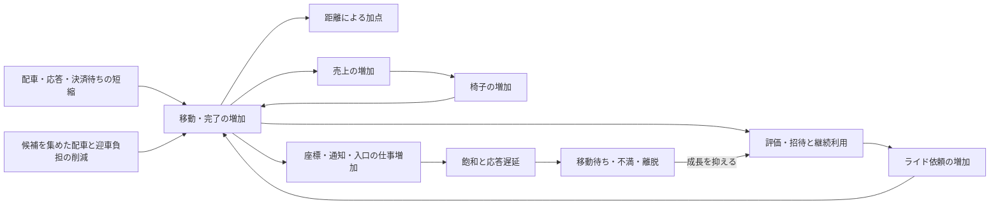

# ISURIDEベンチの得点構造分析

2026-10-11更新。対象は保存済み・分析DB収録済みの `20261011-035537`〜`20261011-083640`、41 finalized RUN。
最新は [083640](../../runs/20261011-083640/bench.log)、最高のPASSスコアは [074654](../../runs/20261011-074654/bench.log)。
他worktreeだけにあるRUNまで網羅した一覧ではない。以下、同日のRUNを時刻6桁で略記する。

## 結論

得点の中心は移動距離で、完了・売上・椅子増加による回転の成長が得点に効く。
最高は572,775点・PASS、最新の追加計測RUN `083640` は527,163点・PASS。
外部matcherを使う構成へ戻り、座標・ライド段階・配車機会のv3計測を追加したRUNである。
同系列の `074654` より8.0%低いが、計測追加にも処理・ロック取得があるため、
この1 RUNの差を計測費用や実装の退行の確定値にしない。

追加計測により、座標の処理本体と待ちを分けて見られるようになった。
INFO開始後30〜60秒のうち有効25.004秒、成功座標の1/64サンプル2,146件では、
共通状態ロック待ちが平均19.38ms、保持が0.024ms、WAL Writeが0.0077ms。
この観測では座標の小さなWriteだけを削るより、共通状態ロックの待ちを減らす根拠が強い。
ただし待ちを発生させた処理やCPU消費への帰属は、この段階計測だけでは確定しない。

同じ有効差分では、未割当と配車可能椅子が共存する時間が24.995／25.004秒、
未処理の配車機会から計画開始まで平均614ms、solverが平均91.81ms。
割当可能な組があるのに外部matcherの次の呼出しを待つ経路が見える。
一方、過去の `081805→082354` は待ちを500→100msへ削って45.9%減点した。
早く小さく割り当てるだけでは回転が増えないので、配車機会待ち・計画件数・迎車品質を同時に評価する。

ライド段階別の受理距離は迎車302,242、乗車中282,400座標単位。
公式の距離重みを当てた観測値では乗車中が90.3%を占め、距離の加点経路を裏付ける。
採点区間・採点者の距離とは一致を確認していないため、スコア内訳への換算は行わない。
ARRIVED滞在は2,644.63椅子秒、平均105.77台で、決済・完了を含む待ちも供給回転の判断に使える。
初期状態から復元された387台の滞在は別に扱い、通常の再利用待ちを過大評価しない。

TLS分散後も資源制約は残る。最新の同30秒窓で1号機は52.52／60 CPU秒、
2号機は38.51／60、nginx・MySQL同居の3号機は49.71／60 CPU秒。
配車機会の待ちを削ると仕事の集中も変わるため、Goと3号機の共有容量を併せて追う。

## 公式の得点式と直接の加点

[当日マニュアルの得点式](../official/manual.md#スコアの計算)は次のとおり。

```text
得点 = 迎車距離の合計 × 0.1
     + 乗車中の移動距離の合計
     + ライド完了数 × 5
```

同じ距離なら乗車中の移動は迎車の10倍の加点になる。
通知・検索の件数自体には加点がなく、未割当椅子の移動もこの距離加点には含まれない。
最高RUNの評価API成功8,684件を仮に採点対象完了数とすると、完了ボーナスは43,420点、約7.6%。
最新も7,903件×5＝39,515点、約7.5%にとどまる。
これはRUN全期間HTTP件数による概算で、採点対象完了数や得点内訳の確定値ではない。
距離加点が大部分を占める目安として使い、残りを迎車・乗車距離へ分解しない。

完了は直接の5点に加えて、次のライドへ進む、売上を発生させる、評価を確定する役割を持つ。
ユーザーも椅子も `COMPLETED` まで次のライドを要求・受理できない。
これらは[アプリケーションマニュアル](../official/ISURIDE.md#ライドride)の仕様である。
[最終スコア](../official/manual.md#最終スコア)は最後の負荷走行結果なので、過去最高点と区別する。

## RUN比較

得点・合否・最終人数・椅子数は `bench.log`、評価API成功件数は `alp.json` が出典。
評価APIは `POST /api/app/rides/{ride_id}/evaluation` の2xx件数。
人数は最終地域情報の2地域合計、椅子数は最終オーナー情報の5社合計。

| RUN | 得点 | 合否 | 評価API成功件数 | 最終登録／アクティブ人数 | 最終椅子数 |
| --- | ---: | --- | ---: | ---: | ---: |
| [20261011-035537](../../runs/20261011-035537/bench.log) | 671 | PASS | 6 | 10／10 | 20 |
| [20261011-040258](../../runs/20261011-040258/bench.log) | 1,244 | PASS | 13 | 17／17 | 22 |
| [20261011-041159](../../runs/20261011-041159/bench.log) | 1,204 | PASS | 13 | 14／14 | 21 |
| [20261011-041530](../../runs/20261011-041530/bench.log) | 2,565 | PASS | 26 | 37／26 | 26 |
| [20261011-042043](../../runs/20261011-042043/bench.log) | 3,732 | PASS | 40 | 55／26 | 32 |
| [20261011-042630](../../runs/20261011-042630/bench.log) | 8,288 | PASS | 90 | 99／78 | 51 |
| [20261011-043341](../../runs/20261011-043341/bench.log) | 16,687 | PASS | 184 | 128／61 | 80 |
| [20261011-043850](../../runs/20261011-043850/bench.log) | 19,688 | PASS | 218 | 139／66 | 89 |
| [20261011-044454](../../runs/20261011-044454/bench.log) | 24,015 | PASS | 296 | 140／69 | 106 |
| [20261011-045005](../../runs/20261011-045005/bench.log) | 18,089 | PASS | 220 | 143／69 | 85 |
| [20261011-045602](../../runs/20261011-045602/bench.log) | 29,450 | PASS | 452 | 202／105 | 150 |
| [20261011-050014](../../runs/20261011-050014/bench.log) | 35,117 | PASS | 503 | 203／137 | 154 |
| [20261011-050820](../../runs/20261011-050820/bench.log) | 48,731 | FAIL | 684 | 325／316 | 177 |
| [20261011-051222](../../runs/20261011-051222/bench.log) | 40,795 | PASS | 607 | 214／139 | 179 |
| [20261011-051806](../../runs/20261011-051806/bench.log) | 45,032 | PASS | 678 | 224／137 | 194 |
| [20261011-052401](../../runs/20261011-052401/bench.log) | 185,859 | PASS | 2,736 | 822／635 | 497 |
| [20261011-052957](../../runs/20261011-052957/bench.log) | 206,466 | PASS | 3,146 | 867／646 | 548 |
| [20261011-053536](../../runs/20261011-053536/bench.log) | 225,300 | PASS | 3,526 | 1,010／924 | 614 |
| [20261011-054248](../../runs/20261011-054248/bench.log) | 126,305 | PASS | 1,664 | 693／477 | 343 |
| [20261011-054939](../../runs/20261011-054939/bench.log) | 217,486 | PASS | 3,364 | 1,031／925 | 592 |
| [20261011-055518](../../runs/20261011-055518/bench.log) | 175,935 | PASS | 2,414 | 760／532 | 445 |
| [20261011-055959](../../runs/20261011-055959/bench.log) | 227,629 | PASS | 3,593 | 1,268／1,213 | 626 |
| [20261011-060837](../../runs/20261011-060837/bench.log) | 231,056 | PASS | 3,628 | 1,240／1,163 | 631 |
| [20261011-061703](../../runs/20261011-061703/bench.log) | 279,537 | PASS | 4,434 | 3,788／3,787 | 759 |
| [20261011-062549](../../runs/20261011-062549/bench.log) | 289,926 | PASS | 4,580 | 3,906／3,906 | 778 |
| [20261011-063543](../../runs/20261011-063543/bench.log) | 289,519 | PASS | 4,584 | 3,925／3,923 | 780 |
| [20261011-064138](../../runs/20261011-064138/bench.log) | 447,849 | PASS | 7,120 | 3,770／3,689 | 1,147 |
| [20261011-064927](../../runs/20261011-064927/bench.log) | 458,824 | PASS | 7,320 | 3,746／3,701 | 1,173 |
| [20261011-065430](../../runs/20261011-065430/bench.log) | 451,146 | PASS | 7,217 | 3,705／3,657 | 1,148 |
| [20261011-070058](../../runs/20261011-070058/bench.log) | 510,296 | PASS | 7,830 | 1,986／1,736 | 1,183 |
| [20261011-070813](../../runs/20261011-070813/bench.log) | 164,278 | FAIL | 2,318 | 1,654／1,630 | 415 |
| [20261011-071543](../../runs/20261011-071543/bench.log) | 520,066 | PASS | 7,887 | 2,667／2,347 | 1,111 |
| [20261011-072629](../../runs/20261011-072629/bench.log) | 472,415 | PASS | 7,337 | 3,262／3,040 | 1,104 |
| [20261011-074032](../../runs/20261011-074032/bench.log) | 490,954 | PASS | 7,461 | 2,892／2,554 | 1,127 |
| [20261011-074654](../../runs/20261011-074654/bench.log) | 572,775 | PASS | 8,684 | 2,446／2,139 | 1,238 |
| [20261011-075546](../../runs/20261011-075546/bench.log) | 416,282 | PASS | 6,217 | 2,300／1,805 | 978 |
| [20261011-080400](../../runs/20261011-080400/bench.log) | 254,113 | PASS | 3,111 | 1,799／1,598 | 525 |
| [20261011-081239](../../runs/20261011-081239/bench.log) | 556,671 | PASS | 8,477 | 2,859／2,494 | 1,201 |
| [20261011-081805](../../runs/20261011-081805/bench.log) | 540,785 | PASS | 8,193 | 2,361／2,031 | 1,205 |
| [20261011-082354](../../runs/20261011-082354/bench.log) | 292,472 | PASS | 4,066 | 2,445／2,229 | 636 |
| [20261011-083640](../../runs/20261011-083640/bench.log) | 527,163 | PASS | 7,903 | 2,460／2,141 | 1,207 |

FAILの数値を有効な成功スコアとして扱わない。`scores.tsv` にもFAILの数値があるため、
`bench_results.passed` と原文の結果を併せて確認する。035537のTSV得点は空欄だが、原文では671点・PASS。
最新の結果行は `pass=true`、`種別エラー数=map[24:2]`。PASSはエラーなしという意味ではない。

### 変更ごとの比較元を分ける

直前RUNは異なるworktreeの実験を含む。時刻順の得点差を、記載した変更単独の効果と解釈しない。
比較元は保存commitのGo・nginx・Taskfile・競技設定の差分で確認した。

| RUN | 測定commit／branch | 比較元 | 実装・配置の差分 | 得点差 |
| --- | --- | --- | --- | ---: |
| 061703 | `115fd36`／thu | 060837 | Go・入口nginx・MySQLの3台分離。配置以外の差分も含む | +21.0% |
| 062549 | `d7ed815`／sat | 061703 | 状態WALのMySQL投影を削除 | +3.7% |
| 064138 | `539a75d`／mon | 062549 | 飽和時に64件を最大2バッチ配車 | +54.5% |
| 064927 | `7aeda02`／tue | 064138 | 決済をライド単位の冪等POST再試行へ変更、履歴GET照合を削除 | +2.5% |
| 070058 | `4023fad`／wed | 064927 | FIFO計画上限256、solver置換・共通状態ロック外計算、追加計画の閾値変更 | +11.2% |
| 070813 | `1c61035`／mon | 070058 | Go中継でTLS終端を2・3号機へ分散 | FAIL・途中終了 |
| 071543 | `79017eb`／mon | 070058 | TLS分散と中継のFD圧力への対処を含む | +1.9% |
| 072629 | `ca61d8e`／tue | 071543 | 座標更新を共通ライド状態ロックから分離 | −9.2% |
| 074032 | `a85a1e5`／thu | 071543 | solverのCPU・作業領域確保を削減 | −5.6% |
| 074654 | `0909770`／tue | 071543 | Go TLS中継をkernel NAT分散へ置換。Goアプリ差分なし | +10.1% |
| 075546 | `0e7e871`／wed | 074654 | 座標所有を3号機へ移動、専用loopとbinary WAL batchingを導入 | −27.3% |
| 080400 | `5c645cf`／fri | 074654 | 外部matcherをイベント駆動・10msのスケジューラへ置換 | −55.6% |
| 081239 | `3e95580`／wed | 075546 | 座標所有を1号機へ戻し、専用loopとbinary WAL batchingは保持。配置・役割設定も変更 | +33.7% |
| 081805 | `cccca01`／fri | 080400 | スケジューラの待ちを10→500msへ変更 | +112.8% |
| 082354 | `b5ca59d`／fri | 081805 | 同じスケジューラの待ちを500→100msへ変更 | −45.9% |
| 083640 | `63d012f`／tue | 074654 | 外部matcher・上限256の構成に座標・flow・配車機会のv3計測を追加 | −8.0% |

`074032→074654` はsolver最適化の取り外しも含むため、その16.7%をNAT単独へ帰属させない。
`081239→081805` は座標loop・WALなども異なり、スケジューラだけの比較ではない。
`080400→081805→082354` のGo・nginx・Taskfile・競技設定の差分はスケジューラ定数だけ。
この3 RUNは待ち時間による挙動比較に使えるが、各設定1 RUNで需要・候補供給も変わるため、
500msが最適という結論や将来の期待倍率は確定しない。

`071543` 以降はnginxが2・3号機、MySQLが3号機。`075546` のみ座標処理用Goが3号機にもある。
スケジューラRUNでは外部matcherを停止し、Go内部で配車する。
`082354` はfriのスケジューラ実験、最新 `083640` はtueの外部matcher構成。
更新時のmainも[外部matcherの配車処理](../../webapp/go/runtime_matching.go)とv3計測を使う。

## 得点を増やす成長と、成長を抑える待ち

公式仕様と参加者INFOから確認できる経路は次のとおり。
評価・売上の判定閾値や増加量の内部式は未確認である。



図は得点と制約への経路を整理したもの。各変更が全経路の原因と確定したことを示すものではない。

### 供給側：椅子が増え始める時刻より、その後の完了・売上・増加量

| 指標 | 070058 | 074654 | 081239 | 081805 | 082354 |
| --- | ---: | ---: | ---: | ---: | ---: |
| 最初の椅子増加（INFO開始から） | 7.145秒 | 7.219秒 | 7.290秒 | 7.291秒 | 7.300秒 |
| 椅子増加イベントの追加台数合計 | 1,163 | 1,218 | 1,181 | 1,185 | 616 |
| 最終椅子数 | 1,183 | 1,238 | 1,201 | 1,205 | 636 |
| 最終売上合計（円） | 46,173,700 | 51,705,300 | 49,915,200 | 48,189,600 | 23,583,100 |
| 評価API成功件数（RUN全期間） | 7,830 | 8,684 | 8,477 | 8,193 | 4,066 |

直近の最初の椅子追加は約7.2〜7.3秒でほぼ同じ。`082354` の退行は開始時刻の遅れで説明できない。
一方、売上・評価成功・最終椅子数は大きく減っている。初期化短縮より負荷中の回転を優先する。
途中終了の `070813` は追加イベント428台に対して最終415台で一致せず、
イベントが全て登録・稼働へ進んだと仮定しない。

### 需要側：最終人数だけで成長速度を判断しない

同じRUNの登録・離脱を同じ報告時刻で結合し、椅子追加はその時刻までの累計とした。
経過時刻がRUN間で完全に一致するわけではないので、約36・47・63秒の推移として比較する。

| RUN | INFO経過 | 評判登録 | 招待登録 | 低評価離脱 | 椅子追加 |
| --- | ---: | ---: | ---: | ---: | ---: |
| 074654 | 36.046秒 | 67 | 1,420 | 12 | 405 |
| 074654 | 46.906秒 | 91 | 2,107 | 126 | 706 |
| 074654 | 63.106秒 | 144 | 2,282 | 304 | 1,183 |
| 081805 | 36.118秒 | 66 | 1,244 | 3 | 338 |
| 081805 | 46.917秒 | 89 | 1,982 | 98 | 621 |
| 081805 | 63.117秒 | 140 | 2,203 | 319 | 1,158 |
| 082354 | 36.607秒 | 68 | 872 | 3 | 250 |
| 082354 | 47.437秒 | 92 | 1,420 | 73 | 373 |
| 082354 | 63.637秒 | 126 | 2,166 | 215 | 616 |

`082354` は約36〜47秒の招待・椅子追加が遅れ、終盤まで招待が増える一方、椅子追加の差は埋まらない。
最終アクティブ人数が多くても、距離・完了が少ない状態がある。
離脱行がない報告時刻を0へ補わない。最後の離脱と最終登録−アクティブは別時点の値である。

## 配車量と割当品質を併せて評価する

### 比較する時間窓と母数

以下は各RUNのINFO「負荷走行を開始します」の時刻を起点に30〜60秒。
manifest収集開始や `load_windows.started_at` とは異なり、採点60秒の厳密な境界ではない。
起点と窓長は末尾の表に示す。

HTTPはバケット開始 `ts >= 窓開始 AND ts < 窓終了`、分母30秒、両nginxの値を合算する。
既存HTTP集計は5秒バケットなので、端のバケットはINFO基準の境界と最大約5秒ずれ得る。
依頼は `POST` のみ。`GET /api/app/rides` を依頼数へ足さない。
応答は窓内HTTP全件を母数にした加重平均、成功率は2xx件数/秒。

アプリは `interval_start >= 窓開始 AND ts <= 窓終了` に完全に収まる有効差分を使う。
histogramの全列が存在する差分の実観測秒数で割り、各stageの観測秒数を横断して足さない。
v3の `083640` は状態観測時刻を使い、snapshot失敗に隣接する差分も除外する。詳細は追加計測の節に示す。
HTTPと分母・端の扱いが異なるので、依頼−割当をそのまま待機増分としない。
`070813` は途中終了してこの30秒窓を満たさないため、以下の横断比較から除外する。

| RUN | 依頼成功/秒（HTTP） | 割当件数／観測秒数 | 割当/秒 | バッチ数／平均件数 | 平均作成→割当 | 評価成功/秒（アプリ） |
| --- | ---: | ---: | ---: | ---: | ---: | ---: |
| 070058 | 214.7 | 6,191／29.000 | 213.5 | 39／158.7 | 4.51秒 | 192.0 |
| 071543 | 227.6 | 6,003／29.014 | 206.9 | 35／171.5 | 5.17秒 | 191.7 |
| 072629 | 239.4 | 5,710／28.996 | 196.9 | 35／163.1 | 5.49秒 | 181.0 |
| 074032 | 229.5 | 6,030／29.001 | 207.9 | 39／154.6 | 5.20秒 | 184.0 |
| 074654 | 255.7 | 6,981／28.999 | 240.7 | 39／179.0 | 5.06秒 | 214.0 |
| 075546 | 167.2 | 4,908／29.000 | 169.2 | 48／102.2 | 4.42秒 | 149.2 |
| 080400 | 84.9 | 2,343／29.002 | 80.8 | 1292／1.8 | 0.85秒 | 70.1 |
| 081239 | 259.8 | 6,566／29.009 | 226.3 | 39／168.4 | 5.64秒 | 207.7 |
| 081805 | 247.4 | 6,726／29.002 | 231.9 | 49／137.3 | 4.76秒 | 207.2 |
| 082354 | 112.1 | 3,154／29.001 | 108.8 | 275／11.5 | 1.09秒 | 95.3 |
| 083640 | 247.8 | 5,360／25.004 | 214.4 | 35／153.1 | 5.13秒 | 194.3 |

配車待ちの短い `080400`・`082354` は、依頼・割当・評価成功も少ない。
500msの `081805` では大きな計画が戻り、540,785点へ回復した。
100msへ戻した `082354` では、275バッチ全てが64件以下、平均11.5件。
500msでは49バッチ中47が64件超、平均137.3件だった。
同じ「上限256」でも実際の候補集合と実行件数は大きく違う。

| RUN | 窓内最後のサンプル（JST） | 未割当 | 配車可能椅子 | 最古待ち | 通知待ちによる椅子除外 |
| --- | --- | ---: | ---: | ---: | ---: |
| 074654 | 07:47:57.87 | 1,083 | 94 | 4.472秒 | 25 |
| 080400 | 08:05:04.428 | 158 | 0 | 0.794秒 | 0 |
| 081239 | 08:13:42.596 | 1,716 | 285 | 6.675秒 | 36 |
| 081805 | 08:19:08.507 | 1,102 | 147 | 4.258秒 | 12 |
| 082354 | 08:24:57.2 | 350 | 9 | 2.413秒 | 0 |
| 083640 | 08:37:44.330995 | 1,265 | 213 | 5.302秒 | 12 |

`dispatch_available` はactive・未完了ライドなし・椅子向け未送信通知なしの椅子数。
`082354` の待機350件・配車可能9台は、回転低下・需要低下を伴う状態である。
待機と空き椅子がともに少ないことを、供給処理が十分な証拠にしない。
高得点の `074654`・`081239`・`081805` にも待機と配車可能椅子が同時に残るサンプルがあり、
候補を集める待ちと割当の処理時間・通知・移動回転の関係が次の判断対象になる。

### 推定迎車は実測・得点内訳と区別する

| RUN | 9件以上の計画での推定迎車平均 | 観測ライド数 | 同窓の割当総数 |
| --- | ---: | ---: | ---: |
| 074654 | 8.49秒 | 6,981 | 6,981 |
| 080400 | 15.63秒 | 80 | 2,343 |
| 081239 | 9.31秒 | 6,558 | 6,566 |
| 081805 | 10.58秒 | 6,723 | 6,726 |
| 082354 | 24.28秒 | 2,439 | 3,154 |
| 083640 | 11.18秒 | 5,360 | 5,360 |

位置・モデル速度からの推定値で、実測迎車時間ではない。
`082354` は9件以上の計画での推定迎車も長いが、小さなバッチの割合が変わり、全割当と同じ母数ではない。
`080400` は該当80件しかなく、9件以上の値を全体品質の代表値にしない。
旧v1の `pickup_b9_64` と現v2の `pickup_b9_plus` も対象件数が異なる。

`082354` の退行は「集合が小さくなり、乗車に進むまでの迎車負担が増え、供給の回転と売上の成長が鈍った」
という仮説に整合する。需要・椅子供給も変化しており、solver自体の品質劣化や距離失点量は確定しない。

### 評価待ち：決済時間だけでは回転を説明できない

同じ窓の成功評価を母数とする。各stageで件数・観測秒数が一致することを確認した。

| 平均時間／観測件数 | 074654（6,207件／28.999秒） | 081239（6,025件／29.009秒） | 081805（6,008件／29.002秒） | 082354（2,763件／29.001秒） |
| --- | ---: | ---: | ---: | ---: |
| 評価全体 | 420.43ms | 419.74ms | 418.27ms | 359.02ms |
| 同期SQL段階 | 22.43ms | 32.37ms | 18.64ms | 3.11ms |
| 決済段階 | 357.34ms | 368.03ms | 356.36ms | 349.60ms |
| 完了段階 | 25.33ms | 12.86ms | 25.68ms | 4.25ms |

`082354` は成功評価の待ちが短い一方、処理量は少ない。低負荷で短くなった待ちも含み得る。
段階の境界があり、厳密に足し合わせた内訳ではない。時間はCPU秒ではなく処理の経過時間。
決済を短縮した `064927` の増点は2.5%で、決済時間だけを得点の支配要因にしない。

## 資源の制約：Goと3号機の共有容量を追う

同じINFO開始後30〜60秒で各ホスト2 CPU・30サンプル、容量は60 CPU秒。
CPU秒は既存ビューと同じく1サンプルを1秒として積分した値。
ホストbusyは2 CPU全体の割合、serviceの `cpu_pct` は1 core＝100%なので割合を混ぜない。

| RUN | 1号機 CPU秒／容量 | busy p95／最大 | 2号機 CPU秒／容量 | busy p95／最大 | 3号機 CPU秒／容量 | busy p95／最大 |
| --- | ---: | ---: | ---: | ---: | ---: | ---: |
| 070058 | 51.60／60 | 98.77／99.50% | 56.57／60 | 99.78／100.00% | 15.39／60 | 33.91／40.91% |
| 071543 | 50.75／60 | 96.55／98.99% | 59.39／60 | 100.00／100.00% | 43.52／60 | 77.73／78.97% |
| 074654 | 55.30／60 | 99.27／99.50% | 38.79／60 | 71.97／75.13% | 53.67／60 | 98.60／100.00% |
| 075546 | 29.07／60 | 58.75／59.38% | 29.90／60 | 55.41／57.36% | 59.77／60 | 100.00／100.00% |
| 080400 | 45.37／60 | 83.99／84.77% | 51.37／60 | 97.28／99.49% | 56.27／60 | 100.00／100.00% |
| 081239 | 52.71／60 | 99.55／100.00% | 39.40／60 | 72.87／73.13% | 54.53／60 | 97.99／100.00% |
| 081805 | 53.12／60 | 99.50／99.50% | 35.60／60 | 67.07／68.69% | 52.83／60 | 95.50／97.51% |
| 082354 | 44.28／60 | 83.73／86.73% | 51.24／60 | 99.50／99.50% | 56.97／60 | 100.00／100.00% |
| 083640 | 52.52／60 | 99.28／99.50% | 38.51／60 | 73.25／76.14% | 49.71／60 | 93.57／96.46% |

| サービスCPU秒 | 071543 | 074654 | 075546 | 081239 | 081805 | 082354 |
| --- | ---: | ---: | ---: | ---: | ---: | ---: |
| Go（1号機） | 40.28 | 44.91 | 22.12 | 42.12 | 42.79 | 32.46 |
| Go（3号機） | 0.00 | 0.00 | 15.43 | 0.00 | 0.00 | 0.00 |
| nginx（2号機） | 33.67 | 31.88 | 22.21 | 32.40 | 30.92 | 48.31 |
| nginx（3号機） | 24.16 | 31.03 | 24.55 | 30.95 | 31.01 | 44.52 |
| matcher（2号機） | 2.72 | 2.82 | 3.06 | 3.06 | 0.00 | 0.00 |
| TLS router（2号機） | 22.36 | 計測なし | 計測なし | 計測なし | 計測なし | 計測なし |
| MySQL（3号機） | 17.56 | 21.27 | 14.23 | 22.23 | 20.38 | 11.45 |

サービスCPU秒はホスト消費の内訳で、ホスト値へ足さない。停止サービスの観測0と計測列なしを区別する。
`071543→074654` ではGo中継22.36 CPU秒がなくなり、2号機のbusy・pressureが下がった。
しかし両入口のnginxとGoの仕事は増え、3号機ではMySQLもCPUを使う。
NATで消えた仕事が、nginx・Go・MySQLを含む全体の余力へ同量で戻るわけではない。

最高RUNのpressure平均は1号機30.60%、2号機6.31%、3号機42.68%。
座標を3号機へ移した `075546` は、1・2号機に余力ができる一方、3号機が59.77／60 CPU秒、
pressure平均71.85%、416,282点へ低下した。配置変更は移動先の既存負荷と同じ母数で評価する。
`081239` は座標を1号機へ戻して556,671点に回復したが、専用loop・binary WAL・役割設定も含む比較である。

`082354` はGoのCPU消費が少なくても、入口2・3号機は51.24・56.97／60 CPU秒。
Go CPUの減少を効率改善だけで説明せず、配車・評価処理量の減少も見る。
pressureは待ちの指標なのでCPU消費へ足さない。成長前を含むRUN全体平均だけで後半容量を判断しない。

### 移動への応答と不満

椅子は座標更新の成功確認まで次の移動へ進まない。
[椅子の仕様](../official/ISURIDE.md#椅子chair)から、座標API遅延は距離加点と回転を抑える経路になる。

| RUN | 座標API成功/秒 | 座標API平均応答 | 依頼API平均応答 | 最終配車待ち不満率 | 最終迎車不満率 | 最終実移動不満率 |
| --- | ---: | ---: | ---: | ---: | ---: | ---: |
| 070058 | 4,816.1 | 44.27ms | 83.05ms | 91.0% | 15.7% | 43.1% |
| 071543 | 4,970.9 | 29.12ms | 52.33ms | 89.0% | 16.0% | 35.6% |
| 072629 | 4,341.8 | 20.26ms | 57.93ms | 90.5% | 14.6% | 27.5% |
| 074032 | 4,952.6 | 29.64ms | 43.86ms | 87.8% | 17.8% | 33.0% |
| 074654 | 5,385.7 | 42.14ms | 85.41ms | 93.7% | 15.9% | 38.8% |
| 075546 | 4,345.9 | 42.77ms | 24.74ms | 88.6% | 23.5% | 40.3% |
| 080400 | 5,423.5 | 17.34ms | 74.79ms | 4.2% | 68.3% | 30.9% |
| 081239 | 5,316.6 | 37.86ms | 81.82ms | 90.2% | 15.3% | 36.0% |
| 081805 | 5,657.3 | 37.71ms | 64.08ms | 92.1% | 19.1% | 39.0% |
| 082354 | 4,419.5 | 22.55ms | 55.18ms | 1.6% | 53.7% | 34.7% |
| 083640 | 5,534.2 | 33.29ms | 54.45ms | 86.2% | 18.5% | 35.7% |

`082354` は座標応答も短くなったのに得点が減った。座標成功件数は移動距離・乗車中距離の代用にはならない。
`080400` も座標5,423.5件/秒・平均17.34msで、得点は254,113点にとどまる。
迎車距離は乗車距離の0.1倍の加点なので、座標処理が増えても迎車中心なら得点が比例しない可能性がある。
ただし状態別座標件数・採点距離はこの集計から復元していない。
不満率は累積比率で母数不明、同窓平均待機の母数とも異なる。

### 入口の仕事：転送量だけで判断しない

両nginxの合算、同じ30秒窓。APIは正規化routeが `^/api/` または `/api/` で始まるもの、残りを静的として集計。
MBは1,000,000 bytes、本文サイズでTLS・header・接続の総転送量ではない。

| 入口HTTP集計 | 070058 | 071543 | 074654 | 081805 | 082354 |
| --- | ---: | ---: | ---: | ---: | ---: |
| APIリクエスト | 201,174 | 208,330 | 227,867 | 234,911 | 235,192 |
| API本文（MB） | 54.38 | 63.25 | 74.63 | 60.94 | 40.74 |
| 静的リクエスト | 414,482 | 438,115 | 487,913 | 487,664 | 1,295,318 |
| 静的本文（MB） | 547.10 | 847.53 | 842.30 | 899.69 | 935.71 |
| nginx CPU秒（2号機） | 52.89 | 33.67 | 31.88 | 30.92 | 48.31 |
| nginx CPU秒（3号機） | 計測なし | 24.16 | 31.03 | 31.01 | 44.52 |

`082354` は `081805` より静的件数が約2.66倍、本文は約1.04倍。nginx CPUの増加を本文転送量だけでは説明できない。
API総件数がほぼ同じでも、依頼・評価・座標などの内訳は変わる。
TLS暗号化・接続・HTTP・proxyへのCPU帰属は、この表だけでは未確定。
保存された構成差分には事前圧縮の変更がないため、これらの増減を事前圧縮の効果としない。

## 追加計測で見える待ち・回転・距離（083640）

v3は [座標段階](../../webapp/go/coordinate_metrics.go)、[椅子のflow](../../webapp/go/flow_metrics.go)、
[配車機会・計画段階](../../webapp/go/planning_metrics.go)を既存collectorへ出す。
これらは `083640` で初めて保存されている。旧RUNに値がないことを0や改善量として扱わない。

### 共通窓とsnapshotの成立条件

起点は08:36:44.851 JST、比較窓は08:37:14.851〜08:37:44.851。
v3の `ts` は収集時刻ではなく `snapshot_observed_us` が表す状態の観測時刻。
ready・status・epoch・versionを満たし、全histogram列がある差分を使う。
同窓30 snapshot中28は有効、2は状態ロック取得期限を超えた `snapshot_status=3`。
無効snapshotの前後をつながないため、29差分候補のうち25差分、有効観測25.004451秒となる。
計測失敗を処理量0へ補わず、欠けた約5秒を外挿しない。

sql-pool成果物は `ok / valid`、manifest収集窓のcoverage100%だが、状態snapshotの有効性とは別。
traffic-thresholdの63秒では63 snapshot中60が有効、残る3はlifecycle競合1と状態ロック期限超過2。
成功snapshotの同30秒窓の取得は平均1.92ms・最大7.89ms、export最大8.10ms。
期限超過snapshotは取得最大27.31ms。実装の20ms期限は再試行判定の期限で、OSの実行待ちも含む実経過が20ms以下という保証ではない。

### 座標：小さい処理本体より共通状態ロックの待ち

同じ有効25.004451秒で座標成功・WAL成功・状態適用は各137,286件、5,490.5件/秒。
失敗カウンターは明示的に0。成功呼出しの固定1/64サンプルは2,146件。
以下は全て同じ成功サンプルを母数とする経過時間である。

| 段階 | 平均 | 観測時間合計 | 範囲 |
| --- | ---: | ---: | --- |
| 共通状態ロック待ち | 19.38063ms | 41,590.82463ms | 座標処理でロックを要求してから取得まで |
| 共通状態ロック保持 | 0.02440ms | 52.36915ms | 検証・WAL・公開・通知を含む。計測集計とunlockは除く |
| JSON化 | 0.00831ms | 17.82833ms | WAL recordのJSON化 |
| frame作成 | 0.00095ms | 2.04942ms | frame確保・CRC・コピー |
| WAL Write | 0.00772ms | 16.56767ms | `os.File.Write` の経過。fsyncやディスクCPU時間ではない |
| 状態適用 | 0.00169ms | 3.61899ms | `s.apply` の経過 |

待ち10ms超は1,070／2,146件（49.9%）、100ms超は60件（2.8%）。
保持は1ms超1件で、平均は待ちより大幅に短い。
JSON・frame・Write・適用は保持の内側なので保持へ加算しない。
ロック待ちの合計は並行した呼出しの待ちが重なる値で、CPU秒やホストの未使用時間とは比較できない。
サンプルを64倍して確定したCPU費用にしたり、HTTP平均33.29msから19.38msを引いて残りの内訳を決めたりしない。

このRUNは座標書込み1回の経過より、他の状態変更・計画確定・通知と共有するロック待ちを優先して調べる根拠になる。
待たせた処理の特定は未完了。snapshotにも短いロック取得・コピーがあり、計測自身の影響も未分離である。

### 配車：機会待ちとsolver、確定、空計画を分ける

同じ有効25.004451秒でmatcher呼出し35回、計画試行70回、成功35バッチ・5,360割当。
成功計画の平均はライド153.1件・椅子候補160.8台。
空試行は35回で、追加計画の最低件数256に届かない33回、供給なし2回。
ライド・椅子競合、generation不一致、WAL失敗、3試行後の断念は明示的に0だった。

| 計測 | 母数 | 平均 | 経過合計 |
| --- | ---: | ---: | ---: |
| 配車可能な未処理機会→計画開始 | 35機会 | 614.01ms | 21,490.20ms |
| planner同士の `matchingMu` 待ち | 35呼出し | 0.00013ms | 0.00447ms |
| 計画開始時の状態ロック待ち | 70試行 | 5.57ms | 389.60ms |
| snapshotロック待ち | 70試行 | 0.31ms | 21.64ms |
| snapshotコピー | 70試行 | 0.052ms | 3.66ms |
| solver（候補sortを含む） | 35非空試行 | 91.81ms | 3,213.50ms |
| 確定ロック待ち | 35確定 | 8.92ms | 312.22ms |
| 確定処理 | 35確定 | 3.00ms | 105.01ms |
| 成功計画全体 | 35試行 | 108.87ms | 3,810.43ms |
| 空計画全体 | 35試行 | 21.93ms | 767.60ms |

段階は異なる母数や包含関係を持つため、平均を足して計画全体へ合わせない。
solverの経過もCPU秒ではない。配車機会待ちは、readyになった時刻または前計画後に残った仕事から、
次の `beginPlan` 開始までであり、ライドの平均作成→割当5.13秒とは別の母数・開始点を持つ。

`match_ready_total_ms` の差分は24.995416秒／有効25.004451秒。
ここでreadyは「未割当と配車可能椅子が各1以上」で、solver稼働中も含む。
24.995秒の全てを外部ポーリング待ちと解釈せず、機会待ち614msを併せて使う。
有効28 snapshot全てでready、26でpending。窓末も待機1,265件・配車可能213台・pendingが残った。

外部matcherは [curlの完了後にsleepする構成](../../etc/systemd/system/isuride-matcher.service)。
このRUNは競合再試行やplanner同士の待ちより、次の呼出しを待つ間隔とsolverの処理量を検討する根拠になる。
待ちだけを短縮すると小さな候補集合へ変わる可能性があるため、`080400`・`082354` の退行例と併せて判断する。

### 椅子の回転：終了した段階の平均と、未完了を含む占有

closed-stageのhistogramは、その差分内で終了した段階の全経過を記録する。
開始が比較窓より前でも含み、未完了の長い段階は平均へ入らない。
`flow_*_total_ms` は未完了・復元中も含む段階占有の積分で、差分の椅子秒／実観測秒を平均占有台数とする。

| 段階 | 終了段階数 | 終了した段階の平均 | 有効窓内の椅子秒 | 平均占有台数 |
| --- | ---: | ---: | ---: | ---: |
| assigned（割当→ENROUTE） | 5,273 | 100.87ms | 544.42 | 21.77 |
| ENROUTE | 5,078 | 505.59ms | 3,017.31 | 120.67 |
| PICKUP | 5,123 | 78.62ms | 393.61 | 15.74 |
| CARRYING | 4,994 | 773.91ms | 4,009.22 | 160.34 |
| ARRIVED | 4,859 | 537.40ms | 2,644.63 | 105.77 |
| reuse（COMPLETED→配車可能） | 4,862 | 18.32ms | 9,763.95（復元分込み） | 390.49（復元分込み） |

割当から再利用可能までのclosed-cycleは4,862件、平均1,981.67ms。
段階ごとに終了ライド集合が異なるので、段階平均を足してcycle平均へ合わせない。
推定迎車11.18秒とclosed ENROUTE平均0.506秒も同じ指標ではない。未完了の迎車を除いた終了者平均から、
全ライドの迎車負担が小さいとは判断しない。
ARRIVEDは決済だけでなく評価開始・SQL・完了などへ進むまでの状態滞在で、決済段階の平均351.35msとは異なる。

reuseの占有が大きい理由には初期状態がある。最初の有効snapshotでは復元中387台が全てreuse、
他のflow段階は0。復元中台数はその後も387で、partial段階・cycleの終了差分は0。
実装は初期データ中のinactiveなCOMPLETED椅子も復元中として持つ。
この定常387台を同じ有効25.004451秒から控除すると、通常のreuseは87.22椅子秒、平均3.49台。
したがって390台が負荷中の完了通知待ちで塞がったとは解釈しない。

### 受理距離：迎車と乗車中を分けた加点経路

[距離の観測処理](../../webapp/go/flow_metrics.go)はWAL受理後の座標差分を、状態適用前のENROUTE・CARRYINGで分類する。
同じ有効25.004451秒の値は次のとおり。

| 状態 | 座標差分イベント数 | 受理距離（座標単位） | 公式の重みを当てた観測値 |
| --- | ---: | ---: | ---: |
| ENROUTE | 60,197 | 302,242 | 30,224.2 |
| CARRYING | 76,423 | 282,400 | 282,400.0 |

受理座標137,286件のうち、直前座標がない最初の更新666件は距離イベントへ入らない。
ライドなし・他段階の座標カウンターは0、距離0の22件はENROUTEイベントに含む。
これらはベンチマーカーの距離ではなく、アプリが受理したマンハッタン距離の分類である。
重み付き観測値の乗車中寄与は90.3%。迎車の距離イベントを増やすだけでは距離加点が比例しないことを具体化できる。
全スコア527,163点との差を未計測の失点としたり、端の区間を補正して得点を復元したりしない。
旧RUNに同じ分類がないため、スケジューラ実験で迎車距離が何単位増えたかはまだ比較できない。

## 次のRUNで追う指標

| 得点への経路 | 既存成果物で見る指標 | 判断上の注意 |
| --- | --- | --- |
| 距離と回転 | 得点、状態別受理距離、cycle件数・時間、段階占有の椅子秒 | 受理距離と採点距離、closed平均と未完了占有を区別する |
| 配車の量と質 | ready/pending時間、機会待ち、solver・確定時間、計画件数・割当率、迎車 | 試行・機会・ライドの母数を分け、待ち短縮と集合縮小を併せて評価する |
| 需要と待機 | POST依頼/秒、待機・最古待ち・配車可能椅子の同時刻ゲージ | 依頼率低下による待機短縮を能力増としない |
| 成長と継続 | 招待登録・離脱の同時刻推移、売上・椅子追加 | 最終人数・台数だけで成長速度を判断しない |
| 資源の配置 | 全3ホストの同窓CPU秒／容量、pressure、座標待ち・保持・Write | サンプル経過時間をCPU消費へ換算しない |
| 決済と再利用 | 評価段階、ARRIVED・reuseの椅子秒、restored/partial | 初期復元387台を通常の通知待ちへ混ぜない |
| 正当性 | PASS、原文エラー、通知順序、決済完了、通常再起動 | PASSと計測成果物の品質を別々に確認する |

追加計測を使う次の比較基準は `083640`。`074654` は同じ配車系列の最高得点、`082354` はスケジューラの退行例として使う。
500msの成功例と100ms・10msの退行例から、候補を集める時間を削れば常に増点するとはいえない。
入口だけを軽くする案も、GoとMySQLへ移る仕事・迎車品質・完了量まで併せて判定する。
SSEのHTTP件数・応答時間は通知件数・遅延ではなく、主に接続の長さである。

## 出典、再確認方法、未確定点

数値集計・時系列結合には `task q` の読み取り専用DuckDBを使用した。
分析DBは対象41 RUNを収録済み。同期・RUN成果物再生成・ベンチ実行・計測変更は行っていない。

- [参加者INFOの解釈](../../tools/contest/analysis-schema/bench-summary.sql)と[進捗](../../tools/contest/analysis-schema/bench-progress.sql)：人数・売上・登録・不満・椅子増加。
- [結果の解釈](../../tools/contest/analysis-schema/bench-errors-semantic.sql)：`bench_results` のscore・passed。DEBUG内部配列は解釈しない。
- [API集計](../../tools/analysis/schema/endpoints.sql)：`alp.json` のRUN全期間2xx件数。
- [HTTP・資源](../../tools/analysis/schema/semantic.sql)：`http_traffic_series`、`metrics`、`load_windows`。
- [アプリ計測](../../tools/contest/analysis-schema/ride-metrics.sql)：ready・epoch・version・単調増加などを満たす有効差分。
- 最高の [run.json](../../runs/20261011-074654/run.json)・[bench.log](../../runs/20261011-074654/bench.log)、最新の [run.json](../../runs/20261011-083640/run.json)・[bench.log](../../runs/20261011-083640/bench.log)・[alp.json](../../runs/20261011-083640/alp.json)。

基本情報は以下で再確認できる。範囲は後続RUNが増えても変えない。
INFO系の大きなビューはRUNを絞って照会する。

```shell
task q -- "SELECT run_id, score, passed FROM bench_results WHERE run_id BETWEEN '20261011-035537' AND '20261011-083640' ORDER BY run_id"
task q -- "SELECT run_id, commit, branch, app_hosts, nginx_hosts, mysql_host FROM manifests WHERE run_id BETWEEN '20261011-070058' AND '20261011-083640' ORDER BY run_id"
task q -- "SELECT sum(registered_users) registered, sum(active_users) active FROM bench_final_regions WHERE run_id='20261011-082354'"
task q -- "SELECT sum(chairs) chairs, sum(sales) sales FROM bench_final_owners WHERE run_id='20261011-082354'"
task q -- "SELECT run_id,status_2xx FROM endpoints WHERE contains(uri,'/evaluation') AND run_id BETWEEN '20261011-070058' AND '20261011-083640' ORDER BY run_id"
task q -- "SELECT line FROM bench_log_lines WHERE run_id='20261011-082354' AND (contains(line,'msg=結果') OR contains(line,'低評価なライド')) ORDER BY line_number"
task artifacts-run RUN=runs/20261011-074654
task artifacts-run RUN=runs/20261011-083640
```

配車・評価表の再現クエリ。seriesごとの件数・合計・観測秒数を出し、分母を横断して足さない。
`dispatch_batch` の `total` は割当件数、他の時間seriesではmsの合計である。

```sql
WITH a AS (
 SELECT run_id,min(reported_at) t0 FROM bench_log_lines
 WHERE run_id BETWEEN '20261011-070058' AND '20261011-083640'
   AND contains(line,'負荷走行を開始') GROUP BY run_id
)
SELECT h.run_id,h.series,sum(events) n,sum(total) total,
       sum(total)/nullif(sum(events),0) mean_measure,
       sum(interval_ms)/1000.0 observed_seconds,
       sum(le_inf-le_b3) over_last_finite_bucket
FROM ride_metric_histograms h JOIN a USING(run_id)
WHERE h.run_id <> '20261011-070813'
  AND interval_start >= t0+INTERVAL '30 seconds'
  AND ts <= t0+INTERVAL '60 seconds'
  AND events IS NOT NULL AND total IS NOT NULL
  AND le_b0 IS NOT NULL AND le_b1 IS NOT NULL
  AND le_b2 IS NOT NULL AND le_b3 IS NOT NULL AND le_inf IS NOT NULL
GROUP BY h.run_id,h.series ORDER BY h.run_id,h.series;
```

HTTPはmethod別・入口合算で集計する。

```sql
WITH a AS (
 SELECT run_id,min(reported_at) t0 FROM bench_log_lines
 WHERE run_id IN ('20261011-081805','20261011-082354')
   AND contains(line,'負荷走行を開始') GROUP BY run_id
)
SELECT h.run_id,h.method,h.route,sum(status_2xx)/30.0 success_per_second,
       sum(response_time_sum_seconds)*1000/nullif(sum(requests),0) mean_ms
FROM http_traffic_series h JOIN a USING(run_id)
WHERE ts >= t0+INTERVAL '30 seconds' AND ts < t0+INTERVAL '60 seconds'
  AND method='POST'
  AND route IN ('^/api/app/rides$','^/api/chair/coordinate$',
                '^/api/app/rides/[^/]+/evaluation$')
GROUP BY h.run_id,h.method,h.route ORDER BY h.run_id,h.route;
```

追加計測の詳細は既存の [ride-metrics.sql](../../tools/contest/queries/ride-metrics.sql) でも再確認できる。
変数 `ride_run` と `ride_window_start/end` を指定し、`task q` で読み込む。
段階占有と配車可能時間の差分は次のクエリで再現できる。

```sql
WITH a AS (
 SELECT min(reported_at) t0 FROM bench_log_lines
 WHERE run_id='20261011-083640' AND contains(line,'負荷走行を開始')
)
SELECT i.metric,i.unit,count(i.delta) valid_intervals,
       count(*) FILTER(WHERE i.delta IS NULL) missing_intervals,
       sum(i.interval_ms) FILTER(WHERE i.delta IS NOT NULL)/1000.0 observed_seconds,
       sum(i.delta)/1000.0 accumulated_seconds,
       sum(i.delta)/nullif(sum(i.interval_ms) FILTER(WHERE i.delta IS NOT NULL),0) normalized_value
FROM ride_metric_intervals i,a
WHERE i.run_id='20261011-083640' AND i.kind='counter' AND i.suffix IS NULL
  AND i.interval_start>=t0+INTERVAL '30 seconds' AND i.ts<=t0+INTERVAL '60 seconds'
  AND ((starts_with(i.metric,'flow_') AND ends_with(i.metric,'_total_ms'))
       OR i.metric='match_ready_total_ms')
GROUP BY i.metric,i.unit ORDER BY i.metric;
```

flowの `accumulated_seconds` は椅子秒、`normalized_value` は平均占有台数。
readyはそれぞれ配車可能だった秒数と観測時間比率で、異なる単位を混ぜない。

### 時間窓と成果物の限界

| RUN | INFO開始（JST）／開始〜終了 | manifest収集窓 | traffic-threshold分析窓 | 1号機sql-pool coverage／最大gap |
| --- | --- | ---: | ---: | ---: |
| 070058 | 07:01:02.553／68.573秒 | 69.522秒 | 63.000秒 | 98.6%／2,319ms |
| 070813 | 07:08:17.197／44.791秒 | 45.721秒 | 41.000秒 | 100.0%／2,349ms |
| 071543 | 07:15:47.506／68.635秒 | 69.134秒 | 67.519秒（収集末尾まで） | 97.1%／1,040ms |
| 074654 | 07:46:58.698／68.647秒 | 69.378秒 | 66.735秒（収集末尾まで） | 97.1%／1,099ms |
| 075546 | 07:55:51.121／68.752秒 | 69.403秒 | 67.187秒（収集末尾まで） | 97.1%／1,009ms |
| 080400 | 08:04:05.264／68.655秒 | 69.339秒 | 67.256秒（収集末尾まで） | 97.1%／1,016ms |
| 081239 | 08:12:43.165／68.718秒 | 69.254秒 | 67.297秒（収集末尾まで） | 97.1%／1,076ms |
| 081805 | 08:18:09.063／68.719秒 | 69.283秒 | 63.000秒 | 97.1%／1,042ms |
| 082354 | 08:23:57.78／68.728秒 | 69.212秒 | 66.872秒（収集末尾まで） | 97.1%／1,026ms |
| 083640 | 08:36:44.851／68.697秒 | 70.165秒 | 63.000秒 | 100.0%／1,035ms |

- `062549` 以降の17 RUNに `task artifacts-run` を実行。`070813` を除く16 RUNは必須capture検査成功。
  `070813` はallocs・heap・goroutineのsnapshotが負荷窓外で検査失敗、負荷途中の通知状態遷移エラーでFAIL。
  44.791秒のINFO窓・41秒の分析窓を、完走RUNと同じ60秒負荷として扱わない。
- `062549`〜`082354` の16 RUNの1号機sql-poolは実体があるが `status=failed / quality=invalid`。
  `071543`〜`082354` の完走RUNのcoverageは97.1〜98.6%、`082354` はtimeout 2回、67／69サンプル。
  配車・評価表には残存する有効差分だけを使い、coverageの高さでartifact失敗を取り消さない。
  `075546` の3号機sql-poolは `ok / valid` だが、主要配車・評価表は1号機の値。
  `083640` は1号機sql-poolも `ok / valid`。状態snapshot失敗と隣接差分の欠損は上記のとおり別途除外した。
- 各manifestのトップレベル `missing` は未記録。実体・artifact status・必須capture検査結果を別々に確認した。
  capture検査成功は周期計測まで完全という意味ではない。
- 新しい結果行には引用符付き `種別エラー数="map[...]"` がある。
  既存 `bench_completion` はその形式を解析せずNULLを返すため、エラー0としない。
  score・passedは `bench_results` と原文で確認し、エラーmapは原文を引用した。
- INFO全文を複数RUNで展開する照会にはDuckDBのメモリ上限に当たるものがあったため、
  RUNを絞った既存ビューと、INFO原文だけを抽出した一時入力のDuckDB集計を使用した。
  `070813` の原文にはUTF-8として読めない箇所があり、可読なINFO行を使った。
  分析DB・schema・RUN成果物は変更していない。
- 公式負荷テストは60秒。INFO経過・manifest収集・traffic-threshold窓・alp全期間を採点区間と同一視しない。
  API件数には採点区間外や再試行が含まれ得る。評価成功を正確な完了加点へ置き換えない。
- 採点対象の迎車・乗車距離、進行中ライドの加点、端数処理は復元していない。
  v3で状態別受理距離は観測できるが採点対象距離との一致は未検証。
  座標件数・オーナー売上をそのまま距離へ換算しない。不満率の母数や成長・離脱の内部式も不明。
- solverの推定迎車、HTTP応答、CPU割合だけで共通ロック待ち・実測迎車・失点内訳を確定しない。
  座標・計画段階の特定範囲のロック待ちはv3で観測できるが、待たせた処理やCPU帰属までは分からない。
  個々の変更は原則1 RUNずつのため、同一構成のばらつきや期待改善率は未評価。
- アプリjournalの抑制ログから処理量や起動間隔を復元しない。配車・評価はカウンター、HTTPは保存済み集計を使った。
- ベンチマーカーのソース解析、インターネット調査、サーバー変更は行っていない。
