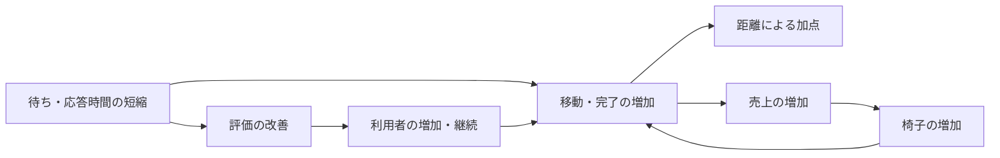

# ISURIDEベンチの得点構造分析

2026-10-11時点の相談で分析した、`20261011-035537`から`20261011-042043`までの5 RUNを対象にする。
これより後のRUNは本資料に含めない。複数台分散は検討対象外。

## 結論

得点の中心は移動距離である。APIの高速化は、移動開始・ライド完了・次のライドを早めることで得点に効く。
さらに、評判による利用者増加と売上による椅子増加が、その後の移動量を増やす。
低評価による離脱は、この成長を抑える。

今回のRUNでは、索引追加後に移動と完了の処理量が増え、距離の差分集計後には椅子増加が早まった。
一方、最後のRUNは登録55人に対してアクティブ26人であり、登録の増加だけでは継続的な需要の増加を判断できない。

## 公式の得点式と直接の加点

[当日マニュアルの得点式](../official/manual.md#スコアの計算)は次のとおり。

```text
得点 = 迎車距離の合計 × 0.1
     + 乗車中の移動距離の合計
     + ライド完了数 × 5
```

同じ距離なら乗車中の移動は迎車の10倍の加点になる。
通知・検索の件数自体には加点がない。ライドに割り当てられていない椅子の移動も、この式の距離加点には含まれない。

最後のRUNの評価API成功40件を仮に採点対象の完了数とすると、完了ボーナスは200点、総得点3,732点の約5.4%になる。
これはRUN全期間の評価API件数を使った概算であり、確定した得点内訳ではない。
距離加点が大部分を占めることを示す目安として使う。

完了には直接の5点に加え、次のライドへ進む、売上を発生させる、評価を確定する役割がある。
ユーザーも椅子も、ライドが完了するまで次のライドを要求・受理できない。
これらの仕様は[アプリケーションマニュアル](../official/ISURIDE.md#ライドride)に記載されている。

## RUN比較

数値は各RUNの`bench.log`と`alp.json`から取得した。全5 RUNの参加者ログに成功が記録されている。
評価API件数は、`POST /api/app/rides/{ride_id}/evaluation`の2xx件数である。

| RUN | 得点 | 評価API成功件数 | 最終登録／アクティブ人数 | 最終椅子数 | 最初の椅子増加 |
| --- | ---: | ---: | ---: | ---: | ---: |
| [20261011-035537](../../runs/20261011-035537/bench.log) | 671 | 6 | 10／10 | 20 | 記録なし |
| [20261011-040258](../../runs/20261011-040258/bench.log) | 1,244 | 13 | 17／17 | 22 | 52.0秒 |
| [20261011-041159](../../runs/20261011-041159/bench.log) | 1,204 | 13 | 14／14 | 21 | 62.8秒 |
| [20261011-041530](../../runs/20261011-041530/bench.log)：索引追加後 | 2,565 | 26 | 37／26 | 26 | 39.4秒 |
| [20261011-042043](../../runs/20261011-042043/bench.log)：距離差分集計後 | 3,732 | 40 | 55／26 | 32 | 16.2秒 |

椅子増加の経過秒は、参加者INFOの「負荷走行を開始します」を起点にした。
公式の採点60秒の開始・終了と、この起点が厳密に一致するとは確認できていない。
ログ内の相対時刻として比較し、62.8秒のイベントを採点区間内と断定しない。

登録人数とアクティブ人数は最終地域情報の2地域合計、椅子数は最終オーナー情報の5社合計である。
初回RUNのmanifestではスコア・合否が未判定だったため、671点・成功は参加者ログの結果行から取得した。
「記録なし」は欠けたイベントを0と補った値ではない。

## 得点を増やす成長と、成長を抑える離脱

公式仕様と参加者INFOから、次の流れが確認できる。
評価・売上の判定閾値や、増加量を決める内部式は未確認である。



図は得点につながる経路を整理したもの。個々の変更が図のすべての効果を発生させたと断定するものではない。
低評価のライドによる利用者離脱は、参加者ログに理由付きの累計人数として出力されている。

### 供給側：椅子増加を早める

索引追加後と距離差分集計後のRUNを比較する。

| 指標 | 20261011-041530 | 20261011-042043 |
| --- | ---: | ---: |
| 椅子一覧API平均応答 | 2,529ms | 38ms |
| 椅子一覧APIの2xx件数 | 86 | 166 |
| 売上APIの2xx件数 | 29 | 120 |
| 同一セッションの椅子一覧→売上確認の平均開始間隔 | 2,518.9ms | 804.1ms |
| 上記遷移の観測件数 | 28 | 119 |
| 最初の椅子増加 | 開始後39.4秒 | 開始後16.2秒 |
| 椅子増加イベントの追加台数合計 | 6台 | 12台 |
| 座標API平均応答 | 92ms | 94ms |

APIの応答時間と件数は`alp.json`、セッションの遷移は`user-transitions.json`、椅子増加は`bench.log`が出典。
開始間隔は一覧リクエスト開始から、その次の売上リクエスト開始までの時間で、API応答時間とは異なる。

一覧の高速化で売上確認が進み、椅子増加が早まったという得点経路が有力である。
座標APIの平均応答はほぼ同じだったため、今回の増点を座標APIの高速化だけで説明することはできない。
早く追加された椅子ほど、残りの時間で移動・売上を積み重ねる機会が増える。

ただし、RUNごとにオーナー名や利用者・椅子の条件が異なる。
得点2,565→3,732の増分を、距離差分集計の効果だけに帰属させることはできない。
椅子追加の時刻も、各椅子が実際に配車可能になった時刻や稼働時間を保証しない。

### 需要側：登録増加と離脱を併せて見る

`20261011-042043`の進捗を同一RUN・同一報告時刻で結合した。
登録と離脱は累計人数、椅子追加はその時刻までの増加イベントの合計である。

| 開始からの経過 | 評判による登録 | 低評価による離脱 | 椅子追加 |
| --- | ---: | ---: | ---: |
| 19.7秒 | 7人 | 3人 | 1台 |
| 35.9秒 | 17人 | 11人 | 4台 |
| 52.1秒 | 35人 | 20人 | 9台 |
| 62.9秒 | 43人 | 29人 | 12台 |

同RUNでは招待による登録も1人が報告されている。
最終登録は55人、アクティブは26人で、差は29人だった。
前のRUNは登録37人、アクティブ26人。登録人数が増えても、最終アクティブ人数は増えていない。

進捗の最終報告は最終地域情報より前に出るため、累計登録・離脱と最終人数が常に一致するとは限らない。
例えば`20261011-041530`の最終報告離脱数は10人、最終登録とアクティブの差は11人だった。
一致させるために人数を補正せず、それぞれの報告時刻と定義を保持する。

最終人数に加え、早い時刻に利用を始め、その後も使い続ける人数を見る必要がある。
開始直後の登録と終了直前の登録では、得点に寄与できる残り時間が異なる。

## 時間短縮が得点に効く仕組み

椅子は、座標更新リクエストの成功を確認するまで次の移動へ進まない。
座標APIの待ちは移動を止め、通知の待ちは状態確認や次の行動を遅らせる。
この仕様は[アプリケーションマニュアル](../official/ISURIDE.md#椅子chair)に記載されている。

最新RUNの最終不満率は、マッチング52.5%、迎車97.5%、移動96.2%だった。
割合の母数と判定閾値は不明であり、不満率だけから資源の律速や損失時間を決めない。
離脱ログと併せると、迎車・移動時間を改善して継続利用を増やす仮説が有力である。

配車を考える際は、迎車の0.1倍加点だけでなく、到着時間、乗車中の加点、評価、その後の利用まで含める。
近い椅子の選択には迎車時間を短縮する効果がある一方、速度の異なるモデルもあるため、距離だけで最適と断定しない。
同じ時間で同じ距離を動ける条件なら、迎車から乗車中の移動へ時間を振り向けるほど直接加点は大きくなる。

## 次のRUNで追う指標

| 得点への経路 | 既存成果物で見る指標 | 判断上の注意 |
| --- | --- | --- |
| 移動量と回転 | 座標APIの応答時間・件数、評価API成功件数、状態遷移 | HTTP件数を距離や採点対象の完了数と同一視しない |
| 需要の成長・維持 | 評判・招待による登録、低評価離脱の時系列、最終アクティブ人数 | 累計登録と離脱、報告時刻を併せて見る |
| 供給の成長 | 売上確認の間隔、椅子追加の時刻・台数、オーナー別売上 | 最終椅子数だけで稼働時間を判断しない |
| 資源の制約 | 同じ観測窓のMySQL・Go CPU秒、待ち、容量 | SQL延べ時間・API延べ時間をCPU秒に足さない |

SSE化後は通知HTTP件数が減るため、その減少を得点や処理量の悪化と判断しない。
移動・完了・登録・離脱・椅子増加へつながったかで評価する。

## 出典、確認方法、未確定点

既存の[参加者ログ解釈ビュー](../../tools/contest/analysis-schema/bench-summary.sql)、
[進捗ビュー](../../tools/contest/analysis-schema/bench-progress.sql)、
[API集計スキーマ](../../tools/analysis/schema/endpoints.sql)、
[セッション遷移スキーマ](../../tools/analysis/schema/user-transitions.sql)を参照した。
数値集計と時系列結合は`task q`のDuckDBを使った。

分析DBに同期済みのRUNは、以下で最終情報と原文を確認できる。
ビューの経過秒は分析窓を起点とするため、本資料のINFO開始基準の経過秒とは区別する。

```shell
task q -- "SELECT run_id, score, passed FROM bench_results ORDER BY run_id"
task q -- "SELECT run_id, region_name, registered_users, active_users FROM bench_final_regions ORDER BY run_id, region_name"
task q -- "SELECT run_id, owner_name, sales, chairs FROM bench_final_owners ORDER BY run_id, owner_name"
task q -- "SELECT run_id, elapsed_s, added_chairs, raw_line FROM bench_chair_growth ORDER BY run_id, line_number"
task q -- "SELECT run_id, elapsed_s, registrations_reputation, registrations_invitation, raw_line FROM bench_registrations ORDER BY run_id, line_number"
task q -- "SELECT run_id, reported_at, line FROM bench_log_lines WHERE line LIKE '%msg=これまでに低評価なライド%' ORDER BY run_id, line_number"
```

分析時はこのmainの分析DBが最新2 RUNに未同期だったため、それらも含めて
`task q`から`read_text('runs/*/bench.log')`、`read_json('runs/*/alp.json')`、
`read_text('runs/*/user-transitions.json')`で保存ファイルを読み取り、対象5 RUNへ限定した。
本資料作成のためのベンチ実行、成果物の再生成、分析基盤や計測方法の変更は行っていない。

離脱行は分析時の解釈ビューで未対応だったため、参加者INFOの
`これまでに低評価なライドによって([0-9]+)人が利用をやめました`から累計人数を取得した。
進捗の経過秒は、同RUNのINFO開始行と報告行の時刻差をミリ秒単位で求めた。
同時刻の登録・離脱・不満率を結合し、椅子追加は報告時刻までのイベントを累積した。

限界は次のとおり。

- `20261011-041530`と`20261011-042043`は、分析時のmainに圧縮生accessログがなかった。
  manifestは正常と記録しているが、`task artifacts-run`はローカルでこの欠損を検出した。
  生ログがないことをリクエスト0件と扱わず、残っているAPI・遷移集計を使った。
- API・遷移集計はRUN全期間を含む。公式の採点60秒と観測窓の厳密な対応は未確定。
  評価API件数には採点区間外や再試行が含まれる可能性があり、正確な完了加点へ置き換えない。
- 迎車・乗車それぞれの採点距離、進行中ライドの加点、端数の扱いは復元していない。
  得点から距離内訳を推定するために、全座標件数やオーナー売上をそのまま換算しない。
- 不満率の母数、評判・招待・離脱・売上による成長の閾値と内部式は不明。
  DEBUGの`tick`・`reqs`・`score`・`criteria`配列の意味は解釈していない。
- ベンチマーカーのソース解析とインターネット調査は行っていない。
