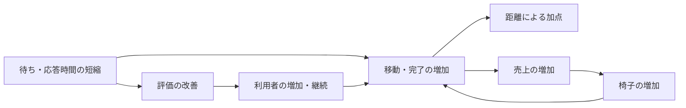

# Codex conversation

- Session: 01a12734-c490-7542-8396-036c0f2fc959

<!-- codex-hook-format: 10; tool results and reasoning content omitted -->

- REASONING durations are estimates from the preceding message or tool event to reasoning completion and may include model/network waits.

---

## USER (2026-10-11 04:05:40 +0900)

$isucon-agent スコアを改善させる施策を検討してください

## ASSISTANT

`isucon-agent`スキルを使い、最新の確定済みRUNと現行実装から、スコア改善の候補と根拠を調べます。今回は相談として、コード変更やデプロイ、ベンチ実行は行いません。

## TOOL

```sh
pwd; rg --files -g 'AGENTS.md' -g 'Taskfile*.yml' -g 'SKILL.md' -g '*run.json' -g 'sources.yaml' -g '*.md' docs tools .agents | head -100
```

## TOOL

```sh
cat .agents/skills/isucon-agent/SKILL.md
```

## TOOL

```sh
git status --short; rg --files -g 'AGENTS.md' -g 'run.json' -g 'Taskfile*.yml' -g '*sql' -g '*.go' -g '*.yaml' | head -130
```

## TOOL

```sh
cat tools/analysis/sources.yaml; cat docs/conversation/20261011-035950_01a1272f-693b-7913-a72f-43de7046f37b.md; cat docs/conversation/20261011-033950_01a1271c-b511-7723-b409-ba4e18f06907.md
```

## TOOL

```sh
cat Taskfile.yml; cat Taskfile.contest.yml
```

## REASONING (Estimated 1s; 2026-10-11 04:05:50 +0900)

## TOOL

```sh
cat runs/20261011-040258/run.json
```

## TOOL

```sh
sed -n '1,145p' Taskfile.yml; rg -n '^## (USER|ASSISTANT)|score|スコア|deploy|反映|律速|提案|推奨' docs/conversation/20261011-033950_01a1271c-b511-7723-b409-ba4e18f06907.md docs/conversation/20261011-035950_01a1272f-693b-7913-a72f-43de7046f37b.md | tail -55; rg --files webapp/go tools/contest/analysis-schema tools/analysis/schema; cat tools/analysis/queries/bottleneck-evidence.sql
```

## TOOL

```sh
task q -- "SHOW TABLES"; task artifacts-run RUN=runs/20261011-040258
```

## TOOL

```sh
task -s q -- "select * from bench_results; select * from bottleneck_run_health where run_id='20261011-040258'; select * from bottleneck_capacity_summary where run_id='20261011-040258'; select host,service,demand_core_seconds,capacity_core_seconds,utilization_ratio from bottleneck_consumers where run_id='20261011-040258'; select host,samples,cpu_count,cpu_busy_peak_pct,idle_mean_pct,iowait_mean_pct,run_queue_over_cpu_samples from bottleneck_host_saturation_summary where run_id='20261011-040258'; select * from bench_latest_dissatisfaction; select * from bench_final_regions;"
```

## TOOL

```sh
cat webapp/go/internal_handlers.go; cat webapp/sql/1-schema.sql; rg -n '^func|SELECT|UPDATE|INSERT|Sleep|Ticker|FOR UPDATE' webapp/go/app_handlers.go webapp/go/chair_handlers.go webapp/go/owner_handlers.go; cat tools/contest/analysis-schema/bench-progress.sql; cat tools/contest/analysis-schema/bench-summary.sql
```

## TOOL

```sh
sed -n '1,100p' Taskfile.yml; cat docs/official/ISURIDE.md; sed -n '435,477p' docs/official/manual.md
```

## REASONING (Estimated 2s; 2026-10-11 04:06:01 +0900)

## ASSISTANT

最新RUNは **1,244点・成功**で、必須成果物と定期計測に欠損はありません。負荷中は`isucon-1`の2コアがほぼ使い切られ、残る2台はほぼ空いています。SQLの処理量と通知・マッチングの実装を照合し、まず削減する仕事を絞ります。

## TOOL

```sh
task -s q -- "select host,service,round(demand_core_seconds,2) cpu_s,round(capacity_core_seconds,2) capacity_s,round(utilization_ratio,3) utilization from bottleneck_consumers where run_id='20261011-040258'; select source,left(query_fingerprint,230) query,calls,round(sum_time_seconds,1) time_s,round(avg_time_ms,2) avg_ms,rows_examined,rows_sent,round(lock_time_seconds,2) lock_s from query_cost where run_id='20261011-040258' order by sum_time_seconds desc limit 12; select method,route,requests,round(response_time_sum_seconds,1) time_s,round(response_time_avg_ms,1) avg_ms,p99_ms,status_5xx from bottleneck_endpoint_ranking where run_id='20261011-040258' order by response_time_rank limit 10;"
```

## TOOL

```sh
cat webapp/go/internal_handlers.go; cat webapp/sql/1-schema.sql
```

## REASONING (Estimated 2s; 2026-10-11 04:06:07 +0900)

## TOOL

```sh
sed -n '1,250p' webapp/go/chair_handlers.go; sed -n '470,770p' webapp/go/app_handlers.go; sed -n '100,270p' webapp/go/owner_handlers.go
```

## TOOL

```sh
cat tools/analysis/schema/digest.sql; cat tools/analysis/schema/mysql-lock.sql; cat tools/analysis/schema/sql-pool.sql; sed -n '1,120p' tools/contest/analysis-schema/bench-progress.sql; cat tools/analysis/schema/proc.sql
```

## TOOL

```sh
rg -n 'スコア|不満|評判|速度|マッチ|乗車|移動|負荷|採点' docs/official/ISURIDE.md docs/official/manual.md | head -65; git log -4 --oneline; sed -n '1,72p' Taskfile.yml; tail -35 runs/20261011-040258/bench.log; cat webapp/go/middlewares.go; sed -n '1,150p' webapp/go/main.go
```

## REASONING (Estimated 2s; 2026-10-11 04:06:12 +0900)

## USER (2026-10-11 04:06:15 +0900)

まずは複数台分散は考慮しなくてよいです

## ASSISTANT

承知しました。複数台への分散は候補から外し、`isucon-1`内の処理削減に絞ります。MySQLが同じ約67秒の観測窓で113.9 CPU秒を使い、通知用の状態検索が全表走査になっています。現時点では、その索引追加が最初の有力候補です。

## TOOL

```sh
cat tools/analysis/schema/digest.sql; cat tools/analysis/schema/sql-pool.sql; cat tools/analysis/schema/mysql-lock.sql; rg -n 'CREATE.*query_cost|queries_digest|query_fingerprint|window' tools/analysis/schema/semantic.sql | head -40; sed -n '190,265p' webapp/go/owner_handlers.go; sed -n '760,825p' webapp/go/app_handlers.go; sed -n '1,85p' docs/official/ISURIDE.md; sed -n '306,367p' docs/official/manual.md
```

## TOOL

```sh
task -s q -- "describe bench_progress; describe bench_registrations; describe bottleneck_wait_axes; describe query_cost; select source,entity,metric,round(value,3) value,unit,denominator from bottleneck_wait_axes where run_id='20261011-040258' and source in ('sql-pool','mysql','task-state');"
```

## REASONING (Estimated 4s; 2026-10-11 04:06:25 +0900)

## TOOL

```sh
task -s q -- "describe bench_progress; describe bench_registrations; describe bottleneck_wait_axes; select source,entity,metric,round(value,3) as metric_value,unit,denominator from bottleneck_wait_axes where run_id='20261011-040258' and source in ('sql-pool','mysql','task-state'); select round(elapsed_s,1) elapsed_s,metric,value from bench_progress where run_id='20261011-040258' and metric in ('registrations_reputation','registrations_invitation') order by elapsed_s;"
```

## TOOL

```sh
ssh -o RequestTTY=no -o LogLevel=ERROR -o BatchMode=yes -o ConnectTimeout=10 -o ControlPath=/tmp/.isucon-ssh-%C ubuntu@isucon-1 'sudo mysql isuride -e "SELECT TABLE_NAME,INDEX_NAME,GROUP_CONCAT(COLUMN_NAME ORDER BY SEQ_IN_INDEX) AS columns_in_order FROM information_schema.STATISTICS WHERE TABLE_SCHEMA=DATABASE() GROUP BY TABLE_NAME,INDEX_NAME ORDER BY TABLE_NAME,INDEX_NAME; EXPLAIN SELECT status FROM ride_statuses WHERE ride_id=CHAR(120) ORDER BY created_at DESC LIMIT 1; EXPLAIN SELECT * FROM chair_locations WHERE chair_id=CHAR(120) ORDER BY created_at DESC LIMIT 1;"'
```

## TOOL

```sh
rg -n 'digest|TRUNCATE|reset|RESET' tools/measurectl/digesters.yaml tools/bench tools/measurement/cmd/mysql-metrics tools/measurectl/collectors.yaml | head -60; rg -n 'create or replace view bottleneck_wait_axes|sql.pool|pool_wait|lock_wait' tools/analysis/schema/bottleneck.sql | head -45; cat tools/contest/analysis-schema/bench-progress.sql | head -100; rg -n '^func appGetNearby|SELECT|for ' webapp/go/app_handlers.go | tail -24
```

## REASONING (Estimated 8s; 2026-10-11 04:06:39 +0900)

## TOOL

```sh
task -s q -- "select round(sum(sum_time_seconds),1) sql_elapsed_s,sum(calls) calls,sum(rows_examined)::bigint examined_rows from query_cost where run_id='20261011-040258' and source='digest' and query_fingerprint like 'SELECT%' and query_fingerprint like '%FROM `ride_statuses` WHERE `ride_id`%'; select left(query_fingerprint,100) query,calls,round(sum_time_seconds,1) elapsed_s,no_index_used,tmp_tables,tmp_disk_tables,sort_merge_passes from query_cost where run_id='20261011-040258' and source='digest' order by sum_time_seconds desc limit 9; select source,metric,round(value,3) metric_value,unit from bottleneck_wait_axes where run_id='20261011-040258' and source='sql_pool'; select round(elapsed_s,1) elapsed_s,registrations_reputation,registrations_invitation from bench_registrations where run_id='20261011-040258' order by elapsed_s;"
```

## REASONING (Estimated 6s; 2026-10-11 04:06:48 +0900)

## ASSISTANT

実DBでも、`ride_statuses`と`chair_locations`に検索用索引がなく、`EXPLAIN`は全表走査とソートを示しました。加えて、オーナーの椅子一覧は毎回、全座標履歴から移動距離を再計算して平均3.58秒かかっています。

改善順は「索引追加 → 移動距離の差分集計 → 配車方法の改善」が有力です。通知のSSE化も候補ですが、まずは変更の小さい施策から効果を確認できます。

## TOOL

```sh
task -s q -- "select round(sum(sum_time_seconds),1) sql_elapsed_s,sum(calls) calls,sum(rows_examined)::bigint examined_rows from query_cost where run_id='20261011-040258' and source='digest' and query_fingerprint like 'SELECT%' and regexp_matches(query_fingerprint,'FROM .ride_statuses. WHERE .ride_id.'); select round(elapsed_s,1) elapsed_s,matching_pct,pickup_pct,travel_pct from bench_dissatisfaction where run_id='20261011-040258' order by elapsed_s; select host,round(cpu_busy_ge80_ratio,3) busy_ge80_ratio,round(cpu_busy_peak_pct,2) peak_busy_pct,round(idle_mean_pct,2) idle_pct,iowait_mean_pct,run_queue_over_cpu_samples,samples from bottleneck_host_saturation_summary where run_id='20261011-040258' and host='isucon-1'; select started_at,ended_at,source,reason from load_windows where run_id='20261011-040258';"
```

## TOOL

```sh
rg -n 'ISUCON_MATCHING_INTERVAL' env.sh etc tools/contest -g '!*.log'; nl -ba webapp/go/internal_handlers.go | head -65; rg -n '^func ownerGetChairs|^func chairPostCoordinate|^func chairGetNotification|^func appGetNotification|^func getChairStats|CREATE TABLE (ride_statuses|chair_locations|rides|chairs)' webapp/go/owner_handlers.go webapp/go/chair_handlers.go webapp/go/app_handlers.go webapp/sql/1-schema.sql; git status --short
```

## REASONING (Estimated 8s; 2026-10-11 04:07:03 +0900)

## ASSISTANT (Worked for 1m 37s; 2026-10-11 04:07:17 +0900)

**まずは索引追加、次に移動距離の差分集計を推奨します。** 複数台分散を除き、`isucon-1`内で削減できる仕事に絞りました。

最新[RUN 20261011-040258](/Users/mineo/src/github.com/EkeMinusYou/isucon14-02/runs/20261011-040258/bench.log)は **1,244点・成功、成果物欠損なし**です。約67秒の観測窓で、2コアの容量134 CPU秒に対し、MySQLが113.9 CPU秒を消費しています。Goは10.5 CPU秒で、DB接続プールの待ちは記録されていません。主な改善対象はMySQLの処理量です。

| 優先 | 施策 | 根拠と変更内容 |
|---|---|---|
| **1** | **状態・座標検索への索引追加** | 最新状態検索だけで8,485回・約3,871万行を検査。実DBの`EXPLAIN`も全表走査とソート。検索条件に合う複合索引で、対象ライド・椅子の行だけを読みます。 |
| **2** | **移動距離の差分集計** | 椅子一覧は67回、平均3.58秒。毎回、全座標履歴をウィンドウ関数で再集計しています。座標登録時に累計距離を更新し、一覧では保存した値を読みます。 |
| **3** | **配車を一括処理し、到着時間で選択** | 現行は1回につき1件、ランダム抽選で空き椅子を探します。待機ライドと空き椅子をまとめて取得し、距離とモデル速度から割り当てます。 |
| **4** | **通知のSSE化・統計再計算の削減** | 通知は合計10,291リクエスト。30ms間隔のポーリングに加え、利用者通知では過去ライドの状態を繰り返し取得します。状態変化時の通知と統計更新へ寄せます。 |

最初の索引追加は、[スキーマ](/Users/mineo/src/github.com/EkeMinusYou/isucon14-02/webapp/sql/1-schema.sql:98)の次の4本に絞れます。

- `ride_statuses (ride_id, created_at)`
- `ride_statuses (ride_id, app_sent_at, created_at)`
- `ride_statuses (ride_id, chair_sent_at, created_at)`
- `chair_locations (chair_id, created_at)`

APIの処理は維持でき、増える仕事は索引の保存容量と書込み時の更新です。通知順序や同時刻の状態の扱いを確認し、次のRUNで**検査行数・MySQL CPU秒・通知／座標APIの応答時間・スコア**を比較します。

距離の差分集計では、初期化時に既存履歴から累計を作り、座標登録と同じトランザクションで永続化します。座標登録に更新処理が増えるため、一覧の高速化と書込み負荷を併せて評価します。

配車改善とSSE化は、正当性に関わるため、それぞれ単独で測る候補です。配車は二重割当と**完了通知前の再割当を防ぐ**必要があり、SSEは接続直後の通知と**全状態遷移の順序・少なくとも1回の配送**を維持します。

進捗ログでは、評判による登録が6人で止まり、最後の不満率はマッチング100%、迎車92.3%、移動100%でした。割合の母数は不明なので律速判定には使いませんが、処理時間短縮が評判・利用者増加につながるかを見る指標になります。

効果量はまだ未確定です。約67秒は採点60秒と一致しない観測窓で、SQL集計もRUN全体の延べ経過時間として扱っています。**今回は調査のみで、コード変更・デプロイ・ベンチ実行はしていません。**

## USER (2026-10-11 04:18:58 +0900)

1については対応済みです。それぞれワークツリーで実装中です

## REASONING (Estimated 3s; 2026-10-11 04:19:01 +0900)

## ASSISTANT

索引追加は対応済みとして扱います。各ワークツリーの変更範囲を読み取りで確認し、実装中の施策と重ならない追加候補を検討します。

## TOOL

```sh
git worktree list --porcelain; git status --short; rg --files docs/conversation | sort | tail -12; git log -7 --oneline
```

## REASONING (Estimated 2s; 2026-10-11 04:19:05 +0900)

## TOOL

```sh
git -C /Users/mineo/worktrees/EkeMinusYou/isucon14-02/tue status --short; git -C /Users/mineo/worktrees/EkeMinusYou/isucon14-02/tue diff --stat; git -C /Users/mineo/worktrees/EkeMinusYou/isucon14-02/tue log -3 --oneline; git -C /Users/mineo/worktrees/EkeMinusYou/isucon14-02/wed status --short; git -C /Users/mineo/worktrees/EkeMinusYou/isucon14-02/wed diff --stat; git -C /Users/mineo/worktrees/EkeMinusYou/isucon14-02/wed log -3 --oneline; git -C /Users/mineo/worktrees/EkeMinusYou/isucon14-02/thu status --short; git -C /Users/mineo/worktrees/EkeMinusYou/isucon14-02/thu diff --stat; git -C /Users/mineo/worktrees/EkeMinusYou/isucon14-02/thu log -3 --oneline
```

## TOOL

```sh
task -s q -- "select run_id,score,passed from bench_results order by run_id; select run_id,score,passed,load_window_seconds,non_ok_artifacts,invalid_periodic_artifacts,commit from bottleneck_run_health order by run_id desc limit 2;"; rg --files runs -g run.json; rg -n '^## USER|^## ASSISTANT|差分|対象|施策|累計|距離|SSE|マッチ|通知|索引|ワークツリー' docs/conversation/20261011-040540_01a12734-c490-7542-8396-036c0f2fc959.md docs/conversation/20261011-040752_01a12736-a098-7720-87d5-7cf1268b4b17.md | tail -45
```

## REASONING (Estimated 4s; 2026-10-11 04:19:15 +0900)

## TOOL

```sh
python3 -c 'import json; p="runs/20261011-041530/run.json"; r=json.load(open(p)); print(json.dumps({k:r.get(k) for k in ["run_id","phase","score","passed","source","missing"]},ensure_ascii=False)); print(json.dumps([{k:a.get(k) for k in ["name","status","reason"]} for a in r.get("artifacts",[]) if a.get("status")!="ok"],ensure_ascii=False))'; cat runs/20261011-041530/alp.txt | head -23; sed -n '465,490p' docs/conversation/20261011-040752_01a12736-a098-7720-87d5-7cf1268b4b17.md; cat webapp/go/payment_gateway.go
```

## TOOL

```sh
git -C /Users/mineo/worktrees/EkeMinusYou/isucon14-02/wed diff -- webapp/sql/1-schema.sql; git -C /Users/mineo/worktrees/EkeMinusYou/isucon14-02/thu diff -- webapp/sql/1-schema.sql; sed -n '1,220p' /Users/mineo/worktrees/EkeMinusYou/isucon14-02/thu/webapp/go/notifications.go; sed -n '830,960p' webapp/go/app_handlers.go
```

## REASONING (Estimated 4s; 2026-10-11 04:19:23 +0900)

## ASSISTANT

ワークツリーは、`tue`が距離の差分集計、`wed`が配車改善、`thu`がSSE通知と椅子統計の集計でした。追加の保存済みRUNも確認でき、索引追加後は **2,565点・成功**、通知と座標APIの応答時間も改善しています。この結果を基準に、残る検索と近隣椅子APIを確認します。

## TOOL

```sh
task -s q -- 
```

## TOOL

```sh
task artifacts-run RUN=runs/20261011-041530; sed -n '1,210p' /Users/mineo/worktrees/EkeMinusYou/isucon14-02/wed/webapp/go/internal_handlers.go; git -C /Users/mineo/worktrees/EkeMinusYou/isucon14-02/tue diff -- webapp/go/chair_handlers.go | head -80; rg -n 'リクエストログ|認証|nearby|近隣|Idempotency|決済' docs/conversation/20261011-040540_01a12734-c490-7542-8396-036c0f2fc959.md | head -12
```

## REASONING (Estimated 10s; 2026-10-11 04:19:38 +0900)

## ASSISTANT (Worked for 46s; 2026-10-11 04:19:44 +0900)

承知しました。索引追加は完了、残る施策は以下で実装中として扱います。

| ワークツリー | 確認した変更 |
|---|---|
| `tue` | 移動距離の差分集計 |
| `wed` | マッチングの一括処理 |
| `thu` | SSE通知・椅子統計の集計 |

索引追加後の最新RUNは **2,565点・成功**でした。追加候補としては、次の順が有力です。

1. **椅子認証の索引追加**  
   `chairs(access_token)`が未索引です。最新RUNで約2万回、約1,042万行を検査し、SQLの延べ時間は37.9秒。動作変更が小さく、索引容量と登録時の更新が増える程度です。

2. **配車を到着時間で選ぶ**  
   `wed`の現時点の実装は、一括処理後もランダム割当です。一括化の効果を確認してから、位置・モデル速度による選択を別の仮説として測れます。

3. **近隣椅子APIのN+1削減**  
   最新RUNで平均570ms。椅子ごとに過去ライド・状態・座標を取得しています。一括取得に変え、空き判定と座標の鮮度を維持する候補です。

**次の独立した施策には、椅子認証の索引追加を推します。** 検査行数、SQL時間、座標APIの応答時間、スコアで確認できます。各ワークツリーには変更していません。

なお、最新RUNのmanifestは成果物を正常と記録していますが、このmainには圧縮accessログがありません。上記は保存済みSQL集計とAPI集計に基づく判断です。

## USER (2026-10-11 04:25:58 +0900)

RUNの計測結果からベンチマーカーの得点構造を分析してください

## ASSISTANT

保存済みRUNの参加者ログから、得点の内訳と、利用者・椅子の増加が得点につながる流れを分析します。公式の得点式と照合し、実測で分かることと未確定な部分を分けて報告します。

## TOOL

```sh
git status --short; rg --files runs -g run.json -g bench.log -g '*summary*'; cat tools/contest/analysis-schema/bench-summary.sql; cat tools/contest/analysis-schema/bench-progress.sql; cat tools/analysis/schema/bench-summary.sql
```

## TOOL

```sh
task -s q -- "select run_id,score,passed from bench_results order by run_id; SHOW TABLES;"; sed -n '25,80p' docs/official/ISURIDE.md; sed -n '306,368p' docs/official/manual.md; rg -n '得点|スコア|負荷|score_routes|bench_' tools/contest/README.md tools/contest/analysis-schema/bench-summary.sql
```

## REASONING (Estimated 12s; 2026-10-11 04:26:16 +0900)

## TOOL

```sh
python3 -c 'import json,pathlib; keys=["run_id","phase","score","passed","source"]; [(print(json.dumps({k:r.get(k) for k in keys},ensure_ascii=False)),print("non_ok",[a.get("name") for a in r.get("artifacts",[]) if a.get("status")!="ok"])) for p in sorted(pathlib.Path("runs").glob("*/run.json")) for r in [json.loads(p.read_text())]]'; rg --files runs/20261011-042043 | head -45; rg -n 'INFO|BENCHMARK' runs/20261011-042043/bench.log; cat tools/analysis/schema/user-transitions.sql | head -100; cat tools/analysis/schema/access-log.sql | head -110
```

## REASONING (Estimated 4s; 2026-10-11 04:26:22 +0900)

## TOOL

```sh
task -s q -- 
```

## TOOL

```sh
rg --files -uu runs -g 'access-*'; python3 -c 'import json; r=json.load(open("runs/20261011-042043/alp.json")); print(type(r).__name__); print(str(r)[:1800])'; head -4 runs/20261011-042043/isucon-1-service-metrics.tsv; cat tools/analysis/schema/service.sql | head -60; cat tools/analysis/schema/endpoints.sql | head -80; git show --stat --oneline 47fecba9ca3951d2ec460dd31d9188d5bc7727af
```

## REASONING (Estimated 11s; 2026-10-11 04:26:46 +0900)

## TOOL

```sh
task -s q -- 
```

## TOOL

```sh
task -s q -- "select run_id,method,route,requests,status_2xx,response_time_avg_ms from bottleneck_endpoint_ranking where method='POST' and (route like '%evaluation%' or route like '%coordinate%' or route='^/api/app/rides$') order by run_id,route; select run_id,record_type,raw_line from bench_info_coverage where not parsed order by run_id,line_number;"; tail -26 runs/20261011-042043/bench.log; rg -n 'sample_type|sample_unit|profile_start|load_window|analysis_window' runs/20261011-042043/run.json | tail -25; git show --stat --oneline 51b71a9; git show --stat --oneline e08cafe | head -25; sed -n '1,90p' tools/analysis/schema/semantic.sql
```

## REASONING (Estimated 5s; 2026-10-11 04:26:57 +0900)

## TOOL

```sh
task -s q -- 
```

## TOOL

```sh
python3 -c 'import json,pathlib; [(print(p.parent.name,json.dumps(r.get("load_window"),ensure_ascii=False)),print("missing_declared",r.get("missing_artifacts")),print("expected_profiles",r.get("profiles_enabled"))) for p in sorted(pathlib.Path("runs").glob("*/run.json")) for r in [json.loads(p.read_text())]]'; git diff 51b71a9 47fecba --stat; git diff 51b71a9 47fecba -- webapp/go/chair_handlers.go webapp/go/owner_handlers.go | head -95; sed -n '1,95p' tools/analysis/schema/proc.sql
```

## REASONING (Estimated 13s; 2026-10-11 04:27:15 +0900)

## ASSISTANT

得点は移動距離が中心で、APIの処理件数自体には加点されません。ログからは、評判による利用者増加、低評価による離脱、売上による椅子増加が連動する構造も見えます。

最新RUNは3,732点で、登録55人に対してアクティブは26人でした。前のRUNもアクティブは26人ですが、最新RUNでは椅子が早く増えています。終わりの人数だけでなく、増加・離脱の時刻を比較します。

## TOOL

```sh
task -s q -- 
```

## TOOL

```sh
task -s q -- 
```

## REASONING (Estimated 3s; 2026-10-11 04:27:31 +0900)

## TOOL

```sh
task -s q -- 
```

## TOOL

```sh
task -s q -- 
```

## TOOL

```sh
git status --short; rg -n '評価|クーポン|売上|遅い|利用をやめ|得点' docs/official/ISURIDE.md | head -25; rg -n 'sales|revenue|completed|matching' runs/20261011-042043/user-transitions.json | head -20
```

## REASONING (Estimated 6s; 2026-10-11 04:27:41 +0900)

## TOOL

```sh
task -s q -- 
```

## TOOL

```sh
task -s q -- 
```

## TOOL

```sh
task artifacts-run RUN=runs/20261011-042043; rg -n 'score|routes|coordinate|evaluation' tools/contest/analysis-schema/bench-errors-semantic.sql tools/contest/score-routes.yaml tools/contest/*score* 2>/dev/null; rg -n '再起動|API.*処理|余剰|低評価|一定の売上' docs/official/ISURIDE.md docs/official/manual.md | head -12
```

## REASONING (Estimated 12s; 2026-10-11 04:28:00 +0900)

## TOOL

```sh
task -s q -- 
```

## TOOL

```sh
rg -n 'BENCHMARK_START|負荷走行を開始|最終地域|最終オーナー|低評価|結果 pass' runs/20261011-041530/bench.log | tail -15; git status --short; cat tools/analysis/schema/bench-errors.sql | head -40; rg -n 'func calculateFare' webapp/go/app_handlers.go; sed -n '954,975p' webapp/go/app_handlers.go
```

## REASONING (Estimated 14s; 2026-10-11 04:28:18 +0900)

## REASONING (Estimated 8s; 2026-10-11 04:28:26 +0900)

## ASSISTANT

得点の伸びを説明する材料が揃いました。距離の差分集計後は、椅子一覧が平均2,529msから38msになり、最初の椅子増加が開始後39.4秒から16.2秒へ早まっています。座標APIの平均応答は92msから94msとほぼ同じなので、供給が早く増えた効果が有力です。

一方、最新RUNでは評判による登録43人に対して、低評価による離脱29人が記録されています。登録を増やす効果と、継続利用を失う効果を併せて見る必要があります。

## REASONING (Estimated 9s; 2026-10-11 04:28:37 +0900)

## REASONING (Estimated 8s; 2026-10-11 04:28:45 +0900)

## ASSISTANT (Worked for 3m 7s; 2026-10-11 04:29:06 +0900)

**得点は「移動距離」と、それを増やす「利用者・椅子の成長」で決まります。** 最新RUNでは成長が早まった一方、低評価による離脱が大きく、継続利用を失っています。

[公式の得点式](/Users/mineo/src/github.com/EkeMinusYou/isucon14-02/docs/official/manual.md:362)は次のとおりです。

\[
得点 = 迎車距離 \times 0.1 + 乗車中の移動距離 + ライド完了数 \times 5
\]

同じ距離なら、乗車中の移動は迎車の10倍の加点です。通知・検索の処理件数には直接の加点がありません。それらの高速化は、移動開始や次のライドを早めることで得点に効きます。

保存済み5 RUNを比較すると、次の推移でした。全RUNで成功が記録されています。

| RUN時刻 | 得点 | 評価API成功件数※ | 最終登録／アクティブ人数 | 最終椅子数 | 最初の椅子増加 |
|---|---:|---:|---:|---:|---:|
| 03:55:37 | 671 | 6 | 10／10 | 20 | 記録なし |
| 04:02:58 | 1,244 | 13 | 17／17 | 22 | 開始後52.0秒 |
| 04:11:59 | 1,204 | 13 | 14／14 | 21 | 62.8秒 |
| 04:15:30：索引追加後 | 2,565 | 26 | 37／26 | 26 | 39.4秒 |
| 04:20:43：距離差分集計後 | **3,732** | **40** | **55／26** | **32** | **16.2秒** |

※評価API成功件数はRUN全期間の集計で、採点対象の完了数の代理です。

最新RUNで40件すべてを完了ボーナスに換算しても200点、総得点の約5.4%です。厳密な内訳は未復元ですが、**距離による加点が大部分を占める**構造です。ただし、完了は椅子・利用者を次のライドへ進め、売上と評価を発生させるため、直接の5点以上の意味があります。



**供給側では、椅子を早く増やす効果が見えます。** 距離差分集計の前後で、椅子一覧は平均2,529ms→38msになりました。同一セッションの椅子一覧→売上確認の開始間隔も、平均2.52秒→0.80秒へ縮まっています。

その後、最初の椅子増加は39.4秒→16.2秒、追加台数は6台→12台になりました。開始直後に増えた椅子ほど、残りの時間で移動と売上を積み重ねられます。これは一覧の高速化が得点につながる有力な経路です。座標APIの平均応答は92ms→94msとほぼ同じでした。ただし、RUNごとに利用者・椅子の条件が異なるため、増点の全量をこの変更だけに帰属させることはできません。

**需要側では、登録増加と離脱が同時に進んでいます。** 最新[RUNの進捗ログ](/Users/mineo/src/github.com/EkeMinusYou/isucon14-02/runs/20261011-042043/bench.log:8)では、次の推移です。時刻は参加者ログの開始行を基準としています。

| 経過 | 評判による登録・累計 | 低評価による離脱・累計 | 椅子追加・累計 |
|---|---:|---:|---:|
| 19.7秒 | 7人 | 3人 | 1台 |
| 35.9秒 | 17人 | 11人 | 4台 |
| 52.1秒 | 35人 | 20人 | 9台 |
| 62.9秒 | 43人 | 29人 | 12台 |

最終登録者は37→55人へ増えたのに、アクティブ人数は26人のままでした。**登録者数だけでは、走行中の需要や得点の伸びを評価できません。** 早期の登録と継続利用によって、利用可能な時間をどれだけ増やせたかが重要です。

最新の不満率は、マッチング52.5%、迎車97.5%、移動96.2%でした。割合の母数と判定閾値は不明ですが、離脱ログと合わせると、迎車・移動時間の改善が継続利用に効く仮説は強いです。配車では迎車距離の0.1倍加点だけでなく、到着時間、乗車中の加点、評価、その後の利用まで含めて考える必要があります。

今後の施策の評価では、次を追うのが得点構造に合っています。

- **移動量と回転**：座標APIの待ち、評価・完了件数、次のライドまでの待ち
- **需要の成長と維持**：評判・招待による登録と低評価離脱の時系列
- **供給の成長**：売上確認の間隔、椅子追加の時刻と台数

最新2 RUNは、このmainに生accessログがなく、採点区間内の厳密な完了数や距離内訳を復元できません。今回は保存済みINFOログ・API集計・遷移集計をDuckDBで分析し、内部DEBUG配列の意味や成長閾値は推測していません。

## USER (2026-10-11 04:33:03 +0900)

なるほど、docsにベンチの得点構造の分析を出力しておいてください

## ASSISTANT

得点式、RUN比較、成長と離脱の流れ、計測上の限界をdocsにまとめます。数値の出典と確認方法も残します。

## TOOL

```sh
git status --short; rg --files -g AGENTS.md -g README.md docs tools/contest; rg --files docs | head -70; cat docs/measurement/README.md; cat docs/official/README.md; sed -n '1,130p' README.md; rg --files runs -g run.json | sort; cat .agents/skills/isucon-agent/SKILL.md
```

## REASONING (Estimated 10s; 2026-10-11 04:33:17 +0900)

## TOOL

```sh
cat AGENTS.md | head -35; python3 -c 'import json,pathlib; ids=["20261011-035537","20261011-040258","20261011-041159","20261011-041530","20261011-042043"]; [(print(i,"bench",(p/"bench.log").exists(),"alp",(p/"alp.json").exists(),"transitions",(p/"user-transitions.json").exists(),"access",len(list((p/"raw").glob("access-*.log*"))))) for i in ids for p in [pathlib.Path("runs")/i]]'; sed -n '1,85p' docs/solutions/in-memory.md; sed -n '30,55p' tools/contest/README.md; git status --short
```

## REASONING (Estimated 9s; 2026-10-11 04:33:28 +0900)

## TOOL

### `apply_patch`

```javascript
tools.apply_patch("*** Begin Patch\n*** Add File: /Users/mineo/src/github.com/EkeMinusYou/isucon14-02/docs/analysis/benchmark-score-structure.md\n+# ISURIDEベンチの得点構造分析\n+\n+2026-10-11時点の相談で分析した、`20261011-035537`から`20261011-042043`までの5 RUNを対象にする。\n+これより後のRUNは本資料に含めない。複数台分散は検討対象外。\n+\n+## 結論\n+\n+得点の中心は移動距離である。APIの高速化は、移動開始・ライド完了・次のライドを早めることで得点に効く。\n+さらに、評判による利用者増加と売上による椅子増加が、その後の移動量を増やす。\n+低評価による離脱は、この成長を抑える。\n+\n+今回のRUNでは、索引追加後に移動と完了の処理量が増え、距離の差分集計後には椅子増加が早まった。\n+一方、最後のRUNは登録55人に対してアクティブ26人であり、登録の増加だけでは継続的な需要の増加を判断できない。\n+\n+## 公式の得点式と直接の加点\n+\n+[当日マニュアルの得点式](../official/manual.md#スコアの計算)は次のとおり。\n+\n+```text\n+得点 = 迎車距離の合計 × 0.1\n+     + 乗車中の移動距離の合計\n+     + ライド完了数 × 5\n+```\n+\n+同じ距離なら乗車中の移動は迎車の10倍の加点になる。\n+通知・検索の件数自体には加点がない。空車の移動も、この式の距離加点には含まれない。\n+\n+最後のRUNの評価API成功40件を仮に採点対象の完了数とすると、完了ボーナスは200点、総得点3,732点の約5.4%になる。\n+これはRUN全期間の評価API件数を使った概算であり、確定した得点内訳ではない。\n+距離加点が大部分を占めることを示す目安として使う。\n+\n+完了には直接の5点に加え、次のライドへ進む、売上を発生させる、評価を確定する役割がある。\n+ユーザーも椅子も、ライドが完了するまで次のライドを要求・受理できない。\n+これらの仕様は[アプリケーションマニュアル](../official/ISURIDE.md#ライドride)に記載されている。\n+\n+## RUN比較\n+\n+数値は各RUNの`bench.log`と`alp.json`から取得した。全5 RUNの参加者ログに成功が記録されている。\n+評価API件数は、`POST /api/app/rides/{ride_id}/evaluation`の2xx件数である。\n+\n+| RUN | 得点 | 評価API成功件数 | 最終登録／アクティブ人数 | 最終椅子数 | 最初の椅子増加 |\n+| --- | ---: | ---: | ---: | ---: | ---: |\n+| [20261011-035537](../../runs/20261011-035537/bench.log) | 671 | 6 | 10／10 | 20 | 記録なし |\n+| [20261011-040258](../../runs/20261011-040258/bench.log) | 1,244 | 13 | 17／17 | 22 | 52.0秒 |\n+| [20261011-041159](../../runs/20261011-041159/bench.log) | 1,204 | 13 | 14／14 | 21 | 62.8秒 |\n+| [20261011-041530](../../runs/20261011-041530/bench.log)：索引追加後 | 2,565 | 26 | 37／26 | 26 | 39.4秒 |\n+| [20261011-042043](../../runs/20261011-042043/bench.log)：距離差分集計後 | 3,732 | 40 | 55／26 | 32 | 16.2秒 |\n+\n+椅子増加の経過秒は、参加者INFOの「負荷走行を開始します」を起点にした。\n+公式の採点60秒の開始・終了と、この起点が厳密に一致するとは確認できていない。\n+ログ内の相対時刻として比較し、62.8秒のイベントを採点区間内と断定しない。\n+\n+登録人数とアクティブ人数は最終地域情報の2地域合計、椅子数は最終オーナー情報の5社合計である。\n+初回RUNのmanifestではスコア・合否が未判定だったため、671点・成功は参加者ログの結果行から取得した。\n+「記録なし」は欠けたイベントを0と補った値ではない。\n+\n+## 得点を増やす成長と、成長を抑える離脱\n+\n+公式仕様と参加者INFOから、次の流れが確認できる。\n+評価・売上の判定閾値や、増加量を決める内部式は未確認である。\n+\n+```mermaid\n+flowchart LR\n+    A[\"待ち・応答時間の短縮\"] --> B[\"移動・完了の増加\"]\n+    B --> C[\"距離による加点\"]\n+    B --> D[\"売上の増加\"]\n+    D --> E[\"椅子の増加\"]\n+    E --> B\n+    A --> F[\"評価の改善\"]\n+    F --> G[\"利用者の増加・継続\"]\n+    G --> B\n+```\n+\n+図は得点につながる経路を整理したもの。個々の変更が図のすべての効果を発生させたと断定するものではない。\n+低評価のライドによる利用者離脱は、参加者ログに理由付きの累計人数として出力されている。\n+\n+### 供給側：椅子増加を早める\n+\n+索引追加後と距離差分集計後のRUNを比較する。\n+\n+| 指標 | 20261011-041530 | 20261011-042043 |\n+| --- | ---: | ---: |\n+| 椅子一覧API平均応答 | 2,529ms | 38ms |\n+| 椅子一覧APIの2xx件数 | 86 | 166 |\n+| 売上APIの2xx件数 | 29 | 120 |\n+| 同一セッションの椅子一覧→売上確認の平均開始間隔 | 2,518.9ms | 804.1ms |\n+| 上記遷移の観測件数 | 28 | 119 |\n+| 最初の椅子増加 | 開始後39.4秒 | 開始後16.2秒 |\n+| 椅子増加イベントの追加台数合計 | 6台 | 12台 |\n+| 座標API平均応答 | 92ms | 94ms |\n+\n+APIの応答時間と件数は`alp.json`、セッションの遷移は`user-transitions.json`、椅子増加は`bench.log`が出典。\n+開始間隔は一覧リクエスト開始から、その次の売上リクエスト開始までの時間で、API応答時間とは異なる。\n+\n+一覧の高速化で売上確認が進み、椅子増加が早まったという得点経路が有力である。\n+座標APIの平均応答はほぼ同じだったため、今回の増点を座標APIの高速化だけで説明することはできない。\n+早く追加された椅子ほど、残りの時間で移動・売上を積み重ねる機会が増える。\n+\n+ただし、RUNごとにオーナー名や利用者・椅子の条件が異なる。\n+得点2,565→3,732の増分を、距離差分集計の効果だけに帰属させることはできない。\n+椅子追加の時刻も、各椅子が実際に配車可能になった時刻や稼働時間を保証しない。\n+\n+### 需要側：登録増加と離脱を併せて見る\n+\n+`20261011-042043`の進捗を同一RUN・同一報告時刻で結合した。\n+登録と離脱は累計人数、椅子追加はその時刻までの増加イベントの合計である。\n+\n+| 開始からの経過 | 評判による登録 | 低評価による離脱 | 椅子追加 |\n+| --- | ---: | ---: | ---: |\n+| 19.7秒 | 7人 | 3人 | 1台 |\n+| 35.9秒 | 17人 | 11人 | 4台 |\n+| 52.1秒 | 35人 | 20人 | 9台 |\n+| 62.9秒 | 43人 | 29人 | 12台 |\n+\n+同RUNでは招待による登録も1人が報告されている。\n+最終登録は55人、アクティブは26人で、差は29人だった。\n+前のRUNは登録37人、アクティブ26人。登録人数が増えても、最終アクティブ人数は増えていない。\n+\n+進捗の最終報告は最終地域情報より前に出るため、累計登録・離脱と最終人数が常に一致するとは限らない。\n+例えば`20261011-041530`の最終報告離脱数は10人、最終登録とアクティブの差は11人だった。\n+一致させるために人数を補正せず、それぞれの報告時刻と定義を保持する。\n+\n+最終人数に加え、早い時刻に利用を始め、その後も使い続ける人数を見る必要がある。\n+開始直後の登録と終了直前の登録では、得点に寄与できる残り時間が異なる。\n+\n+## 時間短縮が得点に効く仕組み\n+\n+椅子は、座標更新リクエストの成功を確認するまで次の移動へ進まない。\n+座標APIの待ちは移動を止め、通知の待ちは状態確認や次の行動を遅らせる。\n+この仕様は[アプリケーションマニュアル](../official/ISURIDE.md#椅子chair)に記載されている。\n+\n+最新RUNの最終不満率は、マッチング52.5%、迎車97.5%、移動96.2%だった。\n+割合の母数と判定閾値は不明であり、不満率だけから資源の律速や損失時間を決めない。\n+離脱ログと併せると、迎車・移動時間を改善して継続利用を増やす仮説が有力である。\n+\n+配車を考える際は、迎車の0.1倍加点だけでなく、到着時間、乗車中の加点、評価、その後の利用まで含める。\n+近い椅子の選択には迎車時間を短縮する効果がある一方、速度の異なるモデルもあるため、距離だけで最適と断定しない。\n+同じ時間で同じ距離を動ける条件なら、迎車から乗車中の移動へ時間を振り向けるほど直接加点は大きくなる。\n+\n+## 次のRUNで追う指標\n+\n+| 得点への経路 | 既存成果物で見る指標 | 判断上の注意 |\n+| --- | --- | --- |\n+| 移動量と回転 | 座標APIの応答時間・件数、評価API成功件数、状態遷移 | HTTP件数を距離や採点対象の完了数と同一視しない |\n+| 需要の成長・維持 | 評判・招待による登録、低評価離脱の時系列、最終アクティブ人数 | 累計登録と離脱、報告時刻を併せて見る |\n+| 供給の成長 | 売上確認の間隔、椅子追加の時刻・台数、オーナー別売上 | 最終椅子数だけで稼働時間を判断しない |\n+| 資源の制約 | 同じ観測窓のMySQL・Go CPU秒、待ち、容量 | SQL延べ時間・API延べ時間をCPU秒に足さない |\n+\n+SSE化後は通知HTTP件数が減るため、その減少を得点や処理量の悪化と判断しない。\n+移動・完了・登録・離脱・椅子増加へつながったかで評価する。\n+\n+## 出典、確認方法、未確定点\n+\n+既存の[参加者ログ解釈ビュー](../../tools/contest/analysis-schema/bench-summary.sql)、\n+[進捗ビュー](../../tools/contest/analysis-schema/bench-progress.sql)、\n+[API集計スキーマ](../../tools/analysis/schema/endpoints.sql)、\n+[セッション遷移スキーマ](../../tools/analysis/schema/user-transitions.sql)を参照した。\n+数値集計と時系列結合は`task q`のDuckDBを使った。\n+\n+分析DBに同期済みのRUNは、以下で最終情報と原文を確認できる。\n+ビューの経過秒は分析窓を起点とするため、本資料のINFO開始基準の経過秒とは区別する。\n+\n+```shell\n+task q -- \"SELECT run_id, score, passed FROM bench_results ORDER BY run_id\"\n+task q -- \"SELECT run_id, region_name, registered_users, active_users FROM bench_final_regions ORDER BY run_id, region_name\"\n+task q -- \"SELECT run_id, owner_name, sales, chairs FROM bench_final_owners ORDER BY run_id, owner_name\"\n+task q -- \"SELECT run_id, elapsed_s, added_chairs, raw_line FROM bench_chair_growth ORDER BY run_id, line_number\"\n+task q -- \"SELECT run_id, elapsed_s, registrations_reputation, registrations_invitation, raw_line FROM bench_registrations ORDER BY run_id, line_number\"\n+task q -- \"SELECT run_id, reported_at, line FROM bench_log_lines WHERE line LIKE '%msg=これまでに低評価なライド%' ORDER BY run_id, line_number\"\n+```\n+\n+分析時はこのmainの分析DBが最新2 RUNに未同期だったため、それらも含めて\n+`task q`から`read_text('runs/*/bench.log')`、`read_json('runs/*/alp.json')`、\n+`read_text('runs/*/user-transitions.json')`で保存ファイルを読み取り、対象5 RUNへ限定した。\n+本資料作成のためのベンチ実行、成果物の再生成、分析基盤や計測方法の変更は行っていない。\n+\n+離脱行は分析時の解釈ビューで未対応だったため、参加者INFOの\n+`これまでに低評価なライドによって([0-9]+)人が利用をやめました`から累計人数を取得した。\n+進捗の経過秒は、同RUNのINFO開始行と報告行の時刻差をミリ秒単位で求めた。\n+同時刻の登録・離脱・不満率を結合し、椅子追加は報告時刻までのイベントを累積した。\n+\n+限界は次のとおり。\n+\n+- `20261011-041530`と`20261011-042043`は、分析時のmainに圧縮生accessログがなかった。\n+  manifestは正常と記録しているが、`task artifacts-run`はローカルでこの欠損を検出した。\n+  生ログがないことをリクエスト0件と扱わず、残っているAPI・遷移集計を使った。\n+- API・遷移集計はRUN全期間を含む。公式の採点60秒と観測窓の厳密な対応は未確定。\n+  評価API件数には採点区間外や再試行が含まれる可能性があり、正確な完了加点へ置き換えない。\n+- 迎車・乗車それぞれの採点距離、進行中ライドの加点、端数の扱いは復元していない。\n+  得点から距離内訳を推定するために、全座標件数やオーナー売上をそのまま換算しない。\n+- 不満率の母数、評判・招待・離脱・売上による成長の閾値と内部式は不明。\n+  DEBUGの`tick`・`reqs`・`score`・`criteria`配列の意味は解釈していない。\n+- ベンチマーカーのソース解析とインターネット調査は行っていない。\n*** End Patch")
```

## REASONING (Estimated 10s; 2026-10-11 04:34:30 +0900)

## ASSISTANT

分析対象を先ほどの5 RUNに固定して、docsへまとめました。直接の加点と、利用者・椅子の増加を通じた効果を分け、比較表、流れの図、DuckDBでの確認方法、計測上の限界を記載しています。数値とリンクを確認します。

## TOOL

### `apply_patch`

```javascript
tools.apply_patch("*** Begin Patch\n*** Update File: /Users/mineo/src/github.com/EkeMinusYou/isucon14-02/docs/analysis/benchmark-score-structure.md\n@@\n-通知・検索の件数自体には加点がない。空車の移動も、この式の距離加点には含まれない。\n+通知・検索の件数自体には加点がない。ライドに割り当てられていない椅子の移動も、この式の距離加点には含まれない。\n*** End Patch")
```

## TOOL

```sh
git diff --no-index --check /dev/null docs/analysis/benchmark-score-structure.md; python3 -c 'import pathlib,re; p=pathlib.Path("docs/analysis/benchmark-score-structure.md"); s=p.read_text(); links=re.findall(r"\]\(([^)]+)\)",s); missing=[x for x in links if not (p.parent/x.split("#",1)[0]).exists()]; print("local_links",len(links),"missing",missing); print("code_fences",s.count("```"),"balanced",s.count("```")%2==0); assert not missing; assert s.count("```")%2==0'; git status --short
```

## TOOL

```sh
task -s q -- 
```

## ASSISTANT (Worked for 1m 39s; 2026-10-11 04:34:42 +0900)

[ベンチの得点構造分析](/Users/mineo/src/github.com/EkeMinusYou/isucon14-02/docs/analysis/benchmark-score-structure.md)に保存しました。

得点式、5 RUNの比較、成長・離脱の流れ、DuckDBでの確認方法、計測上の限界を記載し、数値とリンクを確認済みです。

## USER (2026-10-11 04:35:15 +0900)

得点構造から改善案を提案できますか？抜本的なものが望ましいです

## ASSISTANT

得点構造を踏まえ、ライドの待ち時間や移動量、利用者の継続に大きく効く設計変更を検討します。最新RUNと実装中の施策を確認し、抜本案の仕組み・正当性・実装負担・評価方法をまとめます。

## TOOL

```sh
git status --short; git worktree list --porcelain; git log -10 --oneline; rg --files runs -g run.json | sort; cat docs/analysis/benchmark-score-structure.md
```

## TOOL

```sh
cat webapp/go/internal_handlers.go; sed -n '1,205p' webapp/go/chair_handlers.go; sed -n '1,180p' webapp/go/main.go; cat webapp/sql/1-schema.sql; cat docs/solutions/wal-backed-in-memory-state.md
```

## TOOL

```sh
task -s q -- "select run_id,score,passed from bench_results order by run_id; select run_id,host,service,round(demand_core_seconds,1) cpu_s,round(capacity_core_seconds,1) capacity_s from bottleneck_consumers where run_id=(select max(run_id) from bench_results) order by cpu_s desc;"; sed -n '30,190p' docs/official/ISURIDE.md; sed -n '335,367p' docs/official/manual.md; sed -n '435,458p' docs/official/manual.md
```

## REASONING (Estimated 4s; 2026-10-11 04:35:26 +0900)

## TOOL

```sh
python3 -c 'import json,pathlib; [(print(json.dumps({k:r.get(k) for k in ["run_id","phase","score","passed","source","load_window"]},ensure_ascii=False)),print("non_ok",[a.get("name") for a in r.get("artifacts",[]) if a.get("status")!="ok"],"local_access",len(list((p.parent/"raw").glob("access-*"))))) for p in sorted(pathlib.Path("runs").glob("*/run.json")) for r in [json.loads(p.read_text())] if r.get("run_id","")>="20261011-042043"]'; tail -23 runs/20261011-042630/bench.log; head -16 runs/20261011-042630/alp.txt; cat docs/solutions/wal-backed-in-memory-state.md
```

## TOOL

```sh
git -C /Users/mineo/worktrees/EkeMinusYou/isucon14-02/mon status --short; git -C /Users/mineo/worktrees/EkeMinusYou/isucon14-02/mon diff --stat; git -C /Users/mineo/worktrees/EkeMinusYou/isucon14-02/mon log -3 --oneline; git -C /Users/mineo/worktrees/EkeMinusYou/isucon14-02/fri status --short; git -C /Users/mineo/worktrees/EkeMinusYou/isucon14-02/fri diff --stat; git -C /Users/mineo/worktrees/EkeMinusYou/isucon14-02/fri log -3 --oneline; git -C /Users/mineo/worktrees/EkeMinusYou/isucon14-02/wed status --short; git -C /Users/mineo/worktrees/EkeMinusYou/isucon14-02/wed diff --stat; git -C /Users/mineo/worktrees/EkeMinusYou/isucon14-02/wed log -3 --oneline; rg -n '^func|SELECT|INSERT|UPDATE|FOR UPDATE|publish' webapp/go/notifications.go webapp/go/chair_handlers.go webapp/go/app_handlers.go webapp/go/owner_handlers.go | tail -100
```

## REASONING (Estimated 2s; 2026-10-11 04:35:34 +0900)

## TOOL

```sh
python3 -c 'import json,pathlib; p=pathlib.Path("/Users/mineo/worktrees/EkeMinusYou/isucon14-02/wed/runs"); ids=sorted(p.glob("*/run.json")); [(print(json.dumps({k:r.get(k) for k in ["run_id","phase","score","passed","source","load_window"]},ensure_ascii=False)),print("non_ok",[a.get("name") for a in r.get("artifacts",[]) if a.get("status")!="ok"])) for f in ids[-2:] for r in [json.loads(f.read_text())]]'; tail -20 /Users/mineo/worktrees/EkeMinusYou/isucon14-02/wed/runs/20261011-043341/bench.log; head -15 /Users/mineo/worktrees/EkeMinusYou/isucon14-02/wed/runs/20261011-043341/alp.txt; cat /Users/mineo/worktrees/EkeMinusYou/isucon14-02/wed/webapp/go/internal_handlers.go; git -C /Users/mineo/worktrees/EkeMinusYou/isucon14-02/mon diff -- webapp/sql/1-schema.sql; git -C /Users/mineo/worktrees/EkeMinusYou/isucon14-02/fri diff -- webapp/go/app_handlers.go | head -110
```

## TOOL

```sh
sed -n '111,208p' webapp/go/chair_handlers.go; sed -n '88,158p' webapp/go/notifications.go; sed -n '175,266p' webapp/go/notifications.go; sed -n '510,643p' webapp/go/app_handlers.go; head -3 runs/20261011-042630/isucon-1-proc-metrics.tsv; head -3 runs/20261011-042630/isucon-1-mysql-status.tsv; cat etc/systemd/system/isuride-matcher.service; rg --files -g '*env*' etc tools/contest
```

## REASONING (Estimated 12s; 2026-10-11 04:35:51 +0900)

## ASSISTANT

`wed`の新しい確定済みRUNも確認できました。一括配車後は **16,687点・成功**で、マッチング時間への不満率は0%です。一方、迎車83.7%、移動85.3%と、配車後の不満が残っています。

次の候補は、距離と速度を使って割当を決める「配車の最適化」と、座標更新をDB待ちから切り離す「状態管理の作り替え」です。負荷増加に伴う処理量とCPU消費を確認し、優先順を決めます。

## TOOL

```sh
task -s q -- 
```

## TOOL

```sh
task -s q -- 
```

## TOOL

```sh
task artifacts-run RUN=/Users/mineo/worktrees/EkeMinusYou/isucon14-02/wed/runs/20261011-043341; rg -n '^time=.*level=INFO' /Users/mineo/worktrees/EkeMinusYou/isucon14-02/wed/runs/20261011-043341/bench.log | head -18; rg -n '^time=.*level=INFO' /Users/mineo/worktrees/EkeMinusYou/isucon14-02/wed/runs/20261011-043341/bench.log | tail -15; sed -n '1,70p' webapp/sql/2-master-data.sql; sed -n '185,210p' docs/official/ISURIDE.md
```

## REASONING (Estimated 16s; 2026-10-11 04:36:19 +0900)

## REASONING (Estimated 12s; 2026-10-11 04:36:31 +0900)

## TOOL

```sh
task -s q -- 
```

## TOOL

```sh
task -s q -- 
```

## TOOL

```sh
task go-profile-top RUN=/Users/mineo/worktrees/EkeMinusYou/isucon14-02/wed/runs/20261011-043341 PROFILE=isucon-1-fgprof.pprof
```

## REASONING (Estimated 1s; 2026-10-11 04:36:41 +0900)

## TOOL

```sh
git worktree list; rg --files runs -g run.json | sort; git status --short; git log -5 --oneline; rg -n 'rand.Shuffle|matchingBatch|func match' webapp/go/internal_handlers.go; rg --files docs/conversation | sort | tail -8
```

## REASONING (Estimated 3s; 2026-10-11 04:36:46 +0900)

## TOOL

```sh
task -s q -- 
```

## TOOL

```sh
task go-profile-top RUN=runs/20261011-043341 PROFILE=isucon-1-fgprof.pprof
```

## TOOL

```sh
task -s q -- 
```

## REASONING (Estimated 14s; 2026-10-11 04:37:10 +0900)

## REASONING (Estimated 13s; 2026-10-11 04:37:23 +0900)

## REASONING (Estimated 8s; 2026-10-11 04:37:31 +0900)

## ASSISTANT

最新RUNの後半、観測窓の40〜60秒付近ではCPU使用率が平均99.4%になっています。全期間の座標APIは24,360件・平均52msで、前RUNの19msから増加しました。最終登録128人に対してアクティブは61人、最後の進捗では低評価離脱66人が報告されています。

状態管理の作り替えでは、座標登録・到着判定・距離集計をメモリー上で処理し、追記ログで永続化してから応答する方式が有力です。配車最適化では、近さに加えて速度と乗車距離を使い、ライド全体の所要時間を減らす案を具体化します。

## REASONING (Estimated 12s; 2026-10-11 04:37:46 +0900)

## REASONING (Estimated 13s; 2026-10-11 04:37:59 +0900)

## REASONING (Estimated 9s; 2026-10-11 04:38:08 +0900)

## ASSISTANT (Worked for 3m 10s; 2026-10-11 04:38:25 +0900)

**おすすめは「永続化付きオンメモリの状態管理」と「ライド全体の所要時間を減らす配車」の組合せです。** 単一ホストのまま、移動を止める待ちと、低評価につながる割当を大きく減らします。

最新[RUN 043341](/Users/mineo/src/github.com/EkeMinusYou/isucon14-02/runs/20261011-043341/bench.log)は16,687点・成功でした。一括配車でマッチングへの不満は0%になりましたが、迎車83.7%、移動85.3%は残っています。最終登録128人に対してアクティブ61人、最後の進捗では離脱66人です。さらに観測窓の40〜60秒付近はCPU使用率99.4%でした。

1. **座標更新・状態遷移・通知を、永続化付きオンメモリの処理へ移す**

   現行の座標APIは、毎回DBで距離集計行をロックし、履歴を追加し、ライドと最新状態を読み、commitして応答します。最新RUNでは24,360件・平均52msでした。椅子は応答を待ってから移動するため、この待ちが得点を直接抑えます。

   最新座標、現在のライド、状態、累計距離、通知履歴をGo側で管理し、次の順で処理します。

   ```text
   入力検証・更新順序の確定
     → 永続ファイルへ変更を追記
     → メモリー上の状態更新・到着判定
     → 応答・SSE通知
     → DBへまとめて反映
   ```

   **DBの検索・行ロック・commitを、移動の応答経路から外す**変更です。距離集計だけでなく、通知や近隣椅子の取得も同じ現在状態を参照します。通知のたびにDBからイベントを再取得する仕事も削減できます。

   正当性では、受理した座標履歴と全状態遷移を残し、通知順序・再接続時の再送を維持します。再起動時はDBと追記ログから復元します。通常の再起動後の永続性を満たし、リクエストごとの`fsync`は要件にしません。

   増える仕事は、追記ログ、復元、DBへの一括反映、状態の直列化です。実装負担は大きいですが、負荷が増えてもSQL往復が比例して増える構造を変えられます。確認指標は座標APIの応答時間、MySQL CPU秒、移動への不満、離脱、得点です。

2. **ランダム配車を、迎車・乗車時間を考慮した一括割当へ置き換える**

   現在の[一括配車](/Users/mineo/src/github.com/EkeMinusYou/isucon14-02/webapp/go/internal_handlers.go:80)は、空き椅子をランダムに選びます。ここを、待機ライドと空き椅子の組合せをまとめて評価する方式へ変えます。

   最初の目的関数は、**予想迎車時間＋予想乗車時間の合計を小さくする**ものがよいです。現在位置、乗車位置、目的地、モデル速度を使います。最適化するのは椅子の割当で、利用者が指定した行き先や運賃は維持します。

   例えば、速い椅子を短距離ライドに使い、長距離を遅い椅子に任せる割当を避けられます。近さだけで選ぶ方式より、乗車中の時間と次の配車までの時間も改善できます。

   迎車は距離当たり0.1点、乗車中は1点です。迎車を短縮して乗車中の移動へ時間を振り向け、評価と継続利用も改善する狙いです。

   計算量を抑えるため、有望な候補に絞って割当を解きます。古い依頼を優先し、長距離ライドの放置や二重割当、完了通知前の再割当を防ぎます。増える仕事は位置・速度の取得と割当計算です。確認指標は迎車・移動の不満、離脱、完了件数、椅子増加の時刻、得点です。

**実装中の認証索引・近隣API改善を反映したうえで、1→2の順を推します。** 配車計算が良くても座標応答で移動が止まれば効果が抑えられるためです。各案を単独のRUNで測り、状態管理の効果と配車方針の効果を分けて確認します。

効果倍率や最適な割当の重みは未確定です。ただ、現行に残るDB処理量と、配車後の不満・離脱の両方を対象にできる、抜本的な案です。

