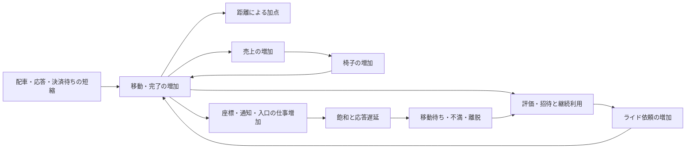

# Codex conversation

- Session: 01a127b2-1fca-7603-8dad-f98bcdfac319

<!-- codex-hook-format: 10; tool results and reasoning content omitted -->

- REASONING durations are estimates from the preceding message or tool event to reasoning completion and may include model/network waits.

---

## USER (2026-10-11 06:22:54 +0900)

$isucon-agent 直近の結果のログから、 docs/analysis/benchmark-score-structure.md を更新してください

## ASSISTANT

isucon-agentスキルを使い、最新のfinalized RUNのログと既存の集計ビューを確認して、スコア構造の資料を更新します。

## TOOL

```sh
pwd; rg --files -g 'AGENTS.md' -g 'SKILL.md' -g 'Taskfile*' -g '*benchmark-score*' -g 'sources.yaml' -g 'run.json' -g '*README*' docs tools .agents | head -150
```

## TOOL

```sh
cat .agents/skills/isucon-agent/SKILL.md; cat docs/analysis/benchmark-score-structure.md; git status --short
```

## REASONING (Estimated 0s; 2026-10-11 06:22:58 +0900)

## TOOL

```sh
rg --files -g AGENTS.md -g 'Taskfile*' -g 'run.json' -g '*sql' -g '*.yaml' | head -160; rg -n '^  (q|artifacts-run|analysis|runs)|ANALYSIS|RUNS_DIR' Taskfile.yml Taskfile.contest.yml; cat tools/analysis/sources.yaml; cat tools/contest/analysis-schema/bench-summary.sql; cat tools/contest/analysis-schema/bench-progress.sql
```

## TOOL

```sh
ls -1 runs | tail -25; cat tools/analysis/schema/endpoints.sql; cat tools/analysis/schema/user-transitions.sql; cat AGENTS.md
```

## REASONING (Estimated 2s; 2026-10-11 06:23:02 +0900)

## TOOL

```sh
sed -n '918,960p' Taskfile.yml; cat runs/20261011-061703/run.json; cat runs/20261011-061703/bench.log; cat tools/contest/analysis-schema/ride-metrics.sql; cat tools/analysis/schema/semantic.sql
```

## TOOL

```sh
task q -- "SELECT run_id, score, passed FROM bench_results ORDER BY run_id; DESCRIBE manifests; DESCRIBE load_windows; DESCRIBE ride_metrics;"
```

## REASONING (Estimated 1s; 2026-10-11 06:23:05 +0900)

## TOOL

```sh
rg 'level=INFO|level=ERROR|評価' runs/20261011-061703/bench.log; cat tools/contest/analysis-schema/ride-metrics.sql; rg -n 'スコア|60秒|再起動|距離|座標更新|評価|モデル|通知' docs/official/manual.md docs/official/ISURIDE.md | head -100; git log -20 --format='%h %s'
```

## TOOL

```sh
task artifacts-run RUN=runs/20261011-061703; task q -- "SELECT run_id, duration_seconds, source, status FROM load_windows WHERE run_id >= '20261011-052401' ORDER BY run_id; SELECT table_name, column_name, data_type FROM information_schema.columns WHERE table_name LIKE 'ride_%' ORDER BY table_name, ordinal_position;"
```

## REASONING (Estimated 3s; 2026-10-11 06:23:13 +0900)

## ASSISTANT

最新RUNは `20261011-061703` で、279,537点・成功でした。資料の最終RUN（3,732点）から成長の様子が大きく変わっているため、直近RUNの利用者・椅子の増加とAPI処理量を比較し、以前の結論を見直します。最新RUNの必須成果物も揃っています。

## TOOL

```sh
task q -- "WITH regions AS (SELECT run_id, sum(registered_users) registered, sum(active_users) active FROM bench_final_regions GROUP BY run_id), owners AS (SELECT run_id, sum(chairs) chairs, sum(sales) sales FROM bench_final_owners GROUP BY run_id), starts AS (SELECT run_id,min(reported_at) started FROM bench_log_lines WHERE line LIKE '%level=INFO msg=負荷走行を開始します' GROUP BY run_id), growth AS (SELECT g.run_id, sum(added_chairs) added, round(date_diff('millisecond',s.started,min(reported_at))/1000.0,3) first_s FROM bench_chair_growth g JOIN starts s USING(run_id) GROUP BY g.run_id,s.started), eval AS (SELECT run_id,sum(status_2xx) evaluations FROM endpoints WHERE method='POST' AND uri LIKE '%/evaluation' GROUP BY run_id) SELECT b.run_id, b.score, b.passed, e.evaluations, r.registered,r.active,o.chairs,o.sales,g.first_s,g.added,d.matching_pct,d.pickup_pct,d.travel_pct FROM bench_results b LEFT JOIN regions r USING(run_id) LEFT JOIN owners o USING(run_id) LEFT JOIN growth g USING(run_id) LEFT JOIN eval e USING(run_id) LEFT JOIN bench_latest_dissatisfaction d USING(run_id) ORDER BY run_id;"
```

## TOOL

```sh
rg 'level=INFO' runs/20261011-061703/bench.log | rg -v '一定の売上'; sed -n '1,210p' tools/contest/analysis-schema/ride-metrics.sql; sed -n '35,100p' docs/official/ISURIDE.md; sed -n '309,324p' docs/official/manual.md; sed -n '362,368p' docs/official/manual.md
```

## TOOL

```sh
task q -- "SELECT run_id, method,uri,status_2xx,round(avg_time_sec*1000,2) avg_ms FROM endpoints WHERE run_id IN ('20261011-042043','20261011-055959','20261011-060837','20261011-061703') AND (uri LIKE '%coordinate' OR uri LIKE '%evaluation' OR uri LIKE '%/sales' OR uri = '/api/owner/chairs' OR uri='/api/app/rides') ORDER BY uri, run_id; SELECT run_id,host,resource_kind,service,round(demand_core_seconds,2) cpu_s,round(capacity_core_seconds,2) capacity_s,round(100*utilization_ratio,2) pct,load_window_seconds FROM resource_demand WHERE run_id >= '20261011-055959' ORDER BY run_id,host,resource_kind;"
```

## REASONING (Estimated 2s; 2026-10-11 06:23:23 +0900)

## TOOL

```sh
task q -- "SELECT run_id, method,uri,count,status_2xx, round(avg_time_sec*1000,2) avg_ms FROM endpoints WHERE run_id='20261011-061703' ORDER BY sum_time_sec DESC; SELECT run_id,metric,count(*) samples,min(value) lo,max(value) hi FROM ride_metric_gauges WHERE run_id >= '20261011-060837' GROUP BY run_id,metric ORDER BY run_id,metric; SELECT run_id,series,count(*) samples,sum(events) n,round(sum(total)/nullif(sum(events),0),2) avg FROM ride_metric_histograms WHERE run_id>='20261011-060837' GROUP BY run_id,series ORDER BY run_id,series;"
```

## TOOL

```sh
python3 - <<'PY'
import json
from pathlib import Path
for rid in ['20261011-042043','20261011-052401','20261011-053536','20261011-055959','20261011-060837','20261011-061703']:
 d=json.loads((Path('runs')/rid/'run.json').read_text())
 print(rid,{k:d.get(k) for k in ['phase','score','passed','missing','load_window','source','roles']})
 print('artifact anomalies',[(a['name'],a['status'],a.get('reason'),a.get('quality',{}).get('status')) for a in d['artifacts'] if a['status']!='ok' or a.get('quality',{}).get('status') not in ['valid','not-applicable',None]])
 print('key artifacts',[(a['name'],a['status']) for a in d['artifacts'] if a['name'] in ['bench.log','alp.json','user-transitions.json'] or a['name'].startswith('raw/access-')])
PY
rg -n 'dispatch_waiting|dispatch_oldest|dispatch_available|dispatch_notify_blocked|dispatch_wait|pickup_b|recordDispatch|dispatchMetrics|rideMetrics' webapp/go tools/contest/queries/ride-metrics.sql | head -90; git show --stat 115fd36; rg --files docs/analysis
```

## REASONING (Estimated 9s; 2026-10-11 06:23:38 +0900)

## TOOL

```sh
task q -- "SELECT run_id,method,uri,status_2xx,round(avg_time_sec*1000,1) avg_ms FROM endpoints WHERE run_id IN ('20261011-042043','20261011-051806','20261011-052401','20261011-053536','20261011-055959','20261011-060837','20261011-061703') AND (contains(uri,'/evaluation') OR contains(uri,'/coordinate') OR contains(uri,'/owner/sales') OR contains(uri,'/owner/chairs') OR uri='^/api/app/rides$' AND method='POST') ORDER BY run_id,uri; SELECT run_id,round(start_gap_avg_ms,1) avg_ms,transitions FROM user_transition_edges WHERE run_id IN ('20261011-042043','20261011-055959','20261011-060837','20261011-061703') AND contains(from_route,'/owner/chairs') AND contains(to_route,'/owner/sales') ORDER BY run_id;"
```

## TOOL

```sh
task q -- "WITH starts AS (SELECT run_id,min(reported_at) started FROM bench_log_lines WHERE line LIKE '%level=INFO msg=負荷走行を開始します' GROUP BY run_id), departures AS (SELECT run_id,reported_at,try_cast(regexp_extract(line,'ライドによって([0-9]+)人',1) AS BIGINT) departures FROM bench_log_lines WHERE line LIKE '%level=INFO msg=これまでに低評価なライド%') SELECT r.run_id,round(date_diff('millisecond',s.started,r.reported_at)/1000.0,3) info_elapsed_s,r.registrations_reputation,r.registrations_invitation,d.departures,(SELECT sum(added_chairs) FROM bench_chair_growth c WHERE c.run_id=r.run_id AND c.reported_at<=r.reported_at) chairs_added FROM bench_registrations r JOIN starts s USING(run_id) LEFT JOIN departures d ON r.run_id=d.run_id AND r.reported_at=d.reported_at WHERE r.run_id IN ('20261011-060837','20261011-061703') ORDER BY r.run_id,r.line_number; SELECT run_id, reported_at,raw_line FROM bench_completion WHERE run_id>='20261011-055959';"
```

## TOOL

```sh
cat tools/contest/queries/ride-metrics.sql; sed -n '80,175p' webapp/go/dispatch_metrics.go; task artifacts-run RUN=runs/20261011-060837; task artifacts-run RUN=runs/20261011-042043; git status --short
```

## REASONING (Estimated 2s; 2026-10-11 06:23:48 +0900)

## TOOL

```sh
task q -- "SET VARIABLE ride_run='20261011-061703'; SELECT name,status,reason,quality_status,quality_window_coverage_pct,quality_max_gap_ms FROM artifacts WHERE run_id=getvariable('ride_run') AND name LIKE '%sql-pool-metrics.tsv'; WITH h AS (SELECT h.*,events IS NOT NULL AND total IS NOT NULL AND le_b0 IS NOT NULL AND le_b1 IS NOT NULL AND le_b2 IS NOT NULL AND le_b3 IS NOT NULL AND le_inf IS NOT NULL complete FROM ride_metric_histograms h JOIN load_windows w USING(run_id) WHERE h.run_id=getvariable('ride_run') AND h.interval_start>=w.started_at AND h.ts<=w.ended_at) SELECT series,observation_unit,count(*) FILTER(WHERE complete) complete_intervals,count(*) FILTER(WHERE NOT complete) missing_intervals,sum(events) FILTER(WHERE complete) n,round(sum(total) FILTER(WHERE complete)/nullif(sum(events) FILTER(WHERE complete),0),2) avg FROM h WHERE series IN ('dispatch_wait','dispatch_batch','eval_total_ok','eval_payment_ok','eval_sql_ok','eval_complete_ok','assign_flush_chair') GROUP BY series,observation_unit ORDER BY series; WITH p AS (SELECT run_id,host,ts,max(value) FILTER(WHERE metric='dispatch_waiting') waiting,max(value) FILTER(WHERE metric='dispatch_available') available,max(value) FILTER(WHERE metric='dispatch_oldest_ms') oldest_ms,max(value) FILTER(WHERE metric='dispatch_notify_blocked') blocked FROM ride_metric_gauges WHERE run_id=getvariable('ride_run') GROUP BY run_id,host,ts), starts AS (SELECT run_id,min(reported_at) started FROM bench_log_lines WHERE line LIKE '%level=INFO msg=負荷走行を開始します' GROUP BY run_id) SELECT round(date_diff('millisecond',s.started,p.ts)/1000.0,3) info_elapsed_s, waiting,available,round(oldest_ms,1) oldest_ms,blocked FROM p JOIN starts s USING(run_id) ORDER BY p.ts;"
```

## TOOL

```sh
task q -- "SELECT run_id,host,samples,cpu_count,round(idle_core_seconds,2) idle_s,round(cpu_busy_peak_pct,2) peak_pct,round(cpu_busy_peak_offset_seconds,2) peak_s, cpu_busy_ge80_samples,run_queue_over_cpu_samples,round(cpu_pressure_some_avg10_mean,2) psi_pct,round(iowait_mean_pct,2) iowait_pct FROM host_saturation WHERE run_id='20261011-061703' ORDER BY host; SELECT run_id,method,route,sum(requests) requests,sum(status_2xx) success,round(sum(response_time_sum_seconds)*1000/nullif(sum(requests),0),2) avg_ms FROM http_traffic_series WHERE run_id IN ('20261011-060837','20261011-061703') AND in_load_window AND (contains(route,'/evaluation') OR contains(route,'/coordinate') OR route='/api/app/rides' AND method='POST') GROUP BY run_id,method,route ORDER BY run_id,route; SELECT run_id,source_artifact,line_number,line FROM bench_log_lines WHERE run_id='20261011-061703' AND (line LIKE '%level=ERROR%' OR line LIKE '%level=WARN%');"
```

## TOOL

```sh
sed -n '1,105p' webapp/go/dispatch_metrics.go; git log --format='%h %s' 00b7864..115fd36 | head -30; cat docs/analysis/batch-travel-time-matching.md | head -100; cat docs/analysis/event-driven-matching.md | head -75; ls runs/20261011-061703 | tail -12
```

## REASONING (Estimated 6s; 2026-10-11 06:24:03 +0900)

## ASSISTANT

直近RUNでは、招待登録が3,533人まで増え、最終登録3,788人に対する離脱は1人でした。一方、未割当ライドが増える時点でも配車可能な椅子が残っています。資料には、需要の成長に加えて配車の処理量を追う必要性と、計測欠損による判断の限界を反映します。

## TOOL

```sh
task q -- "SELECT * FROM load_windows WHERE run_id IN ('20261011-055959','20261011-060837','20261011-061703'); SELECT uri,status_5xx FROM endpoints WHERE run_id='20261011-061703' AND contains(uri,'/app/users'); WITH g AS (SELECT g.* FROM ride_metric_gauges g JOIN load_windows w USING(run_id) WHERE g.run_id='20261011-061703' AND g.ts>=w.started_at AND g.ts<w.ended_at) SELECT metric,count(value) samples,round(avg(value),2) mean,max(value) peak FROM g GROUP BY metric ORDER BY metric; SELECT run_id,round((279537.0/231056-1)*100,2) score_growth_pct,round(4434.0*5/279537*100,2) bonus_pct;"
```

## TOOL

```sh
task q -- "WITH w AS (SELECT * FROM load_windows WHERE run_id='20261011-061703'), traffic AS (SELECT floor(date_diff('millisecond',w.started_at,t.ts)/10000.0)::INT bin,sum(t.status_2xx) rides FROM http_traffic t JOIN w USING(run_id) WHERE t.ts>=w.started_at AND t.ts<w.ended_at AND t.method='POST' AND t.route='^/api/app/rides$' GROUP BY bin), h AS (SELECT h.*,floor(date_diff('millisecond',w.started_at,h.ts)/10000.0)::INT bin FROM ride_metric_histograms h JOIN w USING(run_id) WHERE h.interval_start>=w.started_at AND h.ts<w.ended_at), completions AS (SELECT bin,sum(events) FILTER(WHERE series='dispatch_wait') assignments,sum(events) FILTER(WHERE series='eval_total_ok') evaluations,round(sum(total) FILTER(WHERE series='dispatch_wait')/nullif(sum(events) FILTER(WHERE series='dispatch_wait'),0),2) wait_ms,max(total) FILTER(WHERE series='dispatch_batch' AND events=1) max_batch FROM h GROUP BY bin), gauges AS (SELECT g.ts,floor(date_diff('millisecond',w.started_at,g.ts)/10000.0)::INT bin,max(value) FILTER(WHERE metric='dispatch_waiting') waiting,max(value) FILTER(WHERE metric='dispatch_available') available,max(value) FILTER(WHERE metric='dispatch_oldest_ms') oldest_ms FROM ride_metric_gauges g JOIN w USING(run_id) WHERE g.ts>=w.started_at AND g.ts<w.ended_at GROUP BY g.ts,bin), last_g AS (SELECT * FROM gauges QUALIFY row_number() OVER(PARTITION BY bin ORDER BY ts DESC)=1) SELECT bin,t.rides,c.assignments,c.evaluations,c.wait_ms,c.max_batch,l.waiting,l.available,round(l.oldest_ms,1) oldest_ms,l.ts FROM traffic t JOIN completions c USING(bin) JOIN last_g l USING(bin) ORDER BY bin; SELECT run_id,sum(requests) rides,sum(status_2xx) success FROM http_traffic_series WHERE run_id='20261011-061703' AND in_load_window AND method='POST' AND route='^/api/app/rides$' GROUP BY run_id;"
```

## TOOL

```sh
rg -n '64|matching|sleep|Interval|500|batch' webapp/go/matching*.go matcher Taskfile.yml tools/contest  -g '*.go' -g '*.sh' -g '*.service' -g '*.yml' | head -80; cat matcher/isuride-matcher.service; task artifacts-run RUN=runs/20261011-055959; python3 - <<'PY'
import json
from pathlib import Path
for rid in ['20261011-060837','20261011-061703']:
 d=json.loads((Path('runs')/rid/'run.json').read_text())
 print(rid,'missing',d.get('missing','absent'))
 for a in d['artifacts']:
  if a['name'].endswith('sql-pool-metrics.tsv'):
   print(a)
PY
```

## REASONING (Estimated 11s; 2026-10-11 06:24:27 +0900)

## REASONING (Estimated 10s; 2026-10-11 06:24:37 +0900)

## TOOL

```sh
task q -- "WITH r AS (SELECT run_id,sum(registered_users) registered,sum(active_users) active FROM bench_final_regions GROUP BY run_id),o AS (SELECT run_id,sum(chairs) chairs FROM bench_final_owners GROUP BY run_id),e AS (SELECT run_id,sum(status_2xx) evaluations FROM endpoints WHERE method='POST' AND contains(uri,'/evaluation') GROUP BY run_id) SELECT b.run_id,b.score,b.passed,e.evaluations,r.registered,r.active,o.chairs FROM bench_results b JOIN r USING(run_id) JOIN o USING(run_id) JOIN e USING(run_id) ORDER BY run_id; SELECT round((279537.0/231056-1)*100,2) score_growth_pct,round(4434.0*5/279537*100,2) bonus_pct;"
```

## TOOL

```sh
task q -- "WITH w AS (SELECT * FROM load_windows WHERE run_id='20261011-061703'), bins AS (SELECT i bin,w.started_at+i*INTERVAL '10 seconds' lo,w.started_at+(i+1)*INTERVAL '10 seconds' hi FROM w,range(6) r(i)), h AS (SELECT b.bin,h.* FROM ride_metric_histograms h JOIN w USING(run_id) JOIN bins b ON h.interval_start>=b.lo AND h.ts<=b.hi WHERE series IN ('dispatch_wait','dispatch_batch','eval_total_ok') AND events IS NOT NULL AND total IS NOT NULL) SELECT bin,sum(events) FILTER(WHERE series='dispatch_wait') assignments,sum(events) FILTER(WHERE series='dispatch_batch') batches,max(total) FILTER(WHERE series='dispatch_batch' AND events=1) max_batch,round(sum(interval_ms) FILTER(WHERE series='dispatch_wait')/1000.0,3) observed_s,round(sum(events) FILTER(WHERE series='dispatch_wait')*1000.0/nullif(sum(interval_ms) FILTER(WHERE series='dispatch_wait'),0),1) assignments_per_s FROM h GROUP BY bin ORDER BY bin;"
```

## TOOL

```sh
rg --files | rg 'matching|matcher'; rg -n 'matchingBatchSize|Limit|limit|64|500|sleep' webapp/go/memory_matching.go webapp/go/internal_handlers.go tools/contest  -g '*.go' -g '*.sh' -g '*.service' | head -60; python3 - <<'PY'
import json
from pathlib import Path
for rid in ['20261011-035537','20261011-040258','20261011-041159','20261011-041530','20261011-042043']:
 d=json.loads((Path('runs')/rid/'run.json').read_text())
 print(rid,d.get('missing','absent'),[(a['name'],a['status']) for a in d['artifacts'] if a['name'] in ['bench.log','alp.json']])
PY
```

## REASONING (Estimated 9s; 2026-10-11 06:24:53 +0900)

## TOOL

```sh
cat etc/systemd/system/isuride-matcher.service; sed -n '1,90p' webapp/go/internal_handlers.go; rg -n 'matchingBatchSize|internalMatching|observeAssignments' webapp/go/runtime_state.go webapp/go/*.go | head -35; task q -- "SELECT run_id,metric,min(ts),max(ts),count(*) FROM ride_metric_gauges WHERE run_id='20261011-061703' GROUP BY run_id,metric; SELECT record_type,count(*) n,count(*) FILTER(WHERE NOT parsed) unparsed FROM bench_info_coverage WHERE run_id='20261011-061703' GROUP BY record_type ORDER BY record_type;"
```

## REASONING (Estimated 3s; 2026-10-11 06:24:59 +0900)

## TOOL

### `apply_patch`

```javascript
tools.apply_patch("*** Begin Patch\n*** Delete File: /Users/mineo/src/github.com/EkeMinusYou/isucon14-02/docs/analysis/benchmark-score-structure.md\n*** Add File: /Users/mineo/src/github.com/EkeMinusYou/isucon14-02/docs/analysis/benchmark-score-structure.md\n+# ISURIDEベンチの得点構造分析\n+\n+2026-10-11更新。最新finalized RUNは [20261011-061703](../../runs/20261011-061703/bench.log)。\n+保存済みの `20261011-035537` から `20261011-061703` までの24 RUNを比較し、\n+成長と待ちの分析は直近3 RUN、特に最新RUNを基準にする。\n+旧版の最終RUNは `20261011-042043` だった。今回は3ホストへの配置変更後も含める。\n+\n+## 結論\n+\n+得点の中心は移動距離である。APIの高速化は、移動開始・ライド完了・次のライドを早めることで得点に効く。\n+完了から売上・椅子増加へ、評価から評判・招待登録・継続利用へ進む成長が、その後の移動量を増やす。\n+\n+最新RUNは279,537点・成功で、直前RUNの231,056点から21.0%増えた。\n+評価API成功は3,628→4,434件、最終椅子数は631→759台。\n+最終登録／アクティブ人数は1,240／1,163人から3,788／3,787人へ増えた。\n+旧版で目立った低評価離脱は最新の進捗では1人で、需要の成長は主に招待登録による。\n+\n+一方、後半には未割当ライドと配車可能な椅子が同時に増えた。\n+1回64件の配車バッチが続いても依頼の増加に追いついていない。\n+次の改善候補は配車の起動間隔・処理量であり、利用者数や椅子数を増やすだけで回転が増えるとは判断できない。\n+資源計測では最新RUNの各ホストにCPU容量の余りがあるが、配車・評価など個別の待ちは残る。\n+アプリ計測には取得失敗があるため、残存サンプルで確認できた範囲の判断である。\n+\n+## 公式の得点式と直接の加点\n+\n+[当日マニュアルの得点式](../official/manual.md#スコアの計算)は次のとおり。\n+\n+```text\n+得点 = 迎車距離の合計 × 0.1\n+     + 乗車中の移動距離の合計\n+     + ライド完了数 × 5\n+```\n+\n+同じ距離なら乗車中の移動は迎車の10倍の加点になる。\n+通知・検索の件数自体には加点がない。ライドに割り当てられていない椅子の移動も、この式の距離加点には含まれない。\n+\n+最新RUNの評価API成功4,434件を仮に採点対象の完了数とすると、完了ボーナスは22,170点、総得点の約7.9%になる。\n+これはRUN全期間のHTTP件数を使った概算であり、確定した得点内訳ではない。\n+旧版の `20261011-042043` では同じ概算が約5.4%だった。\n+距離加点が大部分を占めることを示す目安として使い、残りを迎車・乗車それぞれの距離へ分解しない。\n+\n+完了には直接の5点に加え、次のライドへ進む、売上を発生させる、評価を確定する役割がある。\n+ユーザーも椅子も、ライドが完了するまで次のライドを要求・受理できない。\n+これらの仕様は[アプリケーションマニュアル](../official/ISURIDE.md#ライドride)に記載されている。\n+\n+## RUN比較\n+\n+得点・合否・最終人数・椅子数は各RUNの `bench.log`、評価API成功件数は `alp.json` が出典。\n+評価APIは `POST /api/app/rides/{ride_id}/evaluation` の2xx件数である。\n+人数は最終地域情報の2地域合計、椅子数は最終オーナー情報の5社合計。\n+\n+| RUN | 得点 | 合否 | 評価API成功件数 | 最終登録／アクティブ人数 | 最終椅子数 |\n+| --- | ---: | --- | ---: | ---: | ---: |\n+| [20261011-035537](../../runs/20261011-035537/bench.log) | 671 | PASS | 6 | 10／10 | 20 |\n+| [20261011-040258](../../runs/20261011-040258/bench.log) | 1,244 | PASS | 13 | 17／17 | 22 |\n+| [20261011-041159](../../runs/20261011-041159/bench.log) | 1,204 | PASS | 13 | 14／14 | 21 |\n+| [20261011-041530](../../runs/20261011-041530/bench.log) | 2,565 | PASS | 26 | 37／26 | 26 |\n+| [20261011-042043](../../runs/20261011-042043/bench.log) | 3,732 | PASS | 40 | 55／26 | 32 |\n+| [20261011-042630](../../runs/20261011-042630/bench.log) | 8,288 | PASS | 90 | 99／78 | 51 |\n+| [20261011-043341](../../runs/20261011-043341/bench.log) | 16,687 | PASS | 184 | 128／61 | 80 |\n+| [20261011-043850](../../runs/20261011-043850/bench.log) | 19,688 | PASS | 218 | 139／66 | 89 |\n+| [20261011-044454](../../runs/20261011-044454/bench.log) | 24,015 | PASS | 296 | 140／69 | 106 |\n+| [20261011-045005](../../runs/20261011-045005/bench.log) | 18,089 | PASS | 220 | 143／69 | 85 |\n+| [20261011-045602](../../runs/20261011-045602/bench.log) | 29,450 | PASS | 452 | 202／105 | 150 |\n+| [20261011-050014](../../runs/20261011-050014/bench.log) | 35,117 | PASS | 503 | 203／137 | 154 |\n+| [20261011-050820](../../runs/20261011-050820/bench.log) | 48,731 | FAIL | 684 | 325／316 | 177 |\n+| [20261011-051222](../../runs/20261011-051222/bench.log) | 40,795 | PASS | 607 | 214／139 | 179 |\n+| [20261011-051806](../../runs/20261011-051806/bench.log) | 45,032 | PASS | 678 | 224／137 | 194 |\n+| [20261011-052401](../../runs/20261011-052401/bench.log) | 185,859 | PASS | 2,736 | 822／635 | 497 |\n+| [20261011-052957](../../runs/20261011-052957/bench.log) | 206,466 | PASS | 3,146 | 867／646 | 548 |\n+| [20261011-053536](../../runs/20261011-053536/bench.log) | 225,300 | PASS | 3,526 | 1,010／924 | 614 |\n+| [20261011-054248](../../runs/20261011-054248/bench.log) | 126,305 | PASS | 1,664 | 693／477 | 343 |\n+| [20261011-054939](../../runs/20261011-054939/bench.log) | 217,486 | PASS | 3,364 | 1,031／925 | 592 |\n+| [20261011-055518](../../runs/20261011-055518/bench.log) | 175,935 | PASS | 2,414 | 760／532 | 445 |\n+| [20261011-055959](../../runs/20261011-055959/bench.log) | 227,629 | PASS | 3,593 | 1,268／1,213 | 626 |\n+| [20261011-060837](../../runs/20261011-060837/bench.log) | 231,056 | PASS | 3,628 | 1,240／1,163 | 631 |\n+| [20261011-061703](../../runs/20261011-061703/bench.log) | 279,537 | PASS | 4,434 | 3,788／3,787 | 759 |\n+\n+FAILのRUNに出力された数値を、有効な成功スコアとして扱わない。\n+最新RUNもエラーなしではなく、結果行は `pass=true`、`map[17:4]`。\n+参加者WARNにはユーザー登録APIの期待201に対する500が4件あり、`alp.json` の同APIの5xx件数とも一致する。\n+\n+`20261011-061703` のmanifestでは、Goは `isucon-1`、nginx入口は `isucon-2`、MySQLは `isucon-3`。\n+直前2 RUNでは入口・Go・MySQLが `isucon-1` に同居していた。\n+配置以外の取り込み差分やRUNごとの条件もあるため、21.0%の増点を配置変更単独の効果と断定しない。\n+\n+## 得点を増やす成長と、成長を抑える待ち\n+\n+公式仕様と参加者INFOから、次の流れが確認できる。\n+評価・売上の判定閾値や、増加量を決める内部式は未確認である。\n+\n+```mermaid\n+flowchart LR\n+    A[\"待ち・応答時間の短縮\"] --> B[\"移動・完了の増加\"]\n+    B --> C[\"距離による加点\"]\n+    B --> D[\"売上の増加\"]\n+    D --> E[\"椅子の増加\"]\n+    E --> B\n+    A --> F[\"評価の改善\"]\n+    F --> G[\"評判・招待登録と継続利用\"]\n+    G --> H[\"ライド依頼の増加\"]\n+    H --> B\n+    H --> I[\"割当が追いつかない場合の配車待ち\"]\n+```\n+\n+図は得点につながる経路を整理したもの。個々の変更がすべての効果を発生させたと断定するものではない。\n+低評価離脱も成長を抑えるが、最新RUNでは後半の配車待ちの増加と利用者の継続が同時に観測されている。\n+\n+### 供給側：早い椅子増加と、追加後の稼働を分ける\n+\n+旧版の `20261011-041530` → `20261011-042043` では、椅子一覧APIの平均応答が2,529→38ms、\n+最初の椅子増加がINFO開始後39.4→16.2秒、追加台数が6→12台だった。\n+一覧の高速化で売上確認が進み、椅子増加が早まったという経路が有力だった。\n+\n+直近3 RUNでは、最初の椅子増加はすでにほぼ同じ時刻である。\n+\n+| 指標 | 20261011-055959 | 20261011-060837 | 20261011-061703 |\n+| --- | ---: | ---: | ---: |\n+| 最初の椅子増加（INFO開始から） | 7.199秒 | 7.185秒 | 7.213秒 |\n+| 椅子増加イベントの追加台数合計 | 606台 | 611台 | 739台 |\n+| 最終オーナー売上合計 | 21,338,400円 | 21,667,800円 | 26,545,700円 |\n+| 椅子一覧APIの2xx件数／平均応答 | 166件／16ms | 166件／21ms | 166件／1ms |\n+| 売上APIの2xx件数／平均応答 | 164件／20ms | 164件／29ms | 164件／6ms |\n+| 同一セッションの一覧→売上確認の平均開始間隔 | 756.9ms | 766.3ms | 826.1ms |\n+| 上記遷移の観測件数 | 163 | 163 | 163 |\n+| 座標APIの2xx件数／平均応答 | 77,504件／20ms | 79,550件／21ms | 81,192件／4ms |\n+\n+API集計は `alp.json`、セッション遷移は `user-transitions.json`、売上と増加イベントは `bench.log` が出典。\n+開始間隔は一覧リクエスト開始から次の売上リクエスト開始までの時間で、API応答時間とは異なる。\n+\n+最新では一覧・売上APIが速くなっても、確認件数は変わらず、最初の追加も早まっていない。\n+今回の増点を旧版と同じ「最初の椅子増加の前倒し」で説明することはできない。\n+追加量と売上は増えたが、追加された椅子が実際に割り当てられ、移動できたかまで見る必要がある。\n+\n+### 需要側：招待登録が増え、離脱が小さくなった\n+\n+最新RUNの登録と離脱を同一報告時刻で結合した。\n+人数は累計、椅子追加はその報告時刻までの増加イベント合計である。\n+\n+| INFO開始から | 評判による登録 | 招待による登録 | 低評価による離脱 | 椅子追加 |\n+| --- | ---: | ---: | ---: | ---: |\n+| 9.040秒 | 6人 | 35人 | 未報告 | 9台 |\n+| 19.840秒 | 30人 | 106人 | 未報告 | 50台 |\n+| 30.640秒 | 54人 | 530人 | 未報告 | 179台 |\n+| 36.039秒 | 66人 | 979人 | 1人 | 276台 |\n+| 41.439秒 | 78人 | 1,515人 | 1人 | 372台 |\n+| 46.839秒 | 90人 | 2,012人 | 1人 | 462台 |\n+| 52.239秒 | 102人 | 2,514人 | 1人 | 551台 |\n+| 57.639秒 | 114人 | 3,024人 | 1人 | 644台 |\n+| 63.040秒 | 126人 | 3,533人 | 1人 | 739台 |\n+\n+離脱行がない時刻は「未報告」とし、0人に補わない。\n+最終報告の新規登録3,659人のうち招待経由が3,533人で、招待が増加の中心だった。\n+直前RUNの最終報告は評判129人・招待1,034人・離脱77人。\n+評判経由の人数が増えたために最新の需要が増えた、と説明することはできない。\n+\n+最新の最終登録／アクティブ人数の差は1人で、旧版の55／26人とは継続の状態が異なる。\n+ただし登録の最終報告と最終地域情報には時刻差がある。\n+新規登録累計へ初期人数を足して最終登録数と一致させる補正は行わない。\n+また、終了直前に増えた利用者が残り時間で完了・移動へ寄与できる量は限られる。\n+\n+## 最新RUNで残る配車待ちと評価待ち\n+\n+椅子は、座標更新リクエストの成功を確認するまで次の移動へ進まない。\n+この仕様は[アプリケーションマニュアル](../official/ISURIDE.md#椅子chair)に記載されている。\n+直前→最新RUNで座標APIの平均応答は21→4msとなり、最終移動不満率は31.6→0.4%になった。\n+一方、最終マッチング不満率は91.8→88.8%、迎車不満率は14.9→9.2%だった。\n+割合の母数と判定閾値は不明であり、不満率だけから資源の律速や損失時間を決めない。\n+\n+### 未割当と配車可能な椅子が同時に増える\n+\n+最新RUNの分析窓は `06:17:10〜06:18:14 JST` の64秒。\n+その中の10秒窓で、HTTPの依頼成功件数とアプリの配車計測を比較した。\n+アプリ差分は計測間隔全体が窓に収まるものだけを使い、境界をまたぐ差分を除外した。\n+そのためHTTPは各10秒、配車は各約9秒の観測量を、それぞれ件／秒へ換算している。\n+未割当・配車可能数は同じサンプル時刻の値である。\n+\n+| 比較窓（JST） | 依頼成功件数／秒 | 配車件数／観測秒数 | 配車件数／秒 | 窓内最後のサンプル時刻 | 未割当ライド | 配車可能な椅子 | 最古の未割当の待ち |\n+| --- | ---: | ---: | ---: | --- | ---: | ---: | ---: |\n+| 06:17:40〜06:17:50 | 209.6 | 1,024件／9.001秒 | 113.8 | 06:17:49.849 | 1,505 | 262 | 7.026秒 |\n+| 06:17:50〜06:18:00 | 204.6 | 960件／9.001秒 | 106.7 | 06:17:59.848 | 2,472 | 426 | 11.883秒 |\n+| 06:18:00〜06:18:10 | 208.5 | 1,024件／9.001秒 | 113.8 | 06:18:09.848 | 3,382 | 576 | 16.479秒 |\n+\n+各窓の観測配車はそれぞれ16・15・16バッチで、すべて1回64件だった。\n+現行実装の上限も [matchingBatchSize = 64](../../webapp/go/internal_handlers.go) であり、\n+[外部matcher](../../etc/systemd/system/isuride-matcher.service)はAPI完了後にsleepして次の呼び出しへ進む。\n+未割当と配車可能な椅子が同時に残り、配車の観測処理率が依頼率を下回ることから、\n+このRUNでは配車の起動間隔と1回の処理量が成長を抑える要因という仮説が有力である。\n+単純な椅子不足だけでは、この同時残留を説明できない。\n+\n+`dispatch_available` は、アクティブ・未完了ライドなし・椅子向け未送信通知なしの椅子数。\n+`dispatch_waiting` は未割当ライド数で、利用者の継続率や配車待ち不満の母数とは異なる。\n+アプリ計測の取得失敗と観測境界の違いがあるため、依頼と配車の件数差をそのまま全期間の未割当数へ換算しない。\n+配車頻度を上げる場合も、[イベント起動の過去の比較](event-driven-matching.md)と併せて、\n+迎車・乗車の質、完了数、離脱、得点を確認する必要がある。\n+\n+### 評価APIは決済の待ちが大きい\n+\n+同じ64秒分析窓に収まる完全な計測間隔を使うと、最新RUNの成功評価4,434件の平均は次のとおり。\n+\n+| アプリ計測の段階 | 平均時間 |\n+| --- | ---: |\n+| 評価全体 | 574.39ms |\n+| 同期SQL | 0.95ms |\n+| 決済 | 572.74ms |\n+| 完了処理 | 0.48ms |\n+\n+各段階は同じ成功評価件数を母数にしているが、計測範囲の境界があるため厳密な足し算の内訳とは扱わない。\n+HTTP側の評価API平均576msとも近く、現行の評価待ちの大部分は決済である。\n+完了までユーザー・椅子が次へ進めないため、回転に関係する待ちとして追う。\n+これは待ち時間であり、CPU消費時間へ加算しない。決済先の処理や短縮可能量は本資料では未確認。\n+\n+## 資源の容量と得点経路を併せて見る\n+\n+最新RUNの同じ64秒分析窓で、各ホストは2 CPU、各64サンプルである。\n+CPU秒は既存の `resource_demand` が1サンプルを1秒として積分した値。\n+\n+| ホスト・役割 | ホストCPU秒／容量CPU秒 | 容量の余り | 主なサービスCPU秒 | ホストbusyの最大値 |\n+| --- | ---: | ---: | --- | ---: |\n+| isucon-1：Go | 44.04／128.00 | 83.96 CPU秒 | Go 33.78 | 62.76% |\n+| isucon-2：nginx・matcher | 59.86／128.00 | 68.14 CPU秒 | nginx 50.70、matcher 5.86 | 76.14% |\n+| isucon-3：MySQL | 27.89／128.00 | 100.11 CPU秒 | MySQL 26.25 | 38.89% |\n+\n+ホスト・サービスのCPU秒を重ねて足さない。サービスはホスト消費の内訳である。\n+このサンプル範囲では、どのホストもbusy 80%以上のサンプルはなかった。\n+ホスト全体のCPU飽和を得点の主因とする根拠はないが、短時間の競合や個別処理の待ちを否定するものではない。\n+配車待ちと空き椅子の残留、決済待ちを併せて、実際に移動へ進めない時間を減らす候補を選ぶ。\n+\n+## 次のRUNで追う指標\n+\n+| 得点への経路 | 既存成果物で見る指標 | 判断上の注意 |\n+| --- | --- | --- |\n+| 配車待ちの解消 | 同じ時間窓の依頼率・配車率、バッチ件数、未割当数・最古待ち、配車可能数 | 配車率だけを増やして迎車・移動の質や得点を悪化させない |\n+| 移動量と回転 | 座標APIの応答時間・件数、評価API成功件数、評価段階別の待ち | HTTP件数を距離や採点対象の完了数と同一視しない |\n+| 需要の成長・維持 | 評判・招待登録、低評価離脱の時系列、最終アクティブ人数 | 最新は招待が中心。登録時刻と離脱、完了へ進めた量を併せて見る |\n+| 供給の成長と使用 | 椅子追加時刻・台数、売上、配車可能数と配車件数 | 最終椅子数だけで稼働時間・供給不足を判断しない |\n+| 資源の制約 | 同じ観測窓のホスト・Go・nginx・MySQL CPU秒、待ち、容量 | SQL延べ時間・API延べ時間をCPU秒に足さない |\n+| 正当性 | 合否、種別エラー、登録5xx、決済完了、通知順序 | PASSでも最新RUNには登録失敗4件がある |\n+\n+SSEの通知HTTP件数・平均応答時間は、状態通知件数・通知遅延とは異なる。\n+接続の長さや件数の減少を処理量の悪化と判断せず、移動・完了・成長へつながったかで評価する。\n+\n+## 出典、確認方法、未確定点\n+\n+数値集計と時系列結合は `task q` の読み取り専用DuckDBを使った。\n+分析DBは対象24 RUNへ同期済みで、今回のための同期・成果物再生成・ベンチ実行・計測変更は行っていない。\n+主に以下の既存ビュー・保存成果物を参照した。\n+\n+- [参加者ログ解釈ビュー](../../tools/contest/analysis-schema/bench-summary.sql)：最終地域・オーナー、登録、不満率、椅子増加、結果。\n+- [進捗ビュー](../../tools/contest/analysis-schema/bench-progress.sql)：原文・報告時刻。離脱行は未対応のため原文から累計人数を取得。\n+- [API集計](../../tools/analysis/schema/endpoints.sql)と[セッション遷移](../../tools/analysis/schema/user-transitions.sql)：RUN全期間の集計。\n+- [HTTP・資源のビュー](../../tools/analysis/schema/semantic.sql)：`http_traffic_series`、`resource_demand`、`host_saturation`、`load_windows`。\n+- [アプリの配車・評価計測ビュー](../../tools/contest/analysis-schema/ride-metrics.sql)と[確認クエリ](../../tools/contest/queries/ride-metrics.sql)：epoch・ready・version、差分の成立条件、計測間隔を確認。\n+- 最新RUNの [run.json](../../runs/20261011-061703/run.json)、[bench.log](../../runs/20261011-061703/bench.log)、[alp.json](../../runs/20261011-061703/alp.json)。\n+\n+基本情報は以下で再確認できる。後続RUNが増えても本資料の対象範囲を変えない。\n+\n+```shell\n+task q -- \"SELECT run_id, score, passed FROM bench_results WHERE run_id <= '20261011-061703' ORDER BY run_id\"\n+task q -- \"SELECT run_id, sum(registered_users) registered, sum(active_users) active FROM bench_final_regions WHERE run_id <= '20261011-061703' GROUP BY run_id ORDER BY run_id\"\n+task q -- \"SELECT run_id, sum(chairs) chairs, sum(sales) sales FROM bench_final_owners WHERE run_id <= '20261011-061703' GROUP BY run_id ORDER BY run_id\"\n+task q -- \"SELECT run_id, status_2xx, avg_time_sec FROM endpoints WHERE contains(uri, '/evaluation') AND run_id <= '20261011-061703' ORDER BY run_id\"\n+task q -- \"SELECT reported_at, line FROM bench_log_lines WHERE run_id = '20261011-061703' AND line LIKE '%level=INFO msg=これまでに低評価なライド%' ORDER BY line_number\"\n+task q -- \"SELECT run_id, started_at, ended_at, duration_seconds, source, reason FROM load_windows WHERE run_id >= '20261011-055959' AND run_id <= '20261011-061703' ORDER BY run_id\"\n+task q -- \"SELECT name, status, reason, quality_status FROM artifacts WHERE run_id = '20261011-061703' AND name LIKE '%sql-pool-metrics.tsv'\"\n+task artifacts-run RUN=runs/20261011-061703\n+```\n+\n+進捗の経過秒は、同RUNの参加者INFO「負荷走行を開始します」と報告行の時刻差をミリ秒単位で求めた。\n+登録・離脱は同じ `reported_at` で結合し、椅子追加は報告時刻までのイベントを累積した。\n+配車の10秒表は `load_windows.started_at` から窓を作り、HTTPは `ts >= 窓開始 AND ts < 窓終了`、\n+アプリヒストグラムは `interval_start >= 窓開始 AND ts <= 窓終了` で絞った。\n+配車率の分母は残存計測間隔の `sum(interval_ms) / 1000`。\n+未割当・配車可能数は各窓内最後の同一時刻サンプルである。\n+\n+限界は次のとおり。\n+\n+- `task artifacts-run` は直近3 RUNで必須captureの内容検査に成功した。\n+  ただし `20261011-060837` と `20261011-061703` の `isucon-1-sql-pool-metrics.tsv` は\n+  manifestで `status=failed`・`quality.status=invalid`。取得タイムアウトが各2回あり、manifestの収集窓では67／69サンプル。\n+  最新の64秒分析窓にはreadyの配車ゲージ65サンプルと、表に使ったヒストグラムの完全な64差分間隔が残る。\n+  「完全な間隔」は差分の各フィールドが揃うという意味であり、RUN全期間の計測が完全だったという意味ではない。\n+  欠損を0に補わず、配車・評価分析は残存する有効差分へ限定した。\n+- 旧版対象の `20261011-041530`・`20261011-042043` は、manifestのaccess artifactはokでもローカルに圧縮生accessログがない。\n+  今回も `task artifacts-run RUN=runs/20261011-042043` はその欠損を検出した。\n+  旧RUNのHTTP時系列を0件にせず、残っているAPI・遷移集計を使う。トップレベル `missing` は未記録でも実ファイルを確認する。\n+- 公式の負荷テストは60秒だが、INFO開始から終了までは最新RUNで68.641秒。\n+  manifestの収集窓は69.502秒、分析DBのtraffic-threshold窓は64.000秒である。\n+  直前2 RUNの分析窓は66.612／66.992秒で、終了閾値を検出できず収集終了を使っている。\n+  これらを採点60秒の厳密な境界と扱わず、INFO経過・収集窓・分析窓・RUN全期間を区別する。\n+- API・遷移集計には採点区間外や再試行が含まれる可能性がある。評価API成功件数を正確な完了加点へ置き換えない。\n+  迎車・乗車それぞれの採点距離、進行中ライドの加点、端数の扱いも復元していない。\n+  全座標件数やオーナー売上を距離へそのまま換算しない。\n+- 不満率の母数、評判・招待・離脱・売上による成長の閾値と内部式は不明。\n+  DEBUGの `tick`・`reqs`・`score`・`criteria` 配列は解釈していない。\n+- ベンチマーカーのソース解析、インターネット調査、サーバーの変更は行っていない。\n*** End Patch")
```

## REASONING (Estimated 10s; 2026-10-11 06:26:36 +0900)

## REASONING (Estimated 3s; 2026-10-11 06:26:39 +0900)

## ASSISTANT

最新RUNの後半では、依頼が約205〜210件／秒に対し、観測された配車は約107〜114件／秒でした。比較表と結論をこの結果へ更新し、採点60秒と分析窓の違い、登録失敗4件、アプリ計測の欠損も明記します。

## TOOL

```sh
cat docs/analysis/benchmark-score-structure.md
```

## TOOL

### `apply_patch`

```javascript
tools.apply_patch("*** Begin Patch\n*** Update File: /Users/mineo/src/github.com/EkeMinusYou/isucon14-02/docs/analysis/benchmark-score-structure.md\n@@\n" + current.output.trimEnd().split("\n").map(line=>"-"+line).join("\n") + "\n" + added + "*** End Patch")
```

## REASONING (Estimated 11s; 2026-10-11 06:28:03 +0900)

## TOOL

```sh
git diff --check; git diff --stat; git status --short; git diff -- docs/analysis/benchmark-score-structure.md | head -110; python3 - <<'PY'
from pathlib import Path
import re
p=Path('docs/analysis/benchmark-score-structure.md')
text=p.read_text()
broken=[]
for target in re.findall(r'\]\(([^)]+)\)',text):
 if '://' in target:
  continue
 target=target.split('#',1)[0]
 if target and not (p.parent/target).exists():
  broken.append(target)
assert not broken,broken
rows=re.findall(r'^\| \[(20261011-[0-9]{6})\].*$',text,re.M)
assert len(rows)==24 and len(set(rows))==24
assert rows[-1]=='20261011-061703'
print('Verified 24 unique RUN rows and all local link targets.')
for rid in ['20261011-041530','20261011-042043']:
 print(rid,'raw access exists:',(Path('runs')/rid/'raw/access-isucon-1.log.zst').exists())
PY
```

## TOOL

```sh
task q -- "SELECT run_id, count(*) FILTER(WHERE ready=1 AND version=1 AND epoch IS NOT NULL) ready_samples FROM ride_metric_samples s JOIN load_windows w USING(run_id) WHERE run_id='20261011-061703' AND s.ts>=w.started_at AND s.ts<w.ended_at GROUP BY run_id; SELECT run_id, round(date_diff('millisecond',min(reported_at) FILTER(WHERE line LIKE '%level=INFO msg=負荷走行を開始します'),min(reported_at) FILTER(WHERE line LIKE '%level=INFO msg=負荷走行が終了しました'))/1000.0,3) info_span_s FROM bench_log_lines WHERE run_id='20261011-061703' GROUP BY run_id;"
```

## REASONING (Estimated 5s; 2026-10-11 06:28:13 +0900)

## ASSISTANT (Worked for 5m 21s; 2026-10-11 06:28:15 +0900)

[benchmark-score-structure.md](/Users/mineo/src/github.com/EkeMinusYou/isucon14-02/docs/analysis/benchmark-score-structure.md)を更新しました。

最新RUN（279,537点・PASS）までの24 RUN比較、招待登録の成長、配車・決済の待ち、CPU容量、計測欠損と分析窓の注意点を反映しました。

数値・リンクと `git diff --check` を確認済みです。

## USER (2026-10-11 06:30:00 +0900)

その分析結果から構造的な改善案はだせますか？小幅ではなく

## ASSISTANT

構造的な案として、配車待ちの増え方を現行の起動方式・割当方式と照合します。過去に配車頻度を上げて悪化したRUNも確認し、処理量と迎車・乗車の質を両方改善できる案を絞ります。

## TOOL

```sh
sed -n '510,665p' webapp/go/runtime_state.go; cat webapp/go/matching.go; cat docs/analysis/event-driven-matching.md; cat webapp/go/evaluation_metrics.go; rg -n 'payment|evaluation|Complete|Arrived|mutex' webapp/go/app_handlers.go | tail -65
```

## TOOL

```sh
rg -n 'MATCHING_INTERVAL|matching|slot|batch|rate|配車|構造' env.sh Taskfile.yml Taskfile.contest.yml docs/conversation/20261011-053704_01a12788-340a-7741-9a9c-00c3d45c529d.md tools/contest -g '*.md' -g '*.sql' -g '*.yaml' -g '*.sh' | head -90; cat docs/analysis/incremental-owner-sales.md | head -90; sed -n '1,115p' webapp/go/ride_metrics.go; rg -n 'payment|決済|マッチング' docs/official/ISURIDE.md docs/official/manual.md | head -60
```

## REASONING (Estimated 2s; 2026-10-11 06:30:08 +0900)

## TOOL

```sh
sed -n '135,260p' docs/analysis/event-driven-matching.md; sed -n '110,290p' webapp/go/app_handlers.go; rg -n '^func .*Payment|http.Client|Transport|Idempotency|Retry|retry|Sleep|payment' webapp/go/payment*.go webapp/go/evaluation_metrics.go; cat webapp/go/evaluation_metrics.go; sed -n '175,220p' docs/official/ISURIDE.md; sed -n '320,360p' docs/official/manual.md; cat webapp/go/payment_gateway.go
```

## TOOL

```sh
task q -- "SELECT run_id,score,passed FROM bench_results WHERE run_id>='20261011-052401' ORDER BY run_id; SELECT run_id,series,sum(events) n,round(sum(total)/nullif(sum(events),0),2) avg FROM ride_metric_histograms WHERE run_id='20261011-061703' AND series IN ('pickup_b1','pickup_b2_8','pickup_b9_64','dispatch_batch','dispatch_wait') GROUP BY run_id,series ORDER BY series; SELECT metric,sum(delta) observed FROM ride_metric_intervals WHERE run_id='20261011-061703' AND stage='payment_retries' GROUP BY metric;"
```

## REASONING (Estimated 13s; 2026-10-11 06:30:24 +0900)

## REASONING (Estimated 12s; 2026-10-11 06:30:36 +0900)

## REASONING (Estimated 11s; 2026-10-11 06:30:47 +0900)

## REASONING (Estimated 11s; 2026-10-11 06:30:58 +0900)

## ASSISTANT

過去の20ms・200msイベント配車は、マッチ待ちを減らしても迎車・移動・得点が悪化していました。大きく変えるなら、十分な候補を集める時間を保ちつつ、1回の起動で64件しか処理できない制約を外す設計が第一候補です。決済も再試行が多いため、別の改善候補として規模を確認しています。

## TOOL

```sh
task q -- "WITH h AS (SELECT h.* FROM ride_metric_histograms h JOIN load_windows w USING(run_id) WHERE h.run_id='20261011-061703' AND h.interval_start>=w.started_at AND h.ts<=w.ended_at AND events IS NOT NULL AND total IS NOT NULL AND le_b0 IS NOT NULL AND le_b1 IS NOT NULL AND le_b2 IS NOT NULL AND le_b3 IS NOT NULL AND le_inf IS NOT NULL) SELECT series,sum(events) n,round(sum(total)/nullif(sum(events),0),2) avg FROM h WHERE series IN ('eval_total_ok','eval_payment_ok','dispatch_wait','pickup_b2_8','pickup_b9_64') GROUP BY series; SELECT metric,sum(delta) retries,count(delta) valid_intervals FROM ride_metric_intervals i JOIN load_windows w USING(run_id) WHERE i.run_id='20261011-061703' AND i.interval_start>=w.started_at AND i.ts<=w.ended_at AND i.stage='payment_retries' GROUP BY metric;"
```

## TOOL

```sh
sed -n '350,480p' webapp/go/app_handlers.go; sed -n '575,590p' webapp/go/runtime_state.go; sed -n '1,50p' webapp/go/payment_gateway.go; git status --short
```

## REASONING (Estimated 13s; 2026-10-11 06:31:17 +0900)

## REASONING (Estimated 8s; 2026-10-11 06:31:25 +0900)

## ASSISTANT (Worked for 1m 39s; 2026-10-11 06:31:39 +0900)

出せます。**一番有力なのは、配車を「周期ごとに64件割り当てる処理」から、需要と空き椅子をまとめて扱う配車エンジンへ作り替える案です。**

最新RUNの後半は依頼が約205〜210件／秒、配車が約107〜114件／秒。未割当3,382件と配車可能な椅子576台が同時に残っています。需要も供給もあるのに、移動へ進められていない状態です。[分析資料](/Users/mineo/src/github.com/EkeMinusYou/isucon14-02/docs/analysis/benchmark-score-structure.md)

1. **需要に応じて処理量を変える配車エンジン**

   候補を集める時間を確保し、混雑時には一度の起動で複数バッチを処理します。未割当数・最古の待ち・空き椅子数を使って処理量を決め、外部curlとsleepによる起動をGo内のスケジューラへ置き換えます。

   現状の依頼率に追いつくには、後半の配車能力をおよそ2倍へ引き上げる必要があります。そこから移動・完了・売上・椅子増加へつながる成長を狙います。これは処理能力の目安で、得点2倍の予測ではありません。

   過去の20ms・200msイベント配車は迎車・移動が悪化して減点しました。今回は**低負荷時の候補集約と、混雑時の処理量拡大を分ける**設計にします。空き椅子の使い切りで近隣検索が増える可能性は、引き続き評価対象です。[過去の比較](/Users/mineo/src/github.com/EkeMinusYou/isucon14-02/docs/analysis/event-driven-matching.md)

2. **64件を越えた範囲で、椅子の割当をまとめて最適化する**

   現行は先頭64件の中で最適化します。待機列と空き椅子が数百ある場面でも、後続ライドとの組み合わせは考慮できません。

   古い依頼を含む広い範囲をまとめて計画し、椅子の位置・速度と迎車＋乗車時間で割り当てます。大量の組み合わせを扱うため、空間索引と速度別の候補抽出を使う方式が候補です。候補を絞れば近似になるため、割当品質の確認が必要です。

   現行では計算中も共有ロックを保持しています。大きな計画はロック外で計算し、確定時に未割当・椅子の再利用条件を再確認して、WALへ記録してから通知します。計算量・メモリ・競合時の再計画が増えますが、座標更新を長時間止めずに、配車の量と質を両立する狙いです。

3. **決済を、同時実行数と冪等性を管理する方式へ変更する**

   成功評価4,434件に対して再試行4,090回、決済待ちは平均573msです。公式の`Idempotency-Key`を使い、ライド単位で同じキーを保持して重複を防ぎながら、決済の同時実行数を制御する案です。[公式仕様](/Users/mineo/src/github.com/EkeMinusYou/isucon14-02/docs/official/ISURIDE.md:183)

   固定100msの再試行待ちは、観測値から平均約92ms分に相当します。それ以外の待ちも大きいため、この案単独の大幅増点はまだ根拠が弱いです。支払い成功後の完了・椅子再利用と、終了後5秒以内の決済完了を守って評価します。

**優先順は①→②です。** 対象は`isucon-1`のGo配車処理と、①では`isucon-2`のmatcherも含みます。まず処理能力、次に広い範囲での割当品質を別RUNで評価し、配車率だけでなく完了・距離加点・離脱・椅子増加が伸びるかで判断します。100万点までの倍率は未確定ですが、現状の成長を止めている構造へ直接手を入れる案です。

## USER (2026-10-11 06:32:20 +0900)

そのうちワークツリーで未着手なのはどれですか？

## ASSISTANT

既存ワークツリーのコード差分と作業記録を確認し、3案のうち未着手の範囲を整理します。

## TOOL

```sh
git worktree list --porcelain; git status --short; cat .agents/skills/README.md; rg -n '配車エンジン|スケジューラ|冪等|Idempotency|同時実行|広い範囲|64件|candidate|空間索引|scheduler|dispatch' docs/analysis docs/solutions -g '*.md' | head -95
```

## TOOL

```sh
rg --files .agents | sort; git log -15 --format='%h %s'; rg -n 'ISUCON_MATCHING_INTERVAL|MATCHER_HOSTS' Taskfile.yml env.sh etc/systemd/system/isuride-matcher.service
```

## REASONING (Estimated 2s; 2026-10-11 06:32:26 +0900)

## TOOL

```sh
git status --short; git log -6 --format='%h %s'; git diff --stat main...HEAD; git diff --stat; rg --files webapp/go docs/analysis | rg '(match|dispatch|payment|evaluation|scheduler|analysis)'
```

## REASONING (Estimated 2s; 2026-10-11 06:32:30 +0900)

## TOOL

```sh
cat docs/analysis/saturated-two-batch-matching.md; git show --format=short 477df87 -- webapp/go/runtime_state.go; git diff main...HEAD -- webapp/go/matching.go webapp/go/dispatch_metrics.go
```

## TOOL

```sh
cat webapp/go/payment_gateway.go; git show --format=short 8964254 -- webapp/go/app_handlers.go; rg -n '同時|semaphore|制限|limit|デプロイ|未計測|スコア|実装' docs/conversation/20261011-062819_01a127b7-636d-77f0-9e9d-6d12d199a982.md | tail -18
```

## TOOL

```sh
head -18 docs/analysis/static-precompression.md; git diff main...HEAD -- webapp/go
```

## ASSISTANT (Worked for 18s; 2026-10-11 06:32:39 +0900)

**丸ごと未着手なのは②「64件を越えた範囲での割当最適化」です。** 現在の全ワークツリーのコード差分と記録を確認しました。

| 案 | 状況 | 残っている範囲 |
| --- | --- | --- |
| ① 需要に応じた配車エンジン | `mon`で飽和時に最大2バッチ処理を実装済み（`477df87`） | Go内スケジューラ化、需要に応じた処理量制御 |
| ② 広い範囲での割当最適化 | **未着手** | 64件超の計画、空間・速度別候補抽出、ロック外での計算 |
| ③ 決済の冪等性・同時実行管理 | `tue`でIdempotency-Key対応を実装済み（`8964254`） | 決済の同時実行数制御 |

新しく独立した改善に着手するなら②です。

## USER (2026-10-11 06:33:05 +0900)

残っている範囲とはなんですか？漏れですか？

## REASONING (Estimated 7s; 2026-10-11 06:33:12 +0900)

## ASSISTANT (Worked for 10s; 2026-10-11 06:33:15 +0900)

**実装漏れという意味ではありません。** 「残っている範囲」という書き方が紛らわしかったです。

既存ワークツリーで依頼された内容と、私が今回追加で提案した設計との差を指していました。

- `mon`：依頼された「飽和時に最大2バッチ処理」は実装済み。Go内スケジューラ化・需要に応じた処理量制御は、今回の追加提案です。
- `tue`：依頼された「Idempotency-Key対応」は実装済み。決済の同時実行数制御は、今回の追加提案です。
- ②の広い範囲での割当最適化は、関連する実装も未着手です。

①③を「未完了」と受け取れる表現にしたのは不正確でした。既存の依頼に対する漏れと、追加提案の未着手を区別すべきでした。

## USER (2026-10-11 06:33:41 +0900)

2についてどの程度のスコアアップが見込めますか？

## ASSISTANT

②で短縮を狙える迎車時間と、現行64件バッチの配車待ちを分けて確認します。保存済み計測から、スコア上昇を見積もれる範囲と、まだ数値を出せない範囲を整理します。

## TOOL

```sh
git status --short; git worktree list; ls -1 runs | tail -12; sed -n '1,70p' tools/contest/analysis-schema/ride-metrics.sql; rg -n 'matchingBatchSize|func .*match|matchingTravelTime' webapp/go/internal_handlers.go webapp/go/runtime_state.go webapp/go/matching.go; rg 'level=INFO' runs/20261011-061703/bench.log | tail -12
```

## TOOL

```sh
task q -- "SELECT run_id,score,passed FROM bench_results WHERE run_id>='20261011-061703' ORDER BY run_id; SELECT name,status,quality_status,quality_window_coverage_pct FROM artifacts WHERE run_id='20261011-061703' AND name LIKE '%sql-pool-metrics.tsv'; WITH h AS (SELECT h.* FROM ride_metric_histograms h JOIN load_windows w USING(run_id) WHERE h.run_id='20261011-061703' AND h.interval_start>=w.started_at AND h.ts<=w.ended_at AND events IS NOT NULL AND total IS NOT NULL AND le_b0 IS NOT NULL AND le_b1 IS NOT NULL AND le_b2 IS NOT NULL AND le_b3 IS NOT NULL AND le_inf IS NOT NULL) SELECT series,observation_unit,sum(events) n,round(sum(total),2) total,round(sum(total)/nullif(sum(events),0),2) avg,sum(le_b0) le_10,sum(le_b1) le_100,sum(le_b2) le_1000,sum(le_b3) le_3000,sum(le_inf) le_inf FROM h WHERE series IN ('pickup_b1','pickup_b2_8','pickup_b9_64','dispatch_wait','eval_total_ok','eval_payment_ok') GROUP BY series,observation_unit ORDER BY series;"
```

## REASONING (Estimated 8s; 2026-10-11 06:33:57 +0900)

## TOOL

```sh
task q -- "SELECT run_id,score,passed,commit,app_hosts,nginx_hosts,mysql_host FROM manifests WHERE run_id='20261011-062549'; SELECT run_id, duration_seconds,source FROM load_windows WHERE run_id='20261011-062549'; SELECT name,status,quality_status,quality_window_coverage_pct FROM artifacts WHERE run_id='20261011-062549' AND name LIKE '%sql-pool-metrics.tsv'; WITH h AS (SELECT h.* FROM ride_metric_histograms h JOIN load_windows w USING(run_id) WHERE h.run_id='20261011-062549' AND h.interval_start>=w.started_at AND h.ts<=w.ended_at AND events IS NOT NULL AND total IS NOT NULL AND le_inf IS NOT NULL) SELECT series,sum(events) n,round(sum(total)/nullif(sum(events),0),2) avg,sum(le_b2) le_1000,sum(le_b3) le_3000 FROM h WHERE series IN ('pickup_b1','pickup_b2_8','pickup_b9_64','dispatch_wait','eval_total_ok') GROUP BY series ORDER BY series; SELECT matching_pct,pickup_pct,travel_pct FROM bench_latest_dissatisfaction WHERE run_id='20261011-062549';"
```

## TOOL

```sh
python3 - <<'PY'
import json
from pathlib import Path
p=Path('runs/20261011-062549/run.json')
d=json.loads(p.read_text())
print({k:d.get(k) for k in ['phase','score','passed','source','roles','missing']})
print([(a['name'],a['status']) for a in d['artifacts'] if a['name'] in ['alp.json','bench.log'] or a['name'].endswith('sql-pool-metrics.tsv')])
PY
rg 'level=INFO' runs/20261011-062549/bench.log | tail -12; git show --stat e8bab89 | head -18; sed -n '10,33p' webapp/go/matching.go; sed -n '567,622p' webapp/go/runtime_state.go; task artifacts-run RUN=runs/20261011-062549
```

## REASONING (Estimated 12s; 2026-10-11 06:34:16 +0900)

## REASONING (Estimated 11s; 2026-10-11 06:34:27 +0900)

## ASSISTANT (Worked for 53s; 2026-10-11 06:34:34 +0900)

**②単独で「何％上がる」と見積もれる根拠は、まだありません。2倍級の増点を期待する材料もありません。**

現行でも、全空き椅子を候補にして、先頭64ライドの迎車＋乗車時間を最小化しています。②で増える効果は、**64件の区切りを越えて組み合わせを改善できる分**です。現行の割当と大きな範囲での割当を同じ候補で比較した記録がないため、その改善幅が未確定です。[現行の割当処理](/Users/mineo/src/github.com/EkeMinusYou/isucon14-02/webapp/go/matching.go)

最新RUN（289,926点）の有効な計測差分では、配車待ちは平均9.76秒、9〜64件バッチの推定迎車時間は平均5.44秒でした。迎車は実測時間ではありません。また、②の割当品質改善だけでは、周期ごとに64件しか割り当てない処理能力の制約は解消しません。[最新RUN](/Users/mineo/src/github.com/EkeMinusYou/isucon14-02/runs/20261011-062549/bench.log)

規模感を示す条件付き計算なら、次のようになります。十分に配車でき、椅子数と1ライド当たりの得点が同じ場合です。

| 椅子の1周全体を短縮できた割合 | 回転数の増加 | 約29万点からの換算 |
| --- | ---: | ---: |
| 10% | 約11% | 約32万点 |
| 20% | 約25% | 約36万点 |
| 30% | 約43% | 約41万点 |

**これは予測ではありません。②が1周をどれだけ短縮できるかも、成長による追加効果も未計測です。**

大幅増点を優先するなら、現時点では①の処理能力拡大の方が根拠は強いです。②は、同じ待機ライド・空き椅子に対する計算比較で短縮余地を確認してから、実装規模を決めるのが妥当です。

## USER (2026-10-11 06:35:22 +0900)

じゃあまあよいです。2についてワークツリーを作成して対応してください

## ASSISTANT

isucon-worktreeスキルを使って②専用のワークツリーとタブを作成し、広い範囲での割当最適化を実装します。デプロイとベンチ実行は行わず、ローカル検証まで進めます。

## TOOL

```sh
cat .agents/skills/isucon-worktree/SKILL.md; git status --short; git worktree list --porcelain; cat .agents/skills/isucon-agent/SKILL.md
```

## REASONING (Estimated 2s; 2026-10-11 06:35:28 +0900)

## TOOL

```sh
wt list --format json; command -v wt; command -v herdr; python3 - <<'PY'
import os
for key in ['HERDR_ENV','HERDR_WORKSPACE_ID']:
 print(key,os.environ.get(key,''))
PY
rg --files .config .worktrunk docs/conversation 2>/dev/null | tail -20; rg -n '64件を越えた|広い範囲での割当|2について|②単独|構造的な改善案' docs/conversation -g '*.md' --max-count 3 | tail -25
```

## TOOL

```sh
wt switch --help | head -95; wt step copy-ignored --help | head -80; herdr agent --help; herdr tab --help; herdr pane --help; rg -n 'copy|ignored|runs|include' .config/wt.toml .config/worktrunk.toml .git/info/config 2>/dev/null
```

## REASONING (Estimated 3s; 2026-10-11 06:35:34 +0900)

## TOOL

```sh
cat .config/wt.toml; cat .worktreeinclude; sed -n '355,430p' docs/conversation/20261011-062254_01a127b2-1fca-7603-8dad-f98bcdfac319.md; herdr tab create --help; herdr agent start --help; herdr agent prompt --help; herdr pane process-info --help
```

## TOOL

```sh
wt switch --create wed --base main --format json
```

## REASONING (Estimated 1s; 2026-10-11 06:35:40 +0900)

## TOOL

### `write_stdin`

```javascript
tools.write_stdin({session_id:68244,chars:"",yield_time_ms:1000,max_output_tokens:4000})
```

## TOOL

```sh
herdr tab list --workspace "$HERDR_WORKSPACE_ID"; herdr agent list
```

## REASONING (Estimated 8s; 2026-10-11 06:35:49 +0900)

## TOOL

```sh
herdr pane current; herdr pane get --pane w29:p10; herdr pane process-info --pane w29:p10; herdr workspace list; python3 - <<'PY'
import os
for key in ['HERDR_ENV','HERDR_WORKSPACE_ID','HERDR_TAB_ID','HERDR_PANE_ID','HERDR_TERMINAL_ID','CODEX_THREAD_ID']:
 print(key,os.environ.get(key,''))
PY
ls -l /Users/mineo/worktrees/EkeMinusYou/isucon14-02/wed/runs/analysis.duckdb; rg --files .git/wt/logs | tail -12
```

## TOOL

```sh
herdr --skill; herdr tab list --workspace w29; herdr agent get --help
```

## REASONING (Estimated 4s; 2026-10-11 06:35:55 +0900)

## TOOL

```sh
herdr agent get w29:p10; cat .git/wt/logs/wed/user/post-start/runner.log; cat .git/wt/logs/wed/user/post-start/copy-ignored.log; python3 - <<'PY'
from pathlib import Path
import os
src=Path('runs/analysis.duckdb')
dst=Path('/Users/mineo/worktrees/EkeMinusYou/isucon14-02/wed/runs/analysis.duckdb')
print('analysis_copy_is_regular',dst.is_file() and not dst.is_symlink())
print('analysis_copy_has_distinct_inode',not os.path.samefile(src,dst))
PY
```

## REASONING (Estimated 6s; 2026-10-11 06:36:04 +0900)

## ASSISTANT

`main`を起点に `wed` を作成し、分析DBの独立コピーも確認できました。担当には、②の割当範囲拡大とロック外での計算を渡します。既存64件方式との割当品質比較、正当性検証、Linux向けbuildまでを作業範囲にします。

## TOOL

```sh
herdr tab create --workspace w29 --cwd /Users/mineo/worktrees/EkeMinusYou/isucon14-02/wed --label wed --no-focus
```

## TOOL

```sh
herdr pane process-info --pane 
```

## TOOL

```sh
herdr agent start isucon-wed-wide-matching --kind codex --pane 
```

## REASONING (Estimated 13s; 2026-10-11 06:36:24 +0900)

## REASONING (Estimated 7s; 2026-10-11 06:36:31 +0900)

## TOOL

### `write_stdin`

```javascript
tools.write_stdin({session_id:8001,chars:"",yield_time_ms:1000,max_output_tokens:2500})
```

## REASONING (Estimated 7s; 2026-10-11 06:36:39 +0900)

## TOOL

```sh
python3 - <<'PY'
```

## REASONING (Estimated 2s; 2026-10-11 06:37:01 +0900)

## TOOL

```sh
herdr tab list --workspace w29; herdr agent get isucon-wed-wide-matching; herdr agent read isucon-wed-wide-matching --source recent-unwrapped --lines 24; git status --short
```

## TOOL

```sh
git branch --show-current; git log -1 --format='%h %s'; python3 - <<'PY'
from pathlib import Path
p=Path('runs/analysis.duckdb')
print('analysis_db_regular',p.is_file() and not p.is_symlink())
PY
```

## ASSISTANT (Worked for 1m 45s; 2026-10-11 06:37:08 +0900)

[wedワークツリー](/Users/mineo/worktrees/EkeMinusYou/isucon14-02/wed)と `wed` タブを作成し、担当Codex `isucon-wed-wide-matching` の作業開始を確認しました。

②の割当範囲拡大・ロック外計算、比較検証、Linux向けbuild、コミットまで依頼済みです。デプロイ・ベンチは行いません。

## USER (2026-10-11 06:40:19 +0900)

今はリソースに余裕があるようです。スコアが向上しない原因を探ってください

## ASSISTANT

isucon-agentスキルで、最新RUNの負荷の伸び方、配車・移動・完了の処理量、資源の待ちを同じ時間窓で照合します。CPUの余りだけでは説明できない、得点につながる処理が止まる場所を探します。

## TOOL

```sh
git status --short; git log -9 --format='%h %s'; ls -1 runs | tail -14; cat .agents/skills/isucon-agent/SKILL.md; sed -n '1,100p' docs/analysis/wal-authoritative-state.md; rg -n '役割|MATCHER_HOSTS|TARGET_OS|TARGET_ARCH' Taskfile.yml
```

## TOOL

```sh
task q -- "SELECT run_id,score,passed,commit FROM manifests WHERE run_id >= '20261011-055959' ORDER BY run_id; SELECT run_id,started_at,ended_at,duration_seconds,source,status FROM load_windows WHERE run_id >= '20261011-055959' ORDER BY run_id; SELECT table_name FROM information_schema.tables WHERE table_name LIKE '%profile%' OR table_name LIKE '%pool%' OR table_name LIKE '%bottleneck%' OR table_name LIKE '%histogram%' OR table_name LIKE '%traffic%' ORDER BY table_name;"
```

## REASONING (Estimated 10s; 2026-10-11 06:40:34 +0900)

## TOOL

```sh
task q -- "SELECT run_id,host,resource_kind,service,round(demand_core_seconds,2) cpu_s,round(capacity_core_seconds,2) capacity_s,round(100*utilization_ratio,2) pct FROM resource_demand WHERE run_id IN ('20261011-061703','20261011-062549') ORDER BY run_id,host,resource_kind,service; SELECT run_id,host,samples,round(cpu_busy_peak_pct,2) busy_peak,round(cpu_pressure_some_avg10_mean,2) psi_mean,round(iowait_mean_pct,2) iowait_mean,run_queue_over_cpu_samples FROM host_saturation WHERE run_id='20261011-062549' ORDER BY host; SELECT table_name,string_agg(column_name||':'||data_type,', ' ORDER BY ordinal_position) columns FROM information_schema.columns WHERE table_name IN ('bottleneck_wait_axes','bottleneck_serialization_screen','bottleneck_run_health','profile_metadata','profile_functions','profile_edges','window_metrics','query_cost','artifacts') GROUP BY table_name ORDER BY table_name;"
```

## TOOL

```sh
task artifacts-run RUN=runs/20261011-062549; rg 'level=INFO|level=WARN|level=ERROR' runs/20261011-062549/bench.log | rg -v '一定の売上'; cat etc/systemd/system/isuride-matcher.service; sed -n '35,82p' Taskfile.yml; rg -n 'sleep|matching|64|500' tools/contest/generated etc/systemd webapp/go/internal_handlers.go; sed -n '1,185p' tools/analysis/schema/bottleneck.sql
```

## TOOL

```sh
task q -- "SELECT run_id,host,resource_kind,service,round(demand_core_seconds,2) cpu_s,round(capacity_core_seconds,2) capacity_s,round(100*utilization_ratio,2) pct FROM resource_demand WHERE run_id IN ('20261011-061703','20261011-062549') ORDER BY run_id,host,resource_kind,service; SELECT run_id,host,samples,round(cpu_busy_peak_pct,2) busy_peak,round(cpu_pressure_some_avg10_mean,2) psi_mean,round(iowait_mean_pct,2) iowait_mean,run_queue_over_cpu_samples FROM host_saturation WHERE run_id='20261011-062549' ORDER BY host; SELECT table_name,string_agg(column_name||':'||data_type,', ' ORDER BY ordinal_position) col_spec FROM information_schema.columns WHERE table_name IN ('bottleneck_wait_axes','bottleneck_serialization_screen','bottleneck_run_health','profile_metadata','profile_functions','profile_edges','window_metrics','query_cost','artifacts') GROUP BY table_name ORDER BY table_name;"
```

## TOOL

```sh
git status --short; rg -n 'ISUCON_MATCHING_INTERVAL|func .*match|matchingBatchSize|eval_payment|dispatch_batch' webapp/go etc/systemd/system/isuride-matcher.service tools/contest/analysis-schema/ride-metrics.sql tools/analysis/schema/bottleneck.sql docs/analysis/benchmark-score-structure.md
```

## REASONING (Estimated 1s; 2026-10-11 06:42:10 +0900)

## TOOL

```sh
rg --files runs/20261011-062549 | head -65; sed -n '560,658p' webapp/go/runtime_state.go; sed -n '1,170p' webapp/go/payment_gateway.go; sed -n '130,235p' docs/analysis/benchmark-score-structure.md
```

## REASONING (Estimated 1s; 2026-10-11 06:42:15 +0900)

## REASONING (Estimated 1s; 2026-10-11 06:42:19 +0900)

## ASSISTANT

最新RUNでも、3台とも平均CPU使用率は約16〜46%でした。一方、配車待ちと配車可能な椅子が同時に残っています。資源の余りを移動量へ変えられていない原因として、配車の処理上限と呼び出し間隔を確認しています。

## TOOL

```sh
head -8 runs/20261011-062549/isucon-1-app-journal.log; rg -n 'matching|[Mm]utex|payment|WAL|fgprof' runs/20261011-062549/isucon-1-app-journal.log tools/contest/analysis-schema/ride-metrics.sql docs/analysis/wal-authoritative-state.md Taskfile.yml Taskfile.contest.yml | head -80; sed -n '1,140p' .agents/skills/isucon-agent/SKILL.md
```

## REASONING (Estimated 6s; 2026-10-11 06:42:36 +0900)

## REASONING (Estimated 3s; 2026-10-11 06:42:46 +0900)

## TOOL

```sh
rg -n 'Suppressed|suppressed|rate.limit|ISUCON_MATCHING_INTERVAL' runs/20261011-062549/isucon-1-app-journal.log runs/20261011-062549/isucon-1-service-journal.log runs/20261011-062549/isucon-2-service-journal.log webapp/env.sh; head -2 runs/20261011-062549/isucon-1-proc-metrics.tsv; rg -n 'CREATE.*VIEW|FROM .*proc|cpu_busy|cpu_idle' tools/analysis/schema/*.sql | head -60; sed -n '1,160p' webapp/go/dispatch_metrics.go; python3 - <<'PY'
import json
p=json.load(open('runs/20261011-062549/run.json'))
print({k:p[k] for k in ('missing','commit','branch','profiles_enabled') if k in p})
PY
```

## REASONING (Estimated 4s; 2026-10-11 06:42:56 +0900)

## TOOL

```sh
sed -n '415,458p' tools/analysis/schema/semantic.sql; sed -n '510,555p' tools/analysis/schema/semantic.sql; rg --files | rg '(^|/)(env.sh|.*env.*|.*fgprof.*)$' | head -30; sed -n '1,115p' runs/20261011-062549/run.json; task artifacts-run RUN=runs/20261011-062549
```

## REASONING (Estimated 2s; 2026-10-11 06:43:03 +0900)

## ASSISTANT

後半の依頼は毎秒約207〜211件ですが、配車は毎秒約114件で頭打ちでした。その間に未割当は1,864→2,822件、配車可能な椅子は300→486台へ増えています。依頼と椅子がそろっても64件ずつしか処理しない構造が、増えた需要を得点へ変える妨げになっています。決済待ちも別に平均約577ms残っています。

## REASONING (Estimated 7s; 2026-10-11 06:43:17 +0900)

## ASSISTANT (Worked for 3m 9s; 2026-10-11 06:43:28 +0900)

**最も強い原因は、余った資源を使って配車量を増やせない処理上限です。** 最新RUN `20261011-062549` は289,926点・PASSでした。直前から約3.7%増えていますが、需要の増加に配車が追いついていません。

同じ時間帯で比較すると、次の状態でした。

| 時間帯 | 依頼成功／秒 | 配車／秒 | 未割当※ | 配車可能な椅子※ |
|---|---:|---:|---:|---:|
| 06:26:30〜40 | 211.4 | 113.8 | 1,864件 | 300台 |
| 06:26:40〜50 | 206.9 | 113.8 | 2,822件 | 486台 |

※窓内最後の同時サンプル。HTTPは10秒、配車は境界を除いた約9秒の観測を秒換算。

**待っている利用者と使える椅子が両方増えているのに、配車量が一定です。** この20秒間のCPU消費も、各ホストの容量40 CPU秒に対してGo側19.70、nginx側27.96、MySQL側9.69 CPU秒で、ホスト全体のCPU飽和では説明できません。

原因と改善の優先度は、次の順です。

1. **配車の起動間隔と64件上限が成長を止めている。**  
   観測した各窓は16バッチ、すべて64件でした。[現行実装](/Users/mineo/src/github.com/EkeMinusYou/isucon14-02/webapp/go/runtime_state.go:572)も1回最大64件で、[matcher](/Users/mineo/src/github.com/EkeMinusYou/isucon14-02/etc/systemd/system/isuride-matcher.service:11)はAPI完了後にsleepします。SQLを軽くしても、この上限は変わりません。最古の未割当の待ちは8.77→13.63秒へ伸び、終了間際には18.52秒でした。

2. **決済待ちが椅子と利用者の次の周回を遅らせている。**  
   成功評価4,580件の平均は、評価全体579ms、決済577ms、SQL0.91ms、完了処理0.72ms。決済再試行も4,300回ありました。CPUを増やすだけでは縮まらない待ちです。ただし、配車可能な椅子が大量に残る今回の状態では、まず配車上限の解消が優先です。

3. **迎車の組合せ改善にも余地はあるが、配車量と別に評価する必要がある。**  
   9〜64件バッチの推定迎車時間は平均5.44秒でした。wedの広い範囲での最適化はここを改善する候補ですが、**1起動当たりの配車量が増えるか**も確認しないと、毎秒約114件の頭打ちが残ります。

次に効果を切り分けやすいのは、monの「飽和時だけ2バッチ」の比較です。配車率が上がり、空き椅子と待ちが減り、移動量・得点まで増えるかで判断できます。

SQL pool成果物は取得タイムアウトで品質判定がinvalid、アプリログにも抑制があるため、DB接続待ちや共通ロック待ちの寄与は未確定です。今回は保存済み成果物の調査のみで、ベンチ実行・サーバー変更はしていません。

## USER (2026-10-11 06:43:56 +0900)

1、2、3についてそれぞれワークツリーで改善中のものはありますか？

## ASSISTANT

各ワークツリーの差分と担当エージェントの状態を確認して、3つの原因に対応する作業を整理します。

## TOOL

```sh
git worktree list --porcelain
```

## TOOL

```sh
herdr agent list --json
```

## TOOL

```sh
cat .agents/skills/isucon-worktree/SKILL.md
```

## TOOL

```sh
herdr agent list
```

## TOOL

```sh
python3 - <<'PY'
import subprocess
from pathlib import Path
base=Path('/Users/mineo/worktrees/EkeMinusYou/isucon14-02')
for name in ['mon','tue','wed','mon-2']:
 p=base/name
 print('\nWORKTREE',name)
 for args in [['git','status','--short'],['git','log','-4','--format=%h %s'],['git','diff','--stat']]:
  r=subprocess.run(args,cwd=p,capture_output=True,text=True)
  print(r.stdout.strip() or '(no changes)')
 docs=list((p/'docs/analysis').glob('*matching*'))+list((p/'docs/analysis').glob('*payment*'))
 for d in docs:
  if any(x in d.name for x in ['saturated','wide','payment','idempoten']):
   print('DOCUMENT',d.name)
   print(d.read_text()[:6500])
PY
```

## REASONING (Estimated 3s; 2026-10-11 06:44:07 +0900)

## TOOL

```sh
git show --stat --oneline HEAD; rg --files docs/analysis | rg 'fifo|bounded|payment|wide|idempot'; rg -n 'plan|Batch|256|128|64|outside|lock' webapp/go/internal_handlers.go webapp/go/runtime_state.go | tail -30
```

## TOOL

```sh
git show 8964254 --stat; rg -n 'Idempotency|concurr|同時|実装|検証' docs/analysis/*payment* docs/analysis/*idempot* webapp/go/payment_gateway.go
```

## TOOL

```sh
python3 - <<'PY'
import json
p=json.load(open('runs/20261011-064138/run.json'))
print(json.dumps({k:v for k,v in p.items() if k in ['run_id','phase','result','score','passed','benchmark','git','source']},ensure_ascii=False))
PY
rg -n 'score|pass|fail' runs/20261011-064138/run.json runs/scores.tsv | tail -6
rg -n 'dispatchPlan|matchingPlan|matchingBatch|matching' webapp/go/internal_handlers.go | head -12
```

## REASONING (Estimated 2s; 2026-10-11 06:44:14 +0900)

## TOOL

```sh
git log -5 --oneline; cat webapp/go/internal_handlers.go; sed -n '1,70p' /Users/mineo/worktrees/EkeMinusYou/isucon14-02/wed/docs/analysis/large-fifo-matching-plan.md; tail -38 /Users/mineo/worktrees/EkeMinusYou/isucon14-02/wed/docs/analysis/large-fifo-matching-plan.md
```

## TOOL

```sh
rg -n 'Idempotency|Semaphore|semaphore|concurr|100|retry' webapp/go/payment_gateway.go; git log -1 --format='%h %s'
```

## ASSISTANT (Worked for 25s; 2026-10-11 06:44:21 +0900)

はい。**直前の回答の1・2・3**に対応する作業はあります。

| 原因 | ワークツリー | 対応内容・現在の状態 |
|---|---|---|
| **1. 配車の処理上限** | **mon** | 飽和時に64件を最大2バッチ処理。実装・配布・計測済み。新しいRUNは**447,849点・PASS**でした。 |
| **2. 決済待ち** | **tue** | ライドごとの冪等キーを使い、失敗時の決済履歴GET・照合を削除。実装・ローカル検証済み、配布・計測待ち。**同時実行数の制御は未着手**です。 |
| **3. 迎車の組合せ** | **wed** | FIFO先頭最大256件をまとめて最適化し、計算を共通ロック外へ移動。実装コミット済みで、担当は確認作業中。配布・計測は未実施です。 |

**wedは1にも対応します。** 1回の割当上限を64→256件へ増やしているため、迎車の組合せと配車量の両方を改善する変更です。

なお、前の分析後にmonの結果が保存されていました。289,926→447,849点（約54.5%増）なので、配車上限が大きな制約だったという見立てを支持する結果です。

## USER (2026-10-11 06:44:42 +0900)

256は適当な値ですか？

## ASSISTANT

wedで256件にした根拠と、件数ごとの計算時間・割当品質の検証結果を確認します。

## TOOL

```sh
sed -n '1,215p' docs/analysis/large-fifo-matching-plan.md; sed -n '1,175p' webapp/go/runtime_matching.go; cat webapp/go/internal_handlers.go
```

## TOOL

```sh
rg -n '256|128|512|Benchmark|benchmark|planning|limit|horizon' webapp/go/matching_comparison_test.go webapp/go/runtime_matching_test.go webapp/go/matching.go docs/conversation | head -95
```

## REASONING (Estimated 6s; 2026-10-11 06:44:52 +0900)

## ASSISTANT (Worked for 15s; 2026-10-11 06:44:57 +0900)

**256は試す根拠のある暫定値ですが、最適な値と確認できてはいません。** 前の回答では、その点の説明が不足していました。

[wedの検証記録](/Users/mineo/worktrees/EkeMinusYou/isucon14-02/wed/docs/analysis/large-fifo-matching-plan.md)では、候補椅子1,024台の合成入力で、計画1回の計算時間は次のとおりです。

| 配車件数 | 計算時間 | メモリ確保量 |
|---|---:|---:|
| 64 | 3.40ms | 約0.49MB |
| 128 | 16.49ms | 約1.67MB |
| 256 | 79.28ms | 約6.04MB |

Apple M1でのローカル測定です。**128→256は件数2倍に対して計算時間が約4.8倍**なので、大きくする費用は無視できません。計算中の共通ロックは外していますが、配車開始から通知までの時間や、確定時のロック保持は増え得ます。

実際の件数は `min(待機数, 空き椅子数, 256)` で、256件がそろうまで待つ実装ではありません。

判断としては、**256を最初の検証候補にするのは妥当、固定値として採用するには128との実RUN比較が必要**です。配車率・待ち・迎車品質・座標API遅延・得点を見て決めるべきです。

## USER (2026-10-11 06:46:41 +0900)

2バッチ化は増点に効いています。採用維持を勧めますが、CPU負荷と応答遅延は悪化しました。

最新RUN 20261011-064138は 447,849点・PASS。WAL投影削減済みの直前RUN 062549（289,926点）から 54.5%増です。両RUNの実装差分は今回の2バッチ化です。

INFO負荷開始から30〜60秒を比較しました。配車率は窓内に収まる有効差分約29秒から算出しています。

| 指標 | 変更前 | 2バッチ化後 |
|---|---:|---:|
| 割当件数/秒 | 109.6 | 185.1 |
| 平均作成→割当 | 8.88秒 | 6.38秒 |
| 窓末の待機件数 | 3,191 | 2,716 |
| 窓末の最古待機 | 15.47秒 | 9.75秒 |
| 評価成功件数/秒 | 111.0 | 178.1 |
| 推定迎車時間 | 2.69秒 | 4.75秒 |

既存メトリクスは引き続きバッチ単位で、今回の後半84バッチは全て64件です。最終椅子数も778→1,147へ増えました。

負荷面では、同じ30〜60秒窓で次の悪化があります。

- GoホストCPUのp95／最大：56.7／58.2%→83.6／85.9%。CPU pressure平均も19.6→26.4%。
- nginxホストCPUのp95／最大：77.3／78.6%→100／100%。
- 座標API p99：23→100ms。ただしこれは保存済みalpの全体集計で、同一窓の比較ではありません。
- 最終報告の実移動への不満：0.5→18.7%。配車待ちへの不満も83.8→91.5%で、待機短縮だけでは解消していません。

次は入口nginxの負荷削減を優先する根拠があります。 さらに配車量を増やす前に、この飽和と遅延を改善したいです。

最新RUNの必須成果物確認は成功しました。sql-poolはtimeoutでfailed／invalid・coverage 97.1%のため、上記集計は取得済みの有効差分だけを使い、欠損は0扱いしていません。

直近の会話ログでこのような結果となっています。次にnginxを改善すべきですか？

## ASSISTANT

2バッチ化後のRUNと現行nginx設定を照合し、入口のCPU飽和が次の制約になっているか、どの変更が有力かを確認します。

## TOOL

```sh
cat .agents/skills/isucon-agent/SKILL.md; rg --files nginx docs/analysis | sort; git log -5 --oneline; rg -n 'APP_HOSTS|NGINX_HOSTS|APP_TRAFFIC_HOSTS|IP:|HTTP|NGINX' Taskfile.yml | head -45
```

## TOOL

```sh
python3 - <<'PY'
from pathlib import Path
import json
for name in ['20261011-064138','20261011-063543']:
 for base in [Path('runs'),Path('/Users/mineo/worktrees/EkeMinusYou/isucon14-02/mon/runs'),Path('/Users/mineo/worktrees/EkeMinusYou/isucon14-02/mon-2/runs')]:
  f=base/name/'run.json'
  if f.exists():
   p=json.loads(f.read_text());print(str(f),p.get('score'),p.get('passed'),p.get('source'));break
PY
```

## REASONING (Estimated 2s; 2026-10-11 06:46:48 +0900)

## TOOL

```sh
cat nginx/nginx.conf; cat nginx/sites-available/isuride.conf; cat nginx/conf.d/upstream.conf; rg --files runs/20261011-064138 | rg 'nginx|oncpu|profile'; sed -n '1,160p' /Users/mineo/worktrees/EkeMinusYou/isucon14-02/mon-2/docs/analysis/static-precompression.md
```

## REASONING (Estimated 4s; 2026-10-11 06:46:57 +0900)

## TOOL

```sh
tail -100 docs/conversation/20261011-052356_01a12779-8958-7a10-8679-90adf6eec46f.md; cat webapp/go/chair_handlers.go | head -35; rg -n 'event-stream|Flush|proxy_buffering' webapp/go nginx
```

## REASONING (Estimated 9s; 2026-10-11 06:47:11 +0900)

## ASSISTANT

入口の負荷削減を優先する根拠があります。最新RUNの全体集計では静的配信が約68万件・本文約2.25GBあり、mon-2の事前圧縮が有力な候補です。ただし、nginxのCPU消費をTLS・静的配信・proxyへ分解した成果物はなく、削減幅はまだ確定できません。

## REASONING (Estimated 5s; 2026-10-11 06:47:22 +0900)

## ASSISTANT (Worked for 48s; 2026-10-11 06:47:29 +0900)

**はい。2バッチ化を維持して、次は入口nginxの負荷削減を優先するのが妥当です。** 「資源に余裕がある」という状態から、最新RUNでは入口が飽和する状態へ変わっています。

INFO開始後30〜60秒を再確認しました。

| 指標 | 変更前 | 2バッチ化後 |
|---|---:|---:|
| nginxホスト平均CPU使用率 | 70.5% | **94.6%** |
| nginxサービスのCPU消費／容量 | 36.87／60 CPU秒 | **52.74／60 CPU秒** |
| 同居matcherのCPU消費 | 3.27 CPU秒 | 3.14 CPU秒 |

入口ホストの消費増は主にnginxです。座標APIの成功を待って椅子が次へ移動するため、ここでの遅延は移動量・完了数・得点を抑える経路になります。ただし、座標APIの遅延悪化すべてをnginxに帰属できるわけではありません。

**最初に試す候補は、mon-2で実装済みの静的資材の事前圧縮です。** 同じ30秒窓で、静的配信は約48.8万件・本文約1.52GBありました。圧縮済み資材を配信できれば、転送量とTLS暗号化の仕事を減らせます。mon-2の既存RUNは2バッチ化前なので、今回の飽和状態で改めて評価する意味があります。

進める順序は次を勧めます。

1. **2バッチ化を基準に、事前圧縮だけを加えて比較する。**
2. nginxのCPU秒、座標APIの同一窓の応答時間、実移動・完了数、得点を確認する。
3. 飽和が残れば、TLS・接続処理・静的配信・proxyのどこにCPUを使っているかを絞る。

現在はnginxのCPU内訳を示すprofileがなく、事前圧縮の削減幅は未確定です。**256件配車の評価より先に入口の余力を作る**ほうが、次の変更の効果も判断しやすくなります。

## USER (2026-10-11 06:48:47 +0900)

事前圧縮以外の案はありますか？

## ASSISTANT

現行設定と公式の通信要件を確認し、事前圧縮以外で入口のCPU消費を大きく減らせる案を探します。

## TOOL

```sh
rg -n 'TLS|HTTPS|https|HTTP|http|キャッシュ|Cache|静的|ブラウザ|座標|notification|SSE|秒|keep' docs/official/ISURIDE.md docs/official/*.md | head -115; sed -n '1,190p' tools/contest/deployment.yaml; rg -n 'NGINX|nginx|keepalive|upstream' tools/contest/*.yaml Taskfile.contest.yml tools/contest/*.sh | head -65; sed -n '85,190p' webapp/go/notifications.go
```

## REASONING (Estimated 12s; 2026-10-11 06:49:05 +0900)

## TOOL

### `web__run`

```javascript
tools.web__run({open:[{ref_id:"https://nginx.org/en/docs/stream/ngx_stream_proxy_module.html"},{ref_id:"https://nginx.org/en/docs/stream/ngx_stream_upstream_module.html"},{ref_id:"https://nginx.org/en/docs/http/ngx_http_ssl_module.html"},{ref_id:"https://nginx.org/en/docs/http/ngx_http_core_module.html#sendfile"}],response_length:"short"})
```

## TOOL

```sh
rg --files webapp | rg 'package.json|vite|frontend|\.tsx$|\.jsx$|index.html$' | head -35; rg --files tools/contest | head -35; sed -n '45,78p' Taskfile.yml; sed -n '1,65p' nginx/sites-available/isuride.conf; head -15 runs/20261011-064138/isucon-3-proc-metrics.tsv | cut -f1-6
```

## REASONING (Estimated 11s; 2026-10-11 06:49:20 +0900)

## TOOL

### `web__run`

```javascript
tools.web__run({open:[{ref_id:"https://nginx.org/en/docs/http/ngx_http_v2_module.html"},{ref_id:"https://docs.openssl.org/3.0/man3/SSL_CONF_cmd/"}],find:[{ref_id:"turn0view2",pattern:"ssl_session_cache"},{ref_id:"turn0view2",pattern:"ssl_conf_command"},{ref_id:"turn0view1",pattern:"least_conn"}],response_length:"short"})
```

## TOOL

```sh
sed -n '1,200p' tools/contest/deployments.yaml; rg -n 'オンCPU|on.?cpu|TLS|kTLS|TCP|stream|TLS.*分|nginx.*分' docs/analysis docs/conversation/20261011-062254* docs/conversation/20261011-064* | head -30
```

## REASONING (Estimated 10s; 2026-10-11 06:49:42 +0900)

## ASSISTANT

構造的な案として、TLS終端と静的配信を2・3号機へ分散する方法があります。後半の3号機は平均CPU使用率が約30%なので、その余力を使う案です。入口で暗号化された接続を振り分ける構成にし、追加の中継コストとMySQLへの影響を評価する必要があります。

## TOOL

### `web__run`

```javascript
tools.web__run({find:[{ref_id:"turn1view1",pattern:"KTLS"},{ref_id:"turn1view0",pattern:"ALPN"},{ref_id:"turn0view3",pattern:"sendfile"}],search_query:[{q:"site.nginx.org SSL_sendfile kTLS zero copy nginx"}],response_length:"short"})
```

## REASONING (Estimated 5s; 2026-10-11 06:49:52 +0900)

## ASSISTANT (Worked for 1m 13s; 2026-10-11 06:50:00 +0900)

あります。**大きな改善を狙うなら、TLS終端と静的配信を複数台へ分散する案が最有力です。**

1. **2・3号機でTLS終端・静的配信を分担する**

   2号機の入口で暗号化されたTCP接続を振り分け、2・3号機のnginxでTLSを処理します。APIは両方から1号機のGoへ送ります。nginxの[stream機能](https://nginx.org/en/docs/stream/ngx_stream_proxy_module.html)で構成できます。

   最新RUNの後半は、2号機のCPUが平均94.6%、3号機が30.0%。**入口に集中している仕事を、3号機の余力へ移せる**のが根拠です。

   追加のTCP中継・内部通信、MySQLとのCPU競合が増えます。証明書、内部APIのアクセス制限、SSE、複数入口のログ集計を維持する必要があります。単純に処理能力が2倍になるとは見込みません。

2. **kTLSを使って静的ファイルのTLS送信経路を短縮する**

   静的本文約1.52GB／30秒に対し、対応環境ならkTLSと`SSL_sendfile`で送信時のコピーなどを減らす候補です。[nginxの実装説明](https://mailman.nginx.org/pipermail/nginx-devel/2021-October/014391.html)

   現行は`sendfile on`ですが、kTLSが有効かは未確認です。カーネル・OpenSSL・暗号方式の対応確認が必要で、暗号化のCPU消費自体が消えるわけではありません。[OpenSSLの対応条件](https://docs.openssl.org/3.0/man3/SSL_CONF_cmd/)

3. **HTTP/2で接続数を減らす／TLSセッション再利用を改善する**

   現行設定にはHTTP/2と共有TLSセッションキャッシュの指定がありません。クライアントが対応・再利用するなら、接続確立やハンドシェイクの仕事を減らせます。[HTTP/2](https://nginx.org/en/docs/http/ngx_http_v2_module.html)、[TLSセッションキャッシュ](https://nginx.org/en/docs/http/ngx_http_ssl_module.html#ssl_session_cache)

   ただし、現在の新規接続数・再利用率が不明なので、効果の根拠は①より弱いです。この2つは別々に測るべきです。

**優先順位は①の分散、②の送信経路改善です。** ①は現在確認できている「2号機の飽和」と「3号機の余力」を直接つなぐ構造変更なので、事前圧縮以外で大幅な改善を狙う候補になります。

## USER (2026-10-11 06:50:44 +0900)

では、1についてワークツリーを作って対応してください

## ASSISTANT

isucon-worktreeスキルで、TLS終端・静的配信の分散を担当するワークツリーとHerdrタブを作成します。2バッチ化を含むmainを起点に、ローカル実装・必要な検証・コミットまで担当へ渡します。

## TOOL

```sh
cat .agents/skills/isucon-worktree/SKILL.md; cat .agents/skills/isucon-agent/SKILL.md; wt list; git status --short; git log -3 --oneline
```

## TOOL

```sh
herdr --skill; python3 - <<'PY'
import os
for k in ['HERDR_ENV','HERDR_WORKSPACE_ID','HERDR_TAB_ID','HERDR_PANE_ID','CODEX_THREAD_ID']:
 print(k,os.environ.get(k,''))
PY
herdr agent list
```

## REASONING (Estimated 3s; 2026-10-11 06:50:53 +0900)

## TOOL

```sh
git branch --list mon tue wed thu fri sat sun; rg -n 'TLS終端と静的配信|2・3号機でTLS|事前圧縮以外|では、1について' docs/conversation/20261011-062254_01a127b2-1fca-7603-8dad-f98bcdfac319.md | tail -15; herdr pane current --current; herdr tab list --workspace w29
```

## TOOL

```sh
wt switch --help
```

## REASONING (Estimated 2s; 2026-10-11 06:50:57 +0900)

## TOOL

```sh
wt switch --create mon --base main --format json
```

## REASONING (Estimated 2s; 2026-10-11 06:51:04 +0900)

## TOOL

### `write_stdin`

```javascript
tools.write_stdin({session_id:80814,chars:"","yield_time_ms":1000,"max_output_tokens":1700})
```

## TOOL

```sh
herdr --help; herdr agent; herdr pane; rg -n 'では、1について|2・3号機でTLS' docs/conversation/20261011-062254_01a127b2-1fca-7603-8dad-f98bcdfac319.md | tail -6
```

## REASONING (Estimated 2s; 2026-10-11 06:51:07 +0900)

## TOOL

```sh
python3 - <<'PY'
from pathlib import Path
import os
base=Path('/Users/mineo/worktrees/EkeMinusYou/isucon14-02/mon')
main=Path('/Users/mineo/src/github.com/EkeMinusYou/isucon14-02')
for name in ['runs/analysis.duckdb','webapp/sql/3-initial-data.sql.gz','webapp/sql/2-master-data.sql']:
 f=base/name
 print(name,'exists',f.is_file(),'symlink',f.is_symlink(),'size',f.stat().st_size if f.exists() else None)
 if name.endswith('.duckdb') and f.exists(): print('shared_file',os.path.samefile(f,main/name))
log=main/'.git/wt/logs/mon/user/post-start/copy-ignored.log'
print(log.read_text()[-2200:] if log.exists() else 'copy log not found')
PY
```

## TOOL

```sh
herdr tab create --workspace w29 --cwd /Users/mineo/worktrees/EkeMinusYou/isucon14-02/mon --label mon --no-focus
```

## REASONING (Estimated 1s; 2026-10-11 06:51:12 +0900)

## TOOL

```sh
herdr pane process-info --pane w29:p2A; herdr pane read w29:p2A --lines 8; ps -axo pid,ppid,etime,command | rg 'wt step copy-ignored|copy-ignored|worktree-link-raw'
```

## TOOL

```sh
ls -l .git/wt/logs/mon/user/post-start/copy-ignored.log; wt step copy-ignored --help
```

## REASONING (Estimated 1s; 2026-10-11 06:51:15 +0900)

## TOOL

```sh
cat .git/wt/logs/mon/user/post-start/copy-ignored.log; cat .worktreeinclude; ls -l runs/analysis.duckdb; rg -n 'worktree-link-raw|analysis.duckdb' Taskfile.contest.yml tools/analysis/*.sh .config/wt.toml .gitignore; ls -l /Users/mineo/worktrees/EkeMinusYou/isucon14-02/mon/runs/analysis.duckdb
```

## REASONING (Estimated 1s; 2026-10-11 06:51:18 +0900)

## TOOL

```sh
herdr agent start isucon-mon-tls-split --kind codex --pane w29:p2A
```

## REASONING (Estimated 3s; 2026-10-11 06:51:23 +0900)

## ASSISTANT

旧monは2バッチ化の採用後に片付けられていたため、空いている`mon`を今回のTLS分散用に作り直しました。2・3号機でTLS・静的配信を分担し、Goは1号機のままにする範囲で実装を開始させます。

## TOOL

### `write_stdin`

```javascript
tools.write_stdin({session_id:67172,chars:"","yield_time_ms":1000,"max_output_tokens":1500})
```

## TOOL

```sh
python3 - <<'PY'
from pathlib import Path
import os,subprocess
p=Path('/Users/mineo/worktrees/EkeMinusYou/isucon14-02/mon')
f=p/'runs/analysis.duckdb'
assert f.is_file() and not f.is_symlink()
assert not os.path.samefile(f,Path('runs/analysis.duckdb'))
print('analysis database: independent regular file',f.stat().st_size)
print(subprocess.check_output(['git','-C',str(p),'log','-1','--oneline'],text=True).strip())
print((p/'AGENTS.md').read_text())
PY
```

## REASONING (Estimated 9s; 2026-10-11 06:51:35 +0900)

## TOOL

```sh
python3 - <<'PY'
import subprocess
prompt = r'''$isucon-agent を使い、.agents/skills/isucon-agent/SKILL.md と AGENTS.md を読んでください。ユーザーは「では、1についてワークツリーを作って対応してください」と明示的にローカル実装を依頼済みです。提案や確認依頼で止まらず、この範囲の実装・必要な確認・英語commitまで完了してください。回答は日本語、コードコメントとcommitは英語です。

対象worktree: /Users/mineo/worktrees/EkeMinusYou/isucon14-02/mon。起点main 0b91464、採用済み2バッチ配車5631bb1を含みます。旧monは2バッチ化採用後に削除済みで、今回のmonはTLS分散の新規worktreeです。出典: docs/conversation/20261011-062254_01a127b2-1fca-7603-8dad-f98bcdfac319.md の「事前圧縮以外の案」への案①「2・3号機でTLS終端・静的配信を分担する」（約1150行）。ユーザーの承認文はまだログへ保存されていなくても、本プロンプト記載の承認を使ってください。

今回の仮説は入口nginxの飽和解消だけです。2号機の外部443入口で暗号化されたTCP接続を分散し、2号機と3号機でTLS終端・静的配信・HTTP proxyを分担、APIは単一1号機Goへ送る構成を実装してください。3号機はMySQLを維持し、そのCPU余力を使います。2バッチ化、Go/WAL/DBの配置・意味を維持し、wedの256件配車、tue決済、mon-2事前圧縮、kTLS/HTTP2/新規キャッシュ調整など別仮説は混ぜません。

Evidence: RUN 20261011-064138 は447849点/PASS、直前062549は289926点。INFO開始+30〜60秒で2号機host平均94.56%（p95/peak100%）、nginx52.74 CPU秒/容量60 CPU秒、matcher3.14 CPU秒。3号機host平均30.01%、peak39.59%。同窓static488373件、本文1517.1MB、API159847件。追加のTCP中継・コピー・内部通信、3号機MySQLとの競合があるので増点や容量2倍を断定しません。既存DuckDBをtask qで使い、manifestのartifact status/quality/missing/実体を確認してください。sql-poolはfailed/invalid、取得済み有効差分だけ使用。runs/analysis.duckdbは独立した実ファイルとしてコピー済みです。rawはworktree hookで共有されているので共有rawは変更しません。

実装で確認すべき点:
- nginx stream等の実ホスト既存module/バージョンと内部ポート疎通を読み取りで確認。競技やベンチのネット調査・ベンチソース解析は禁止。nginx自身の公式仕様参照は可。追加package導入や本番設定変更はしない。
- TLS終端前に分散する。各終端で同じ公式証明書/SNI/Host/静的内容とHTTP意味を維持。SSEを遅らせず、通知順序・接続継続を維持。
- /api/internal/のlocalhost制限を中継後も維持する。TCP proxyで全クライアントがloopback扱いになり内部APIを誤開放しない。PROXY protocol等が必要なら信頼対象・listenを限定し、外部の偽装ヘッダに頼らない。matcherからのloopbackアクセスは継続する。
- 外部入口ENTRY_HOSTは2号機。TLS/HTTP配信を2・3号機へ追加してもmatcherは2号機の単一サービスだけ。MATCHER_HOSTSの現在のNGINX_HOSTS参照によって3号機にもmatcherを起動する事故を防ぐ。Goは1、MySQLは3のまま。
- Taskfile.ymlを操作入口/構成正本とし、変更するvarsはcontest values区画に置く。競技固有の配置生成/設定/必要なcheckはTaskfile.contest.ymlとtools/contestへ。既存deployctlのrole、配布物verify、check-roles、gen、postflight、複数nginxホストの既存アクセスログ収集・DuckDB集計を成立させる。upstream.confはtask gen生成物なので手編集しない。TLS資材は正規setup/deployの既存preserve契約を使う。今すぐの操作に不要な移行・rollback・旧構成併存は追加しない。
- HTTP accessログはTLS終端ごとに既存形式で収集できるようにする。入口TCPと終端HTTPの役割を分け、リクエストを重複計上しない。新たなcounter/log/profileの追加は行わない。既存計測の構成上不可避な変更があれば最小限にして説明する。

ローカルで正規の生成・nginx設定構文・TLSパススルー/両終端static/API/SSE/内部API制限に必要な意味ある確認（既存Docker等利用可）、deploy dry-runと必要buildを行い、実装を英語commitしてください。実装の範囲内で方法を決めて完遂してください。作業記録はAGENTS.mdに従い会話で報告し、未依頼の記録文書を追加しない。

デプロイ、サービスenable/disable/restart/reload、DB再作成、本番への書込み、ベンチ実行、mainへのマージは許可されていません。読み取り専用確認とローカル実装を行ってください。完了時には変更内容/検証/対象ホスト/増える仕事と未確定点、064138との同一窓で見るCPU秒・capacity、座標応答、移動/完了、PASS/scoreの評価条件を自身の会話で報告してください。'''
subprocess.run(['herdr','agent','prompt','isucon-mon-tls-split',prompt,'--wait','--until','working','--timeout','30000'],check=True)
PY
```

## REASONING (Estimated 3s; 2026-10-11 06:51:59 +0900)

## ASSISTANT (Worked for 1m 17s; 2026-10-11 06:52:01 +0900)

[isucon-worktree](/Users/mineo/src/github.com/EkeMinusYou/isucon14-02/.agents/skills/isucon-worktree/SKILL.md)に従い、新しい[mon](/Users/mineo/worktrees/EkeMinusYou/isucon14-02/mon)とHerdrタブを作成し、実装を開始しました。

- 内容：2・3号機でTLS終端・静的配信を分担
- 基準：2バッチ化を採用済みのmain
- 担当：`isucon-mon-tls-split`

ローカル実装・必要な検証・コミットまで指示済みです。デプロイ・ベンチ実行は行っていません。

## USER (2026-10-11 07:07:14 +0900)

再度、直近のログから得点構造の分析ファイルを更新してください。

## ASSISTANT

isucon-agentスキルで最新の保存済みRUNを確認し、2バッチ化後の得点・需要・配車量・資源の変化を、同じ時間窓で比較して分析ファイルへ反映します。

## TOOL

```sh
cat .agents/skills/isucon-agent/SKILL.md; cat AGENTS.md; git status --short; git log -5 --oneline; cat docs/analysis/benchmark-score-structure.md
```

## TOOL

```sh
task q -- "SELECT run_id,score,passed FROM bench_results ORDER BY run_id DESC LIMIT 12; SELECT run_id,score,passed,load_window_seconds,commit,branch,artifact_failures FROM bottleneck_run_health ORDER BY run_id DESC LIMIT 5;"; rg --files docs/analysis
```

## REASONING (Estimated 7s; 2026-10-11 07:07:25 +0900)

## TOOL

```sh
python3 - <<'PY'
import json
from pathlib import Path
for run in ['20261011-062549','20261011-064138','20261011-064927','20261011-070058']:
 p=json.loads((Path('runs')/run/'run.json').read_text())
 print(run,json.dumps({k:v for k,v in p.items() if k in ['phase','source','missing','load_window','load_started_at','load_ended_at','load_duration_ms','started_at','completed_at']},ensure_ascii=False))
PY
rg -n 'level=INFO|level=WARN' runs/20261011-070058/bench.log | tail -58
 git diff 7aeda02 4023fad --stat -- webapp/go nginx Taskfile.yml Taskfile.contest.yml tools/contest
```

## REASONING (Estimated 3s; 2026-10-11 07:07:34 +0900)

## TOOL

```sh
cat webapp/go/internal_handlers.go; sed -n '96,150p' webapp/go/runtime_matching.go; sed -n '1,95p' tools/contest/analysis-schema/ride-metrics.sql; git diff d7ed815 539a75d --stat -- webapp nginx Taskfile.yml Taskfile.contest.yml tools/contest; git diff 539a75d 7aeda02 --stat -- webapp nginx Taskfile.yml Taskfile.contest.yml tools/contest; task artifacts-run RUN=runs/20261011-070058; task artifacts-run RUN=runs/20261011-064927; task artifacts-run RUN=runs/20261011-064138
```

## REASONING (Estimated 14s; 2026-10-11 07:08:04 +0900)

## ASSISTANT

最新RUNは`20261011-070058`の510,296点・PASSでした。配車待ちと完了数は改善していますが、最終アクティブ人数は3,701→1,736人へ減り、移動への不満率も上がっています。増点の経路と、次の成長を抑える遅延・離脱の両方を更新します。

## TOOL

```sh
go tool pprof -top -nodecount=14 runs/20261011-070058/isucon-1-go-cpu.pprof; rg -n 'Suppressed|負荷走行を開始|低評価' runs/20261011-070058/isucon-1-app-journal.log runs/20261011-070058/bench.log | head -18; rg --files runs/20261011-070058 | rg 'fgprof|profile|cpu'
```

## REASONING (Estimated 11s; 2026-10-11 07:08:23 +0900)

## REASONING (Estimated 13s; 2026-10-11 07:08:47 +0900)

## REASONING (Estimated 12s; 2026-10-11 07:09:05 +0900)

## REASONING (Estimated 0s; 2026-10-11 07:09:05 +0900)

## ASSISTANT

決済変更で後半の平均決済待ちは572→332msへ短縮しましたが、増点は2.5%でした。広い配車計画ではさらに11.2%増点する一方、Goホストも後半にCPUがほぼ飽和し、依頼率が下がっています。「配車率が上がった効果」と「需要減少で待ちが減った効果」を分けて記載します。

## TOOL

```sh
python3 - <<'PY'
from pathlib import Path
p=Path('docs/analysis/benchmark-score-structure.md')
old=p.read_text()
rows=old[old.index('| RUN | 得点 |'):old.index('\nFAILのRUN')]
rows += '''\n| [20261011-062549](../../runs/20261011-062549/bench.log) | 289,926 | PASS | 4,580 | 3,906／3,906 | 778 |
| [20261011-064138](../../runs/20261011-064138/bench.log) | 447,849 | PASS | 7,120 | 3,770／3,689 | 1,147 |
| [20261011-064927](../../runs/20261011-064927/bench.log) | 458,824 | PASS | 7,320 | 3,746／3,701 | 1,173 |
| [20261011-070058](../../runs/20261011-070058/bench.log) | 510,296 | PASS | 7,830 | 1,986／1,736 | 1,183 |'''
intro='''# ISURIDEベンチの得点構造分析

2026-10-11更新。最新finalized RUNは [20261011-070058](../../runs/20261011-070058/bench.log)。
分析DBに保存済みの `20261011-035537` から `20261011-070058` までの28 RUNを比較する。
直近の構造変化はWAL投影削減後の `062549`、2バッチ化後の `064138`、
決済変更後の `064927`、広い配車計画後の `070058` を基準にする。
本資料のRUN一覧は分析DBの収録範囲であり、他worktreeだけにあるRUNまで網羅した一覧ではない。

## 結論

得点の中心は移動距離である。配車・移動・完了を増やし、売上から椅子を増やす成長が得点に効く。
最新RUNは510,296点・PASSで、直前458,824点から11.2%増えた。
評価API成功は7,320→7,830件、売上は43,678,600→46,173,700円へ増えた。
一方、最終椅子数は1,173→1,183台とほぼ同じで、最終アクティブ人数は3,701→1,736人へ減った。
今回の増点を利用者・椅子の総数増加だけで説明することはできない。

2バッチ化では289,926→447,849点、54.5%増。配車量・完了・椅子供給が増え、
従来の「待機ライドと空き椅子が残るのに64件ずつしか処理しない」制約を緩和した。
決済変更では平均決済待ちが短くなったが、増点は2.5%にとどまった。
広い配車計画では後半の配車率が187.6→213.5件/秒、平均作成→割当が6.60→4.51秒へ改善した。
ただし後半の依頼率も268.2→214.7件/秒へ減っており、待機減少を処理能力増だけに帰属させない。

資源の制約も変わった。最新のINFO開始後30〜60秒では入口nginxホストが平均94.3%、
Goホストが平均86.0%・最大99.5%。従来の「各ホストにCPU余力がある」という判断を維持できない。
座標APIの同窓平均応答は20.74→44.27ms、最終移動不満率は20.2→43.1%、
最後の低評価離脱報告は45→246人。配車量をさらに増やす前に、入口とGoの応答遅延を抑える優先度が高い。
不満率の母数・内部判定式は不明であり、これらだけから因果や失点量は確定しない。

## 公式の得点式と直接の加点

[当日マニュアルの得点式](../official/manual.md#スコアの計算)は次のとおり。

```text
得点 = 迎車距離の合計 × 0.1
     + 乗車中の移動距離の合計
     + ライド完了数 × 5
```

同じ距離なら乗車中の移動は迎車の10倍の加点になる。
通知・検索の件数自体には加点がない。未割当椅子の移動も、この式の距離加点には含まれない。
最新の評価API成功7,830件を仮に採点対象の完了数とすると、完了ボーナスは39,150点、総得点の約7.7%。
RUN全期間のHTTP件数からの概算で、確定した得点内訳ではない。
距離加点が大部分を占める目安として使い、残りを迎車・乗車の距離へ分解しない。

完了には直接の5点に加え、次のライドへ進む、売上を発生させる、評価を確定する役割がある。
ユーザーも椅子もライド完了まで次のライドを要求・受理できない。
これらは[アプリケーションマニュアル](../official/ISURIDE.md#ライドride)の仕様である。

## RUN比較

得点・合否・最終人数・椅子数は各RUNの `bench.log`、評価API成功件数は `alp.json` が出典。
評価APIは `POST /api/app/rides/{ride_id}/evaluation` の2xx件数。
人数は最終地域情報の2地域合計、椅子数は最終オーナー情報の5社合計。

'''
body='''

FAILのRUNに出力された数値を、有効な成功スコアとして扱わない。
最新RUNの結果行は `pass=true`、`map[17:2]`。ユーザー登録APIの期待201に対する500が2件あり、
`alp.json` の同APIの5xxとも一致する。PASSはエラーなしという意味ではない。

### 直近の変更と測定commit

| RUN | 測定commit／branch | 主な変更 | 直前からの得点変化 |
| --- | --- | --- | ---: |
| 061703 | `115fd36`／thu | Go・入口nginx・MySQLの3台分離 | +21.0% |
| 062549 | `d7ed815`／sat | 状態WALのMySQL投影を削除 | +3.7% |
| 064138 | `539a75d`／mon | 飽和時に64件を最大2バッチ配車 | +54.5% |
| 064927 | `7aeda02`／tue | 決済をライド単位の冪等POST再試行へ変更、履歴GET照合を削除 | +2.5% |
| 070058 | `4023fad`／wed | FIFO計画上限256、solverを共通状態ロック外へ移動 | +11.2% |

`062549` 以降はGoが1号機、入口nginx・matcherが2号機、MySQLが3号機。
`062549→064138` の実装差分は2バッチ化、`064138→064927` は決済変更。
`064927→070058` は配車計画・solver・ロック範囲と、その既存計測契約の変更で、nginx設定は同じ。
保存commitの `webapp`・`nginx`・Taskfile・競技設定の差分を確認した。
各比較は1 RUNずつで、需要・候補供給も実行に伴って変わるため、将来の期待倍率とは扱わない。
3台分離前後には配置以外の差分もあり、`061703` の21.0%を配置単独の効果とは断定しない。

最新の実装は [matchingPlanLimit = 256](../../webapp/go/internal_handlers.go) と
[ロック外計画・確定処理](../../webapp/go/runtime_matching.go)。
飽和時の2計画処理は維持されるが、追加計画の条件も待機・配車可能数が各256以上へ変わっている。
最新RUNを「従来64件の2バッチに品質改善だけを加えた比較」とは扱わない。
TLS終端分散や事前圧縮の効果を、このRUNへ帰属させない。

## 得点を増やす成長と、成長を抑える待ち

公式仕様と参加者INFOから、次の流れが確認できる。
評価・売上の判定閾値や増加量を決める内部式は未確認である。



図は得点と制約への経路を整理したもの。最新は回転増による加点と、遅延・離脱の悪化が同時に起きている。
個々の変更が全経路の原因になったと断定するものではない。

### 供給側：最初の椅子増加は早まらず、完了と売上が増えた

| 指標 | 062549 | 064138 | 064927 | 070058 |
| --- | ---: | ---: | ---: | ---: |
| 最初の椅子増加（INFO開始から） | 7.292秒 | 7.139秒 | 7.196秒 | 7.145秒 |
| 椅子増加イベントの追加台数合計 | 758 | 1,127 | 1,153 | 1,163 |
| 最終椅子数 | 778 | 1,147 | 1,173 | 1,183 |
| 最終売上合計（円） | 27,458,000 | 42,551,000 | 43,678,600 | 46,173,700 |
| 評価API成功件数（RUN全期間） | 4,580 | 7,120 | 7,320 | 7,830 |
| 椅子一覧APIの2xx件数／平均応答 | 166／2ms | 164／9ms | 157／12ms | 133／11ms |
| 売上APIの2xx件数／平均応答 | 164／6ms | 164／10ms | 164／13ms | 149／18ms |

APIは `alp.json` のRUN全期間集計、売上・追加は `bench.log`。
最初の椅子増加は約7.2秒で変わらず、今回の増点を増加開始の前倒しでは説明できない。
旧版 `041530→042043` では椅子一覧API高速化と最初の追加39.4→16.2秒が同時に起きたが、
直近はすでにその待ちが小さい。オーナーAPIの件数も減っており、最終台数だけで成長速度を判断しない。
最新と直前の椅子数差は10台。追加された椅子が割当・移動・完了へ進めた量を見る必要がある。

### 需要側：最新は後半の招待増加が鈍り、離脱が増えた

最新RUNの累計登録・離脱を同じ報告時刻で結合した。
椅子追加はその報告時刻までのイベント累計である。

| INFO開始から | 評判登録 | 招待登録 | 低評価離脱 | 椅子追加 |
| --- | ---: | ---: | ---: | ---: |
| 8.971秒 | 6 | 33 | 未報告 | 10 |
| 19.771秒 | 30 | 189 | 未報告 | 72 |
| 30.571秒 | 54 | 803 | 1 | 242 |
| 35.972秒 | 66 | 1,295 | 10 | 331 |
| 41.372秒 | 78 | 1,608 | 48 | 463 |
| 46.771秒 | 94 | 1,750 | 86 | 612 |
| 52.172秒 | 112 | 1,798 | 158 | 780 |
| 57.571秒 | 129 | 1,813 | 210 | 957 |
| 62.971秒 | 147 | 1,818 | 246 | 1,094 |

離脱行がない時刻を0に補わない。最後の登録報告と最終地域情報には時刻差があり、
初期人数を加えて一致させる補正も行わない。最後の離脱246人と最終登録−アクティブ250人も別時点の値である。

直前 `064927` は同じ約36秒で招待1,386・離脱1人、約47秒で招待2,175・離脱42人、
最後の約63秒で招待3,466・離脱45人だった。最新は約36秒以降に招待の増加が鈍り、離脱が増えている。
最終アクティブ人数は3,701→1,736人。以前の `061703`・`062549` のように
需要の成長・継続が強い状態ではなくなった。配車待ちの減少には依頼率の低下も寄与している。

## 配車量の増加と、残る待ち

### 比較する時間窓

以下の横断表は、各RUNの参加者INFO「負荷走行を開始します」の `reported_at` を起点に30〜60秒。
開始時刻は `062549=06:25:54.345`、`064138=06:41:42.568`、
`064927=06:49:31.732`、`070058=07:01:02.553 JST`。
manifestの収集開始や `load_windows.started_at` とは異なる起点で、採点60秒の厳密な境界ではない。
過去の会話の丸め値を転記せず、このINFO起点で再集計した。

HTTPは時間バケットの `ts >= 窓開始 AND ts < 窓終了`、分母30秒。
アプリ差分は `interval_start >= 窓開始 AND ts <= 窓終了` の完全に収まる有効差分だけを使う。
アプリの率は残存差分の観測秒数で割るため、HTTPと件数を直接引き算して待機増加を復元しない。
HTTPバケットは開始時刻で選択するので、ミリ秒境界に対して端のバケットを含み得る。

| 指標（INFO開始後30〜60秒） | 062549 | 064138 | 064927 | 070058 |
| --- | ---: | ---: | ---: | ---: |
| 依頼成功件数/秒（HTTP） | 207.4 | 266.0 | 268.2 | 214.7 |
| 割当件数／有効観測秒数 | 3,259／28.999 | 5,376／29.047 | 5,440／29.001 | 6,191／29.000 |
| 割当件数/秒 | 112.4 | 185.1 | 187.6 | 213.5 |
| 配車バッチ数／平均件数 | 51／63.9 | 84／64.0 | 85／64.0 | 39／158.7 |
| 平均作成→割当 | 9.24秒 | 6.38秒 | 6.60秒 | 4.51秒 |
| 評価成功件数／有効観測秒数（アプリ） | 3,247／28.999 | 5,173／29.047 | 5,298／29.001 | 5,567／29.000 |
| 評価成功件数/秒（アプリ） | 112.0 | 178.1 | 182.7 | 192.0 |
| 窓内最後のサンプル時刻（JST） | 06:26:54.292 | 06:42:41.803 | 06:50:30.868 | 07:02:01.653 |
| その時刻の未割当件数 | 3,274 | 2,716 | 2,863 | 846 |
| 同時刻の配車可能椅子数 | 551 | 633 | 758 | 141 |
| 同時刻の最古の未割当の待ち | 15.990秒 | 9.750秒 | 10.298秒 | 3.331秒 |
| 同時刻の椅子向け通知待ちによる除外数 | 0 | 29 | 4 | 36 |

`dispatch_available` はactive・未完了ライドなし・椅子向け未送信通知なしの椅子数。
`dispatch_waiting` は未割当数で、不満率の母数とは異なる。
バッチの件数とHTTP呼出し数は別で、2バッチ化後もカウンターはバッチ単位。
`064138` の84バッチ、`064927` の85バッチは全て64件。
最新の39バッチは全て64件超（`_inf - _b3 = 39`）、平均158.7件で、全て256件という意味ではない。

以前は依頼率が割当率を大きく上回り、待機と空き椅子が同時に増えた。
最新は割当率が上がっただけでなく需要も減り、待機・最古待ち・空き椅子が減っている。
この両方を評価し、待機減少を配車方式の改善だけの証拠にしない。

最新を10秒ごとに見ると次のとおり。

| INFO経過の窓 | 依頼成功/秒 | 割当件数／観測秒数 | 割当/秒 | 窓末未割当 | 同時刻の空き椅子 | 最古待ち |
| --- | ---: | ---: | ---: | ---: | ---: | ---: |
| 30〜40秒 | 236.8 | 1,596／8.999 | 177.4 | 1,080 | 59 | 4.513秒 |
| 40〜50秒 | 215.8 | 2,163／9.007 | 240.1 | 977 | 43 | 4.780秒 |
| 50〜60秒 | 191.4 | 2,115／9.001 | 235.0 | 846 | 141 | 3.331秒 |

ゲージ時刻は順に `07:01:41.652`、`07:01:51.659`、`07:02:01.653 JST`。
10秒表は内部境界をまたぐ差分も除外するため、件数・観測秒数の合計は30秒表と一致しない。
後半に割当率が依頼率を上回る一方、依頼自体も236.8→191.4件/秒へ低下した。

### 広い計画の割当品質と処理量を分ける

後半の推定迎車時間は `064927` の平均3.60秒（5,440件、9〜64件バッチ）に対し、
最新は8.30秒（6,191件、9件以上の計画）。位置・モデル速度からの推定値で、実測迎車時間ではない。
既存計測はv1の `pickup_b9_64` からv2の `pickup_b9_plus` へ変わったため、
同じコホートの比較ではなく、需要・椅子供給・計画件数の分布も異なる。
これだけでsolverの品質が悪化したと断定しないが、今回の実負荷で迎車負担が減った証拠でもない。

最新は計画上限64→256、solver置換、共通ロック外計算、追加計画の閾値変更が同時に入る。
増点や配車件数増を「広い集合での組合せ改善単独の効果」と切り分けることはできない。
確定時のWAL・状態公開・通知処理は共通ロック内に残る。
CPU・計算時間・候補の移動・確定処理の増加も、回転と遅延へ影響する候補である。

### 評価待ち：決済は短縮したが、SQL・完了段階の時間が増えた

同じINFO開始後30〜60秒、有効差分内の成功評価を母数とする。

| 平均時間 | 062549（3,247件） | 064138（5,173件） | 064927（5,298件） | 070058（5,567件） |
| --- | ---: | ---: | ---: | ---: |
| 評価全体 | 580.63ms | 590.57ms | 355.48ms | 394.04ms |
| 同期SQL段階 | 0.99ms | 6.14ms | 7.57ms | 14.62ms |
| 決済段階 | 578.50ms | 572.12ms | 332.05ms | 343.10ms |
| 完了段階 | 0.79ms | 8.03ms | 10.36ms | 21.85ms |
| 決済再試行数 | 3,061 | 4,669 | 11,444 | 11,935 |

段階の境界があり、厳密に足し合わせた内訳ではない。各時間はCPU秒ではなく処理の経過時間。
決済変更では履歴GET照合を削除し、同じ冪等キーのPOSTを再試行する。
再試行カウンターが増えても平均決済時間は短くなっており、再試行数だけで負荷悪化と判断しない。
決済の短縮が得点へ比例して効くわけでもなく、入口・配車・移動の制約が残る。
最新は決済以外の段階も長くなっているが、これをMySQL CPU飽和や共通ロック待ちの時間と同一視しない。

## 資源の制約：入口の飽和に加え、Go側も限界へ近づいた

同じINFO開始後30〜60秒で、各ホスト2 CPU・30サンプル、容量は60 CPU秒。
CPU秒は既存ビューと同じく1サンプルを1秒として積分した値。
ホストbusyは2 CPU全体の割合、serviceの `cpu_pct` は1 core=100%のため、割合を混ぜない。

| RUN | Goホスト CPU秒／容量 | busy p95／最大 | 入口ホスト CPU秒／容量 | busy p95／最大 | MySQLホスト CPU秒／容量 |
| --- | ---: | ---: | ---: | ---: | ---: |
| 062549 | 29.98／60 | 56.69／58.16% | 42.30／60 | 77.33／78.61% | 14.46／60 |
| 064138 | 43.83／60 | 83.58／85.86% | 56.74／60 | 100／100% | 18.01／60 |
| 064927 | 43.08／60 | 79.52／80.61% | 57.01／60 | 99.50／100% | 18.82／60 |
| 070058 | 51.60／60 | 98.77／99.50% | 56.57／60 | 99.78／100% | 15.39／60 |

| サービスCPU秒（同じ30秒窓） | 062549 | 064138 | 064927 | 070058 |
| --- | ---: | ---: | ---: | ---: |
| Go | 23.30 | 34.78 | 34.33 | 41.57 |
| nginx | 36.87 | 52.74 | 53.05 | 52.89 |
| matcher | 3.27 | 3.14 | 3.08 | 2.73 |
| MySQL | 13.33 | 17.00 | 17.78 | 14.56 |

サービスCPU秒はホスト消費の内訳で、ホストへ足さない。
最新のGoホストCPU pressure平均は28.62%、入口は7.69%。圧力は待ちの指標で、CPU消費へ足さない。
RUN全体のtraffic-threshold窓63秒ではGoホスト72.26／126 CPU秒、入口81.31／126 CPU秒だが、
成長前を含む平均だけでは後半の飽和を見落とす。旧版のCPU余力を現行の判断へそのまま持ち込まない。

### 移動への応答と入口の仕事

椅子は座標更新の成功を確認するまで次の移動へ進まない。
[椅子の仕様](../official/ISURIDE.md#椅子chair)から、座標APIの遅延は距離加点と回転を抑える経路になる。

| 指標 | 062549 | 064138 | 064927 | 070058 |
| --- | ---: | ---: | ---: | ---: |
| 座標API成功/秒（同じ30秒窓） | 1,539.2 | 3,168.9 | 2,811.0 | 4,816.1 |
| 座標API平均応答（同じ30秒窓） | 5.72ms | 19.18ms | 20.74ms | 44.27ms |
| 座標API p99（alp全期間） | 23ms | 100ms | 103ms | 189ms |
| 依頼API平均応答（同じ30秒窓） | 6.15ms | 34.12ms | 42.88ms | 83.05ms |
| 配車API平均応答（同じ30秒窓） | 4.96ms | 31.59ms | 28.59ms | 133.77ms |
| 最終配車待ち不満率 | 83.8% | 91.5% | 91.1% | 91.0% |
| 最終迎車不満率 | 10.6% | 10.8% | 7.8% | 15.7% |
| 最終実移動不満率 | 0.5% | 18.7% | 20.2% | 43.1% |

p99は同じ30秒窓の値ではなく、平均応答・資源と厳密に同窓の比較とは扱わない。
不満率も待機ゲージと母数が異なる。平均待機が短くなっても累計配車不満率が下がるとは限らない。

同じ30秒窓の入口の仕事も変わっている。

| 入口HTTP集計 | 064927 | 070058 |
| --- | ---: | ---: |
| APIリクエスト | 149,387 | 201,174 |
| API本文 | 120.46MB | 54.38MB |
| 静的リクエスト | 490,513 | 414,482 |
| 静的本文 | 1,480.63MB | 547.10MB |
| nginx CPU秒 | 53.05 | 52.89 |

MBは1,000,000 bytes。静的は正規化routeが `^/api/` で始まらないもの。
静的本文が減ってもnginx CPU消費はほぼ同じで、API、特に座標の仕事が増えた。
最新の入口CPU飽和を静的転送量だけで説明できない。TLS暗号化・接続・HTTP・proxyなどへのCPU帰属は未確定。
入口負荷の削減・分散は有力だが、同時にGo側の余力と確定・通知処理の費用も評価する必要がある。

## 次のRUNで追う指標

| 得点への経路 | 既存成果物で見る指標 | 判断上の注意 |
| --- | --- | --- |
| 移動量・回転 | 座標APIの同窓応答、評価成功/秒、得点 | HTTP件数を距離や採点対象完了数と同一視しない |
| 配車能力と需要 | 依頼/秒、割当/秒、有効観測秒数、待機/最古待ち、空き椅子 | 需要が減ったための待機短縮も分ける |
| 割当品質 | 推定迎車、計画件数分布、迎車・移動不満、離脱 | v1/v2のpickupコホートと候補・需要の違いを明記する |
| 成長・維持 | 招待登録と離脱の同時刻推移、売上、椅子増加 | 最終人数・台数だけで成長速度を判断しない |
| 入口とGoの容量 | 同じ窓のCPU秒／容量、p95/最大、pressure、応答 | 全体平均で後半飽和を隠さず、CPU内訳は重複加算しない |
| 決済と完了 | 成功評価の段階別時間、再試行、完了後の椅子再利用 | 再試行数とHTTP試行数・完了数を混ぜない |
| 正当性 | PASS、登録5xx、決済完了、通知順序、通常再起動 | 最新も登録500が2件ある |

最新RUNを比較基準に、入口分散なら両入口のログ・CPUを合わせて扱い、Go・MySQLへ移した仕事も含める。
入口応答が改善してもGoが飽和して得点が伸びない可能性があるため、両方を同時に追う。
SSEのHTTP件数・平均応答は状態通知件数・通知遅延ではなく、接続の長さである。

## 出典、確認方法、未確定点

数値集計と時系列結合は `task q` の読み取り専用DuckDBを使った。
分析DBは対象28 RUNを収録済み。今回のための同期・成果物再生成・ベンチ実行・計測変更は行っていない。
参照した既存ビュー・成果物は以下。

- [参加者ログ解釈](../../tools/contest/analysis-schema/bench-summary.sql)と[進捗](../../tools/contest/analysis-schema/bench-progress.sql)：地域・売上・登録・不満・椅子増加・結果。離脱は原文から取得。
- [API集計](../../tools/analysis/schema/endpoints.sql)：RUN全期間の `alp.json`。
- [HTTP・資源](../../tools/analysis/schema/semantic.sql)：`http_traffic_series`、`metrics`、`resource_demand`、`load_windows`。
- [アプリ計測](../../tools/contest/analysis-schema/ride-metrics.sql)：ready・epoch・version・単調増加・各フィールドの成立条件を満たす差分。
- 最新の [run.json](../../runs/20261011-070058/run.json)、[bench.log](../../runs/20261011-070058/bench.log)、[alp.json](../../runs/20261011-070058/alp.json)。

基本情報は以下で再確認できる。後続RUNが増えても本資料の対象範囲を変えない。

```shell
task q -- "SELECT run_id, score, passed FROM bench_results WHERE run_id <= '20261011-070058' ORDER BY run_id"
task q -- "SELECT run_id, sum(registered_users) registered, sum(active_users) active FROM bench_final_regions WHERE run_id >= '20261011-062549' AND run_id <= '20261011-070058' GROUP BY run_id ORDER BY run_id"
task q -- "SELECT run_id, sum(chairs) chairs, sum(sales) sales FROM bench_final_owners WHERE run_id >= '20261011-062549' AND run_id <= '20261011-070058' GROUP BY run_id ORDER BY run_id"
task q -- "SELECT run_id, status_2xx, avg_time_sec, p99_time_sec FROM endpoints WHERE contains(uri, '/coordinate') AND run_id >= '20261011-062549' AND run_id <= '20261011-070058' ORDER BY run_id"
task q -- "SELECT reported_at, line FROM bench_log_lines WHERE run_id = '20261011-070058' AND contains(line, '低評価なライド') ORDER BY line_number"
task q -- "SELECT run_id, started_at, ended_at, duration_seconds, reason FROM load_windows WHERE run_id >= '20261011-062549' AND run_id <= '20261011-070058' ORDER BY run_id"
task q -- "SELECT run_id, name, status, quality_status, quality_window_coverage_pct FROM artifacts WHERE run_id >= '20261011-062549' AND run_id <= '20261011-070058' AND contains(name, 'sql-pool') ORDER BY run_id"
task artifacts-run RUN=runs/20261011-070058
```

配車・評価表の再現クエリは次のとおり。各stageごとに観測秒数を出し、stageを横断して分母を足さない。

```sql
WITH a AS (
 SELECT run_id,min(reported_at) AS t0 FROM bench_log_lines
 WHERE run_id BETWEEN '20261011-062549' AND '20261011-070058'
   AND contains(line,'負荷走行を開始') GROUP BY run_id
)
SELECT h.run_id,h.series,sum(events) AS n,
       sum(total)/nullif(sum(events),0) AS mean_measure,
       sum(interval_ms)/1000.0 AS observed_seconds,
       sum(total)/nullif(sum(interval_ms)/1000.0,0) AS total_per_second
FROM ride_metric_histograms h JOIN a USING(run_id)
WHERE interval_start>=t0+INTERVAL '30 seconds' AND ts<=t0+INTERVAL '60 seconds'
GROUP BY h.run_id,h.series ORDER BY h.run_id,h.series;
```

時間窓と成果物の限界:

| RUN | INFO開始〜終了 | manifest収集窓 | traffic-threshold分析窓 | sql-pool coverage／最大gap |
| --- | ---: | ---: | ---: | ---: |
| 062549 | 68.721秒 | 69.748秒 | 67.501秒（終了は収集末尾） | 100.0%／2,640ms |
| 064138 | 68.564秒 | 69.428秒 | 64.000秒 | 97.1%／1,047ms |
| 064927 | 68.624秒 | 69.494秒 | 66.823秒（終了は収集末尾） | 97.1%／1,015ms |
| 070058 | 68.573秒 | 69.522秒 | 63.000秒 | 98.6%／2,319ms |

- `task artifacts-run` は `064138`・`064927`・`070058` で必須captureの内容検査に成功。
  sql-poolは全4 RUNで実体があるが `status=failed / quality=invalid`。最新は1回timeout、
  manifest収集窓で68／69サンプル。coverage100%の `062549` も失敗を取り消さない。
  配車・評価表は残存する有効差分だけを使用し、欠損を0にしない。
- 各manifestのトップレベル `missing` は未記録。実体とartifact statusを別々に確認した。
  旧 `041530`・`042043` は圧縮生accessログの実体がないため、残存API集計を使い、欠損時系列を0扱いしない。
- 最新アプリjournalには133件・152,398件のログ抑制がある。ログ行数・隣接行の時刻差から処理量や起動間隔を復元しない。
  アプリの配車・評価は既存カウンター、HTTPは保存済みaccess集計を使う。
- 公式負荷テストは60秒。INFO経過・manifest収集・分析窓・alp全期間を区別し、採点区間と同一視しない。
  API件数には採点区間外や再試行が含まれ得る。評価成功を正確な完了加点へ置き換えない。
- 採点対象の迎車・乗車距離、進行中ライドの加点、端数処理は復元していない。
  座標件数やオーナー売上をそのまま距離に換算しない。
- 不満率の母数、評判・招待・離脱・椅子追加の閾値と内部式は不明。
  DEBUGの `tick`・`reqs`・`score`・`criteria` 配列は解釈していない。
- nginxのTLS・接続・proxyへのCPU帰属、Goの共通ロック待ちの寄与は未確定。
  最新はfgprof成果物がなく、API時間・CPU割合だけで待ちの内訳は決めない。
- ベンチマーカーのソース解析、インターネット調査、サーバーの変更は行っていない。
'''
p.write_text(intro+rows+body)
print('Updated',p,'lines',len(p.read_text().splitlines()))
PY
git diff --check
git diff --stat
```

## REASONING (Estimated 13s; 2026-10-11 07:11:03 +0900)

## TOOL

```sh
sed -n '56,119p' docs/analysis/benchmark-score-structure.md; sed -n '185,282p' docs/analysis/benchmark-score-structure.md; git status --short; task q -- "SELECT run_id,score,passed FROM bench_results ORDER BY run_id DESC LIMIT 1;"
```

## TOOL

```sh
python3 - <<'PY'
from pathlib import Path
import re
p=Path('docs/analysis/benchmark-score-structure.md')
s=p.read_text()
links=re.findall(r'\]\(([^)]+)\)',s)
missing=[]
for link in links:
 if '://' not in link:
  f=(p.parent/link.split('#')[0]).resolve()
  if not f.exists(): missing.append((link,str(f)))
runs=re.findall(r'^\| \[(20261011-\d+)\]',s,re.M)
print('RUN rows:',len(runs),'unique:',len(set(runs)))
print('Missing link targets:',missing)
print('Blank lines inside historical RUN table:',len(re.findall(r'\|\n\n\| \[20261011',s)))
assert len(runs)==len(set(runs))==28
assert not missing
PY
```

## REASONING (Estimated 11s; 2026-10-11 07:11:18 +0900)

## TOOL

### `apply_patch`

```javascript
tools.apply_patch("*** Begin Patch\n*** Update File: /Users/mineo/src/github.com/EkeMinusYou/isucon14-02/docs/analysis/benchmark-score-structure.md\n@@\n | [20261011-061703](../../runs/20261011-061703/bench.log) | 279,537 | PASS | 4,434 | 3,788／3,787 | 759 |\n-\n | [20261011-062549](../../runs/20261011-062549/bench.log) | 289,926 | PASS | 4,580 | 3,906／3,906 | 778 |\n@@\n-    J --> F\n+    J -->|成長を抑える| F\n*** End Patch")
```

## TOOL

```sh
git diff --check; python3 - <<'PY'
from pathlib import Path
import re
p=Path('docs/analysis/benchmark-score-structure.md')
s=p.read_text()
runs=re.findall(r'^\| \[(20261011-\d+)\]',s,re.M)
assert len(runs)==len(set(runs))==28
assert not re.search(r'\|\n\n\| \[20261011',s)
for link in re.findall(r'\]\(([^)]+)\)',s):
 if '://' not in link: assert (p.parent/link.split('#')[0]).exists(),link
assert s.count('```')%2==0
lines=s.splitlines()
for i,line in enumerate(lines):
 if line.startswith('|') and i and lines[i-1].startswith('|'):
  assert line.count('|')==lines[i-1].count('|'),f'table columns differ at line {i+1}'
print('Verified: 28 unique RUNs; local links; table columns; code fences; diff whitespace.')
PY
git diff --stat; git status --short
```

## REASONING (Estimated 3s; 2026-10-11 07:11:26 +0900)

## ASSISTANT (Worked for 4m 14s; 2026-10-11 07:11:28 +0900)

[得点構造の分析ファイル](/Users/mineo/src/github.com/EkeMinusYou/isucon14-02/docs/analysis/benchmark-score-structure.md)を更新しました。最新`070058`（510,296点・PASS）までの28 RUNを反映しています。

- 2バッチ化・決済変更・256件計画の効果を比較
- nginxに加え、Go側の後半CPU飽和を記載
- 配車待ち短縮と、需要減少・離脱増加を区別

数値をDuckDBで再集計し、成果物の欠損・時間窓の違いを明記しました。リンク・表・差分の検査も完了しています。

