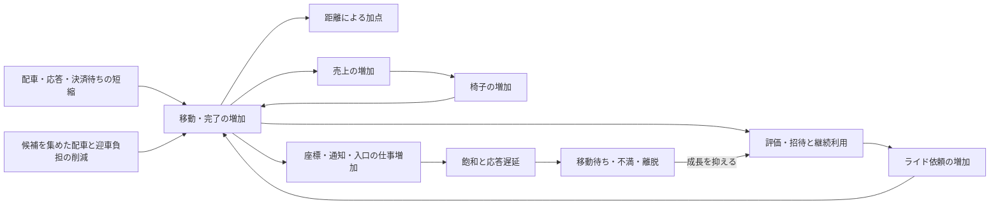

# Codex conversation

- Session: 01a1282c-717f-73b1-b2ed-00c60b39d531

<!-- codex-hook-format: 10; tool results and reasoning content omitted -->

- REASONING durations are estimates from the preceding message or tool event to reasoning completion and may include model/network waits.

---

## USER (2026-10-11 08:36:37 +0900)

$isucon-agent  docs/analysis/benchmark-score-structure.md を直近の複数のRUNやスコア結果から更新してください

## ASSISTANT

isucon-agentスキルを使い、直近の保存済みRUNとスコア結果を確認して文書を更新します。集計には既存のDuckDB基盤を使います。

## TOOL

```sh
pwd; git status --short; cat .agents/skills/isucon-agent/SKILL.md; cat docs/analysis/benchmark-score-structure.md
```

## TOOL

```sh
rg -n '(^  (q|artifacts-run)|analysis|RUN|run-list)' Taskfile.yml Taskfile.contest.yml; rg --files tools/analysis tools/contest/analysis-schema docs/analysis | head -100
```

## TOOL

```sh
sed -n '938,958p' Taskfile.yml; cat runs/scores.tsv; cat tools/analysis/sources.yaml; cat tools/contest/analysis-schema/bench-progress.sql; cat tools/contest/analysis-schema/bench-summary.sql
```

## TOOL

```sh
task q -- "SELECT * FROM bench_results ORDER BY run_id; SELECT table_name FROM information_schema.tables ORDER BY table_name"
```

## REASONING (Estimated 4s; 2026-10-11 08:36:49 +0900)

## TOOL

```sh
cat tools/analysis/schema/manifest.sql; cat tools/analysis/schema/semantic.sql; cat tools/contest/analysis-schema/ride-metrics.sql
```

## TOOL

```sh
python3 - <<'PY'
import json,pathlib
for p in sorted(pathlib.Path('runs').glob('*/run.json')):
 if p.parent.name<'20261011-070058': continue
 r=json.loads(p.read_text()); print(p.parent.name,json.dumps({k:v for k,v in r.items() if k not in ['artifacts','collectors','hosts','measurements']},ensure_ascii=False)[:3500])
PY
sed -n '230,290p' docs/analysis/benchmark-score-structure.md; rg -n 'スコアの計算|負荷テスト|60秒|座標|次の' docs/official/manual.md docs/official/ISURIDE.md
```

## REASONING (Estimated 3s; 2026-10-11 08:36:54 +0900)

## TOOL

```sh
python3 - <<'PY'
import json,pathlib
for p in sorted(pathlib.Path('runs').glob('*/run.json')):
 if p.parent.name<'20261011-070058': continue
 r=json.loads(p.read_text()); print(p.parent.name,json.dumps({k:r.get(k) for k in ['phase','source','roles','score','passed','missing','load_window']},ensure_ascii=False))
PY
rg -n 'view ride_|series|dispatch_|pickup_|evaluation_|valid|histogram' tools/contest/analysis-schema/ride-metrics.sql; rg -n 'cpu|pressure|cpus' tools/analysis/schema/proc.sql tools/analysis/schema/service.sql tools/analysis/schema/semantic.sql
```

## TOOL

```sh
task q -- "DESCRIBE ride_metric_histograms; DESCRIBE ride_metric_gauges; DESCRIBE http_traffic_series; SELECT DISTINCT source,entity,metric FROM metrics WHERE run_id='20261011-082354' AND (contains(metric,'cpu') OR contains(metric,'pressure')) ORDER BY ALL; SELECT DISTINCT series FROM ride_metric_histograms WHERE run_id>='20261011-070058' ORDER BY series"
```

## REASONING (Estimated 2s; 2026-10-11 08:37:00 +0900)

## ASSISTANT

保存済みの40 RUNを確認できました。最高のPASSスコアは572,775点、最新RUNは292,472点で、文書の基準だった510,296点から状況が変わっています。直近の変更差分と、同じ時間窓の配車・完了・CPU消費を照合し、スコア差とその原因の仮説を分けて更新します。

## TOOL

```sh
git log --all --oneline -28; cat tools/contest/analysis-schema/ride-metrics.sql; sed -n '45,125p' docs/official/ISURIDE.md; sed -n '362,375p' docs/official/manual.md
```

## TOOL

```sh
task q -- "SELECT b.run_id,b.score,b.passed, substr(m.commit,1,7) commit,m.branch,r.registered,r.active,o.chairs,o.sales,e.status_2xx evaluations,c.error_types_raw,d.matching_pct,d.pickup_pct,d.travel_pct FROM bench_results b JOIN manifests m USING(run_id) LEFT JOIN (SELECT run_id,sum(registered_users) registered,sum(active_users) active FROM bench_final_regions GROUP BY run_id) r USING(run_id) LEFT JOIN (SELECT run_id,sum(chairs) chairs,sum(sales) sales FROM bench_final_owners GROUP BY run_id) o USING(run_id) LEFT JOIN endpoints e ON e.run_id=b.run_id AND contains(e.uri,'/evaluation') LEFT JOIN bench_completion c ON c.run_id=b.run_id LEFT JOIN bench_latest_dissatisfaction d ON d.run_id=b.run_id WHERE b.run_id>='20261011-062549' ORDER BY b.run_id"
```

## REASONING (Estimated 6s; 2026-10-11 08:37:10 +0900)

## TOOL

```sh
python3 - <<'PY'
import subprocess,json,pathlib
queries={
'summary':'''SELECT b.run_id,b.score,b.passed, substr(m.commit,1,7) AS measured_commit,m.branch,r.registered,r.active,o.chairs,o.sales,e.status_2xx evaluations,c.error_types_raw,d.matching_pct,d.pickup_pct,d.travel_pct FROM bench_results b JOIN manifests m USING(run_id) LEFT JOIN (SELECT run_id,sum(registered_users) registered,sum(active_users) active FROM bench_final_regions GROUP BY run_id) r USING(run_id) LEFT JOIN (SELECT run_id,sum(chairs) chairs,sum(sales) sales FROM bench_final_owners GROUP BY run_id) o USING(run_id) LEFT JOIN endpoints e ON e.run_id=b.run_id AND contains(e.uri,'/evaluation') LEFT JOIN bench_completion c ON c.run_id=b.run_id LEFT JOIN bench_latest_dissatisfaction d ON d.run_id=b.run_id WHERE b.run_id BETWEEN '20261011-035537' AND '20261011-082354' ORDER BY b.run_id''',
'http':'''WITH a AS (SELECT run_id,min(reported_at) t0 FROM bench_log_lines WHERE contains(line,'負荷走行を開始') GROUP BY run_id) SELECT h.run_id,route,sum(status_2xx)/30.0 AS success_per_sec,sum(requests) requests,sum(response_time_sum_seconds)*1000/nullif(sum(requests),0) mean_ms,sum(sum_body_bytes)/1e6 body_mb FROM http_traffic_series h JOIN a USING(run_id) WHERE h.run_id BETWEEN '20261011-070058' AND '20261011-082354' AND ts>=t0+INTERVAL '30 seconds' AND ts<t0+INTERVAL '60 seconds' AND (route='/api/app/rides' OR contains(route,'/coordinate') OR route='/api/internal/matching' OR contains(route,'/evaluation')) GROUP BY h.run_id,route ORDER BY ALL''',
'app':'''WITH a AS (SELECT run_id,min(reported_at) t0 FROM bench_log_lines WHERE contains(line,'負荷走行を開始') GROUP BY run_id) SELECT h.run_id,h.series,sum(events) n,sum(total)/nullif(sum(events),0) mean_measure,sum(interval_ms) FILTER (WHERE events IS NOT NULL AND total IS NOT NULL)/1000.0 observed_seconds,sum(total)/nullif(sum(interval_ms) FILTER (WHERE events IS NOT NULL AND total IS NOT NULL)/1000.0,0) total_per_second,sum(le_inf-le_b3) over_b3 FROM ride_metric_histograms h JOIN a USING(run_id) WHERE h.run_id BETWEEN '20261011-070058' AND '20261011-082354' AND interval_start>=t0+INTERVAL '30 seconds' AND ts<=t0+INTERVAL '60 seconds' GROUP BY h.run_id,h.series ORDER BY ALL''',
'cpu':'''WITH a AS (SELECT run_id,min(reported_at) t0 FROM bench_log_lines WHERE contains(line,'負荷走行を開始') GROUP BY run_id), x AS (SELECT m.* FROM metrics m JOIN a USING(run_id) WHERE m.run_id BETWEEN '20261011-070058' AND '20261011-082354' AND ts>=t0+INTERVAL '30 seconds' AND ts<t0+INTERVAL '60 seconds') SELECT run_id,host,sum(value) FILTER(WHERE metric='cpu_busy_pct')/100*max(value) FILTER(WHERE metric='cpu_count') cpu_seconds,count(*) FILTER(WHERE metric='cpu_busy_pct') samples,max(value) FILTER(WHERE metric='cpu_count') cpus,quantile_cont(value,0.95) FILTER(WHERE metric='cpu_busy_pct') busy_p95,max(value) FILTER(WHERE metric='cpu_busy_pct') busy_max,avg(value) FILTER(WHERE metric='cpu_pressure_some_avg10') pressure FROM x WHERE source='proc' GROUP BY run_id,host ORDER BY ALL''',
'service':'''WITH a AS (SELECT run_id,min(reported_at) t0 FROM bench_log_lines WHERE contains(line,'負荷走行を開始') GROUP BY run_id) SELECT m.run_id,host,entity,sum(value)/100 cpu_seconds,count(*) samples FROM metrics m JOIN a USING(run_id) WHERE m.run_id BETWEEN '20261011-070058' AND '20261011-082354' AND ts>=t0+INTERVAL '30 seconds' AND ts<t0+INTERVAL '60 seconds' AND source='service' AND metric='cpu_pct' GROUP BY ALL ORDER BY ALL''',
'gauges':'''WITH a AS (SELECT run_id,min(reported_at) t0 FROM bench_log_lines WHERE contains(line,'負荷走行を開始') GROUP BY run_id) SELECT h.* FROM ride_metric_gauges h JOIN a USING(run_id) WHERE h.run_id BETWEEN '20261011-070058' AND '20261011-082354' AND ts>=t0+INTERVAL '30 seconds' AND ts<t0+INTERVAL '60 seconds' QUALIFY row_number() OVER(PARTITION BY h.run_id,h.host,h.metric ORDER BY ts DESC)=1 ORDER BY h.run_id,h.host,h.metric'''
}
for name,q in queries.items():
 path=f'/private/tmp/isucon-score-{name}.json'; p=subprocess.run(['task','--silent','q','--',f"COPY ({q}) TO '{path}' (FORMAT JSON, ARRAY true)"],capture_output=True,text=True)
 if p.returncode: print(name,p.stderr,p.stdout);continue
 rows=json.loads(pathlib.Path(path).read_text()); print(name)
 for r in rows:
  if name=='summary' and r['run_id']<'20261011-062549': continue
  if name=='app' and r['series'] not in ['dispatch_wait','dispatch_batch','eval_total_ok','eval_payment_ok','eval_sql_ok','eval_complete_ok','pickup_b9_plus']: continue
  if name=='service' and r['entity'] not in ['isuride-go.service','nginx.service','mysql.service','isuride-matcher.service']: continue
  print(r)
PY
```

## REASONING (Estimated 3s; 2026-10-11 08:37:30 +0900)

## TOOL

```sh
python3 - <<'PY'
import subprocess,json,pathlib
q="""SELECT b.run_id,b.score,b.passed,substr(m.commit,1,7) measured_commit,m.branch,r.registered,r.active,o.chairs,o.sales,e.status_2xx evaluations,c.error_types_raw,d.matching_pct,d.pickup_pct,d.travel_pct FROM bench_results b JOIN manifests m USING(run_id) LEFT JOIN (SELECT run_id,sum(registered_users) registered,sum(active_users) active FROM bench_final_regions GROUP BY run_id) r USING(run_id) LEFT JOIN (SELECT run_id,sum(chairs) chairs,sum(sales) sales FROM bench_final_owners GROUP BY run_id) o USING(run_id) LEFT JOIN endpoints e ON e.run_id=b.run_id AND contains(e.uri,'/evaluation') LEFT JOIN bench_completion c ON c.run_id=b.run_id LEFT JOIN bench_latest_dissatisfaction d ON d.run_id=b.run_id WHERE b.run_id BETWEEN '20261011-035537' AND '20261011-082354' ORDER BY b.run_id"""
p=subprocess.run(['task','--silent','q','--',f"SET threads=2; COPY ({q}) TO '/private/tmp/isucon-score-summary.json' (FORMAT JSON, ARRAY true)"],capture_output=True,text=True); print(p.stdout,p.stderr)
if p.returncode==0:
 for r in json.loads(pathlib.Path('/private/tmp/isucon-score-summary.json').read_text()):
  if r['run_id']>='20261011-062549': print(r)
PY
python3 - <<'PY'
import subprocess,json,pathlib
rs=[json.loads(p.read_text()) for p in sorted(pathlib.Path('runs').glob('*/run.json')) if p.parent.name>='20261011-070058']
prev=rs[0]
for r in rs[1:]:
 a,b=prev['source']['commit'],r['source']['commit']; print('\n',prev['run_id'],r['run_id'])
 p=subprocess.run(['git','log','--oneline',f'{a}..{b}','--','webapp/go','nginx','Taskfile.yml','Taskfile.contest.yml','tools/contest'],capture_output=True,text=True); print(p.stdout)
 p=subprocess.run(['git','diff','--stat',a,b,'--','webapp/go','nginx','Taskfile.yml','Taskfile.contest.yml','tools/contest'],capture_output=True,text=True); print(p.stdout)
 prev=r
PY
```

## REASONING (Estimated 5s; 2026-10-11 08:37:42 +0900)

## TOOL

```sh
python3 - <<'PY'
import subprocess,json,pathlib
queries={
'base':"SELECT b.*,substr(m.commit,1,7) measured_commit,m.branch FROM bench_results b JOIN manifests m USING(run_id) ORDER BY run_id",
'regions':"SELECT run_id,sum(registered_users) registered,sum(active_users) active FROM bench_final_regions GROUP BY run_id ORDER BY run_id",
'owners':"SELECT run_id,sum(chairs) chairs,sum(sales) sales FROM bench_final_owners GROUP BY run_id ORDER BY run_id",
'evaluations':"SELECT run_id,status_2xx evaluations FROM endpoints WHERE contains(uri,'/evaluation') ORDER BY run_id",
'completion':"SELECT run_id,error_types_raw FROM bench_completion ORDER BY run_id",
'dissatisfaction':"SELECT run_id,matching_pct,pickup_pct,travel_pct FROM bench_latest_dissatisfaction ORDER BY run_id"
}
for name,q in queries.items():
 path=f'/private/tmp/isucon-score-{name}.json'; p=subprocess.run(['task','--silent','q','--',f"SET threads=1; SET preserve_insertion_order=false; COPY ({q}) TO '{path}' (FORMAT JSON, ARRAY true)"],capture_output=True,text=True)
 print(name,p.returncode,p.stderr)
q="SELECT * FROM read_json_auto('/private/tmp/isucon-score-base.json') LEFT JOIN read_json_auto('/private/tmp/isucon-score-regions.json') USING(run_id) LEFT JOIN read_json_auto('/private/tmp/isucon-score-owners.json') USING(run_id) LEFT JOIN read_json_auto('/private/tmp/isucon-score-evaluations.json') USING(run_id) LEFT JOIN read_json_auto('/private/tmp/isucon-score-completion.json') USING(run_id) LEFT JOIN read_json_auto('/private/tmp/isucon-score-dissatisfaction.json') USING(run_id) ORDER BY run_id"
p=subprocess.run(['task','--silent','q','--',f"COPY ({q}) TO '/private/tmp/isucon-score-summary.json' (FORMAT JSON, ARRAY true)"],capture_output=True,text=True); print(p.returncode,p.stdout,p.stderr)
if p.returncode==0:
 for r in json.loads(pathlib.Path('/private/tmp/isucon-score-summary.json').read_text()):
  if r['run_id']>='20261011-062549': print(r)
PY
```

## TOOL

```sh
python3 - <<'PY'
import json,pathlib
for name in ['cpu','service']:
 print(name)
 for r in json.loads(pathlib.Path(f'/private/tmp/isucon-score-{name}.json').read_text()):
  if r['run_id']<'20261011-071543': continue
  if name=='service' and not r['cpu_seconds']: continue
  print(r)
PY
```

## REASONING (Estimated 5s; 2026-10-11 08:37:56 +0900)

## TOOL

```sh
task --silent q -- "SELECT run_id,sum(registered_users),sum(active_users) FROM bench_final_regions WHERE run_id='20261011-082354' GROUP BY run_id; SELECT run_id,sum(chairs),sum(sales) FROM bench_final_owners WHERE run_id='20261011-082354' GROUP BY run_id; SELECT error_types_raw FROM bench_completion WHERE run_id='20261011-082354'; SELECT matching_pct,pickup_pct,travel_pct FROM bench_latest_dissatisfaction WHERE run_id='20261011-082354'"
```

## TOOL

```sh
git diff 79017eb a85a1e5 --stat -- webapp/go nginx Taskfile.yml Taskfile.contest.yml tools/contest; git diff 0909770 cccca01 --stat -- webapp/go nginx Taskfile.yml Taskfile.contest.yml tools/contest; git show cccca01:webapp/go/runtime_scheduler.go; git diff cccca01 b5ca59d -- webapp/go/runtime_scheduler.go; git status --short
```

## REASONING (Estimated 2s; 2026-10-11 08:38:02 +0900)

## TOOL

```sh
git ls-tree -l HEAD runs/analysis.duckdb.tmp/duckdb_temp_storage_DEFAULT-0.tmp; rg 'msg=結果' runs/20261011-082354/bench.log; rg -n 'missing|phase' runs/20261011-082354/run.json | head; rg --files -g AGENTS.md docs .agents
```

## REASONING (Estimated 9s; 2026-10-11 08:38:12 +0900)

## TOOL

```sh
git show HEAD:runs/analysis.duckdb.tmp/duckdb_temp_storage_DEFAULT-0.tmp > runs/analysis.duckdb.tmp/duckdb_temp_storage_DEFAULT-0.tmp
python3 - <<'PY'
import subprocess,json,pathlib
base=json.loads(pathlib.Path('/private/tmp/isucon-score-base.json').read_text())
for r in base:
 run=r['run_id']
 if run<'20261011-062549':continue
 queries=[f"SELECT sum(registered_users) registered,sum(active_users) active FROM bench_final_regions WHERE run_id='{run}'",f"SELECT sum(chairs) chairs,sum(sales) sales FROM bench_final_owners WHERE run_id='{run}'",f"SELECT line result_line FROM bench_log_lines WHERE run_id='{run}' AND contains(line,'msg=結果')",f"SELECT matching_pct,pickup_pct,travel_pct FROM bench_latest_dissatisfaction WHERE run_id='{run}'"]
 sql="SET temp_directory='/private/tmp/isucon-score-duckdb-tmp'; "
 for i,q in enumerate(queries):sql+=f"COPY ({q}) TO '/private/tmp/isucon-score-part-{i}.json' (FORMAT JSON, ARRAY true); "
 p=subprocess.run(['task','--silent','q','--',sql],capture_output=True,text=True)
 if p.returncode: print(run,p.stderr); continue
 for i in range(4):
  data=json.loads(pathlib.Path(f'/private/tmp/isucon-score-part-{i}.json').read_text());r.update(data[0] if data else {})
 print(r)
pathlib.Path('/private/tmp/isucon-score-summary.json').write_text(json.dumps(base))
PY
```

## REASONING (Estimated 7s; 2026-10-11 08:38:25 +0900)

## ASSISTANT

配車待ちの短縮だけでは増点を説明できないことが、直近RUNで確認できました。500ms→100msのスケジューラ変更では、配車待ちが短くなる一方、平均バッチ件数と評価完了率が大きく減っています。TLS分散後はMySQLとnginxが同居する3号機の負荷も増えているため、この変化を比較に加えます。

## TOOL

```sh
python3 - <<'PY'
import json,pathlib
p=pathlib.Path('/private/tmp/isucon-score-summary.json')
if p.exists():
 for r in json.loads(p.read_text()):
  if r['run_id']>='20261011-062549':print(r)
PY
rg 'msg=結果|決済|ERROR|Error' runs/20261011-070813/bench.log | tail -12; git status --short
```

## TOOL

```sh
python3 - <<'PY'
import subprocess,json,pathlib
runs=['20261011-070058','20261011-071543','20261011-074032','20261011-074654','20261011-075546','20261011-080400','20261011-081239','20261011-081805','20261011-082354']
queries={
'http':"""WITH a AS (SELECT run_id,min(reported_at) t0 FROM bench_log_lines WHERE contains(line,'負荷走行を開始') GROUP BY run_id) SELECT h.run_id,route,sum(status_2xx)/30.0 success_per_sec,sum(requests) requests,sum(response_time_sum_seconds)*1000/nullif(sum(requests),0) mean_ms FROM http_traffic_series h JOIN a USING(run_id) WHERE h.run_id BETWEEN '20261011-070058' AND '20261011-082354' AND ts>=t0+INTERVAL '30 seconds' AND ts<t0+INTERVAL '60 seconds' AND (contains(route,'/coordinate') OR contains(route,'/evaluation') OR route='^/api/app/rides$' OR contains(route,'/internal/matching')) GROUP BY ALL ORDER BY ALL""",
'ingress':"""WITH a AS (SELECT run_id,min(reported_at) t0 FROM bench_log_lines WHERE contains(line,'負荷走行を開始') GROUP BY run_id) SELECT h.run_id,ingress_host,case when regexp_matches(route,'^\\^?/api/') then 'api' else 'static' end kind,sum(requests) requests,sum(sum_body_bytes)/1e6 body_mb FROM http_traffic_series h JOIN a USING(run_id) WHERE h.run_id BETWEEN '20261011-070058' AND '20261011-082354' AND ts>=t0+INTERVAL '30 seconds' AND ts<t0+INTERVAL '60 seconds' GROUP BY ALL ORDER BY ALL""",
'artifacts':"SELECT run_id,name,status,quality_status,quality_in_window_samples,quality_expected_samples,quality_window_coverage_pct,quality_max_gap_ms,reason FROM artifacts WHERE run_id BETWEEN '20261011-070058' AND '20261011-082354' AND (status<>'ok' OR quality_status='invalid' OR contains(name,'sql-pool')) ORDER BY ALL",
'windows':"SELECT run_id,started_at,ended_at,duration_seconds,reason FROM load_windows WHERE run_id BETWEEN '20261011-070058' AND '20261011-082354' ORDER BY run_id"
}
for name,q in queries.items():
 path=f'/private/tmp/isucon-score-{name}.json';p=subprocess.run(['task','--silent','q','--',f"SET temp_directory='/private/tmp/isucon-score-duckdb-tmp'; COPY ({q}) TO '{path}' (FORMAT JSON, ARRAY true)"],capture_output=True,text=True)
 print(name,p.returncode,p.stderr)
 if not p.returncode:
  for r in json.loads(pathlib.Path(path).read_text()):
   if name=='artifacts' or (name=='http' and r['run_id'] in runs and not 'coordinate' in r['route'] and not 'evaluation' in r['route']):print(r)
PY
```

## REASONING (Estimated 4s; 2026-10-11 08:38:39 +0900)

## TOOL

### `write_stdin`

```javascript
tools.write_stdin({session_id:load("querySession"),chars:"","max_output_tokens":4700,"yield_time_ms":1000})
```

## TOOL

```sh
rg '最終地域情報|最終オーナー情報|%のライド|新規登録しました|低評価なライド' runs/20261011-070813/bench.log | tail -12; git diff 79017eb 0909770 --stat -- webapp/go nginx Taskfile.yml Taskfile.contest.yml tools/contest; rg -n 'benchmark-score|071543|074654|082354' docs/conversation --glob '*.md' | head -15
```

## TOOL

```sh
python3 - <<'PY'
import subprocess,json,pathlib
results=[]
for p in sorted(pathlib.Path('runs').glob('*/run.json')):
 if p.parent.name<'20261011-062549':continue
 r=subprocess.run(['task','--silent','artifacts-run',f'RUN={p.parent}'],capture_output=True,text=True)
 results.append({'run_id':p.parent.name,'returncode':r.returncode,'output':r.stdout+r.stderr})
 print(p.parent.name,r.returncode,('\n'.join((r.stdout+r.stderr).splitlines()[-3:])),flush=True)
pathlib.Path('/private/tmp/isucon-score-artifact-checks.json').write_text(json.dumps(results))
PY
```

## REASONING (Estimated 9s; 2026-10-11 08:38:54 +0900)

## TOOL

```sh
python3 - <<'PY'
import subprocess,json,pathlib
q="""WITH a AS (SELECT run_id,min(reported_at) t0 FROM bench_log_lines WHERE contains(line,'負荷走行を開始') GROUP BY run_id) SELECT h.run_id,method,route,sum(status_2xx)/30.0 success_per_sec,sum(requests) requests,sum(response_time_sum_seconds)*1000/nullif(sum(requests),0) mean_ms FROM http_traffic_series h JOIN a USING(run_id) WHERE h.run_id BETWEEN '20261011-070058' AND '20261011-082354' AND ts>=t0+INTERVAL '30 seconds' AND ts<t0+INTERVAL '60 seconds' AND (method='POST' AND (contains(route,'/coordinate') OR contains(route,'/evaluation') OR route='^/api/app/rides$') OR contains(route,'/internal/matching')) GROUP BY ALL ORDER BY ALL"""
p=subprocess.run(['task','--silent','q','--',f"SET temp_directory='/private/tmp/isucon-score-duckdb-tmp'; COPY ({q}) TO '/private/tmp/isucon-score-http.json' (FORMAT JSON, ARRAY true)"],capture_output=True,text=True);print(p.returncode,p.stderr)
for r in json.loads(pathlib.Path('/private/tmp/isucon-score-http.json').read_text()):
 if r['route']=='^/api/app/rides$': print(r)
q="SELECT run_id,line_number,reported_at,line FROM bench_log_lines WHERE run_id BETWEEN '20261011-062549' AND '20261011-082354' AND regexp_matches(line,'^time=\\S+ level=INFO ') ORDER BY run_id,line_number"
p=subprocess.run(['task','--silent','q','--',f"SET temp_directory='/private/tmp/isucon-score-duckdb-tmp'; COPY ({q}) TO '/private/tmp/isucon-score-info.json' (FORMAT JSON, ARRAY true)"],capture_output=True,text=True);print('info',p.returncode,p.stderr)
PY
```

## TOOL

### `write_stdin`

```javascript
tools.write_stdin({session_id:load("artifactSession"),chars:"","yield_time_ms":1000,"max_output_tokens":2300})
```

## REASONING (Estimated 9s; 2026-10-11 08:39:14 +0900)

## TOOL

```sh
python3 - <<'PY'
import subprocess,json,pathlib
rows=[]
for run in ['20261011-070813','20261011-074654','20261011-081805','20261011-082354']:
 q=f"SELECT '{run}' run_id,line FROM (SELECT unnest(string_split(content,chr(10))) line FROM read_text('runs/{run}/bench.log')) WHERE regexp_matches(line,'^time=\\S+ level=INFO ')"
 path='/private/tmp/isucon-score-info-part.json';p=subprocess.run(['task','--silent','q','--',f"SET temp_directory='/private/tmp/isucon-score-duckdb-tmp'; COPY ({q}) TO '{path}' (FORMAT JSON, ARRAY true)"],capture_output=True,text=True)
 print(run,p.returncode,p.stderr)
 if p.returncode==0:rows+=json.loads(pathlib.Path(path).read_text())
pathlib.Path('/private/tmp/isucon-score-info.json').write_text(json.dumps(rows))
q="""WITH l AS (SELECT *,try_cast('2026-10-11T'||regexp_extract(line,'^time=([0-9:.]+)',1)||'+09:00' AS TIMESTAMPTZ) reported_at FROM read_json_auto('/private/tmp/isucon-score-info.json')), a AS (SELECT run_id,min(reported_at) FILTER(WHERE contains(line,'負荷走行を開始')) t0 FROM l GROUP BY run_id), r AS (SELECT l.run_id,reported_at,date_diff('millisecond',t0,reported_at)/1000.0 elapsed,try_cast(regexp_extract(line,'評判によって([0-9]+)人',1) AS BIGINT) reputation,try_cast(regexp_extract(line,'招待経由で([0-9]+)人',1) AS BIGINT) invitation FROM l JOIN a USING(run_id) WHERE contains(line,'新規登録しました')), d AS (SELECT run_id,reported_at,try_cast(regexp_extract(line,'低評価なライドによって([0-9]+)人',1) AS BIGINT) departed FROM l WHERE contains(line,'低評価なライド')), g AS (SELECT run_id,reported_at,try_cast(regexp_extract(line,'増加数=([0-9]+)',1) AS BIGINT) added FROM l WHERE contains(line,'椅子が増加')) SELECT r.*,d.departed,(SELECT sum(added) FROM g WHERE g.run_id=r.run_id AND g.reported_at<=r.reported_at) added_chairs FROM r LEFT JOIN d USING(run_id,reported_at) ORDER BY r.run_id,r.reported_at"""
p=subprocess.run(['task','--silent','q','--',f"COPY ({q}) TO '/private/tmp/isucon-score-progress.json' (FORMAT JSON, ARRAY true)"],capture_output=True,text=True);print(p.returncode,p.stderr)
for r in json.loads(pathlib.Path('/private/tmp/isucon-score-progress.json').read_text()):print(r)
q="SELECT run_id,sum(try_cast(regexp_extract(line,'ユーザー登録数=([0-9]+)',1) AS BIGINT)) registered,sum(try_cast(regexp_extract(line,'アクティブユーザー数=([0-9]+)',1) AS BIGINT)) active,sum(try_cast(regexp_extract(line,'売上=([0-9]+)',1) AS BIGINT)) sales,sum(try_cast(regexp_extract(line,'椅子数=([0-9]+)',1) AS BIGINT)) chairs FROM read_json_auto('/private/tmp/isucon-score-info.json') WHERE run_id='20261011-070813' GROUP BY run_id"
p=subprocess.run(['task','--silent','q','--',f"COPY ({q}) TO '/private/tmp/isucon-score-failed-summary.json' (FORMAT JSON, ARRAY true)"],capture_output=True,text=True);print(p.returncode,p.stderr);print(pathlib.Path('/private/tmp/isucon-score-failed-summary.json').read_text())
PY
```

## REASONING (Estimated 9s; 2026-10-11 08:39:33 +0900)

## TOOL

```sh
python3 - <<'PY'
import json,pathlib,subprocess
rows=[]
for p in sorted(pathlib.Path('runs').glob('*/bench.log')):
 if not '20261011-062549'<=p.parent.name<='20261011-082354':continue
 for n,line in enumerate(p.read_bytes().decode('utf-8',errors='replace').splitlines(),1):
  if ' level=INFO ' in line and line.startswith('time='):rows.append({'run_id':p.parent.name,'line_number':n,'line':line})
pathlib.Path('/private/tmp/isucon-score-info.json').write_text(json.dumps(rows))
queries={
'growth':"""WITH l AS (SELECT *,try_cast('2026-10-11T'||regexp_extract(line,'^time=([0-9:.]+)',1)||'+09:00' AS TIMESTAMPTZ) reported_at FROM read_json_auto('/private/tmp/isucon-score-info.json')), a AS (SELECT run_id,min(reported_at) FILTER(WHERE contains(line,'負荷走行を開始')) t0,max(reported_at) FILTER(WHERE contains(line,'負荷走行が終了')) t1 FROM l GROUP BY run_id) SELECT a.run_id,t0,t1,date_diff('millisecond',t0,t1)/1000.0 info_duration, min(date_diff('millisecond',t0,reported_at)/1000.0) FILTER(WHERE contains(line,'椅子が増加')) first_add_s,sum(try_cast(regexp_extract(line,'増加数=([0-9]+)',1) AS BIGINT)) added_chairs,max(try_cast(regexp_extract(line,'低評価なライドによって([0-9]+)人',1) AS BIGINT)) last_departed FROM a JOIN l USING(run_id) GROUP BY ALL ORDER BY a.run_id""",
'failed-summary':"SELECT run_id,sum(try_cast(regexp_extract(line,'ユーザー登録数=([0-9]+)',1) AS BIGINT)) registered,sum(try_cast(regexp_extract(line,'アクティブユーザー数=([0-9]+)',1) AS BIGINT)) active,sum(try_cast(regexp_extract(line,'売上=([0-9]+)',1) AS BIGINT)) sales,sum(try_cast(regexp_extract(line,'椅子数=([0-9]+)',1) AS BIGINT)) chairs FROM read_json_auto('/private/tmp/isucon-score-info.json') WHERE run_id='20261011-070813' GROUP BY run_id"
}
for name,q in queries.items():
 path=f'/private/tmp/isucon-score-{name}.json';p=subprocess.run(['task','--silent','q','--',f"COPY ({q}) TO '{path}' (FORMAT JSON, ARRAY true)"],capture_output=True,text=True);print(name,p.returncode,p.stderr)
 if p.returncode==0:
  for r in json.loads(pathlib.Path(path).read_text()):print(r)
PY
```

## TOOL

### `write_stdin`

```javascript
tools.write_stdin({session_id:load("artifactSession"),chars:"","yield_time_ms":1000,"max_output_tokens":2200})
```

## TOOL

```sh
python3 - <<'PY'
import json,pathlib
for r in json.loads(pathlib.Path('/private/tmp/isucon-score-ingress.json').read_text()):
 if r['run_id'] in ['20261011-070058','20261011-071543','20261011-074654','20261011-081805','20261011-082354']:print(r)
PY
rg -n 'matchingPlanLimit|matchingCoalesce' webapp/go/internal_handlers.go webapp/go/runtime_matching.go webapp/go/runtime_scheduler.go; git diff 0909770 3e95580 --stat -- webapp/go nginx Taskfile.yml Taskfile.contest.yml tools/contest; git diff 5c645cf b5ca59d --stat -- webapp/go nginx Taskfile.yml Taskfile.contest.yml tools/contest
```

## REASONING (Estimated 9s; 2026-10-11 08:39:51 +0900)

## TOOL

```sh
cat tools/contest/analysis-schema/bench-errors-semantic.sql; git diff b5ca59d HEAD --stat -- webapp/go nginx Taskfile.yml Taskfile.contest.yml tools/contest; git status --short; sed -n '1,90p' tools/analysis/schema/access-log.sql; head -3 runs/20261011-082354/isucon-1-sql-pool-metrics.tsv
```

## TOOL

```sh
python3 - <<'PY'
import json,pathlib
rs={r['run_id']:r for r in json.loads(pathlib.Path('/private/tmp/isucon-score-summary.json').read_text())}
e={r['run_id']:r for r in json.loads(pathlib.Path('/private/tmp/isucon-score-evaluations.json').read_text())}
for key in sorted(rs):
 if key<'20261011-062549':continue
 print(key,rs[key]['score'],e.get(key))
for name in ['windows']:
 for r in json.loads(pathlib.Path(f'/private/tmp/isucon-score-{name}.json').read_text()):print(r)
PY
```

## REASONING (Estimated 8s; 2026-10-11 08:40:02 +0900)

## TOOL

```sh
task --silent q -- "SELECT run_id,score,round(100*(score/lag(score) OVER(ORDER BY run_id)-1),1) change_pct FROM bench_results WHERE run_id BETWEEN '20261011-070058' AND '20261011-082354' ORDER BY run_id; SELECT run_id,kind,sum(requests) requests,round(sum(body_mb),2) body_mb FROM read_json_auto('/private/tmp/isucon-score-ingress.json') WHERE run_id IN ('20261011-070058','20261011-071543','20261011-074654','20261011-081805','20261011-082354') GROUP BY ALL ORDER BY ALL; SELECT e.run_id,e.evaluations*5 AS estimated_bonus,round(e.evaluations*500.0/b.score,1) AS bonus_pct FROM read_json_auto('/private/tmp/isucon-score-evaluations.json') e JOIN bench_results b USING(run_id) WHERE e.run_id IN ('20261011-074654','20261011-082354'); SELECT round(100.0*(572775.0/520066-1),1) nat_vs_relay_pct,round(100.0*(292472.0/540785-1),1) latest_change_pct"
```

## REASONING (Estimated 6s; 2026-10-11 08:40:11 +0900)

## ASSISTANT

比較の基準を整理できました。文書には最新RUN、最高スコアRUN、変更ごとの比較元を明記し、「配車待ち・座標応答の改善」と「完了・売上・椅子の成長」を併せて評価する形で反映します。成果物検査では、途中終了したFAIL RUNに負荷窓外のprofileがあり、PASS RUNでもsql-pool計測にtimeoutがあります。これらの制約も記載します。

## TOOL

```sh
cat > /private/tmp/update-isucon-score-doc.py <<'PY'
import json,pathlib,re
p=pathlib.Path('docs/analysis/benchmark-score-structure.md')
old=p.read_text()
summary=json.loads(pathlib.Path('/private/tmp/isucon-score-summary.json').read_text())
by_id={r['run_id']:r for r in summary}
evals={r['run_id']:r['evaluations'] for r in json.loads(pathlib.Path('/private/tmp/isucon-score-evaluations.json').read_text())}
failed=json.loads(pathlib.Path('/private/tmp/isucon-score-failed-summary.json').read_text())[0]
by_id[failed['run_id']].update(failed)
for line in old.splitlines():
 if not line.startswith('| [20261011-'):continue
 fields=[x.strip() for x in line.split('|')[1:-1]]
 run=re.search(r'20261011-\d+',fields[0]).group()
 if 'registered' not in by_id[run]:
  registered,active=fields[4].replace(',','').split('／')
  by_id[run].update(registered=int(registered),active=int(active),chairs=int(fields[5].replace(',','')))
rows=['| RUN | 得点 | 合否 | 評価API成功件数 | 最終登録／アクティブ人数 | 最終椅子数 |','| --- | ---: | --- | ---: | ---: | ---: |']
for run,r in sorted(by_id.items()):
 rows.append(f"| [{run}](../../runs/{run}/bench.log) | {r['score']:,} | {'PASS' if r['passed'] else 'FAIL'} | {evals[run]:,} | {r['registered']:,}／{r['active']:,} | {r['chairs']:,} |")
growth={r['run_id']:r for r in json.loads(pathlib.Path('/private/tmp/isucon-score-growth.json').read_text())}
app={(r['run_id'],r['series']):r for r in json.loads(pathlib.Path('/private/tmp/isucon-score-app.json').read_text())}
http={(r['run_id'],r['route']):r for r in json.loads(pathlib.Path('/private/tmp/isucon-score-http.json').read_text())}
gauges={(r['run_id'],r['metric']):r for r in json.loads(pathlib.Path('/private/tmp/isucon-score-gauges.json').read_text())}
cpu={(r['run_id'],r['host']):r for r in json.loads(pathlib.Path('/private/tmp/isucon-score-cpu.json').read_text())}
service={(r['run_id'],r['host'],r['entity']):r for r in json.loads(pathlib.Path('/private/tmp/isucon-score-service.json').read_text())}
selected=['070058','071543','072629','074032','074654','075546','080400','081239','081805','082354']
def full(run):return '20261011-'+run
def a(run,series):return app[(full(run),series)]
def h(run,route):return http[(full(run),route)]
dispatch=['| RUN | 依頼成功/秒（HTTP） | 割当件数／観測秒数 | 割当/秒 | バッチ数／平均件数 | 平均作成→割当 | 評価成功/秒（アプリ） |','| --- | ---: | ---: | ---: | ---: | ---: | ---: |']
for run in selected:
 b=a(run,'dispatch_batch'); w=a(run,'dispatch_wait'); e=a(run,'eval_total_ok')
 dispatch.append(f"| {run} | {h(run,'^/api/app/rides$')['success_per_sec']:.1f} | {int(w['n']):,}／{w['observed_seconds']:.3f} | {b['total_per_second']:.1f} | {int(b['n'])}／{b['mean_measure']:.1f} | {w['mean_measure']/1000:.2f}秒 | {e['n']/e['observed_seconds']:.1f} |")
snapshots=['| RUN | 窓内最後のサンプル（JST） | 未割当 | 配車可能椅子 | 最古待ち | 通知待ちによる椅子除外 |','| --- | --- | ---: | ---: | ---: | ---: |']
for run in ['074654','080400','081239','081805','082354']:
 g=lambda metric:gauges[(full(run),metric)]
 snapshots.append(f"| {run} | {g('dispatch_waiting')['ts'].split()[1].replace('+09','')} | {int(g('dispatch_waiting')['value']):,} | {int(g('dispatch_available')['value']):,} | {g('dispatch_oldest_ms')['value']/1000:.3f}秒 | {int(g('dispatch_notify_blocked')['value'])} |")
cpus=['| RUN | 1号機 CPU秒／容量 | busy p95／最大 | 2号機 CPU秒／容量 | busy p95／最大 | 3号機 CPU秒／容量 | busy p95／最大 |','| --- | ---: | ---: | ---: | ---: | ---: | ---: |']
for run in ['070058','071543','074654','075546','080400','081239','081805','082354']:
 fields=[run]
 for host in ['isucon-1','isucon-2','isucon-3']:
  c=cpu[(full(run),host)];assert c['samples']==30 and c['cpus']==2
  fields.extend([f"{c['cpu_seconds']:.2f}／60",f"{c['busy_p95']:.2f}／{c['busy_max']:.2f}%"])
 cpus.append('| '+' | '.join(fields)+' |')
services=['| サービスCPU秒 | 071543 | 074654 | 075546 | 081239 | 081805 | 082354 |','| --- | ---: | ---: | ---: | ---: | ---: | ---: |']
for label,host,entity in [('Go（1号機）','isucon-1','isuride-go.service'),('Go（3号機）','isucon-3','isuride-go.service'),('nginx（2号機）','isucon-2','nginx.service'),('nginx（3号機）','isucon-3','nginx.service'),('matcher（2号機）','isucon-2','isuride-matcher.service'),('TLS router（2号機）','isucon-2','isuride-tls-router.service'),('MySQL（3号機）','isucon-3','mysql.service')]:
 fields=[label]
 for run in ['071543','074654','075546','081239','081805','082354']:
  s=service.get((full(run),host,entity));fields.append(f"{s['cpu_seconds']:.2f}" if s else '計測なし')
 services.append('| '+' | '.join(fields)+' |')
move=['| RUN | 座標API成功/秒 | 座標API平均応答 | 依頼API平均応答 | 配車待ち不満率 | 迎車不満率 | 実移動不満率 |','| --- | ---: | ---: | ---: | ---: | ---: | ---: |']
for run in selected:
 c=h(run,'^/api/chair/coordinate$'); r=by_id[full(run)]
 move.append(f"| {run} | {c['success_per_sec']:,.1f} | {c['mean_ms']:.2f}ms | {h(run,'^/api/app/rides$')['mean_ms']:.2f}ms | {r['matching_pct']:.1f}% | {r['pickup_pct']:.1f}% | {r['travel_pct']:.1f}% |")
windows={r['run_id']:r for r in json.loads(pathlib.Path('/private/tmp/isucon-score-windows.json').read_text())}
artifacts={(r['run_id'],r['name']):r for r in json.loads(pathlib.Path('/private/tmp/isucon-score-artifacts.json').read_text())}
quality=['| RUN | INFO開始（JST）／開始〜終了 | manifest収集窓 | traffic-threshold分析窓 | 1号機sql-pool coverage／最大gap |','| --- | --- | ---: | ---: | ---: |']
for run in ['070058','070813','071543','074654','075546','080400','081239','081805','082354']:
 rid=full(run); g=growth[rid]; m=json.loads(pathlib.Path(f'runs/{rid}/run.json').read_text()); w=windows[rid]; art=artifacts[(rid,'isucon-1-sql-pool-metrics.tsv')]
 suffix='（収集末尾まで）' if 'collection end used' in w['reason'] else ''
 quality.append(f"| {run} | {g['t0'].split()[1].replace('+09','')}／{g['info_duration']:.3f}秒 | {m['load_window']['duration_ms']/1000:.3f}秒 | {w['duration_seconds']:.3f}秒{suffix} | {art['quality_window_coverage_pct']:.1f}%／{art['quality_max_gap_ms']:,}ms |")
text='''# ISURIDEベンチの得点構造分析

2026-10-11更新。対象は保存済み・分析DB収録済みの `20261011-035537`〜`20261011-082354`、40 finalized RUN。
最新は [082354](../../runs/20261011-082354/bench.log)、最高のPASSスコアは [074654](../../runs/20261011-074654/bench.log)。
他worktreeだけにあるRUNまで網羅した一覧ではない。以下、同日のRUNを時刻6桁で略記する。

## 結論

得点の中心は移動距離で、完了・売上・椅子増加による回転の成長が得点に効く。
最高は572,775点・PASS、最新は292,472点・PASS。最新は直前540,785点から45.9%減った。
最新の評価API成功は8,193→4,066件、売上は48,189,600→23,583,100円、椅子数は1,205→636台。
一方、最終アクティブ人数は2,031→2,229人に増えた。利用者数や配車待ちだけでは増減点を判断できない。

最新の比較 `081805→082354` は、同じイベント駆動スケジューラの待ちを500→100msに変えたもの。
INFO開始後30〜60秒の平均作成→割当は4.76→1.09秒へ短縮したが、
平均バッチ件数は137.3→11.5件、割当は231.9→108.8件/秒、評価成功は207.2→95.3件/秒へ減った。
最終配車待ち不満率は92.1→1.6%に下がり、迎車不満率は19.1→53.7%に上がった。
「早く少人数を割り当てる」ことで待ちが減っても、乗車・完了へ進む回転が増えるとは限らない。
迎車品質と候補の集まり方が有力な説明候補だが、実測迎車時間や採点距離の内訳は未復元である。

TLS分散後も資源制約は残る。GoのTLS中継をkernel NATに置き換えた `074654` は、
比較元 `071543` から10.1%増点。2号機のCPU消費は59.39→38.79／60 CPU秒へ減ったが、
Goの1号機は55.30／60、nginx・MySQL同居の3号機は53.67／60 CPU秒となった。
最高RUNでは入口分散をさらに増やす前に、Goの仕事と3号機の共有容量を評価する必要がある。
最新では静的リクエストも増えており、待ちの短縮・需要の変化・資源消費を一緒に追う。

最新RUNは `fri` の実験構成。更新時のmainにはイベント駆動スケジューラがなく、外部matcherと上限256の計画が残る。
最新RUNの退行を現行mainの性能と同一視しない。比較にはRUNの保存commit・配置を使う。

## 公式の得点式と直接の加点

[当日マニュアルの得点式](../official/manual.md#スコアの計算)は次のとおり。

```text
得点 = 迎車距離の合計 × 0.1
     + 乗車中の移動距離の合計
     + ライド完了数 × 5
```

同じ距離なら乗車中の移動は迎車の10倍の加点になる。
通知・検索の件数自体には加点がなく、未割当椅子の移動もこの距離加点には含まれない。
最高RUNの評価API成功8,684件を仮に採点対象完了数とすると、完了ボーナスは43,420点、約7.6%。
最新も4,066件×5＝20,330点、約7.0%にとどまる。
これはRUN全期間HTTP件数による概算で、採点対象完了数や得点内訳の確定値ではない。
距離加点が大部分を占める目安として使い、残りを迎車・乗車距離へ分解しない。

完了は直接の5点に加えて、次のライドへ進む、売上を発生させる、評価を確定する役割を持つ。
ユーザーも椅子も `COMPLETED` まで次のライドを要求・受理できない。
これらは[アプリケーションマニュアル](../official/ISURIDE.md#ライドride)の仕様である。
[最終スコア](../official/manual.md#最終スコア)は最後の負荷走行結果なので、過去最高点と区別する。

## RUN比較

得点・合否・最終人数・椅子数は `bench.log`、評価API成功件数は `alp.json` が出典。
評価APIは `POST /api/app/rides/{ride_id}/evaluation` の2xx件数。
人数は最終地域情報の2地域合計、椅子数は最終オーナー情報の5社合計。

@@RUNS@@

FAILの数値を有効な成功スコアとして扱わない。`scores.tsv` にもFAILの数値があるため、
`bench_results.passed` と原文の結果を併せて確認する。035537のTSV得点は空欄だが、原文では671点・PASS。
最新の結果行は `pass=true`、`種別エラー数="map[17:1 24:1 30:5]"`。PASSはエラーなしという意味ではない。

### 変更ごとの比較元を分ける

直前RUNは異なるworktreeの実験を含む。時刻順の得点差を、記載した変更単独の効果と解釈しない。
比較元は保存commitのGo・nginx・Taskfile・競技設定の差分で確認した。

| RUN | 測定commit／branch | 比較元 | 実装・配置の差分 | 得点差 |
| --- | --- | --- | --- | ---: |
| 061703 | `115fd36`／thu | 060837 | Go・入口nginx・MySQLの3台分離。配置以外の差分も含む | +21.0% |
| 062549 | `d7ed815`／sat | 061703 | 状態WALのMySQL投影を削除 | +3.7% |
| 064138 | `539a75d`／mon | 062549 | 飽和時に64件を最大2バッチ配車 | +54.5% |
| 064927 | `7aeda02`／tue | 064138 | 決済をライド単位の冪等POST再試行へ変更、履歴GET照合を削除 | +2.5% |
| 070058 | `4023fad`／wed | 064927 | FIFO計画上限256、solver置換・共通状態ロック外計算、追加計画の閾値変更 | +11.2% |
| 070813 | `1c61035`／mon | 070058 | Go中継でTLS終端を2・3号機へ分散 | FAIL・途中終了 |
| 071543 | `79017eb`／mon | 070058 | TLS分散と中継のFD圧力への対処を含む | +1.9% |
| 072629 | `ca61d8e`／tue | 071543 | 座標更新を共通ライド状態ロックから分離 | −9.2% |
| 074032 | `a85a1e5`／thu | 071543 | solverのCPU・作業領域確保を削減 | −5.6% |
| 074654 | `0909770`／tue | 071543 | Go TLS中継をkernel NAT分散へ置換。Goアプリ差分なし | +10.1% |
| 075546 | `0e7e871`／wed | 074654 | 座標所有を3号機へ移動、専用loopとbinary WAL batchingを導入 | −27.3% |
| 080400 | `5c645cf`／fri | 074654 | 外部matcherをイベント駆動・10msのスケジューラへ置換 | −55.6% |
| 081239 | `3e95580`／wed | 075546 | 座標所有を1号機へ戻し、専用loopとbinary WAL batchingは保持。配置・役割設定も変更 | +33.7% |
| 081805 | `cccca01`／fri | 080400 | スケジューラの待ちを10→500msへ変更 | +112.8% |
| 082354 | `b5ca59d`／fri | 081805 | 同じスケジューラの待ちを500→100msへ変更 | −45.9% |

`074032→074654` はsolver最適化の取り外しも含むため、その16.7%をNAT単独へ帰属させない。
`081239→081805` は座標loop・WALなども異なり、スケジューラだけの比較ではない。
`080400→081805→082354` のGo・nginx・Taskfile・競技設定の差分はスケジューラ定数だけ。
この3 RUNは待ち時間による挙動比較に使えるが、各設定1 RUNで需要・候補供給も変わるため、
500msが最適という結論や将来の期待倍率は確定しない。

`071543` 以降はnginxが2・3号機、MySQLが3号機。`075546` のみ座標処理用Goが3号機にもある。
スケジューラRUNでは外部matcherを停止し、Go内部で配車する。
最新の保存commitと[現在の配車処理](../../webapp/go/runtime_matching.go)を混同しない。

## 得点を増やす成長と、成長を抑える待ち

公式仕様と参加者INFOから確認できる経路は次のとおり。
評価・売上の判定閾値や増加量の内部式は未確認である。



図は得点と制約への経路を整理したもの。各変更が全経路の原因と確定したことを示すものではない。

### 供給側：椅子が増え始める時刻より、その後の完了・売上・増加量

| 指標 | 070058 | 074654 | 081239 | 081805 | 082354 |
| --- | ---: | ---: | ---: | ---: | ---: |
| 最初の椅子増加（INFO開始から） | 7.145秒 | 7.219秒 | 7.290秒 | 7.291秒 | 7.300秒 |
| 椅子増加イベントの追加台数合計 | 1,163 | 1,218 | 1,181 | 1,185 | 616 |
| 最終椅子数 | 1,183 | 1,238 | 1,201 | 1,205 | 636 |
| 最終売上合計（円） | 46,173,700 | 51,705,300 | 49,915,200 | 48,189,600 | 23,583,100 |
| 評価API成功件数（RUN全期間） | 7,830 | 8,684 | 8,477 | 8,193 | 4,066 |

直近の最初の椅子追加は約7.2〜7.3秒でほぼ同じ。最新の退行は開始時刻の遅れで説明できない。
一方、売上・評価成功・最終椅子数は大きく減っている。初期化短縮より負荷中の回転を優先する。
途中終了の `070813` は追加イベント428台に対して最終415台で一致せず、
イベントが全て登録・稼働へ進んだと仮定しない。

### 需要側：最終人数だけで成長速度を判断しない

同じRUNの登録・離脱を同じ報告時刻で結合し、椅子追加はその時刻までの累計とした。
経過時刻がRUN間で完全に一致するわけではないので、約36・47・63秒の推移として比較する。

| RUN | INFO経過 | 評判登録 | 招待登録 | 低評価離脱 | 椅子追加 |
| --- | ---: | ---: | ---: | ---: | ---: |
| 074654 | 36.046秒 | 67 | 1,420 | 12 | 405 |
| 074654 | 46.906秒 | 91 | 2,107 | 126 | 706 |
| 074654 | 63.106秒 | 144 | 2,282 | 304 | 1,183 |
| 081805 | 36.118秒 | 66 | 1,244 | 3 | 338 |
| 081805 | 46.917秒 | 89 | 1,982 | 98 | 621 |
| 081805 | 63.117秒 | 140 | 2,203 | 319 | 1,158 |
| 082354 | 36.607秒 | 68 | 872 | 3 | 250 |
| 082354 | 47.437秒 | 92 | 1,420 | 73 | 373 |
| 082354 | 63.637秒 | 126 | 2,166 | 215 | 616 |

最新は約36〜47秒の招待・椅子追加が遅れ、終盤まで招待が増える一方、椅子追加の差は埋まらない。
最終アクティブ人数が多くても、距離・完了が少ない状態がある。
離脱行がない報告時刻を0へ補わない。最後の離脱と最終登録−アクティブは別時点の値である。

## 配車量と割当品質を併せて評価する

### 比較する時間窓と母数

以下は各RUNのINFO「負荷走行を開始します」の時刻を起点に30〜60秒。
manifest収集開始や `load_windows.started_at` とは異なり、採点60秒の厳密な境界ではない。
起点と窓長は末尾の表に示す。

HTTPはバケット開始 `ts >= 窓開始 AND ts < 窓終了`、分母30秒、両nginxの値を合算する。
既存HTTP集計は5秒バケットなので、端のバケットはINFO基準の境界と最大約5秒ずれ得る。
依頼は `POST` のみ。`GET /api/app/rides` を依頼数へ足さない。
応答は窓内HTTP全件を母数にした加重平均、成功率は2xx件数/秒。

アプリは `interval_start >= 窓開始 AND ts <= 窓終了` に完全に収まる有効差分を使う。
イベント数・合計が存在する差分の実観測秒数で割り、各stageの観測秒数を横断して足さない。
HTTPと分母・端の扱いが異なるので、依頼−割当をそのまま待機増分としない。
`070813` は途中終了してこの30秒窓を満たさないため、以下の横断比較から除外する。

@@DISPATCH@@

配車待ちの短い `080400`・`082354` は、依頼・割当・評価成功も少ない。
500msの `081805` では大きな計画が戻り、540,785点へ回復した。
100msへ戻した最新では、275バッチ全てが64件以下、平均11.5件。
500msでは49バッチ中47が64件超、平均137.3件だった。
同じ「上限256」でも実際の候補集合と実行件数は大きく違う。

@@SNAPSHOTS@@

`dispatch_available` はactive・未完了ライドなし・椅子向け未送信通知なしの椅子数。
最新の待機350件・配車可能9台は、回転低下・需要低下を伴う状態である。
待機と空き椅子がともに少ないことを、供給処理が十分な証拠にしない。
高得点の `074654`・`081239`・`081805` にも待機と配車可能椅子が同時に残るサンプルがあり、
候補を集める待ちと割当の処理時間・通知・移動回転の関係が次の判断対象になる。

### 推定迎車は実測・得点内訳と区別する

| RUN | 9件以上の計画での推定迎車平均 | 観測ライド数 | 同窓の割当総数 |
| --- | ---: | ---: | ---: |
| 074654 | 8.49秒 | 6,981 | 6,981 |
| 080400 | 15.63秒 | 80 | 2,343 |
| 081239 | 9.31秒 | 6,558 | 6,566 |
| 081805 | 10.58秒 | 6,723 | 6,726 |
| 082354 | 24.28秒 | 2,439 | 3,154 |

位置・モデル速度からの推定値で、実測迎車時間ではない。
最新は9件以上の計画での推定迎車も長いが、小さなバッチの割合が変わり、全割当と同じ母数ではない。
`080400` は該当80件しかなく、9件以上の値を全体品質の代表値にしない。
旧v1の `pickup_b9_64` と現v2の `pickup_b9_plus` も対象件数が異なる。

最新の退行は「集合が小さくなり、乗車に進むまでの迎車負担が増え、供給の回転と売上の成長が鈍った」
という仮説に整合する。需要・椅子供給も変化しており、solver自体の品質劣化や距離失点量は確定しない。

### 評価待ち：決済時間だけでは回転を説明できない

同じ窓の成功評価を母数とする。各stageで件数・観測秒数が一致することを確認した。

| 平均時間／観測件数 | 074654（6,207件／28.999秒） | 081239（6,025件／29.009秒） | 081805（6,008件／29.002秒） | 082354（2,763件／29.001秒） |
| --- | ---: | ---: | ---: | ---: |
| 評価全体 | 420.43ms | 419.74ms | 418.27ms | 359.02ms |
| 同期SQL段階 | 22.43ms | 32.37ms | 18.64ms | 3.11ms |
| 決済段階 | 357.34ms | 368.03ms | 356.36ms | 349.60ms |
| 完了段階 | 25.33ms | 12.86ms | 25.68ms | 4.25ms |

最新は成功評価の待ちが短い一方、処理量は少ない。低負荷で短くなった待ちも含み得る。
段階の境界があり、厳密に足し合わせた内訳ではない。時間はCPU秒ではなく処理の経過時間。
決済を短縮した `064927` の増点は2.5%で、決済時間だけを得点の支配要因にしない。

## 資源の制約：Goと3号機の共有容量を追う

同じINFO開始後30〜60秒で各ホスト2 CPU・30サンプル、容量は60 CPU秒。
CPU秒は既存ビューと同じく1サンプルを1秒として積分した値。
ホストbusyは2 CPU全体の割合、serviceの `cpu_pct` は1 core＝100%なので割合を混ぜない。

@@CPU@@

@@SERVICE@@

サービスCPU秒はホスト消費の内訳で、ホスト値へ足さない。停止サービスの観測0と計測列なしを区別する。
`071543→074654` ではGo中継22.36 CPU秒がなくなり、2号機のbusy・pressureが下がった。
しかし両入口のnginxとGoの仕事は増え、3号機ではMySQLもCPUを使う。
NATで消えた仕事が、nginx・Go・MySQLを含む全体の余力へ同量で戻るわけではない。

最高RUNのpressure平均は1号機30.60%、2号機6.31%、3号機42.68%。
座標を3号機へ移した `075546` は、1・2号機に余力ができる一方、3号機が59.77／60 CPU秒、
pressure平均71.85%、416,282点へ低下した。配置変更は移動先の既存負荷と同じ母数で評価する。
`081239` は座標を1号機へ戻して556,671点に回復したが、専用loop・binary WAL・役割設定も含む比較である。

最新はGoのCPU消費が少なくても、入口2・3号機は51.24・56.97／60 CPU秒。
Go CPUの減少を効率改善だけで説明せず、配車・評価処理量の減少も見る。
pressureは待ちの指標なのでCPU消費へ足さない。成長前を含むRUN全体平均だけで後半容量を判断しない。

### 移動への応答と不満

椅子は座標更新の成功確認まで次の移動へ進まない。
[椅子の仕様](../official/ISURIDE.md#椅子chair)から、座標API遅延は距離加点と回転を抑える経路になる。

@@MOVE@@

最新は座標応答も短くなったのに得点が減った。座標成功件数は移動距離・乗車中距離の代用にはならない。
`080400` も座標5,423.5件/秒・平均17.34msで、得点は254,113点にとどまる。
迎車距離は乗車距離の0.1倍の加点なので、座標処理が増えても迎車中心なら得点が比例しない可能性がある。
ただし状態別座標件数・採点距離はこの集計から復元していない。
不満率は累積比率で母数不明、同窓平均待機の母数とも異なる。

### 入口の仕事：転送量だけで判断しない

両nginxの合算、同じ30秒窓。APIは正規化routeが `^/api/` または `/api/` で始まるもの、残りを静的として集計。
MBは1,000,000 bytes、本文サイズでTLS・header・接続の総転送量ではない。

| 入口HTTP集計 | 070058 | 071543 | 074654 | 081805 | 082354 |
| --- | ---: | ---: | ---: | ---: | ---: |
| APIリクエスト | 201,174 | 208,330 | 227,867 | 234,911 | 235,192 |
| API本文（MB） | 54.38 | 63.25 | 74.63 | 60.94 | 40.74 |
| 静的リクエスト | 414,482 | 438,115 | 487,913 | 487,664 | 1,295,318 |
| 静的本文（MB） | 547.10 | 847.53 | 842.30 | 899.69 | 935.71 |
| nginx CPU秒（2号機） | 52.89 | 33.67 | 31.88 | 30.92 | 48.31 |
| nginx CPU秒（3号機） | 計測なし | 24.16 | 31.03 | 31.01 | 44.52 |

最新は静的件数が約2.66倍、本文は約1.04倍。nginx CPUの増加を本文転送量だけでは説明できない。
API総件数がほぼ同じでも、依頼・評価・座標などの内訳は変わる。
TLS暗号化・接続・HTTP・proxyへのCPU帰属は、この表だけでは未確定。
保存された構成差分には事前圧縮の変更がないため、これらの増減を事前圧縮の効果としない。

## 次のRUNで追う指標

| 得点への経路 | 既存成果物で見る指標 | 判断上の注意 |
| --- | --- | --- |
| 距離と回転 | 得点、評価成功/秒、座標の同窓応答 | HTTP件数を採点距離・完了数へ置き換えない |
| 配車の量と質 | バッチ数・件数分布、割当/秒、推定迎車の母数、不満率 | 待ちの短縮と小さい候補集合の影響を併記する |
| 需要と待機 | POST依頼/秒、待機・最古待ち・配車可能椅子の同時刻ゲージ | 依頼率低下による待機短縮を能力増としない |
| 成長と継続 | 招待登録・離脱の同時刻推移、売上・椅子追加 | 最終人数・台数だけで成長速度を判断しない |
| 資源の配置 | 全3ホストの同窓CPU秒／容量、p95・最大、pressure | nginxとMySQL、座標Goの同居負荷を含める |
| 決済と再利用 | 成功評価の段階別時間、件数、完了後の椅子供給 | 待ちが短くても処理量が落ちる場合がある |
| 正当性 | PASS、原文エラー、通知順序、決済完了、通常再起動 | PASSと計測成果物の品質を別々に確認する |

現行mainを評価する基準には、同じ実装系列の `074654` を使い、最新 `082354` はスケジューラの退行例として使う。
500msの成功例と100ms・10msの退行例から、候補を集める時間を削れば常に増点するとはいえない。
入口だけを軽くする案も、GoとMySQLへ移る仕事・迎車品質・完了量まで併せて判定する。
SSEのHTTP件数・応答時間は通知件数・遅延ではなく、主に接続の長さである。

## 出典、再確認方法、未確定点

数値集計・時系列結合には `task q` の読み取り専用DuckDBを使用した。
分析DBは対象40 RUNを収録済み。同期・RUN成果物再生成・ベンチ実行・計測変更は行っていない。

- [参加者INFOの解釈](../../tools/contest/analysis-schema/bench-summary.sql)と[進捗](../../tools/contest/analysis-schema/bench-progress.sql)：人数・売上・登録・不満・椅子増加。
- [結果の解釈](../../tools/contest/analysis-schema/bench-errors-semantic.sql)：`bench_results` のscore・passed。DEBUG内部配列は解釈しない。
- [API集計](../../tools/analysis/schema/endpoints.sql)：`alp.json` のRUN全期間2xx件数。
- [HTTP・資源](../../tools/analysis/schema/semantic.sql)：`http_traffic_series`、`metrics`、`load_windows`。
- [アプリ計測](../../tools/contest/analysis-schema/ride-metrics.sql)：ready・epoch・version・単調増加などを満たす有効差分。
- 最高の [run.json](../../runs/20261011-074654/run.json)・[bench.log](../../runs/20261011-074654/bench.log)、最新の [run.json](../../runs/20261011-082354/run.json)・[bench.log](../../runs/20261011-082354/bench.log)・[alp.json](../../runs/20261011-082354/alp.json)。

基本情報は以下で再確認できる。範囲は後続RUNが増えても変えない。
INFO系の大きなビューはRUNを絞って照会する。

```shell
task q -- "SELECT run_id, score, passed FROM bench_results WHERE run_id BETWEEN '20261011-035537' AND '20261011-082354' ORDER BY run_id"
task q -- "SELECT run_id, commit, branch, app_hosts, nginx_hosts, mysql_host FROM manifests WHERE run_id BETWEEN '20261011-070058' AND '20261011-082354' ORDER BY run_id"
task q -- "SELECT sum(registered_users) registered, sum(active_users) active FROM bench_final_regions WHERE run_id='20261011-082354'"
task q -- "SELECT sum(chairs) chairs, sum(sales) sales FROM bench_final_owners WHERE run_id='20261011-082354'"
task q -- "SELECT run_id,status_2xx FROM endpoints WHERE contains(uri,'/evaluation') AND run_id BETWEEN '20261011-070058' AND '20261011-082354' ORDER BY run_id"
task q -- "SELECT line FROM bench_log_lines WHERE run_id='20261011-082354' AND (contains(line,'msg=結果') OR contains(line,'低評価なライド')) ORDER BY line_number"
task artifacts-run RUN=runs/20261011-074654
task artifacts-run RUN=runs/20261011-082354
```

配車・評価表の再現クエリ。seriesごとの件数・合計・観測秒数を出し、分母を横断して足さない。
`dispatch_batch` の `total` は割当件数、他の時間seriesではmsの合計である。

```sql
WITH a AS (
 SELECT run_id,min(reported_at) t0 FROM bench_log_lines
 WHERE run_id BETWEEN '20261011-070058' AND '20261011-082354'
   AND contains(line,'負荷走行を開始') GROUP BY run_id
)
SELECT h.run_id,h.series,sum(events) n,sum(total) total,
       sum(total)/nullif(sum(events),0) mean_measure,
       sum(interval_ms)/1000.0 observed_seconds,
       sum(le_inf-le_b3) over_last_finite_bucket
FROM ride_metric_histograms h JOIN a USING(run_id)
WHERE h.run_id <> '20261011-070813'
  AND interval_start >= t0+INTERVAL '30 seconds'
  AND ts <= t0+INTERVAL '60 seconds'
  AND events IS NOT NULL AND total IS NOT NULL
GROUP BY h.run_id,h.series ORDER BY h.run_id,h.series;
```

HTTPはmethod別・入口合算で集計する。

```sql
WITH a AS (
 SELECT run_id,min(reported_at) t0 FROM bench_log_lines
 WHERE run_id IN ('20261011-081805','20261011-082354')
   AND contains(line,'負荷走行を開始') GROUP BY run_id
)
SELECT h.run_id,h.method,h.route,sum(status_2xx)/30.0 success_per_second,
       sum(response_time_sum_seconds)*1000/nullif(sum(requests),0) mean_ms
FROM http_traffic_series h JOIN a USING(run_id)
WHERE ts >= t0+INTERVAL '30 seconds' AND ts < t0+INTERVAL '60 seconds'
  AND method='POST'
  AND route IN ('^/api/app/rides$','^/api/chair/coordinate$',
                '^/api/app/rides/[^/]+/evaluation$')
GROUP BY h.run_id,h.method,h.route ORDER BY h.run_id,h.route;
```

### 時間窓と成果物の限界

@@QUALITY@@

- `062549` 以降の16 RUNに `task artifacts-run` を実行。`070813` を除く15 RUNは必須capture検査成功。
  `070813` はallocs・heap・goroutineのsnapshotが負荷窓外で検査失敗、負荷途中の通知状態遷移エラーでFAIL。
  44.791秒のINFO窓・41秒の分析窓を、完走RUNと同じ60秒負荷として扱わない。
- 1号機sql-poolは全対象RUNで実体があるが `status=failed / quality=invalid`。
  新しい完走RUNのcoverageは97.1〜98.6%、最新はtimeout 2回、67／69サンプル。
  配車・評価表には残存する有効差分だけを使い、coverageの高さでartifact失敗を取り消さない。
  `075546` の3号機sql-poolは `ok / valid` だが、主要配車・評価表は1号機の値。
- 各manifestのトップレベル `missing` は未記録。実体・artifact status・必須capture検査結果を別々に確認した。
  capture検査成功は周期計測まで完全という意味ではない。
- 新しい結果行には引用符付き `種別エラー数="map[...]"` がある。
  既存 `bench_completion` はその形式を解析せずNULLを返すため、エラー0としない。
  score・passedは `bench_results` と原文で確認し、エラーmapは原文を引用した。
- INFO全文を複数RUNで展開する照会にはDuckDBのメモリ上限に当たるものがあったため、
  RUNを絞った既存ビューと、INFO原文だけを抽出した一時入力のDuckDB集計を使用した。
  `070813` の原文にはUTF-8として読めない箇所があり、可読なINFO行を使った。
  分析DB・schema・RUN成果物は変更していない。
- 公式負荷テストは60秒。INFO経過・manifest収集・traffic-threshold窓・alp全期間を採点区間と同一視しない。
  API件数には採点区間外や再試行が含まれ得る。評価成功を正確な完了加点へ置き換えない。
- 採点対象の迎車・乗車距離、進行中ライドの加点、端数処理は復元していない。
  座標件数・オーナー売上をそのまま距離へ換算しない。不満率の母数や成長・離脱の内部式も不明。
- solverの推定迎車、HTTP応答、CPU割合だけで共通ロック待ち・実測迎車・失点内訳を確定しない。
  個々の変更は原則1 RUNずつのため、同一構成のばらつきや期待改善率は未評価。
- アプリjournalの抑制ログから処理量や起動間隔を復元しない。配車・評価はカウンター、HTTPは保存済み集計を使った。
- ベンチマーカーのソース解析、インターネット調査、サーバー変更は行っていない。
'''
for key,val in [('RUNS',rows),('DISPATCH',dispatch),('SNAPSHOTS',snapshots),('CPU',cpus),('SERVICE',services),('MOVE',move),('QUALITY',quality)]:text=text.replace('@@'+key+'@@','\n'.join(val))
p.write_text(text)
print(f'Updated {p}: {len(text.splitlines())} lines, {len(rows)-2} RUNs')
PY
python3 /private/tmp/update-isucon-score-doc.py
 git diff --stat
```

## REASONING (Estimated 11s; 2026-10-11 08:42:30 +0900)

## TOOL

```sh
git diff --check; sed -n '1,155p' docs/analysis/benchmark-score-structure.md; sed -n '235,360p' docs/analysis/benchmark-score-structure.md; sed -n '435,490p' docs/analysis/benchmark-score-structure.md
```

## TOOL

```sh
task --silent q -- "SELECT run_id, commit, branch, app_hosts, nginx_hosts, mysql_host FROM manifests WHERE run_id BETWEEN '20261011-070058' AND '20261011-082354' ORDER BY run_id; SELECT run_id,name,status,quality_status FROM artifacts WHERE run_id BETWEEN '20261011-062549' AND '20261011-082354' AND name='isucon-1-sql-pool-metrics.tsv' ORDER BY run_id; SELECT b.run_id,b.score,round(100.0*(b.score/c.score-1),1) change_pct FROM bench_results b JOIN bench_results c ON (b.run_id='20261011-074032' AND c.run_id='20261011-071543') OR (b.run_id='20261011-080400' AND c.run_id='20261011-074654') OR (b.run_id='20261011-081239' AND c.run_id='20261011-075546') OR (b.run_id='20261011-081805' AND c.run_id='20261011-080400') ORDER BY b.run_id"
```

## REASONING (Estimated 11s; 2026-10-11 08:42:46 +0900)

## TOOL

### `apply_patch`

```javascript
tools.apply_patch("*** Begin Patch\n*** Update File: /Users/mineo/src/github.com/EkeMinusYou/isucon14-02/docs/analysis/benchmark-score-structure.md\n@@\n-| RUN | 座標API成功/秒 | 座標API平均応答 | 依頼API平均応答 | 配車待ち不満率 | 迎車不満率 | 実移動不満率 |\n+| RUN | 座標API成功/秒 | 座標API平均応答 | 依頼API平均応答 | 最終配車待ち不満率 | 最終迎車不満率 | 最終実移動不満率 |\n@@\n-- 1号機sql-poolは全対象RUNで実体があるが `status=failed / quality=invalid`。\n+- `062549` 以降の16 RUNの1号機sql-poolは実体があるが `status=failed / quality=invalid`。\n*** End Patch")
```

## TOOL

```sh
python3 - <<'PY'
import json,pathlib,re,subprocess
p=pathlib.Path('docs/analysis/benchmark-score-structure.md'); text=p.read_text()
missing=[]
for target in re.findall(r'\]\(([^)]+)\)',text):
 path=target.split('#',1)[0]
 if path and not (p.parent/path).exists():missing.append(target)
assert not missing,missing
rows=re.findall(r'^\| \[(20261011-\d+)\].*?\| ([\d,]+) \| (PASS|FAIL) \| ([\d,]+) \|',text,re.M)
base={r['run_id']:r for r in json.loads(pathlib.Path('/private/tmp/isucon-score-base.json').read_text())}
evaluations={r['run_id']:r['evaluations'] for r in json.loads(pathlib.Path('/private/tmp/isucon-score-evaluations.json').read_text())}
assert len(rows)==40
for run,score,status,n in rows:
 assert int(score.replace(',',''))==base[run]['score'],run
 assert (status=='PASS')==base[run]['passed'],run
 assert int(n.replace(',',''))==evaluations[run],run
for n,sql in enumerate(re.findall(r'```sql\n(.*?)\n```',text,re.S),1):
 r=subprocess.run(['task','--silent','q','--',"SET temp_directory='/private/tmp/isucon-score-duckdb-tmp'; "+sql],capture_output=True,text=True)
 assert r.returncode==0,(n,r.stderr)
 print(f'SQL example {n}: OK')
print('40 RUN scores, PASS/FAIL, evaluation counts, and local source links: OK')
PY
git diff --check
git status --short
```

## REASONING (Estimated 3s; 2026-10-11 08:42:55 +0900)

## ASSISTANT (Worked for 6m 20s; 2026-10-11 08:42:56 +0900)

[benchmark-score-structure.md](/Users/mineo/src/github.com/EkeMinusYou/isucon14-02/docs/analysis/benchmark-score-structure.md)を40 RUNの結果で更新しました。

- 最高572,775点・最新292,472点を反映
- 配車待ち短縮と回転低下、TLS分散後のCPU制約を比較
- 最新実験とmainの違い、欠損・計測品質、再現SQLを明記

数値・リンク・SQL・差分を確認済みです。ベンチ実行やデプロイは行っていません。

## USER (2026-10-11 08:43:11 +0900)

直近の計測で計測内容が増えていると思います。それを参考にできるところがあれば、さらに資料を更新してください

## ASSISTANT

isucon-agentスキルに沿って、直近RUNに追加された計測と保存済み成果物を確認します。座標更新・ライド段階・配車機会など、得点構造の説明に使える値があれば、時間窓と母数をそろえて資料に追記します。

## TOOL

```sh
git status --short; git log -10 --oneline; cat .agents/skills/isucon-agent/SKILL.md; rg --files webapp/go tools/contest/analysis-schema | rg 'metric|coordinate|matching'; tail -18 runs/scores.tsv
```

## TOOL

```sh
cat tools/contest/analysis-schema/ride-metrics.sql; sed -n '1,60p' docs/analysis/benchmark-score-structure.md; sed -n '355,510p' docs/analysis/benchmark-score-structure.md; task --silent q -- "SELECT run_id,score,passed FROM bench_results WHERE run_id>='20261011-081239' ORDER BY run_id"
```

## REASONING (Estimated 2s; 2026-10-11 08:43:18 +0900)

## TOOL

```sh
cat webapp/go/coordinate_metrics.go; cat webapp/go/planning_metrics.go; cat webapp/go/flow_metrics.go
```

## TOOL

```sh
cat webapp/go/ride_metrics.go; rg -n 'coordMetric|coordinateMetrics|flow|planning|record|snapshot' webapp/go/chair_handlers.go webapp/go/runtime_matching.go webapp/go/runtime_state.go webapp/go/runtime_wal.go tools/measurement/app/server.go; python3 - <<'PY'
import json,pathlib
p=pathlib.Path('runs/20261011-083640/run.json'); r=json.loads(p.read_text()); print(json.dumps({k:r.get(k) for k in ['phase','source','roles','score','passed','missing','load_window']},ensure_ascii=False,indent=2));print('artifact problems')
for a in r['artifacts']:
 if a.get('status')!='ok' or 'sql-pool' in a['name']:print(a)
PY
rg '負荷走行|最終地域|最終オーナー|%のライド|msg=結果' runs/20261011-083640/bench.log | tail -14
```

## REASONING (Estimated 5s; 2026-10-11 08:43:26 +0900)

## TOOL

```sh
sed -n '65,108p' webapp/go/runtime_wal.go; sed -n '180,220p' webapp/go/runtime_wal.go; sed -n '463,522p' webapp/go/runtime_state.go; cat webapp/go/runtime_matching.go; cat webapp/go/internal_handlers.go; git diff 0909770 63d012f --stat -- webapp/go nginx Taskfile.yml Taskfile.contest.yml tools/contest; git log --oneline 0909770..63d012f -- webapp/go tools/contest/analysis-schema; git show 63d012f:webapp/go/ride_metrics.go | rg 'version|snapshot|20'; task --silent artifacts-run RUN=runs/20261011-083640
```

## TOOL

```sh
task --silent q -- "SELECT run_id,version,count(*) n,count(*) FILTER(WHERE valid) valid_samples,min(observed_at) first_observed,max(observed_at) last_observed FROM ride_metric_samples WHERE run_id>='20261011-082354' GROUP BY run_id,version ORDER BY ALL; SELECT run_id,score,passed,commit,branch FROM manifests WHERE run_id='20261011-083640'; SELECT metric,count(*) n FROM metrics WHERE run_id='20261011-083640' AND (starts_with(metric,'snapshot_') OR metric='ride_metrics_version') GROUP BY metric ORDER BY metric"
```

## REASONING (Estimated 3s; 2026-10-11 08:43:34 +0900)

## TOOL

```sh
cat tools/contest/queries/ride-metrics.sql; rg -n 'ride-metric|query|q-' Taskfile.contest.yml; rg -n 'observeReusable|observeFlowStatus|startFlow|observeOpportunity' webapp/go/runtime_state.go webapp/go/runtime_indexes.go webapp/go/dispatch_metrics.go; git diff 63d012f ffd158a --stat -- webapp/go tools/contest/analysis-schema tools/contest/queries
```

## TOOL

### `write_stdin`

```javascript
tools.write_stdin({session_id:68256,chars:"","yield_time_ms":1000,"max_output_tokens":1000})
```

## TOOL

```sh
task --silent q -- "SET temp_directory='/private/tmp/isucon-score-v3-duckdb-tmp'; SELECT min(reported_at) t0 FROM bench_log_lines WHERE run_id='20261011-083640' AND contains(line,'負荷走行を開始'); SELECT * FROM load_windows WHERE run_id='20261011-083640'; SELECT sum(registered_users) registered,sum(active_users) active FROM bench_final_regions WHERE run_id='20261011-083640'; SELECT sum(chairs) chairs,sum(sales) sales FROM bench_final_owners WHERE run_id='20261011-083640'; SELECT status_2xx evaluations FROM endpoints WHERE run_id='20261011-083640' AND contains(uri,'/evaluation'); SELECT * EXCLUDE(raw_line) FROM bench_latest_dissatisfaction WHERE run_id='20261011-083640'"
```

## REASONING (Estimated 4s; 2026-10-11 08:43:42 +0900)

## TOOL

```sh
python3 - <<'PY'
import subprocess,json,pathlib
base="""WITH a AS (SELECT min(reported_at) t0 FROM bench_log_lines WHERE run_id='20261011-083640' AND contains(line,'負荷走行を開始')) """
queries={
'hist':base+"""SELECT series,stage,cohort,observation_unit,count(*) intervals,count(*) FILTER(WHERE events IS NULL OR total IS NULL OR le_inf IS NULL) missing_intervals,sum(interval_ms) FILTER(WHERE events IS NOT NULL AND total IS NOT NULL AND le_inf IS NOT NULL)/1000.0 observed_seconds,sum(events) n,sum(total) total,sum(total)/nullif(sum(events),0) mean_measure,sum(le_b0) le_b0,sum(le_b1) le_b1,sum(le_b2) le_b2,sum(le_b3) le_b3,sum(le_inf) le_inf FROM ride_metric_histograms,a WHERE run_id='20261011-083640' AND interval_start>=t0+INTERVAL '30 seconds' AND ts<=t0+INTERVAL '60 seconds' GROUP BY ALL ORDER BY series""",
'counters':base+"""SELECT metric,unit,count(*) intervals,count(delta) valid_intervals,count(*) FILTER(WHERE delta IS NULL) missing_intervals,sum(interval_ms) FILTER(WHERE delta IS NOT NULL)/1000.0 observed_seconds,sum(delta) total,sum(delta)/nullif(sum(interval_ms) FILTER(WHERE delta IS NOT NULL)/1000.0,0) per_second FROM ride_metric_intervals,a WHERE run_id='20261011-083640' AND kind='counter' AND suffix IS NULL AND interval_start>=t0+INTERVAL '30 seconds' AND ts<=t0+INTERVAL '60 seconds' GROUP BY ALL ORDER BY metric""",
'snapshots':base+"""SELECT snapshot_status,ready,valid,count(*) n,min(observed_at) first_at,max(observed_at) last_at,avg(acquire_ms) acquire_mean,max(acquire_ms) acquire_max,avg(export_ms) export_mean,max(export_ms) export_max,max(capture_age_ms) capture_age_max FROM ride_metric_samples,a WHERE run_id='20261011-083640' AND observed_at>=t0+INTERVAL '30 seconds' AND observed_at<=t0+INTERVAL '60 seconds' GROUP BY ALL ORDER BY snapshot_status""",
'cpu':base+"""SELECT host,sum(value) FILTER(WHERE metric='cpu_busy_pct')/100*max(value) FILTER(WHERE metric='cpu_count') cpu_seconds,count(*) FILTER(WHERE metric='cpu_busy_pct') samples,quantile_cont(value,0.95) FILTER(WHERE metric='cpu_busy_pct') p95,max(value) FILTER(WHERE metric='cpu_busy_pct') maximum,avg(value) FILTER(WHERE metric='cpu_pressure_some_avg10') pressure FROM metrics,a WHERE run_id='20261011-083640' AND source='proc' AND ts>=t0+INTERVAL '30 seconds' AND ts<t0+INTERVAL '60 seconds' GROUP BY host ORDER BY host""",
'service':base+"""SELECT host,entity,sum(value)/100 cpu_seconds,count(*) samples FROM metrics,a WHERE run_id='20261011-083640' AND source='service' AND metric='cpu_pct' AND ts>=t0+INTERVAL '30 seconds' AND ts<t0+INTERVAL '60 seconds' GROUP BY ALL ORDER BY ALL""",
'http':base+"""SELECT ingress_host,method,route,sum(status_2xx) n,sum(requests) requests,sum(status_5xx) failures,sum(response_time_sum_seconds)*1000/nullif(sum(requests),0) mean_ms FROM http_traffic_series,a WHERE run_id='20261011-083640' AND ts>=t0+INTERVAL '30 seconds' AND ts<t0+INTERVAL '60 seconds' AND (contains(route,'coordinate') OR contains(route,'evaluation') OR contains(route,'matching') OR route='^/api/app/rides$') GROUP BY ALL ORDER BY ALL""",
'gauges':base+"""SELECT metric,unit,count(value) samples,count(*) FILTER(WHERE value IS NULL) missing_samples,avg(value) mean_value,max(value) maximum,arg_max(value,ts) last_value,max(ts) last_at FROM ride_metric_gauges,a WHERE run_id='20261011-083640' AND ts>=t0+INTERVAL '30 seconds' AND ts<t0+INTERVAL '60 seconds' GROUP BY ALL ORDER BY metric"""
}
for name,q in queries.items():
 path=f'/private/tmp/isucon-score-v3-{name}.json';r=subprocess.run(['task','--silent','q','--',f"SET temp_directory='/private/tmp/isucon-score-v3-duckdb-tmp'; COPY ({q}) TO '{path}' (FORMAT JSON, ARRAY true)"],capture_output=True,text=True)
 print(name,r.returncode,r.stderr,flush=True)
 if r.returncode==0:
  for d in json.loads(pathlib.Path(path).read_text()):
   if name=='hist' and (d['n']==0 or d['series'].startswith('eval_')):continue
   if name=='service' and d['cpu_seconds']==0:continue
   print(d)
PY
```

## REASONING (Estimated 11s; 2026-10-11 08:44:06 +0900)

## REASONING (Estimated 1s; 2026-10-11 08:44:07 +0900)

## ASSISTANT

新しい `083640` RUNには、座標更新のロック待ち、ライド段階別の滞在時間・受理距離、配車可能になってから計画開始までの待ちが保存されています。座標更新では処理本体よりロック待ちが長く、配車可能な需要と椅子がある間にも計画開始待ちが見えます。一方、椅子の滞在時間には初期状態から復元された椅子も含まれるため、その値を通常の再利用待ちと混ぜずに解釈します。

## TOOL

```sh
python3 - <<'PY'
import csv
p='runs/20261011-083640/isucon-1-sql-pool-metrics.tsv'
with open(p) as f:
 rows=csv.DictReader(f,delimiter='\t')
 for r in rows:
  if r['sample']!='0':break
  if r['metric'].startswith('flow_') and ('chairs' in r['metric'] or 'partial' in r['metric']):print(r['metric'],r['value'])
PY
sed -n '270,325p' webapp/go/runtime_state.go; sed -n '80,135p' webapp/go/runtime_indexes.go; cat etc/systemd/system/isuride-matcher.service; rg -n 'sleep|Sleep|matching' tools/contest --glob '*matcher*'
```

## TOOL

```sh
task --silent q -- "SET temp_directory='/private/tmp/isucon-score-v3-duckdb-tmp'; SELECT count(*) n,count(*) FILTER(WHERE NOT valid) invalid,min(observed_at) first_at,max(observed_at) last_at,max(acquire_ms) max_acquire_ms FROM ride_metric_samples WHERE run_id='20261011-083640'; SELECT metric,sum(value) n FROM metrics WHERE run_id='20261011-083640' AND metric='ride_state_available' GROUP BY metric; SELECT metric,min(value),max(value) FROM ride_metric_gauges WHERE run_id='20261011-083640' AND metric IN ('flow_ongoing_restored','flow_reuse_chairs') GROUP BY metric; SELECT series,n,total,mean_measure FROM read_json_auto('/private/tmp/isucon-score-v3-hist.json') WHERE starts_with(series,'eval_') AND n>0; SELECT round(100.0*(527163.0/572775-1),1) versus_baseline_pct,round(100.0*(527163.0/292472-1),1) chronological_change_pct"
```

## REASONING (Estimated 10s; 2026-10-11 08:44:25 +0900)

## TOOL

```sh
rg -n 'ISUCON_MATCHING_INTERVAL' Taskfile.yml Taskfile.contest.yml tools/contest etc webapp/go; task --silent q -- "SELECT metric,value,ts FROM ride_metric_gauges WHERE run_id='20261011-083640' AND metric IN ('flow_ongoing_restored','flow_reuse_chairs','flow_assigned_chairs','flow_enroute_chairs','flow_arrived_chairs','flow_pickup_chairs','flow_carrying_chairs') QUALIFY ts=min(ts) OVER(); SELECT ts,metric,value FROM metrics WHERE run_id='20261011-083640' AND metric='flow_restored_chairs' ORDER BY ts LIMIT 3; SELECT observed_at,snapshot_status,ready FROM ride_metric_samples WHERE run_id='20261011-083640' AND NOT valid ORDER BY observed_at"
```

## TOOL

```sh
task --silent q -- "WITH h AS (SELECT * FROM read_json_auto('/private/tmp/isucon-score-v3-hist.json')), c AS (SELECT * FROM read_json_auto('/private/tmp/isucon-score-v3-counters.json')) SELECT series,n,total,round(mean_measure,5) mean_measure,round(100*(n-le_b2)/n,2) over_b2_pct,round(100*(n-le_b3)/n,2) over_b3_pct FROM h WHERE series IN ('coord_wait_ok','coord_hold_ok'); SELECT metric,total/1000 chair_seconds,observed_seconds,total/(observed_seconds*1000) mean_chairs FROM read_json_auto('/private/tmp/isucon-score-v3-counters.json') WHERE starts_with(metric,'flow_') AND ends_with(metric,'_total_ms') ORDER BY metric; SELECT (total-387*observed_seconds*1000)/1000 known_reuse_chair_seconds,(total-387*observed_seconds*1000)/(observed_seconds*1000) known_reuse_mean_chairs FROM read_json_auto('/private/tmp/isucon-score-v3-counters.json') WHERE metric='flow_reuse_total_ms'; SELECT sum(n) coordinate_samples,sum(total) distance_total,100*sum(total) FILTER(WHERE series='flow_dist_carrying')/(sum(total) FILTER(WHERE series='flow_dist_carrying')+0.1*sum(total) FILTER(WHERE series='flow_dist_enroute')) weighted_carrying_pct FROM read_json_auto('/private/tmp/isucon-score-v3-hist.json') WHERE starts_with(series,'flow_dist_'); SELECT method,route,sum(n) n,sum(requests) requests,sum(n)/30.0 success_per_sec,sum(mean_ms*requests)/sum(requests) mean_ms FROM read_json_auto('/private/tmp/isucon-score-v3-http.json') GROUP BY method,route ORDER BY ALL"
```

## REASONING (Estimated 4s; 2026-10-11 08:44:36 +0900)

## TOOL

```sh
task --silent q -- "SELECT metric,value,ts FROM ride_metric_gauges WHERE run_id='20261011-083640' AND metric IN ('flow_ongoing_restored','flow_reuse_chairs','flow_assigned_chairs','flow_enroute_chairs','flow_arrived_chairs','flow_pickup_chairs','flow_carrying_chairs') AND value IS NOT NULL QUALIFY ts=min(ts) OVER(); SELECT sum(delta) restored_stage_closures FROM ride_metric_intervals WHERE run_id='20261011-083640' AND starts_with(metric,'flow_') AND ends_with(metric,'_partial'); SELECT series,sum(events) n,sum(total) total FROM ride_metric_histograms WHERE run_id='20261011-083640' AND series LIKE 'flow_dist_%' AND events IS NOT NULL GROUP BY series"
```

## TOOL

```sh
rg 'ISUCON_MATCHING_INTERVAL|matching_interval' runs/20261011-083640/run.json runs/20261011-083640/meta* tools/contest/config-check.yaml tools/contest/deployments.yaml; git status --short; sed -n '200,235p' docs/analysis/benchmark-score-structure.md
```

## REASONING (Estimated 14s; 2026-10-11 08:44:54 +0900)

## REASONING (Estimated 9s; 2026-10-11 08:45:03 +0900)

## REASONING (Estimated 10s; 2026-10-11 08:45:13 +0900)

## TOOL

```sh
task --silent q -- "WITH a AS (SELECT min(reported_at) t0 FROM bench_log_lines WHERE run_id='20261011-083640' AND contains(line,'負荷走行を開始')) SELECT sum(added_chairs) added_chairs,min(date_diff('millisecond',t0,reported_at)/1000.0) first_add_s FROM bench_chair_growth,a WHERE run_id='20261011-083640'; SELECT round(7903*500.0/527163,1) bonus_pct; SELECT series,count(*) n,count(*) FILTER(WHERE events IS NULL OR total IS NULL OR le_b0 IS NULL OR le_b1 IS NULL OR le_b2 IS NULL OR le_b3 IS NULL OR le_inf IS NULL) incomplete FROM ride_metric_histograms WHERE run_id='20261011-083640' AND interval_start>=TIMESTAMPTZ '2026-10-11 08:37:14.851+09' AND ts<=TIMESTAMPTZ '2026-10-11 08:37:44.851+09' GROUP BY series ORDER BY series LIMIT 4; SELECT (SELECT count(DISTINCT epoch) FROM ride_metric_samples WHERE run_id='20261011-083640' AND valid) epochs; SELECT max(value) departures FROM metrics WHERE false"
```

## REASONING (Estimated 3s; 2026-10-11 08:45:20 +0900)

## ASSISTANT

追加計測から資料に使える根拠が得られました。`083640` の有効観測25.004秒では、座標更新のサンプル平均はロック待ち19.38ms、ロック保持0.024msです。また、受理距離を公式の重みで計算すると乗車中の寄与が約90%になります。これは採点内訳ではなく、得点を伸ばす方向を確認する観測値として追記します。

## TOOL

```sh
cat > /private/tmp/extend-isucon-score-v3.py <<'PY'
import pathlib
p=pathlib.Path('docs/analysis/benchmark-score-structure.md');s=p.read_text()
s=s.replace('20261011-035537`〜`20261011-082354`、40 finalized RUN','20261011-035537`〜`20261011-083640`、41 finalized RUN')
s=s.replace('最新は [082354](../../runs/20261011-082354/bench.log)','最新は [083640](../../runs/20261011-083640/bench.log)')
start=s.index('得点の中心は');end=s.index('\n## 公式の得点式',start)
s=s[:start]+'''得点の中心は移動距離で、完了・売上・椅子増加による回転の成長が得点に効く。
最高は572,775点・PASS、最新の追加計測RUN `083640` は527,163点・PASS。
外部matcherを使う構成へ戻り、座標・ライド段階・配車機会のv3計測を追加したRUNである。
同系列の `074654` より8.0%低いが、計測追加にも処理・ロック取得があるため、
この1 RUNの差を計測費用や実装の退行の確定値にしない。

追加計測により、座標の処理本体と待ちを分けて見られるようになった。
INFO開始後30〜60秒のうち有効25.004秒、成功座標の1/64サンプル2,146件では、
共通状態ロック待ちが平均19.38ms、保持が0.024ms、WAL Writeが0.0077ms。
この観測では座標の小さなWriteだけを削るより、共通状態ロックの待ちを減らす根拠が強い。
ただし待ちを発生させた処理やCPU消費への帰属は、この段階計測だけでは確定しない。

同じ有効差分では、未割当と配車可能椅子が共存する時間が24.995／25.004秒、
未処理の配車機会から計画開始まで平均614ms、solverが平均91.81ms。
割当可能な組があるのに外部matcherの次の呼出しを待つ経路が見える。
一方、過去の `081805→082354` は待ちを500→100msへ削って45.9%減点した。
早く小さく割り当てるだけでは回転が増えないので、配車機会待ち・計画件数・迎車品質を同時に評価する。

ライド段階別の受理距離は迎車302,242、乗車中282,400座標単位。
公式の距離重みを当てた観測値では乗車中が90.3%を占め、距離の加点経路を裏付ける。
採点区間・採点者の距離とは一致を確認していないため、スコア内訳への換算は行わない。
ARRIVED滞在は2,644.63椅子秒、平均105.77台で、決済・完了を含む待ちも供給回転の判断に使える。
初期状態から復元された387台の滞在は別に扱い、通常の再利用待ちを過大評価しない。

TLS分散後も資源制約は残る。最新の同30秒窓で1号機は52.52／60 CPU秒、
2号機は38.51／60、nginx・MySQL同居の3号機は49.71／60 CPU秒。
配車機会の待ちを削ると仕事の集中も変わるため、Goと3号機の共有容量を併せて追う。

''' + s[end:]
s=s.replace('最新も4,066件×5＝20,330点、約7.0%にとどまる。','最新も7,903件×5＝39,515点、約7.5%にとどまる。')
s=s.replace('最新の結果行は `pass=true`、`種別エラー数="map[17:1 24:1 30:5]"`。','最新の結果行は `pass=true`、`種別エラー数=map[24:2]`。')
needle='| [20261011-082354](../../runs/20261011-082354/bench.log) | 292,472 | PASS | 4,066 | 2,445／2,229 | 636 |'
s=s.replace(needle,needle+'\n| [20261011-083640](../../runs/20261011-083640/bench.log) | 527,163 | PASS | 7,903 | 2,460／2,141 | 1,207 |')
needle='| 082354 | `b5ca59d`／fri | 081805 | 同じスケジューラの待ちを500→100msへ変更 | −45.9% |'
s=s.replace(needle,needle+'\n| 083640 | `63d012f`／tue | 074654 | 外部matcher・上限256の構成に座標・flow・配車機会のv3計測を追加 | −8.0% |')
s=s.replace('最新の保存commitと[現在の配車処理](../../webapp/go/runtime_matching.go)を混同しない。','`082354` はfriのスケジューラ実験、最新 `083640` はtueの外部matcher構成。\n更新時のmainも[外部matcherの配車処理](../../webapp/go/runtime_matching.go)とv3計測を使う。')
s=s.replace('100msへ戻した最新では','100msへ戻した `082354` では')
s=s.replace('最新の待機350件','`082354` の待機350件')
s=s.replace('最新は9件以上の計画で','`082354` は9件以上の計画で')
s=s.replace('最新の退行は','`082354` の退行は')
s=s.replace('最新は成功評価の待ちが短い','`082354` は成功評価の待ちが短い')
s=s.replace('最新はGoのCPU消費が少なくても','`082354` はGoのCPU消費が少なくても')
s=s.replace('最新は座標応答も短くなった','`082354` は座標応答も短くなった')
s=s.replace('最新は静的件数が約2.66倍','`082354` は `081805` より静的件数が約2.66倍')
needle='| 082354 | 112.1 | 3,154／29.001 | 108.8 | 275／11.5 | 1.09秒 | 95.3 |'
s=s.replace(needle,needle+'\n| 083640 | 247.8 | 5,360／25.004 | 214.4 | 35／153.1 | 5.13秒 | 194.3 |')
needle='| 082354 | 08:24:57.2 | 350 | 9 | 2.413秒 | 0 |'
s=s.replace(needle,needle+'\n| 083640 | 08:37:44.330995 | 1,265 | 213 | 5.302秒 | 12 |')
needle='| 082354 | 24.28秒 | 2,439 | 3,154 |'
s=s.replace(needle,needle+'\n| 083640 | 11.18秒 | 5,360 | 5,360 |')
needle='| 082354 | 44.28／60 | 83.73／86.73% | 51.24／60 | 99.50／99.50% | 56.97／60 | 100.00／100.00% |'
s=s.replace(needle,needle+'\n| 083640 | 52.52／60 | 99.28／99.50% | 38.51／60 | 73.25／76.14% | 49.71／60 | 93.57／96.46% |')
needle='| 082354 | 4,419.5 | 22.55ms | 55.18ms | 1.6% | 53.7% | 34.7% |'
s=s.replace(needle,needle+'\n| 083640 | 5,534.2 | 33.29ms | 54.45ms | 86.2% | 18.5% | 35.7% |')
section='''## 追加計測で見える待ち・回転・距離（083640）

v3は [座標段階](../../webapp/go/coordinate_metrics.go)、[椅子のflow](../../webapp/go/flow_metrics.go)、
[配車機会・計画段階](../../webapp/go/planning_metrics.go)を既存collectorへ出す。
これらは `083640` で初めて保存されている。旧RUNに値がないことを0や改善量として扱わない。

### 共通窓とsnapshotの成立条件

起点は08:36:44.851 JST、比較窓は08:37:14.851〜08:37:44.851。
v3の `ts` は収集時刻ではなく `snapshot_observed_us` が表す状態の観測時刻。
ready・status・epoch・versionを満たし、全histogram列がある差分を使う。
同窓30 snapshot中28は有効、2は状態ロック取得期限を超えた `snapshot_status=3`。
無効snapshotの前後をつながないため、29差分候補のうち25差分、有効観測25.004451秒となる。
計測失敗を処理量0へ補わず、欠けた約5秒を外挿しない。

sql-pool成果物は `ok / valid`、manifest収集窓のcoverage100%だが、状態snapshotの有効性とは別。
traffic-thresholdの63秒では63 snapshot中60が有効、残る3はlifecycle競合1と状態ロック期限超過2。
成功snapshotの同30秒窓の取得は平均1.92ms・最大7.89ms、export最大8.10ms。
期限超過snapshotは取得最大27.31ms。実装の20ms期限は再試行判定の期限で、OSの実行待ちも含む実経過が20ms以下という保証ではない。

### 座標：小さい処理本体より共通状態ロックの待ち

同じ有効25.004451秒で座標成功・WAL成功・状態適用は各137,286件、5,490.5件/秒。
失敗カウンターは明示的に0。成功呼出しの固定1/64サンプルは2,146件。
以下は全て同じ成功サンプルを母数とする経過時間である。

| 段階 | 平均 | 観測時間合計 | 範囲 |
| --- | ---: | ---: | --- |
| 共通状態ロック待ち | 19.38063ms | 41,590.82463ms | 座標処理でロックを要求してから取得まで |
| 共通状態ロック保持 | 0.02440ms | 52.36915ms | 検証・WAL・公開・通知を含む。計測集計とunlockは除く |
| JSON化 | 0.00831ms | 17.82833ms | WAL recordのJSON化 |
| frame作成 | 0.00095ms | 2.04942ms | frame確保・CRC・コピー |
| WAL Write | 0.00772ms | 16.56767ms | `os.File.Write` の経過。fsyncやディスクCPU時間ではない |
| 状態適用 | 0.00169ms | 3.61899ms | `s.apply` の経過 |

待ち10ms超は1,070／2,146件（49.9%）、100ms超は60件（2.8%）。
保持は1ms超1件で、平均は待ちより大幅に短い。
JSON・frame・Write・適用は保持の内側なので保持へ加算しない。
ロック待ちの合計は並行した呼出しの待ちが重なる値で、CPU秒やホストの未使用時間とは比較できない。
サンプルを64倍して確定したCPU費用にしたり、HTTP平均33.29msから19.38msを引いて残りの内訳を決めたりしない。

このRUNは座標書込み1回の経過より、他の状態変更・計画確定・通知と共有するロック待ちを優先して調べる根拠になる。
待たせた処理の特定は未完了。snapshotにも短いロック取得・コピーがあり、計測自身の影響も未分離である。

### 配車：機会待ちとsolver、確定、空計画を分ける

同じ有効25.004451秒でmatcher呼出し35回、計画試行70回、成功35バッチ・5,360割当。
成功計画の平均はライド153.1件・椅子候補160.8台。
空試行は35回で、追加計画の最低件数256に届かない33回、供給なし2回。
ライド・椅子競合、generation不一致、WAL失敗、3試行後の断念は明示的に0だった。

| 計測 | 母数 | 平均 | 経過合計 |
| --- | ---: | ---: | ---: |
| 配車可能な未処理機会→計画開始 | 35機会 | 614.01ms | 21,490.20ms |
| planner同士の `matchingMu` 待ち | 35呼出し | 0.00013ms | 0.00447ms |
| 計画開始時の状態ロック待ち | 70試行 | 5.57ms | 389.60ms |
| snapshotロック待ち | 70試行 | 0.31ms | 21.64ms |
| snapshotコピー | 70試行 | 0.052ms | 3.66ms |
| solver（候補sortを含む） | 35非空試行 | 91.81ms | 3,213.50ms |
| 確定ロック待ち | 35確定 | 8.92ms | 312.22ms |
| 確定処理 | 35確定 | 3.00ms | 105.01ms |
| 成功計画全体 | 35試行 | 108.87ms | 3,810.43ms |
| 空計画全体 | 35試行 | 21.93ms | 767.60ms |

段階は異なる母数や包含関係を持つため、平均を足して計画全体へ合わせない。
solverの経過もCPU秒ではない。配車機会待ちは、readyになった時刻または前計画後に残った仕事から、
次の `beginPlan` 開始までであり、ライドの平均作成→割当5.13秒とは別の母数・開始点を持つ。

`match_ready_total_ms` の差分は24.995416秒／有効25.004451秒。
ここでreadyは「未割当と配車可能椅子が各1以上」で、solver稼働中も含む。
24.995秒の全てを外部ポーリング待ちと解釈せず、機会待ち614msを併せて使う。
有効28 snapshot全てでready、26でpending。窓末も待機1,265件・配車可能213台・pendingが残った。

外部matcherは [curlの完了後にsleepする構成](../../etc/systemd/system/isuride-matcher.service)。
このRUNは競合再試行やplanner同士の待ちより、次の呼出しを待つ間隔とsolverの処理量を検討する根拠になる。
待ちだけを短縮すると小さな候補集合へ変わる可能性があるため、`080400`・`082354` の退行例と併せて判断する。

### 椅子の回転：終了した段階の平均と、未完了を含む占有

closed-stageのhistogramは、その差分内で終了した段階の全経過を記録する。
開始が比較窓より前でも含み、未完了の長い段階は平均へ入らない。
`flow_*_total_ms` は未完了・復元中も含む段階占有の積分で、差分の椅子秒／実観測秒を平均占有台数とする。

| 段階 | 終了段階数 | 終了した段階の平均 | 有効窓内の椅子秒 | 平均占有台数 |
| --- | ---: | ---: | ---: | ---: |
| assigned（割当→ENROUTE） | 5,273 | 100.87ms | 544.42 | 21.77 |
| ENROUTE | 5,078 | 505.59ms | 3,017.31 | 120.67 |
| PICKUP | 5,123 | 78.62ms | 393.61 | 15.74 |
| CARRYING | 4,994 | 773.91ms | 4,009.22 | 160.34 |
| ARRIVED | 4,859 | 537.40ms | 2,644.63 | 105.77 |
| reuse（COMPLETED→配車可能） | 4,862 | 18.32ms | 9,763.95（復元分込み） | 390.49（復元分込み） |

割当から再利用可能までのclosed-cycleは4,862件、平均1,981.67ms。
段階ごとに終了ライド集合が異なるので、段階平均を足してcycle平均へ合わせない。
推定迎車11.18秒とclosed ENROUTE平均0.506秒も同じ指標ではない。未完了の迎車を除いた終了者平均から、
全ライドの迎車負担が小さいとは判断しない。
ARRIVEDは決済だけでなく評価開始・SQL・完了などへ進むまでの状態滞在で、決済段階の平均351.35msとは異なる。

reuseの占有が大きい理由には初期状態がある。最初の有効snapshotでは復元中387台が全てreuse、
他のflow段階は0。復元中台数はその後も387で、partial段階・cycleの終了差分は0。
実装は初期データ中のinactiveなCOMPLETED椅子も復元中として持つ。
この定常387台を同じ有効25.004451秒から控除すると、通常のreuseは87.22椅子秒、平均3.49台。
したがって390台が負荷中の完了通知待ちで塞がったとは解釈しない。

### 受理距離：迎車と乗車中を分けた加点経路

[距離の観測処理](../../webapp/go/flow_metrics.go)はWAL受理後の座標差分を、状態適用前のENROUTE・CARRYINGで分類する。
同じ有効25.004451秒の値は次のとおり。

| 状態 | 座標差分イベント数 | 受理距離（座標単位） | 公式の重みを当てた観測値 |
| --- | ---: | ---: | ---: |
| ENROUTE | 60,197 | 302,242 | 30,224.2 |
| CARRYING | 76,423 | 282,400 | 282,400.0 |

受理座標137,286件のうち、直前座標がない最初の更新666件は距離イベントへ入らない。
ライドなし・他段階の座標カウンターは0、距離0の22件はENROUTEイベントに含む。
これらはベンチマーカーの距離ではなく、アプリが受理したマンハッタン距離の分類である。
重み付き観測値の乗車中寄与は90.3%。迎車の距離イベントを増やすだけでは距離加点が比例しないことを具体化できる。
全スコア527,163点との差を未計測の失点としたり、端の区間を補正して得点を復元したりしない。
旧RUNに同じ分類がないため、スケジューラ実験で迎車距離が何単位増えたかはまだ比較できない。

'''
s=s.replace('## 次のRUNで追う指標',section+'## 次のRUNで追う指標')
s=s.replace('| 距離と回転 | 得点、評価成功/秒、座標の同窓応答 | HTTP件数を採点距離・完了数へ置き換えない |','| 距離と回転 | 得点、状態別受理距離、cycle件数・時間、段階占有の椅子秒 | 受理距離と採点距離、closed平均と未完了占有を区別する |')
s=s.replace('| 配車の量と質 | バッチ数・件数分布、割当/秒、推定迎車の母数、不満率 | 待ちの短縮と小さい候補集合の影響を併記する |','| 配車の量と質 | ready/pending時間、機会待ち、solver・確定時間、計画件数・割当率、迎車 | 試行・機会・ライドの母数を分け、待ち短縮と集合縮小を併せて評価する |')
s=s.replace('| 資源の配置 | 全3ホストの同窓CPU秒／容量、p95・最大、pressure | nginxとMySQL、座標Goの同居負荷を含める |','| 資源の配置 | 全3ホストの同窓CPU秒／容量、pressure、座標待ち・保持・Write | サンプル経過時間をCPU消費へ換算しない |')
s=s.replace('| 決済と再利用 | 成功評価の段階別時間、件数、完了後の椅子供給 | 待ちが短くても処理量が落ちる場合がある |','| 決済と再利用 | 評価段階、ARRIVED・reuseの椅子秒、restored/partial | 初期復元387台を通常の通知待ちへ混ぜない |')
s=s.replace('現行mainを評価する基準には、同じ実装系列の `074654` を使い、最新 `082354` はスケジューラの退行例として使う。','追加計測を使う次の比較基準は `083640`。`074654` は同じ配車系列の最高得点、`082354` はスケジューラの退行例として使う。')
s=s.replace('分析DBは対象40 RUNを収録済み。','分析DBは対象41 RUNを収録済み。')
s=s.replace('最新の [run.json](../../runs/20261011-082354/run.json)・[bench.log](../../runs/20261011-082354/bench.log)・[alp.json](../../runs/20261011-082354/alp.json)。','最新の [run.json](../../runs/20261011-083640/run.json)・[bench.log](../../runs/20261011-083640/bench.log)・[alp.json](../../runs/20261011-083640/alp.json)。')
s=s.replace("AND '20261011-082354'", "AND '20261011-083640'")
# Preserve the earlier scheduler comparison example; add a separate v3 example.
marker='### 時間窓と成果物の限界'
query='''追加計測の詳細は既存の [ride-metrics.sql](../../tools/contest/queries/ride-metrics.sql) でも再確認できる。
変数 `ride_run` と `ride_window_start/end` を指定し、`task q` で読み込む。
段階占有と配車可能時間の差分は次のクエリで再現できる。

```sql
WITH a AS (
 SELECT min(reported_at) t0 FROM bench_log_lines
 WHERE run_id='20261011-083640' AND contains(line,'負荷走行を開始')
)
SELECT i.metric,i.unit,count(i.delta) valid_intervals,
       count(*) FILTER(WHERE i.delta IS NULL) missing_intervals,
       sum(i.interval_ms) FILTER(WHERE i.delta IS NOT NULL)/1000.0 observed_seconds,
       sum(i.delta)/1000.0 accumulated_seconds,
       sum(i.delta)/nullif(sum(i.interval_ms) FILTER(WHERE i.delta IS NOT NULL),0) normalized_value
FROM ride_metric_intervals i,a
WHERE i.run_id='20261011-083640' AND i.kind='counter' AND i.suffix IS NULL
  AND i.interval_start>=t0+INTERVAL '30 seconds' AND i.ts<=t0+INTERVAL '60 seconds'
  AND ((starts_with(i.metric,'flow_') AND ends_with(i.metric,'_total_ms'))
       OR i.metric='match_ready_total_ms')
GROUP BY i.metric,i.unit ORDER BY i.metric;
```

flowの `accumulated_seconds` は椅子秒、`normalized_value` は平均占有台数。
readyはそれぞれ配車可能だった秒数と観測時間比率で、異なる単位を混ぜない。

'''
s=s.replace(marker,query+marker)
needle='| 082354 | 08:23:57.78／68.728秒 | 69.212秒 | 66.872秒（収集末尾まで） | 97.1%／1,026ms |'
s=s.replace(needle,needle+'\n| 083640 | 08:36:44.851／68.697秒 | 70.165秒 | 63.000秒 | 100.0%／1,035ms |')
s=s.replace('- `062549` 以降の16 RUNに `task artifacts-run` を実行。`070813` を除く15 RUNは必須capture検査成功。','- `062549` 以降の17 RUNに `task artifacts-run` を実行。`070813` を除く16 RUNは必須capture検査成功。')
s=s.replace('- `062549` 以降の16 RUNの1号機sql-poolは実体があるが `status=failed / quality=invalid`。','- `062549`〜`082354` の16 RUNの1号機sql-poolは実体があるが `status=failed / quality=invalid`。')
s=s.replace('新しい完走RUNのcoverageは97.1〜98.6%、最新はtimeout 2回、67／69サンプル。','従来の新しい完走RUNのcoverageは97.1〜98.6%、`082354` はtimeout 2回、67／69サンプル。')
s=s.replace('  `075546` の3号機sql-poolは `ok / valid` だが、主要配車・評価表は1号機の値。','  `075546` の3号機sql-poolは `ok / valid` だが、主要配車・評価表は1号機の値。\n  `083640` は1号機sql-poolも `ok / valid`。状態snapshot失敗と隣接差分の欠損は上記のとおり別途除外した。')
s=s.replace('  座標件数・オーナー売上をそのまま距離へ換算しない。不満率の母数や成長・離脱の内部式も不明。','  v3で状態別受理距離は観測できるが採点対象距離との一致は未検証。\n  座標件数・オーナー売上をそのまま距離へ換算しない。不満率の母数や成長・離脱の内部式も不明。')
s=s.replace('  個々の変更は原則1 RUNずつのため、同一構成のばらつきや期待改善率は未評価。','  座標・計画段階の特定範囲のロック待ちはv3で観測できるが、待たせた処理やCPU帰属までは分からない。\n  個々の変更は原則1 RUNずつのため、同一構成のばらつきや期待改善率は未評価。')
s=s.replace('task artifacts-run RUN=runs/20261011-082354','task artifacts-run RUN=runs/20261011-083640')
p.write_text(s); print('Updated:',p,len(s.splitlines()),'lines')
PY
python3 /private/tmp/extend-isucon-score-v3.py
git diff --check
```

## REASONING (Estimated 12s; 2026-10-11 08:46:56 +0900)

## TOOL

```sh
rg -n '最新|40 RUN|16 RUN|083640|未復元|状態別|復元して|観測秒|1/64' docs/analysis/benchmark-score-structure.md; sed -n '1,66p' docs/analysis/benchmark-score-structure.md; sed -n '364,532p' docs/analysis/benchmark-score-structure.md; sed -n '557,660p' docs/analysis/benchmark-score-structure.md
```

## TOOL

```sh
python3 - <<'PY'
import pathlib,re,subprocess,json
p=pathlib.Path('docs/analysis/benchmark-score-structure.md');s=p.read_text()
for target in re.findall(r'\]\(([^)]+)\)',s):
 path=target.split('#',1)[0]
 assert not path or (p.parent/path).exists(),target
assert len(re.findall(r'^\| \[20261011-\d+\]',s,re.M))==41
for n,q in enumerate(re.findall(r'```sql\n(.*?)\n```',s,re.S),1):
 r=subprocess.run(['task','--silent','q','--',"SET temp_directory='/private/tmp/isucon-score-v3-duckdb-tmp'; "+q],capture_output=True,text=True)
 assert r.returncode==0,(n,r.stderr)
 print('SQL example',n,'OK')
print('Local source links and 41 RUN table: OK')
PY
task --silent q -- "SELECT run_id,count(*) samples FROM ride_metric_samples WHERE version=3 GROUP BY run_id; SELECT min(reported_at) t0,max(reported_at) t1,date_diff('millisecond',min(reported_at),max(reported_at))/1000.0 duration FROM bench_log_lines WHERE run_id='20261011-083640' AND (contains(line,'負荷走行を開始') OR contains(line,'負荷走行が終了')); SELECT name,status,quality_status,quality_window_coverage_pct,quality_max_gap_ms FROM artifacts WHERE run_id='20261011-083640' AND contains(name,'sql-pool')"
git diff --check
git status --short
```

## REASONING (Estimated 13s; 2026-10-11 08:47:16 +0900)

## TOOL

### `apply_patch`

```javascript
tools.apply_patch("*** Begin Patch\n*** Update File: /Users/mineo/src/github.com/EkeMinusYou/isucon14-02/docs/analysis/benchmark-score-structure.md\n@@\n-配車機会の待ちを削ると仕事の集中も変わるため、Goと3号機の共有容量を併せて追う。\n-\n+配車機会の待ちを削ると仕事の集中も変わるため、Goと3号機の共有容量を併せて追う。\n@@\n-最新は約36〜47秒の招待・椅子追加が遅れ、終盤まで招待が増える一方、椅子追加の差は埋まらない。\n+`082354` は約36〜47秒の招待・椅子追加が遅れ、終盤まで招待が増える一方、椅子追加の差は埋まらない。\n@@\n-イベント数・合計が存在する差分の実観測秒数で割り、各stageの観測秒数を横断して足さない。\n+histogramの全列が存在する差分の実観測秒数で割り、各stageの観測秒数を横断して足さない。\n+v3の `083640` は状態観測時刻を使い、snapshot失敗に隣接する差分も除外する。詳細は追加計測の節に示す。\n@@\n   AND events IS NOT NULL AND total IS NOT NULL\n+  AND le_b0 IS NOT NULL AND le_b1 IS NOT NULL\n+  AND le_b2 IS NOT NULL AND le_b3 IS NOT NULL AND le_inf IS NOT NULL\n@@\n-  従来の新しい完走RUNのcoverageは97.1〜98.6%、`082354` はtimeout 2回、67／69サンプル。\n+  `071543`〜`082354` の完走RUNのcoverageは97.1〜98.6%、`082354` はtimeout 2回、67／69サンプル。\n*** End Patch")
```

## TOOL

```sh
python3 - <<'PY'
import pathlib,re,subprocess
p=pathlib.Path('docs/analysis/benchmark-score-structure.md');s=p.read_text()
q=re.findall(r'```sql\n(.*?)\n```',s,re.S)[0]
r=subprocess.run(['task','--silent','q','--',"SET temp_directory='/private/tmp/isucon-score-v3-duckdb-tmp'; "+q],capture_output=True,text=True)
assert r.returncode==0,r.stderr
print('Updated histogram query: OK')
PY
git diff --check
git diff --stat
git status --short
```

## ASSISTANT (Worked for 4m 15s; 2026-10-11 08:47:26 +0900)

[資料](/Users/mineo/src/github.com/EkeMinusYou/isucon14-02/docs/analysis/benchmark-score-structure.md)に、最新 `083640` RUNの追加計測を反映しました。

- 座標更新：平均ロック待ち19.38ms、保持0.024ms
- 配車機会：計画開始まで平均614ms
- ライド段階別の占有時間と受理距離
- 初期復元387台の扱い、snapshot欠損の除外条件

比較表・再現SQLも更新し、数値・リンク・SQLを確認済みです。

## USER (2026-10-11 08:48:01 +0900)

ここから次の改善点を検討してください

## ASSISTANT

isucon-agentスキルに沿って、追加計測で見えた待ちがどの処理・呼出し間隔から生じているかを確認し、次に試す改善を優先順位付きで提案します。最新の保存済みRUNを基準に、配車品質・回転・CPU容量への影響も併せて判断します。

## TOOL

```sh
git status --short; tail -12 runs/scores.tsv; cat .agents/skills/isucon-agent/SKILL.md; cat webapp/go/runtime_matching.go; cat webapp/go/evaluation_metrics.go
```

## TOOL

```sh
rg -n 'matching|ready_wait|state|lock|notify|evaluation' webapp/go/app_handlers.go webapp/go/runtime_notifications.go webapp/go/runtime_state.go webapp/go/runtime_wal.go tools/contest/config-check.yaml Taskfile.yml Taskfile.contest.yml; task --silent q -- "SELECT run_id,score,passed FROM bench_results WHERE run_id>='20261011-083640' ORDER BY run_id; SELECT run_id,name,status,quality_status FROM artifacts WHERE run_id>='20261011-083640' AND (contains(name,'pprof') OR contains(name,'sql-pool')) ORDER BY run_id,name"
```

## TOOL

```sh
sed -n '895,940p' Taskfile.yml; sed -n '180,270p' webapp/go/app_handlers.go; sed -n '580,660p' webapp/go/app_handlers.go; sed -n '1,250p' webapp/go/runtime_notifications.go
```

## TOOL

```sh
rg -n 'RLock|Lock\(|notifyRide|snapshotMatching|matchBatch|observeMatcherCall|beginPlan' webapp/go/runtime_matching.go webapp/go/runtime_state.go; cat runs/20261011-083640/run.json
```

## REASONING (Estimated 1s; 2026-10-11 08:49:22 +0900)

## TOOL

```sh
task go-profile-top RUN=runs/20261011-083640 PROFILE=isucon-1-go-cpu.pprof
```

## TOOL

```sh
task go-profile-top RUN=runs/20261011-083640 PROFILE=isucon-1-go-allocs.pprof
```

## TOOL

```sh
sed -n '1,210p' webapp/go/runtime_matching.go; sed -n '415,570p' webapp/go/runtime_state.go; cat runs/20261011-083640/profile-collection.log; cat .agents/skills/isucon-agent/SKILL.md
```

## REASONING (Estimated 2s; 2026-10-11 08:49:27 +0900)

## TOOL

```sh
rg -n 'Logger|Log|Use\(|log_output|access_log|buffer=|proxy_http_version|keepalive|matchingInterval|500.*Millisecond' webapp/go/main.go nginx tools/contest webapp/go/payment_gateway.go docs/analysis/benchmark-score-structure.md; sed -n '1,170p' webapp/go/payment_gateway.go; sed -n '1,180p' webapp/go/runtime_wal.go; sed -n '400,550p' webapp/go/app_handlers.go; rg --files tools/contest | rg 'matcher|match'
```

## TOOL

```sh
go tool pprof -top -nodecount=28 -focus='main.writeWALRecordMeasured|main.chairPostCoordinate|defaultLogEntry|log.\(.*Logger' runs/20261011-083640/isucon-1-go-cpu.pprof; go tool pprof -top -nodecount=24 runs/20261011-083640/isucon-1-go-allocs.pprof; git log -8 --oneline
```

## REASONING (Estimated 2s; 2026-10-11 08:49:33 +0900)

## ASSISTANT

最新RUNでは、座標更新のロック待ちは平均19.38msですが、取得後の処理は平均0.024msでした。配車の競合・再計算も0件なので、次は「排他区間の長さ」だけでなく、呼出し回数やCPU消費を減らす案を優先して考えています。配車間隔の単純な短縮は、過去RUNで迎車品質とスコアが落ちています。

## TOOL

```sh
rg --files | rg 'matcher|matching|metrics|score' | head -65; sed -n '100,138p' webapp/go/main.go; rg -n 'finishCoordinate|observeMatcherCall|beginPlan|finishEmptyPlan|refreshMatchingOpportunity|observeAcceptedDistance|observeReusable' webapp/go/*metrics*; sed -n '190,330p' webapp/go/runtime_wal.go; sed -n '1,130p' docs/analysis/benchmark-score-structure.md; sed -n '570,670p' docs/analysis/benchmark-score-structure.md
```

## TOOL

```sh
go tool pprof -top -nodecount=18 -focus='defaultLogEntry.*Write' runs/20261011-083640/isucon-1-go-cpu.pprof; go tool pprof -top -nodecount=15 -focus='main.writeWALRecordMeasured' runs/20261011-083640/isucon-1-go-cpu.pprof; rg -n 'Logger|ログ|payment|決済|スケジュール|500ms|集約|ロック' docs/analysis/benchmark-score-structure.md | tail -35; git status --short
```

## REASONING (Estimated 6s; 2026-10-11 08:49:45 +0900)

## TOOL

```sh
cat webapp/go/evaluation_metrics.go; cat webapp/go/coordinate_metrics.go; sed -n '1,190p' webapp/go/planning_metrics.go; rg --files tools/contest webapp | rg 'matcher|matching'; rg -n 'requestPaymentGateway|payment.*retry|100.*Millisecond|payment.*sleep|payments' docs/official webapp/go/*payment*test*; sed -n '480,525p' docs/analysis/benchmark-score-structure.md
```

## TOOL

```sh
task q -- "DESCRIBE ride_metric_intervals; DESCRIBE ride_histograms;" 
```

## REASONING (Estimated 2s; 2026-10-11 08:49:49 +0900)

## TOOL

```sh
task q -- "SET temp_directory='/private/tmp/isucon-score-v3-duckdb-tmp'; SELECT metric,kind,suffix,count(delta) AS valid_intervals,round(sum(interval_ms) FILTER(WHERE delta IS NOT NULL)/1000,3) AS observed_s,round(sum(delta),3) AS total FROM ride_metric_intervals WHERE run_id='20261011-083640' AND interval_start>=TIMESTAMPTZ '2026-10-11 08:37:14.851+09' AND ts<=TIMESTAMPTZ '2026-10-11 08:37:44.851+09' AND (starts_with(metric,'eval_payment') OR metric IN ('eval_total_ok','coord_calls_ok','match_assigned')) AND (suffix IS NULL OR suffix IN ('n','sum')) GROUP BY metric,kind,suffix ORDER BY metric,suffix;" 
```

## REASONING (Estimated 1s; 2026-10-11 08:49:52 +0900)

## TOOL

```sh
sed -n '1,115p' tools/contest/queries/ride-metrics.sql; sed -n '1,120p' webapp/go/payment_gateway_test.go; rg -n 'retry|再試行|決済|外部API|3秒|永続' docs/official/manual.md; rg --files -g '*matcher*' -g '!runs/**' -g '!webapp/node/**'; sed -n '1,135p' webapp/go/measurement_http.go
```

## TOOL

```sh
task q -- "SELECT metric,series,kind,suffix,stage,outcome FROM ride_metric_intervals WHERE run_id='20261011-083640' AND (series='eval_payment_ok' OR stage='eval_payment') LIMIT 12;" 
```

## REASONING (Estimated 8s; 2026-10-11 08:50:03 +0900)

## TOOL

```sh
task q -- "SET temp_directory='/private/tmp/isucon-score-v3-duckdb-tmp'; SELECT series,count(*) FILTER(WHERE events IS NOT NULL AND total IS NOT NULL) intervals,round(sum(interval_ms) FILTER(WHERE events IS NOT NULL AND total IS NOT NULL)/1000,6) observed_s,sum(events) events,round(sum(total),3) total_ms,round(sum(total)/nullif(sum(events),0),3) avg_ms FROM ride_metric_histograms WHERE run_id='20261011-083640' AND interval_start>=TIMESTAMPTZ '2026-10-11 08:37:14.851+09' AND ts<=TIMESTAMPTZ '2026-10-11 08:37:44.851+09' AND series IN ('eval_payment_ok','eval_payment_fail','eval_total_ok','eval_total_fail') GROUP BY series ORDER BY series;" 
```

## TOOL

```sh
sed -n '295,340p' docs/official/manual.md; cat etc/systemd/system/isuride-matcher.service; rg -n 'payment|決済|100ms|リトライ|Logger|ログ' docs/conversation/20261011* 2>/dev/null | head -30; rg -n '^func.*measurementSession|^func.*runtimeStateMiddleware|logger|logger.*Write|NewLogEntry' webapp/go/*.go
```

## REASONING (Estimated 7s; 2026-10-11 08:50:14 +0900)

## TOOL

```sh
cat etc/systemd/system/isuride-matcher.service; cat webapp/go/measurement.go; sed -n '86,112p' webapp/go/middlewares.go; sed -n '20,72p' nginx/nginx.conf; rg -n 'requestPaymentGateway|payment.*retry|100ms|retry delay|再試行間隔' docs/analysis docs/conversation/20261011-06*.md docs/conversation/20261011-08*.md -g '*.md' --max-count 2 | cut -c 1-280 | head -24; nl -ba webapp/go/payment_gateway.go | sed -n '64,86p'; nl -ba webapp/go/main.go | sed -n '114,122p'
```

## REASONING (Estimated 4s; 2026-10-11 08:50:20 +0900)

## ASSISTANT

新たに、改善候補を2つ具体化できました。Goの全リクエストログは、最新のCPU profileでログ出力処理だけに2.94 CPU秒を使っています。また、成功決済4,859件に再試行10,570回があり、現行の固定100ms待ちは1件あたり約217.5ms分に相当します。ログ削減を小さな変更で先に試し、決済待ちの短縮を次の候補にするのがよさそうです。

## REASONING (Estimated 0s; 2026-10-11 08:50:22 +0900)

## TOOL

```sh
rg -n '409|Idempotency|Retry-After|retry|再試行|レート|429' docs/official webapp/go/payment_gateway.go; rg -n 'Logger|DefaultLogFormatter|GetLogEntry' webapp/go -g '*.go'; nl -ba webapp/go/payment_gateway.go | sed -n '35,65p'; rg -n '^##|^###' docs/analysis/benchmark-score-structure.md; git status --short
```

## TOOL

```sh
go tool pprof -top -nodecount=12 -focus='DefaultLogFormatter.*NewLogEntry' runs/20261011-083640/isucon-1-go-cpu.pprof; task q -- "SET temp_directory='/private/tmp/isucon-score-v3-duckdb-tmp'; WITH p AS (SELECT sum(delta) retries FROM ride_metric_intervals WHERE run_id='20261011-083640' AND metric='eval_payment_ok_retries' AND interval_start>=TIMESTAMPTZ '2026-10-11 08:37:14.851+09' AND ts<=TIMESTAMPTZ '2026-10-11 08:37:44.851+09'), h AS (SELECT sum(events) n,sum(total) elapsed_ms FROM ride_metric_histograms WHERE run_id='20261011-083640' AND series='eval_payment_ok' AND interval_start>=TIMESTAMPTZ '2026-10-11 08:37:14.851+09' AND ts<=TIMESTAMPTZ '2026-10-11 08:37:44.851+09') SELECT retries,n,round(retries/n,3) retries_per_payment,round(retries*100/n,3) fixed_sleep_ms_per_payment,round(elapsed_ms/n,3) payment_ms,round(retries*100/elapsed_ms*100,2) nominal_sleep_pct FROM p,h;" 
```

## REASONING (Estimated 3s; 2026-10-11 08:50:31 +0900)

## TOOL

```sh
sed -n '170,220p' docs/official/ISURIDE.md; sed -n '1,105p' webapp/go/matching.go; sed -n '220,250p' docs/analysis/benchmark-score-structure.md; rg -n '500|MATCHING_INTERVAL' tools/contest Taskfile.yml Taskfile.contest.yml webapp/go/env.sh* etc -g '!*.py'; git status --short
```

## REASONING (Estimated 10s; 2026-10-11 08:50:42 +0900)

## TOOL

```sh
rg -n '409|429|422|204|Retry|retry|processing|完了|期限' webapp/payment_mock/openapi.yaml; git status --short
```

## TOOL

```sh
task q -- "SELECT name,status,quality_status FROM artifacts WHERE run_id='20261011-083640' AND name IN ('isucon-1-go-cpu.pprof','isucon-1-go-allocs.pprof','isucon-1-sql-pool-metrics.tsv');" 
```

## REASONING (Estimated 7s; 2026-10-11 08:50:51 +0900)

## ASSISTANT (Worked for 2m 59s; 2026-10-11 08:51:01 +0900)

**次はGoの全リクエストログ削減を単独で試す案を推します。** 最新の `083640` を基準に、次の順で検討するとよさそうです。

1. **Goのアクセスログを削減する**
   
   [main.go](/Users/mineo/src/github.com/EkeMinusYou/isucon14-02/webapp/go/main.go:119) の `middleware.Logger` が全リクエストを出力しています。最新CPU profileでは、ログ出力処理だけで **2.94 CPU秒／総57.39 CPU秒**。これはRUN全体のprofileで、30〜60秒窓の値とは別です。
   
   nginxのアクセスログとアプリのエラーログを残し、Goのアクセスログを外す小さな変更です。応答・割当・永続性を変えず、CPUとログ出力の仕事を減らせます。GoのCPU秒、座標待ち、乗車中の受理距離、得点で評価します。**5.1%のCPU消費がそのまま増点率になるとは限りません。**

2. **決済の固定100ms再試行待ちを短縮する**
   
   同じ有効25.004秒で、成功決済4,859件・再試行10,570回。現行の [再試行処理](/Users/mineo/src/github.com/EkeMinusYou/isucon14-02/webapp/go/payment_gateway.go:60) は、平均 **217.5ms／件** を固定待ちに使っています。決済段階351.4msの約62%に相当します。
   
   まず50ms間隔を候補とし、再試行を許す時間は縮めず、回数上限も合わせて調整します。同じ再試行回数なら約109ms／件の短縮余地があります。ただし、リクエスト増加で決済側のエラーが増える可能性は未確定です。冪等キー・204確認後の完了を維持し、決済時間だけでなく、失敗・再試行・ARRIVED占有・完了率で判断します。

3. **候補数を確保してから配車する**
   
   配車機会待ちは平均614msですが、間隔だけを短縮した過去RUNでは、平均バッチが137→11.5件へ縮み、得点も45.9%落ちています。
   
   次の案は「候補が128件以上なら起動、足りなければ未処理機会の発生から最大500ms待つ」という集約です。128件は検証用の仮置きです。FIFO・通知ACK条件を維持し、タイマーと供給変化の通知処理が増えます。待ち短縮と同時に、迎車品質・割当率・乗車中距離が改善するかを確認します。

座標ロックの大規模な分離は、この3案より後に置きます。最新では待ち19.38msに対して保持は0.024msと短く、待たせた処理は未特定です。過去の分離実験も−9.2%だったため、まず小さくCPU消費を減らし、その後に待ちの変化を見るのが妥当です。

## USER (2026-10-11 08:57:49 +0900)

1,2,3それぞれ有力なのはどれですか

## REASONING (Estimated 5s; 2026-10-11 08:57:54 +0900)

## ASSISTANT (Worked for 10s; 2026-10-11 08:57:59 +0900)

**増点の本命は2、最初に試すなら1、3はその後です。** 効果の余地と、成功の確かさを分けて評価しています。

| 案 | 有力度 | 判断 |
| --- | --- | --- |
| **1. Goログ削減** | 高い。効果は比較的小さい | ログ出力のCPU消費を確認済みで、変更も小さい。性能改善を得やすいが、大幅増点の根拠は弱い |
| **2. 決済待ち短縮** | **増点候補として最も有力** | 平均217.5ms／件の固定待ちを減らせれば、椅子の回転が改善する。ただし再試行増加で決済側が悪化する可能性がある |
| **3. 候補数を確保した配車** | 条件付き。優先度は低め | 待ちを減らす余地はあるが、候補集合が変わるため迎車品質への影響が大きい。128件という閾値も未検証 |

1を先に勧めたのは、**小さな変更でCPUの余裕を作り、効果を判定しやすいから**です。大きな増点を狙うなら2を重視します。3は過去の短間隔化による退行が大きいため、候補数と迎車品質を維持できるか慎重に検証する位置付けです。

## USER (2026-10-11 08:58:27 +0900)

では、1と2についてそれぞれワークツリーを作り対応して

## ASSISTANT

isucon-worktreeスキルを使い、Goログ削減と決済の再試行待ち短縮を別々のワークツリーで実装します。それぞれ必要な確認まで進め、比較できる状態にします。

## TOOL

```sh
cat .agents/skills/isucon-worktree/SKILL.md; cat .agents/skills/isucon-agent/SKILL.md
```

## TOOL

```sh
git status --short; pwd; rg --files -g AGENTS.md -g '*worktree*' -g '*herdr*' -g '*wt*' -g '!runs/**' -g '!docs/conversation/**'; command -v wt; command -v herdr
```

## REASONING (Estimated 4s; 2026-10-11 08:58:35 +0900)

## TOOL

```sh
wt list --format json; cat .worktreeinclude; rg -n 'worktree|post-create|copy-ignored' .config .git/config .worktree* 2>/dev/null; git branch --show-current; git log -3 --oneline
```

## TOOL

```sh
python3 - <<'PY'
import os,json
print(json.dumps({k:os.environ.get(k) for k in ('HERDR_ENV','HERDR_WORKSPACE_ID','HERDR_TAB_ID','HERDR_PANE_ID')},ensure_ascii=False))
PY
herdr agent --help; herdr pane --help; herdr tab --help; rg --files docs/conversation | sort | tail -5
```

## REASONING (Estimated 5s; 2026-10-11 08:58:42 +0900)

## TOOL

```sh
cat .config/wt.toml; wt switch --help; herdr tab create --help; herdr agent prompt --help; herdr agent start --help; rg -n 'Goログ|Goログ削減|決済待ち|固定100ms|次はGo|増点の本命' docs/conversation/20261011-083637_01a1282c-717f-73b1-b2ed-00c60b39d531.md | cut -c 1-260 | tail -10
```

## TOOL

```sh
herdr tab list --workspace "$HERDR_WORKSPACE_ID"; herdr agent list --workspace "$HERDR_WORKSPACE_ID"; sed -n '1,90p' webapp/go/payment_gateway.go; rg -n 'mux.Use\(middleware.Logger|TARGET_OS|TARGET_ARCH|build-go|test-go' webapp/go/main.go Taskfile.yml Taskfile.contest.yml
```

## REASONING (Estimated 6s; 2026-10-11 08:58:50 +0900)

## TOOL

```sh
herdr --skill; herdr workspace list; herdr pane current; herdr agent list
```

## TOOL

```sh
rg -n -A15 'worktree-link-raw:|worktree-save-run-raw:' Taskfile.yml Taskfile.contest.yml; cat /Users/mineo/.config/worktrunk/config.toml; sed -n '1630,1685p' docs/conversation/20261011-083637_01a1282c-717f-73b1-b2ed-00c60b39d531.md
```

## REASONING (Estimated 4s; 2026-10-11 08:58:56 +0900)

## TOOL

```sh
herdr agent read --help; herdr pane process-info --help; herdr pane list --workspace w29; python3 - <<'PY'
import os,json
print(json.dumps({k:v for k,v in os.environ.items() if k.startswith('HERDR_') and not any(s in k for s in ('TOKEN','SECRET','KEY'))},ensure_ascii=False))
PY
```

## TOOL

```sh
wt switch --create tue --base main --format json --yes
```

## REASONING (Estimated 2s; 2026-10-11 08:59:07 +0900)

## TOOL

```sh
herdr agent read w29:p37 --lines 35 --format text; herdr pane process-info --pane w29:p37
```

## TOOL

### `write_stdin`

```javascript
tools.write_stdin({session_id:35638,chars:"",yield_time_ms:1000,max_output_tokens:1400})
```

## REASONING (Estimated 3s; 2026-10-11 08:59:12 +0900)

## ASSISTANT

ログ削減は `tue`、決済待ち短縮は `wed` に分けます。両方とも最新のmainから作成し、各タブのCodexへ実装範囲と評価指標を渡します。決済側は再試行間隔を50msにし、再試行できる時間を短くしないよう回数上限も調整します。

## TOOL

```sh
wt switch --create wed --base main --format json --yes
```

## TOOL

```sh
python3 - <<'PY'
from pathlib import Path
import json
base=Path('/Users/mineo/src/github.com/EkeMinusYou/isucon14-02')
w=Path('/Users/mineo/worktrees/EkeMinusYou/isucon14-02/tue')
p=Path('runs/analysis.duckdb')
print(json.dumps({'main_db_bytes':(base/p).stat().st_size,'tue_db_exists':(w/p).exists(),'tue_db_is_symlink':(w/p).is_symlink(),'tue_db_bytes':(w/p).stat().st_size if (w/p).exists() else None,'tue_raw_target':str((w/'raw').resolve())},ensure_ascii=False))
PY
herdr tab list --workspace w29
```

## REASONING (Estimated 7s; 2026-10-11 08:59:26 +0900)

## TOOL

```sh
HERDR_WORKSPACE_ID=w29 HERDR_TAB_ID=w29:t1 HERDR_PANE_ID=w29:p37 herdr tab create --workspace w29 --cwd /Users/mineo/worktrees/EkeMinusYou/isucon14-02/tue --label tue --no-focus
```

## TOOL

### `write_stdin`

```javascript
tools.write_stdin({session_id:66288,chars:"",yield_time_ms:1000,max_output_tokens:1200})
```

## REASONING (Estimated 2s; 2026-10-11 08:59:29 +0900)

## TOOL

```sh
herdr pane process-info --pane w29:p3D; herdr pane read --pane w29:p3D --lines 8
```

## TOOL

```sh
herdr agent start isucon-tue-go-logs --kind codex --pane w29:p3D
```

## REASONING (Estimated 11s; 2026-10-11 08:59:42 +0900)

## TOOL

### `write_stdin`

```javascript
tools.write_stdin({session_id:88690,chars:"",yield_time_ms:1000,max_output_tokens:1000})
```

## TOOL

```sh
python3 - <<'PY'
from pathlib import Path
import json
root=Path('/Users/mineo/src/github.com/EkeMinusYou/isucon14-02')
rows=[]
for name in ('tue','wed'):
    w=Path('/Users/mineo/worktrees/EkeMinusYou/isucon14-02')/name
    db=w/'runs/analysis.duckdb'
    rows.append({'branch':name,'db_exists':db.is_file(),'db_is_symlink':db.is_symlink(),'db_bytes':db.stat().st_size if db.exists() else None,'same_db_inode':db.stat().st_ino==(root/'runs/analysis.duckdb').stat().st_ino if db.exists() else None})
print(json.dumps(rows))
PY
```

## TOOL

```sh
python3 - <<'PY'
import subprocess
prompt='''$isucon-agent
.agents/skills/isucon-agent/SKILL.md を読み、ユーザーが実装を指示済みの次の範囲をローカルで実装・必要な確認・コミットまで進めてください。合意済みなので実装開始の再確認は不要です。

担当: /Users/mineo/worktrees/EkeMinusYou/isucon14-02/tue (main 0118abd から作成)。改善仮説1: Goの全リクエストアクセスログ削減。
出典: docs/conversation/20261011-083637_01a1282c-717f-73b1-b2ed-00c60b39d531.md の末尾の改善案1と有力度比較、および docs/analysis/benchmark-score-structure.md。ユーザーの最新指示は「では、1と2についてそれぞれワークツリーを作り対応して」です。あなたは1だけを担当します。
根拠: RUN 20261011-083640 の有効なGo CPU profile全体(71.60秒、総57.39 CPU秒)で defaultLogEntry.Write が累積2.94 CPU秒。INFO+30..60秒の座標サンプルは待ち19.38ms/保持0.024ms。ログ削減でGo CPU・出力の仕事を減らす仮説です。CPU比率を期待増点率にはしません。
実装範囲: webapp/go/main.go の middleware.Logger による全リクエストアクセスログを外す最小変更。nginxのアクセスログ、アプリのエラーログ、Recoverer、計測、HTTP/API・SSEの応答とFlush・通知/ACK・WAL永続性を維持してください。決済待ち・配車・ロック構造は変更しません。新しい切替フラグや独自ロギング基盤は不要です。
現行mainには083640以降のアカウント/ライド作成WAL化があるので、保存RUNと現行の差を認識してください。将来の比較は同じmain起点、同じ計測構成で変更1つです。
確認: AGENTS.md と既存Taskfileに従い必要な既存チェックとTARGET_OS/TARGET_ARCH向けローカルbuild。SSE/ResponseControllerとログmiddleware依存の既存テストがあれば必要範囲だけ確認し、単純削除をなぞる新規テストは不要です。不要な資料・作業記録を新規作成しないでください。コードコメント・コミットメッセージはEnglish、応答は日本語。検証対象の差分を独立したコミットにし、変更・確認結果・commitをこのタブで報告してください。
評価指標: 正当性/PASS/原文エラー、Go CPU秒、座標待ち、CARRYING受理距離、評価完了率、得点。スコア効果は未計測です。
禁止: deploy、service操作、DB再作成、ベンチ実行、ベンチソース解析、競技インターネット調査、RUN成果物の再生成、mainへの取り込みは行わないでください。デプロイの明示指示はまだありません。通常デプロイ対象はGoアプリisucon-1です。ワークツリーのanalysis.duckdbは個別の実ファイルとしてコピー済みです。'''
subprocess.run(['herdr','agent','prompt','isucon-tue-go-logs',prompt,'--wait','--until','working','--timeout','30000'],check=True)
PY
```

## TOOL

```sh
HERDR_WORKSPACE_ID=w29 HERDR_TAB_ID=w29:t1 HERDR_PANE_ID=w29:p37 herdr tab create --workspace w29 --cwd /Users/mineo/worktrees/EkeMinusYou/isucon14-02/wed --label wed --no-focus
```

## REASONING (Estimated 3s; 2026-10-11 09:00:03 +0900)

## TOOL

```sh
herdr pane process-info --pane w29:p3E
```

## TOOL

```sh
herdr agent start isucon-wed-payment-retry --kind codex --pane w29:p3E
```

## REASONING (Estimated 3s; 2026-10-11 09:00:08 +0900)

## TOOL

### `write_stdin`

```javascript
tools.write_stdin({session_id:62769,chars:"",yield_time_ms:1000,max_output_tokens:900})
```

## TOOL

```sh
herdr agent get isucon-tue-go-logs; herdr agent read isucon-tue-go-logs --lines 12 --format text
```

## TOOL

```sh
python3 - <<'PY'
import subprocess
prompt='''$isucon-agent
.agents/skills/isucon-agent/SKILL.md を読み、ユーザーが実装を指示済みの次の範囲をローカルで実装・必要な確認・コミットまで進めてください。合意済みなので実装開始の再確認は不要です。

担当: /Users/mineo/worktrees/EkeMinusYou/isucon14-02/wed (main 0118abd から作成)。改善仮説2: 決済の固定100ms再試行待ち短縮。
出典: docs/conversation/20261011-083637_01a1282c-717f-73b1-b2ed-00c60b39d531.md の末尾の改善案2と有力度比較、および docs/analysis/benchmark-score-structure.md。ユーザーの最新指示は「では、1と2についてそれぞれワークツリーを作り対応して」です。あなたは2だけを担当します。
根拠: RUN 20261011-083640 のINFO+30..60秒に完全に収まる有効25.004451秒の同一差分・成功決済4859件、成功決済の再試行10570回、決済平均351.353ms。固定100msのsleepは平均217.534ms/件に相当。ARRIVED占有は平均105.77台で、初期復元387台を控除した通常reuseは平均3.49台。決済待ち短縮でARRIVEDから供給へ戻る回転を増やす仮説です。実際の増点や再試行数は未確定です。
実装範囲: webapp/go/payment_gateway.go の再試行間隔を100msから50msに変更し、最大再試行回数を5から10へ調整して、固定待ちの累積上限500msを維持します。現行の試行時間まで含めた期限を縮めないよう必要な範囲で判断してください。現在のユーザーcontext、固定Idempotency-Keyと同一payload、ボディの消費/Close、204だけ成功、409は処理中、400/422は恒久エラー、通信失敗や408/429/5xxの再試行という契約を維持。決済成功前にCOMPLETEDを返さず、受理後レスポンス喪失・通常再起動でも二重請求しないことを維持します。公式 docs/official/ISURIDE.md と webapp/payment_mock/openapi.yaml を参照可。ベンチのソースは解析しません。
差分は再試行待ちとその正当性チェックに限定し、Goログ、配車、ロック、SQLキャッシュ、HTTP transport等の別仮説は変更しないでください。追加計測や記録ファイルの作成は未依頼なので不要です。現行mainには083640以降のアカウント/ライド作成WAL化があるため、保存RUNと現行の差を認識してください。
確認: 既存payment_gateway_test.go等の再試行成功/打ち切り/永久エラー/固定キー・受理後レスポンス喪失/再起動の関連テストを必要範囲で更新・実行。上限変更に伴うfixtureの試行回数も整合させ、6回目以降に成功するケースを確認してください。AGENTS.md と既存Taskfileに従いTARGET_OS/TARGET_ARCH向けローカルbuild。コードコメント・コミットメッセージはEnglish、応答は日本語。検証対象差分を独立したコミットにし、変更・確認結果・commitをこのタブで報告してください。
評価指標: PASS/原文エラー、成功/失敗決済・再試行数と決済時間、ARRIVED椅子秒、評価成功/秒、cycle、CARRYING受理距離、全ホストCPU/pressure、得点。短間隔による決済側へのリクエスト増加は未確定リスクです。
禁止: deploy、service操作、DB再作成、ベンチ実行、ベンチソース解析、競技インターネット調査、RUN成果物の再生成、mainへの取り込みは行わないでください。デプロイの明示指示はまだありません。通常デプロイ対象はGoアプリisucon-1です。ワークツリーのanalysis.duckdbは個別の実ファイルとしてコピー済みです。'''
subprocess.run(['herdr','agent','prompt','isucon-wed-payment-retry',prompt,'--wait','--until','working','--timeout','30000'],check=True)
PY
```

## REASONING (Estimated 11s; 2026-10-11 09:00:35 +0900)

## TOOL

```sh
herdr agent get isucon-tue-go-logs; herdr agent get isucon-wed-payment-retry; herdr tab list --workspace w29
```

## TOOL

```sh
python3 - <<'PY'
import subprocess,json
rows=[]
for branch in ('tue','wed'):
    path='/Users/mineo/worktrees/EkeMinusYou/isucon14-02/'+branch
    rows.append({'branch':branch,'base':subprocess.check_output(['git','-C',path,'merge-base','HEAD','0118abd'],text=True).strip()})
print(json.dumps(rows))
PY
```

## ASSISTANT (Worked for 2m 12s; 2026-10-11 09:00:39 +0900)

mainから2つのワークツリーとHerdrタブを作成し、各Codexが実装を開始したことを確認しました。

| ワークツリー | 対応内容 | エージェント |
| --- | --- | --- |
| `tue` | Goの全リクエストログ削減 | `isucon-tue-go-logs` |
| `wed` | 決済の再試行間隔50ms・上限調整 | `isucon-wed-payment-retry` |

それぞれ必要な確認とコミットまで進める指示を渡しています。完了結果は各タブで報告されます。デプロイ・ベンチ実行は含めていません。

## USER (2026-10-11 09:21:24 +0900)

状況は少し変わったと思います。スコア構造のドキュメントを更新しておいてください

## ASSISTANT

直近のRUN・スコア・採用済み変更を確認し、スコア構造の資料を更新します。前回のログ削減・決済待ち短縮の結果も、保存済みの計測があれば比較に加えます。

## TOOL

```sh
git status --short; git log -12 --oneline; cat .agents/skills/isucon-agent/SKILL.md; sed -n '1,68p' docs/analysis/benchmark-score-structure.md; tail -18 runs/scores.tsv; rg --files -g AGENTS.md -g '!runs/**'; sed -n '1,165p' tools/analysis/sources.yaml
```

## TOOL

```sh
task q -- "SELECT run_id,score,passed FROM bench_results ORDER BY run_id DESC LIMIT 16; SHOW TABLES;"; wt list --format json
```

## REASONING (Estimated 3s; 2026-10-11 09:21:32 +0900)

## TOOL

```sh
sed -n '1,235p' tools/contest/queries/ride-metrics.sql; sed -n '1,160p' tools/contest/analysis-schema/bench-summary.sql; sed -n '280,385p' docs/analysis/benchmark-score-structure.md; sed -n '1,180p' /private/tmp/extend-isucon-score-v3.py
```

## TOOL

```sh
python3 - <<'PY'
import json
from pathlib import Path
for rid in ['20261011-085204','20261011-090927','20261011-091422']:
 p=Path('runs')/rid/'run.json'; r=json.loads(p.read_text()); print(rid,json.dumps({k:v for k,v in r.items() if k not in ['artifacts','artifact_contract']},ensure_ascii=False))
 print(json.dumps([a for a in r.get('artifacts',[]) if a.get('name','').endswith(('sql-pool-metrics.tsv','go-cpu.pprof','go-heap.pprof','go-allocs.pprof','go-goroutine.pprof'))],ensure_ascii=False))
PY
git show --stat 87a4850; git show --stat ff88b0e; git show --stat 3cfdc72; sed -n '1,120p' webapp/go/payment_gateway.go
```

## REASONING (Estimated 12s; 2026-10-11 09:21:48 +0900)

## TOOL

```sh
rg '負荷走行を開始|負荷走行が終了|最終地域情報|最終オーナー情報|スコア=|種別エラー' runs/20261011-085204/bench.log runs/20261011-090927/bench.log runs/20261011-091422/bench.log; git diff 63d012f bbd27e4 --stat -- webapp/go nginx Taskfile.yml Taskfile.contest.yml tools/contest; git diff bbd27e4 8f5f986 --stat -- webapp/go nginx Taskfile.yml Taskfile.contest.yml tools/contest; git diff 8f5f986 185e404 --stat -- webapp/go nginx Taskfile.yml Taskfile.contest.yml tools/contest; sed -n '110,145p' docs/analysis/benchmark-score-structure.md; sed -n '281,337p' docs/analysis/benchmark-score-structure.md
```

## TOOL

```sh
task q -- "DESCRIBE bench_latest_dissatisfaction; DESCRIBE bench_chair_growth; DESCRIBE bench_registrations; DESCRIBE metrics; DESCRIBE endpoints; DESCRIBE pprof_metadata; DESCRIBE pprof_functions; DESCRIBE pprof_samples; DESCRIBE metrics_sql_pool; SELECT count(*) finalized_runs FROM runs;" 
```

## REASONING (Estimated 2s; 2026-10-11 09:21:53 +0900)

## TOOL

```sh
python3 - <<'PY'
import subprocess,json
prefix="SET temp_directory='/private/tmp/isucon-score-v3-duckdb-tmp'; CREATE TEMP TABLE cw AS SELECT run_id,t0,t0+INTERVAL '30 seconds' a,t0+INTERVAL '60 seconds' b FROM (VALUES ('20261011-083640',TIMESTAMPTZ '2026-10-11 08:36:44.851+09'),('20261011-085204',TIMESTAMPTZ '2026-10-11 08:52:09.672+09'),('20261011-090927',TIMESTAMPTZ '2026-10-11 09:09:31.588+09'),('20261011-091422',TIMESTAMPTZ '2026-10-11 09:14:27.515+09')) AS v(run_id,t0); "
queries={
'hist':"WITH h AS (SELECT h.*,events IS NOT NULL AND total IS NOT NULL AND le_b0 IS NOT NULL AND le_b1 IS NOT NULL AND le_b2 IS NOT NULL AND le_b3 IS NOT NULL AND le_inf IS NOT NULL complete FROM ride_metric_histograms h JOIN cw USING(run_id) WHERE interval_start>=a AND ts<=b) SELECT run_id,host,epoch,series,stage,outcome,cohort,observation_unit,count(*) FILTER(WHERE complete) intervals,count(*) FILTER(WHERE NOT complete) missing,sum(interval_ms) FILTER(WHERE complete)/1000 observed_s,sum(events) FILTER(WHERE complete) events,sum(total) FILTER(WHERE complete) total,sum(total) FILTER(WHERE complete)/nullif(sum(events) FILTER(WHERE complete),0) average,sum(le_b2) FILTER(WHERE complete) le_b2,sum(le_b3) FILTER(WHERE complete) le_b3 FROM h GROUP BY ALL ORDER BY run_id,series",
'counters':"SELECT run_id,host,epoch,metric,unit,count(delta) intervals,count(*) FILTER(WHERE delta IS NULL) missing,sum(interval_ms) FILTER(WHERE delta IS NOT NULL)/1000 observed_s,sum(delta) total,sum(delta)/nullif(sum(interval_ms) FILTER(WHERE delta IS NOT NULL)/1000,0) rate FROM ride_metric_intervals JOIN cw USING(run_id) WHERE interval_start>=a AND ts<=b AND kind='counter' AND suffix IS NULL GROUP BY ALL ORDER BY run_id,metric",
'snapshots':"SELECT run_id,host,version,ready,snapshot_status,valid,count(*) n,min(observed_at) first_at,max(observed_at) last_at,avg(acquire_ms) avg_acquire_ms,max(acquire_ms) max_acquire_ms,max(export_ms) max_export_ms FROM ride_metric_samples JOIN cw USING(run_id) WHERE observed_at>=a AND observed_at<=b GROUP BY ALL ORDER BY run_id,snapshot_status",
'gauges':"SELECT run_id,host,epoch,metric,count(value) n,avg(value) average,min(value) minimum,max(value) maximum,arg_max(value,ts) last_value,max(ts) last_at FROM ride_metric_gauges JOIN cw USING(run_id) WHERE ts>=a AND ts<=b GROUP BY ALL ORDER BY run_id,metric",
'http':"SELECT run_id,method,route,sum(requests) requests,sum(status_2xx) success,sum(status_5xx) failures_5xx,sum(sum_time_sec)*1000/nullif(sum(requests),0) mean_ms,sum(status_2xx)/30 success_s,sum(body_bytes) body_bytes FROM http_traffic JOIN cw USING(run_id) WHERE ts>=a AND ts<b GROUP BY run_id,method,route ORDER BY run_id,method,route",
'cpu':"SELECT run_id,host,count(*) FILTER(WHERE metric='cpu_busy_pct') n,max(value) FILTER(WHERE metric='cpu_count') cpus,sum(value) FILTER(WHERE metric='cpu_busy_pct')/100*max(value) FILTER(WHERE metric='cpu_count') cpu_s,quantile_cont(value,0.95) FILTER(WHERE metric='cpu_busy_pct') p95,max(value) FILTER(WHERE metric='cpu_busy_pct') maximum,avg(value) FILTER(WHERE metric='cpu_pressure_some_avg10') pressure FROM metrics JOIN cw USING(run_id) WHERE source='proc' AND ts>=a AND ts<b GROUP BY run_id,host ORDER BY run_id,host",
'service':"WITH m AS (SELECT m.* FROM metrics m JOIN cw USING(run_id) WHERE source='service' AND ts>=a AND ts<b), av AS (SELECT run_id,host,entity,ts FROM m WHERE metric='available' AND value=1) SELECT run_id,host,entity,count(*) n,sum(value)/100 cpu_s FROM m JOIN av USING(run_id,host,entity,ts) WHERE metric='cpu_pct' GROUP BY run_id,host,entity ORDER BY run_id,host,entity",
'profile':"SELECT p.* FROM pprof_metadata p JOIN cw USING(run_id) WHERE profile_type='cpu'",
'profile-functions':"SELECT p.* FROM pprof_functions p JOIN cw USING(run_id) WHERE profile_type='cpu' AND (contains(function,'defaultLogEntry') OR contains(function,'DefaultLogFormatter') OR contains(function,'writeWALRecordMeasured') OR contains(function,'assignMatchingChairs'))",
}
for name,query in queries.items():
 path='/private/tmp/isucon-score-09-'+name+'.json'
 sql=prefix+"COPY ("+query+") TO '"+path+"' (FORMAT JSON,ARRAY true);"
 r=subprocess.run(['task','q','--',sql],text=True,capture_output=True)
 if r.returncode:
  print(name,r.stderr[-1600:]);raise SystemExit(r.returncode)
 print(name,len(json.load(open(path))))
PY
```

## REASONING (Estimated 2s; 2026-10-11 09:22:09 +0900)

## TOOL

```sh
python3 - <<'PY'
import subprocess,json
prefix="SET temp_directory='/private/tmp/isucon-score-v3-duckdb-tmp'; CREATE TEMP TABLE cw AS SELECT run_id,t0,t0+INTERVAL '30 seconds' a,t0+INTERVAL '60 seconds' b FROM (VALUES ('20261011-083640',TIMESTAMPTZ '2026-10-11 08:36:44.851+09'),('20261011-085204',TIMESTAMPTZ '2026-10-11 08:52:09.672+09'),('20261011-090927',TIMESTAMPTZ '2026-10-11 09:09:31.588+09'),('20261011-091422',TIMESTAMPTZ '2026-10-11 09:14:27.515+09')) AS v(run_id,t0); "
queries={
'http':"SELECT run_id,method,route,sum(requests) requests,sum(status_2xx) success,sum(status_5xx) failures_5xx,sum(sum_time_sec)*1000/nullif(sum(requests),0) mean_ms,sum(status_2xx)/30 success_s,sum(sum_body_bytes) body_bytes FROM http_traffic JOIN cw USING(run_id) WHERE ts>=a AND ts<b GROUP BY run_id,method,route ORDER BY run_id,method,route",
'cpu':"SELECT run_id,host,count(*) FILTER(WHERE metric='cpu_busy_pct') n,max(value) FILTER(WHERE metric='cpu_count') cpus,sum(value) FILTER(WHERE metric='cpu_busy_pct')/100*max(value) FILTER(WHERE metric='cpu_count') cpu_s,quantile_cont(value,0.95) FILTER(WHERE metric='cpu_busy_pct') p95,max(value) FILTER(WHERE metric='cpu_busy_pct') maximum,avg(value) FILTER(WHERE metric='cpu_pressure_some_avg10') pressure FROM metrics JOIN cw USING(run_id) WHERE source='proc' AND ts>=a AND ts<b GROUP BY run_id,host ORDER BY run_id,host",
'service':"WITH m AS (SELECT m.* FROM metrics m JOIN cw USING(run_id) WHERE source='service' AND ts>=a AND ts<b), av AS (SELECT run_id,host,entity,ts FROM m WHERE metric='available' AND value=1) SELECT run_id,host,entity,count(*) n,sum(value)/100 cpu_s FROM m JOIN av USING(run_id,host,entity,ts) WHERE metric='cpu_pct' GROUP BY run_id,host,entity ORDER BY run_id,host,entity",
'profile':"SELECT p.* FROM pprof_metadata p JOIN cw USING(run_id) WHERE profile_type='cpu'",
'profile-functions':"SELECT p.* FROM pprof_functions p JOIN cw USING(run_id) WHERE profile_type='cpu' AND (contains(function,'defaultLogEntry') OR contains(function,'DefaultLogFormatter') OR contains(function,'writeWALRecordMeasured') OR contains(function,'assignMatchingChairs'))"
}
for name,query in queries.items():
 path='/private/tmp/isucon-score-09-'+name+'.json'
 r=subprocess.run(['task','q','--',prefix+"COPY ("+query+") TO '"+path+"' (FORMAT JSON,ARRAY true);"],text=True,capture_output=True)
 if r.returncode:print(name,r.stderr[-1500:]);raise SystemExit(r.returncode)
 print(name,len(json.load(open(path))))
PY
```

## TOOL

```sh
git diff bbd27e4 8f5f986 -- webapp/go; git diff 8f5f986 185e404 -- webapp/go/payment_gateway.go; git show bbd27e4:webapp/go/app_handlers.go | sed -n '265,390p'; sed -n '1,125p' tools/analysis/schema/sql-pool.sql; sed -n '1,120p' tools/analysis/schema/manifest.sql
```

## REASONING (Estimated 6s; 2026-10-11 09:22:24 +0900)

## ASSISTANT

新しい3 RUNを確認できました。アカウント・ライド作成のWAL化で615,533点、Goログ削減後は636,609点、決済待ち短縮後は727,170点・PASSまで伸びています。変更ごとの比較元を確認し、決済時間・椅子の回転・CPUの変化を同じ時間窓で資料に反映します。

## TOOL

```sh
python3 - <<'PY'
import json
from pathlib import Path
p='/private/tmp/isucon-score-09-'
h=json.load(open(p+'hist.json'));c=json.load(open(p+'counters.json'));g=json.load(open(p+'gauges.json'))
for rid in ['20261011-083640','20261011-085204','20261011-090927','20261011-091422']:
 print(rid)
 print('hist',[(x['series'],x['events'],round(x['average'],3) if x['average'] is not None else None,round(x['observed_s'],6),x['missing']) for x in h if x['run_id']==rid and x['series'] in ('dispatch_wait','pickup_b9_plus','coord_wait_ok','coord_hold_ok','coord_write_ok','eval_total_ok','eval_payment_ok','eval_sql_ok','eval_complete_ok','flow_cycle','flow_arrived','flow_reuse','match_ready_wait','match_solver','match_rides','match_candidates')])
 print('counter',[(x['metric'],round(x['total'],3) if x['total'] is not None else None,round(x['rate'],3) if x['rate'] is not None else None) for x in c if x['run_id']==rid and (x['metric'] in ('match_calls','match_attempts','match_assigned','match_batches','eval_payment_ok_retries','eval_payment_fail_retries','coord_calls_ok','match_ready_total_ms') or (x['metric'].startswith('flow_') and ('distance' in x['metric'] or x['metric'].endswith('_total_ms')))])
 print('gauges',[(x['metric'],round(x['average'],3) if x['average'] is not None else None,x['minimum'],x['maximum'],x['last_value']) for x in g if x['run_id']==rid and x['metric'] in ('flow_ongoing_restored','flow_reuse_chairs','match_ready','match_pending','match_pending_age_ms','waiting_rides','available_chairs','oldest_wait_ms','matching_notification_blocked')])
print('snapshot',json.load(open(p+'snapshots.json')))
print('cpu',json.load(open(p+'cpu.json')))
print('service',json.load(open(p+'service.json')))
print('http',[(x['run_id'],x['route'],round(x['success_s'],3),round(x['mean_ms'],3)) for x in json.load(open(p+'http.json')) if x['method']=='POST' and x['route'] in ('^/api/app/rides$','^/api/chair/coordinate$','^/api/app/rides/[^/]+/evaluation$')])
PY
```

## TOOL

```sh
task q -- "SELECT DISTINCT profile_type,sample_type,value_unit FROM pprof_metadata LIMIT 15; SELECT count(*) FROM manifests; DESCRIBE queries; DESCRIBE sql_pool_metrics;"; task artifacts-run RUN=runs/20261011-091422
```

## REASONING (Estimated 2s; 2026-10-11 09:22:38 +0900)

## TOOL

```sh
python3 - <<'PY'
import json
p='/private/tmp/isucon-score-09-'
h=json.load(open(p+'hist.json'));c=json.load(open(p+'counters.json'));g=json.load(open(p+'gauges.json'))
metrics={'match_calls','match_attempts','match_assigned','match_batches','eval_payment_ok_retries','eval_payment_fail_retries','coord_calls_ok','match_ready_total_ms'}
series={'dispatch_wait','pickup_b9_plus','coord_wait_ok','coord_hold_ok','coord_write_ok','eval_total_ok','eval_payment_ok','eval_sql_ok','eval_complete_ok','match_ready_wait','match_solver','match_rides','match_candidates'}
for rid in ['20261011-083640','20261011-085204','20261011-090927','20261011-091422']:
 print(rid)
 print('hist',[(x['series'],x['events'],round(x['average'],3) if x['average'] is not None else None,round(x['observed_s'],6),x['missing']) for x in h if x['run_id']==rid and (x['series'] in series or x['series'].startswith('flow_')) and x['outcome']!='fail'])
 cs=[x for x in c if x['run_id']==rid and (x['metric'] in metrics or x['metric'].startswith('flow_'))]
 print('counter',[(x['metric'],round(x['total'],3) if x['total'] is not None else None,round(x['rate'],3) if x['rate'] is not None else None) for x in cs])
 print('gauges',[(x['metric'],round(x['average'],3) if x['average'] is not None else None,x['minimum'],x['maximum'],x['last_value']) for x in g if x['run_id']==rid and (x['metric'] in ('flow_ongoing_restored','flow_reuse_chairs','match_ready','match_pending','match_pending_age_ms') or 'waiting' in x['metric'] or 'available' in x['metric'] or 'oldest' in x['metric'])])
print('snapshot',json.load(open(p+'snapshots.json')))
print('cpu',json.load(open(p+'cpu.json')))
print('service',json.load(open(p+'service.json')))
print('http',[(x['run_id'],x['route'],round(x['success_s'],3),round(x['mean_ms'],3)) for x in json.load(open(p+'http.json')) if x['method']=='POST' and x['route'] in ('^/api/app/rides$','^/api/chair/coordinate$','^/api/app/rides/[^/]+/evaluation$')])
PY
```

## REASONING (Estimated 2s; 2026-10-11 09:22:46 +0900)

## TOOL

```sh
python3 - <<'PY'
import json
p='/private/tmp/isucon-score-09-'
h=json.load(open(p+'hist.json'));c=json.load(open(p+'counters.json'));g=json.load(open(p+'gauges.json'))
def rn(x,n=3):return round(x,n) if x is not None else None
metrics={'match_calls','match_attempts','match_assigned','match_batches','eval_payment_ok_retries','eval_payment_fail_retries','coord_calls_ok','match_ready_total_ms'}
series={'dispatch_wait','pickup_b9_plus','coord_wait_ok','coord_hold_ok','coord_write_ok','eval_total_ok','eval_payment_ok','eval_sql_ok','eval_complete_ok','match_ready_wait','match_solver','match_rides','match_candidates'}
for rid in ['20261011-083640','20261011-085204','20261011-090927','20261011-091422']:
 print(rid)
 print('hist',[(x['series'],x['events'],rn(x['average']),rn(x['observed_s'],6),x['missing']) for x in h if x['run_id']==rid and (x['series'] in series or x['series'].startswith('flow_')) and x['outcome']!='fail' and x['events']])
 cs=[x for x in c if x['run_id']==rid and (x['metric'] in metrics or x['metric'].startswith('flow_'))]
 print('counter',[(x['metric'],rn(x['total']),rn(x['rate'])) for x in cs])
 print('gauges',[(x['metric'],rn(x['average']),x['minimum'],x['maximum'],x['last_value']) for x in g if x['run_id']==rid and (x['metric'] in ('flow_ongoing_restored','flow_reuse_chairs','match_ready','match_pending','match_pending_age_ms') or 'waiting' in x['metric'] or 'available' in x['metric'] or 'oldest' in x['metric'])])
print('snapshot',json.load(open(p+'snapshots.json')))
print('cpu',json.load(open(p+'cpu.json')))
print('service',json.load(open(p+'service.json')))
print('http',[(x['run_id'],x['route'],rn(x['success_s']),rn(x['mean_ms'])) for x in json.load(open(p+'http.json')) if x['method']=='POST' and x['route'] in ('^/api/app/rides$','^/api/chair/coordinate$','^/api/app/rides/[^/]+/evaluation$')])
PY
```

## REASONING (Estimated 9s; 2026-10-11 09:23:00 +0900)

## TOOL

```sh
sed -n '215,278p' webapp/go/app_handlers.go; sed -n '1,145p' webapp/go/runtime_accounts.go; sed -n '1,150p' tools/contest/analysis-schema/bench-progress.sql; sed -n '170,208p' docs/analysis/benchmark-score-structure.md; task artifacts-run RUN=runs/20261011-085204; task artifacts-run RUN=runs/20261011-090927
```

## TOOL

```sh
python3 - <<'PY'
import subprocess,json
runs="('20261011-083640','20261011-085204','20261011-090927','20261011-091422')"
queries={
'summary':f"SELECT r.run_id,r.score,r.passed,u.registered,u.active,o.sales,o.chairs,e.evaluations FROM bench_results r LEFT JOIN (SELECT run_id,sum(registered_users) registered,sum(active_users) active FROM bench_final_regions WHERE run_id IN {runs} GROUP BY run_id) u USING(run_id) LEFT JOIN (SELECT run_id,sum(sales) sales,sum(chairs) chairs FROM bench_final_owners WHERE run_id IN {runs} GROUP BY run_id) o USING(run_id) LEFT JOIN (SELECT run_id,sum(status_2xx) evaluations FROM endpoints WHERE method='POST' AND contains(uri,'evaluation') GROUP BY run_id) e USING(run_id) WHERE r.run_id IN {runs} ORDER BY run_id",
'dissat':f"SELECT run_id,matching_pct,pickup_pct,travel_pct,raw_line FROM bench_latest_dissatisfaction WHERE run_id IN {runs} ORDER BY run_id",
'growth':f"SELECT run_id,min(reported_at) first_at,sum(added_chairs) added,count(*) reports FROM bench_chair_growth WHERE run_id IN {runs} GROUP BY run_id ORDER BY run_id",
'registration':f"SELECT run_id,reported_at,elapsed_s,registrations_reputation,registrations_invitation FROM bench_registrations WHERE run_id IN {runs} ORDER BY run_id,reported_at",
'windows':f"SELECT run_id,started_at,ended_at,duration_seconds,status,reason FROM load_windows WHERE run_id IN {runs} ORDER BY run_id",
'profile':f"SELECT * FROM pprof_metadata WHERE run_id IN {runs} AND profile_type='go-cpu' AND sample_type='cpu' ORDER BY run_id",
'profile-functions':f"SELECT * FROM pprof_functions WHERE run_id IN {runs} AND profile_type='go-cpu' AND sample_type='cpu' AND (contains(function,'defaultLogEntry') OR contains(function,'DefaultLogFormatter') OR contains(function,'writeWALRecordMeasured') OR contains(function,'assignMatchingChairs')) ORDER BY run_id,function",
'sql-pool':f"SELECT run_id,metric,entity,min(value) minimum,max(value) maximum,count(*) samples FROM metrics WHERE run_id IN {runs} AND source='sql_pool' AND (metric IN ('queries','queries_total','wait_count','wait_duration_ms') OR contains(metric,'query')) GROUP BY run_id,metric,entity ORDER BY run_id,metric"
}
for name,query in queries.items():
 path='/private/tmp/isucon-score-09-'+name+'.json'
 r=subprocess.run(['task','q','--',"SET temp_directory='/private/tmp/isucon-score-v3-duckdb-tmp'; COPY ("+query+") TO '"+path+"' (FORMAT JSON,ARRAY true);"],text=True,capture_output=True)
 if r.returncode:print(name,r.stderr[-1200:]);raise SystemExit(r.returncode)
 print(name,len(json.load(open(path))))
PY
```

## REASONING (Estimated 9s; 2026-10-11 09:23:24 +0900)

## TOOL

```sh
python3 - <<'PY'
import json
p='/private/tmp/isucon-score-09-'
for name in ('summary','dissat','growth','windows','profile','profile-functions'):
 rows=json.load(open(p+name+'.json'))
 if name=='profile':rows=[{k:r[k] for k in ('run_id','duration_seconds','total_value','sample_type','incomplete_samples')} for r in rows]
 if name=='profile-functions':rows=[{k:r[k] for k in ('run_id','function','cumulative_value','flat_value')} for r in rows]
 print(name,rows)
print('registration',json.load(open(p+'registration.json')))
PY
sed -n '360,382p' docs/analysis/benchmark-score-structure.md; sed -n '98,145p' tools/contest/analysis-schema/bench-summary.sql; rg -n '最高|最新|41 finalized|41 RUN|083640|同期SQL|sql_pool' docs/analysis/benchmark-score-structure.md | tail -36
```

## TOOL

```sh
task q -- "SELECT DISTINCT metric FROM metrics WHERE source='sql_pool' AND run_id='20261011-091422' LIMIT 15; SELECT run_id,source,sum(count) queries,sum(sum_time_sec) elapsed_seconds FROM queries WHERE run_id IN ('20261011-083640','20261011-085204','20261011-090927','20261011-091422') GROUP BY run_id,source ORDER BY run_id,source; SELECT name,status,reason,quality_status FROM artifacts WHERE run_id IN ('20261011-085204','20261011-090927','20261011-091422') AND status<>'ok';" 
```

## REASONING (Estimated 12s; 2026-10-11 09:23:41 +0900)

## TOOL

```sh
python3 - <<'PY'
import json
p='/private/tmp/isucon-score-09-'
h=json.load(open(p+'hist.json'));c=json.load(open(p+'counters.json'));g=json.load(open(p+'gauges.json'))
for rid in ['20261011-083640','20261011-085204','20261011-090927','20261011-091422']:
 hh={x['series']:x for x in h if x['run_id']==rid and x['observed_s']};cc={x['metric']:x for x in c if x['run_id']==rid and x['observed_s']};gg={x['metric']:x for x in g if x['run_id']==rid and x['n']}
 n=hh['eval_payment_ok']['events'];sec=hh['eval_payment_ok']['observed_s'];retries=cc['eval_payment_ok_retries']['total'];delay=50 if rid.endswith('091422') else 100
 print(rid,'effective',sec,'eval_rate',n/sec,'batch',cc['match_batches']['total'],'assigned',cc['match_assigned']['total'],'assigned_rate',cc['match_assigned']['rate'],'retry_per',retries/n,'sleep_ms',retries*delay/n,'payment_ms',hh['eval_payment_ok']['average'],'nominal_posts_s',(n+retries)/sec)
 for s in ('flow_dist_enroute','flow_dist_carrying'):
  x=hh[s];print(s,'events',x['events'],'sum',x['total'],'rate',x['total']/x['observed_s'])
 en=hh['flow_dist_enroute']['total'];ca=hh['flow_dist_carrying']['total'];print('carrying_weighted_pct',ca/(en*.1+ca)*100)
 print('occupancy',[(x,cc[x]['rate']/1000) for x in cc if x.startswith('flow_') and x.endswith('_total_ms')])
 print('ready',cc['match_ready_total_ms']['total']/1000,'restored',gg['flow_ongoing_restored']['minimum'],gg['flow_ongoing_restored']['maximum'],'adjusted_reuse',cc['flow_reuse_total_ms']['rate']/1000-387)
 print('fails',[(x,v['total']) for x,v in cc.items() if any(k in x for k in ('conflict','fail','below_min','empty','abandon'))])
 print('bucketscoordwait',hh['coord_wait_ok']['events'],hh['coord_wait_ok']['le_b2'],hh['coord_wait_ok']['le_b3'])
PY
```

## TOOL

```sh
task q -- "SET temp_directory='/private/tmp/isucon-score-v3-duckdb-tmp'; SELECT run_id,reported_at,elapsed_s,line FROM bench_log_lines WHERE run_id IN ('20261011-085204','20261011-090927','20261011-091422') AND (contains(line,'新規登録しました') OR contains(line,'低評価なライド')) AND elapsed_s BETWEEN 34 AND 65 ORDER BY run_id,reported_at LIMIT 26;" 
```

## REASONING (Estimated 16s; 2026-10-11 09:24:06 +0900)

## ASSISTANT

資料の前提も変わっています。WAL化後は負荷中のSQLがなくなり、MySQLの同30秒窓のCPU消費は19.53秒から約0.6秒へ下がっています。また、決済待ち短縮後は平均決済時間が360.59→263.81ms、評価成功率が232.8→273.1件/秒へ改善しています。処理量も増えているため、ARRIVEDの占有台数やCPU消費が減ったとは書かず、回転と負荷の両方を示します。

## TOOL

```sh
sed -n '145,175p' docs/analysis/benchmark-score-structure.md; sed -n '520,568p' docs/analysis/benchmark-score-structure.md; rg -n 'sql|SQL|db\.|database\.' webapp/go/app_handlers.go webapp/go/chair_handlers.go webapp/go/owner_handlers.go webapp/go/middlewares.go webapp/go/runtime_registration.go; rg 'time=.*level=ERROR' runs/20261011-090927/bench.log runs/20261011-091422/bench.log | head -8; sed -n '30,60p' webapp/payment_mock/openapi.yaml
```

## TOOL

```sh
python3 - <<'PY'
import subprocess,json
sql="""SET temp_directory='/private/tmp/isucon-score-v3-duckdb-tmp'; CREATE TEMP TABLE t0 AS SELECT * FROM (VALUES ('20261011-083640',TIMESTAMPTZ '2026-10-11 08:36:44.851+09'),('20261011-085204',TIMESTAMPTZ '2026-10-11 08:52:09.672+09'),('20261011-090927',TIMESTAMPTZ '2026-10-11 09:09:31.588+09'),('20261011-091422',TIMESTAMPTZ '2026-10-11 09:14:27.515+09')) a(run_id,t0); COPY (WITH regs AS (SELECT r.*, (epoch_us(reported_at)-epoch_us(t0))/1000000.0 info_s FROM bench_registrations r JOIN t0 USING(run_id)), chosen AS (SELECT r.*,target FROM regs r CROSS JOIN (VALUES (36),(47),(63)) t(target) QUALIFY row_number() OVER(PARTITION BY run_id,target ORDER BY abs(info_s-target))=1), departures AS (SELECT b.run_id,b.reported_at,try_cast(regexp_extract(line,'低評価なライドによって([0-9]+)人',1) AS BIGINT) departed FROM bench_log_lines b JOIN t0 USING(run_id) WHERE contains(line,'低評価なライド')) SELECT c.run_id,c.target,c.info_s,c.registrations_reputation reputation,c.registrations_invitation invitation,d.departed,(SELECT sum(added_chairs) FROM bench_chair_growth g WHERE g.run_id=c.run_id AND g.reported_at<=c.reported_at) added FROM chosen c LEFT JOIN departures d USING(run_id,reported_at) ORDER BY c.run_id,target) TO '/private/tmp/isucon-score-09-progress.json' (FORMAT JSON,ARRAY true);"""
r=subprocess.run(['task','q','--',sql],text=True,capture_output=True)
if r.returncode:print(r.stderr[-1500:]);raise SystemExit(r.returncode)
print(json.load(open('/private/tmp/isucon-score-09-progress.json')))
PY
```

## REASONING (Estimated 14s; 2026-10-11 09:24:29 +0900)

## TOOL

```sh
python3 - <<'PY'
import json,subprocess
from pathlib import Path
rows=[]
for rid in ('20261011-083640','20261011-085204','20261011-090927','20261011-091422'):
 for line in (Path('runs')/rid/'bench.log').read_text().splitlines():
  if ' level=INFO ' in line and any(s in line for s in ('新規登録しました','低評価なライド','椅子を追加します')):
   rows.append({'run_id':rid,'line':line})
Path('/private/tmp/isucon-score-09-info-input.json').write_text(json.dumps(rows,ensure_ascii=False))
sql="""CREATE TEMP TABLE t0 AS SELECT * FROM (VALUES ('20261011-083640',TIMESTAMPTZ '2026-10-11 08:36:44.851+09'),('20261011-085204',TIMESTAMPTZ '2026-10-11 08:52:09.672+09'),('20261011-090927',TIMESTAMPTZ '2026-10-11 09:09:31.588+09'),('20261011-091422',TIMESTAMPTZ '2026-10-11 09:14:27.515+09')) a(run_id,t0); CREATE TEMP TABLE lines AS SELECT run_id,line,('2026-10-11 '||regexp_extract(line,'time=([^ ]+)',1)||'+09')::TIMESTAMPTZ reported_at FROM read_json_auto('/private/tmp/isucon-score-09-info-input.json'); COPY (WITH regs AS (SELECT r.run_id,r.reported_at::TIMESTAMPTZ reported_at,r.registrations_reputation reputation,r.registrations_invitation invitation,(epoch_us(r.reported_at::TIMESTAMPTZ)-epoch_us(t0))/1000000.0 info_s FROM read_json_auto('/private/tmp/isucon-score-09-registration.json') r JOIN t0 USING(run_id)), chosen AS (SELECT r.*,target FROM regs r CROSS JOIN (VALUES (36),(47),(63)) t(target) QUALIFY row_number() OVER(PARTITION BY run_id,target ORDER BY abs(info_s-target))=1), departures AS (SELECT run_id,reported_at,try_cast(regexp_extract(line,'低評価なライドによって([0-9]+)人',1) AS BIGINT) departed FROM lines WHERE contains(line,'低評価なライド')), growth AS (SELECT run_id,reported_at,try_cast(regexp_extract(line,'([0-9]+)台の椅子を追加',1) AS BIGINT) added FROM lines WHERE contains(line,'椅子を追加します')) SELECT c.run_id,c.target,c.info_s,c.reputation,c.invitation,d.departed,(SELECT sum(added) FROM growth g WHERE g.run_id=c.run_id AND g.reported_at<=c.reported_at) added FROM chosen c LEFT JOIN departures d USING(run_id,reported_at) ORDER BY c.run_id,target) TO '/private/tmp/isucon-score-09-progress.json' (FORMAT JSON,ARRAY true);"""
r=subprocess.run(['task','q','--',sql],text=True,capture_output=True)
if r.returncode:print(r.stderr[-1400:]);raise SystemExit(r.returncode)
print(json.load(open('/private/tmp/isucon-score-09-progress.json')))
PY
```

## REASONING (Estimated 1s; 2026-10-11 09:24:38 +0900)

## TOOL

```sh
rg '追加' runs/20261011-091422/bench.log | head -3; sed -n '82,108p' tools/contest/analysis-schema/bench-summary.sql; rg '招待|低評価なライド' runs/20261011-091422/bench.log | tail -5; git status --short
```

## REASONING (Estimated 7s; 2026-10-11 09:24:47 +0900)

## TOOL

```sh
python3 - <<'PY'
import json,subprocess
from pathlib import Path
rows=[]
for rid in ('20261011-083640','20261011-085204','20261011-090927','20261011-091422'):
 for line in (Path('runs')/rid/'bench.log').read_text().splitlines():
  if ' level=INFO ' in line and '一定の売上が立ったためオーナーの椅子が増加します' in line:
   rows.append({'run_id':rid,'line':line})
Path('/private/tmp/isucon-score-09-chair-input.json').write_text(json.dumps(rows,ensure_ascii=False))
sql="""CREATE TEMP TABLE p AS SELECT * FROM read_json_auto('/private/tmp/isucon-score-09-progress.json'); CREATE TEMP TABLE c AS SELECT run_id,('2026-10-11 '||regexp_extract(line,'time=([^ ]+)',1)||'+09')::TIMESTAMPTZ reported_at,try_cast(regexp_extract(line,'増加数=([0-9]+)',1) AS BIGINT) added FROM read_json_auto('/private/tmp/isucon-score-09-chair-input.json'); CREATE TEMP TABLE t0 AS SELECT * FROM (VALUES ('20261011-083640',TIMESTAMPTZ '2026-10-11 08:36:44.851+09'),('20261011-085204',TIMESTAMPTZ '2026-10-11 08:52:09.672+09'),('20261011-090927',TIMESTAMPTZ '2026-10-11 09:09:31.588+09'),('20261011-091422',TIMESTAMPTZ '2026-10-11 09:14:27.515+09')) a(run_id,t0); COPY (SELECT p.* EXCLUDE(added),(SELECT sum(added) FROM c WHERE c.run_id=p.run_id AND epoch_us(c.reported_at)-epoch_us(t0)<=p.info_s*1000000) added FROM p JOIN t0 USING(run_id) ORDER BY p.run_id,p.target) TO '/private/tmp/isucon-score-09-progress.json' (FORMAT JSON,ARRAY true);"""
r=subprocess.run(['task','q','--',sql],text=True,capture_output=True)
if r.returncode:print(r.stderr[-1000:]);raise SystemExit(r.returncode)
print(json.load(open('/private/tmp/isucon-score-09-progress.json')))
PY
```

## REASONING (Estimated 12s; 2026-10-11 09:25:05 +0900)

## TOOL

```sh
python3 - <<'PY'
import json
for kind in ('gauges','hist'):
 rows=json.load(open('/private/tmp/isucon-score-09-'+kind+'.json'))
 if kind=='gauges':print([(r['metric'],r['last_value']) for r in rows if r['run_id']=='20261011-091422' and ('blocked' in r['metric'] or 'dispatch' in r['metric'])])
 else:print([(r['series'],r['average']) for r in rows if r['run_id']=='20261011-091422' and r['events'] and ('match_total' in r['series'] or 'match_commit' in r['series'] or 'assign_flush' in r['series'])])
PY
sed -n '120,139p' webapp/go/runtime_registration.go; git diff 185e404 HEAD -- webapp/go nginx Taskfile.yml Taskfile.contest.yml tools/contest | head -45
```

## REASONING (Estimated 4s; 2026-10-11 09:25:11 +0900)

## TOOL

### `apply_patch`

```javascript
tools.apply_patch("*** Begin Patch\n*** Update File: /Users/mineo/src/github.com/EkeMinusYou/isucon14-02/docs/analysis/benchmark-score-structure.md\n@@\n-2026-10-11更新。対象は保存済み・分析DB収録済みの `20261011-035537`〜`20261011-083640`、41 finalized RUN。\n-最新は [083640](../../runs/20261011-083640/bench.log)、最高のPASSスコアは [074654](../../runs/20261011-074654/bench.log)。\n+2026-10-11更新。対象は保存済み・分析DB収録済みの `20261011-035537`〜`20261011-091422`、44 finalized RUN。\n+最新と最高のPASSスコアは [091422](../../runs/20261011-091422/bench.log)。旧最高は [074654](../../runs/20261011-074654/bench.log)。\n@@\n-最高は572,775点・PASS、最新の追加計測RUN `083640` は527,163点・PASS。\n-外部matcherを使う構成へ戻り、座標・ライド段階・配車機会のv3計測を追加したRUNである。\n-同系列の `074654` より8.0%低いが、計測追加にも処理・ロック取得があるため、\n-この1 RUNの差を計測費用や実装の退行の確定値にしない。\n-\n-追加計測により、座標の処理本体と待ちを分けて見られるようになった。\n-INFO開始後30〜60秒のうち有効25.004秒、成功座標の1/64サンプル2,146件では、\n-共通状態ロック待ちが平均19.38ms、保持が0.024ms、WAL Writeが0.0077ms。\n-この観測では座標の小さなWriteだけを削るより、共通状態ロックの待ちを減らす根拠が強い。\n-ただし待ちを発生させた処理やCPU消費への帰属は、この段階計測だけでは確定しない。\n-\n-同じ有効差分では、未割当と配車可能椅子が共存する時間が24.995／25.004秒、\n-未処理の配車機会から計画開始まで平均614ms、solverが平均91.81ms。\n-割当可能な組があるのに外部matcherの次の呼出しを待つ経路が見える。\n+最新 `091422` は727,170点・PASS。`083640` の527,163点から37.9%増えた。\n+アカウント・ライド作成をWALへ統合した `085204` は615,533点、\n+Goアクセスログを外した `090927` は636,609点、決済の再試行待ちを短縮した `091422` は727,170点。\n+比較元と実装差分は下表に分ける。各変更1 RUNなので、増点率を期待効果の確定値にはしない。\n+\n+負荷中の同期SQLを取り除いたため、資源の前提が変わった。\n+INFO開始後30〜60秒のMySQL CPUは `083640` の19.53秒から直近3 RUNの0.59〜0.65秒へ低下。\n+現在の `eval_sql` はSQLではなくメモリー上の決済設定参照を測る旧名のseriesである。\n+Goログ削減では1号機全体のCPUが52.59→44.36秒、座標ロック待ちが19.55→8.31msへ低下したが、\n+GoサービスCPUは42.57→43.18秒で減っていない。需要増加とホスト全体の仕事を併せて評価する。\n+\n+決済待ち短縮の比較 `090927→091422` では、平均決済時間が360.59→263.81ms、\n+成功評価が232.8→273.1件/秒、乗車中受理距離が13,591.8→16,061.4単位/秒へ増えた。\n+固定待ちは100ms×最大5回から50ms×最大10回へ変更し、累積待ち上限500msを維持する。\n+HTTP往復まで含む処理時間の上限ではない。冪等キーと204確認後の完了は維持している。\n+\n+最新のアプリ差分は同30秒窓のうち有効29.000412秒。座標の1/64成功サンプル2,859件では、\n+共通状態ロック待ち15.62ms、保持0.018ms、WAL Write0.0042ms。\n+処理量が増えて待ちは再び大きくなっている。待たせた処理やCPU消費への帰属は段階計測だけでは確定しない。\n+未割当と配車可能椅子の共存は29.000／29.000秒、未処理機会→計画開始は平均549ms、solverは148.01ms。\n+窓末に待機2,148件・配車可能297台が残り、配車の量と品質も引き続き確認対象になる。\n@@\n-ライド段階別の受理距離は迎車302,242、乗車中282,400座標単位。\n-公式の距離重みを当てた観測値では乗車中が90.3%を占め、距離の加点経路を裏付ける。\n+最新のライド段階別受理距離は迎車306,314、乗車中465,788座標単位。\n+公式の距離重みを当てた観測値では乗車中が93.8%を占め、距離の加点経路を裏付ける。\n@@\n-ARRIVED滞在は2,644.63椅子秒、平均105.77台で、決済・完了を含む待ちも供給回転の判断に使える。\n-初期状態から復元された387台の滞在は別に扱い、通常の再利用待ちを過大評価しない。\n+最新のARRIVED滞在は4,617.30椅子秒、平均159.21台。決済が短くなっても処理量が増えて占有は減っていない。\n+初期復元387台は通常の再利用待ちへ混ぜず、控除後のreuse占有は平均5.03台である。\n@@\n-TLS分散後も資源制約は残る。最新の同30秒窓で1号機は52.52／60 CPU秒、\n-2号機は38.51／60、nginx・MySQL同居の3号機は49.71／60 CPU秒。\n-配車機会の待ちを削ると仕事の集中も変わるため、Goと3号機の共有容量を併せて追う。\n+TLS分散後も資源制約は残る。最新の同30秒窓で1号機は48.16／60 CPU秒、\n+2号機は52.39／60、3号機は38.23／60 CPU秒。2号機nginxだけで47.77 CPU秒、busy最大は100%。\n+MySQL同居を律速の前提にせず、現在残るGo・入口nginxの仕事と処理量を同じ窓で追う。\n@@\n-最高RUNの評価API成功8,684件を仮に採点対象完了数とすると、完了ボーナスは43,420点、約7.6%。\n-最新も7,903件×5＝39,515点、約7.5%にとどまる。\n+旧最高 `074654` の評価API成功8,684件を仮に採点対象完了数とすると、完了ボーナスは43,420点、約7.6%。\n+最新・最高 `091422` も11,200件×5＝56,000点、約7.7%にとどまる。\n*** End Patch")
```

## REASONING (Estimated 13s; 2026-10-11 09:26:05 +0900)

## TOOL

```sh
python3 - <<'PY'
from pathlib import Path
import json,datetime
p=Path('docs/analysis/benchmark-score-structure.md');s=p.read_text()
base='/private/tmp/isucon-score-09-'
def data(k):return json.load(open(base+k+'.json'))
rids=['20261011-083640','20261011-085204','20261011-090927','20261011-091422'];new=rids[1:]
summary={x['run_id']:x for x in data('summary')}
h={(x['run_id'],x['series']):x for x in data('hist') if x['observed_s']}
c={(x['run_id'],x['metric']):x for x in data('counters') if x['observed_s']}
g={(x['run_id'],x['metric']):x for x in data('gauges') if x['n']}
http={(x['run_id'],x['method'],x['route']):x for x in data('http')}
cpu={(x['run_id'],x['host']):x for x in data('cpu')}
dissat={x['run_id']:x for x in data('dissat')}
service={(x['run_id'],x['host'],x['entity']):x['cpu_s'] for x in data('service')}
def replace(a,b):
 global s
 assert s.count(a)==1,(a[:80],s.count(a))
 s=s.replace(a,b,1)
def append_after(a,b):replace(a,a+'\n'+b)
def hs(r,k):return h[r,k]['average']
def rate(r,k):return c[r,k]['rate']
def table(header,rows):return '\n'.join(['| '+' | '.join(header)+' |','| '+' | '.join(['---']+['---:']*(len(header)-1))+' |']+['| '+' | '.join(map(str,row))+' |' for row in rows])
append_after('| [20261011-083640](../../runs/20261011-083640/bench.log) | 527,163 | PASS | 7,903 | 2,460／2,141 | 1,207 |', '\n'.join(f"| [{r}](../../runs/{r}/bench.log) | {summary[r]['score']:,} | PASS | {summary[r]['evaluations']:,} | {summary[r]['registered']:,}／{summary[r]['active']:,} | {summary[r]['chairs']:,} |" for r in new))
replace('最新の結果行は `pass=true`、`種別エラー数=map[24:2]`。PASSはエラーなしという意味ではない。','直近3 RUNの結果は全てPASSだが、エラーmapは `085204: map[17:3]`、`090927: map[17:9]`、\n`091422: "map[17:2 24:1]"`。PASSはエラーなしという意味ではない。')
append_after('| 083640 | `63d012f`／tue | 074654 | 外部matcher・上限256の構成に座標・flow・配車機会のv3計測を追加 | −8.0% |','| 085204 | `bbd27e4`／wed | 083640 | アカウント・認証・ライド作成・決済設定参照を状態WAL／メモリーへ統合し、負荷中SQLを削除 | +16.8% |\n| 090927 | `8f5f986`／tue | 085204 | Goの全リクエストアクセスログを削除。Goアプリの差分は1行 | +3.4% |\n| 091422 | `185e404`／wed | 090927 | 決済再試行を100ms×最大5回から50ms×最大10回へ変更。ほかは関連テスト・テスト用task | +14.2% |')
replace('`082354` はfriのスケジューラ実験、最新 `083640` はtueの外部matcher構成。','`082354` はfriのスケジューラ実験。`083640` と直近3 RUNは外部matcher構成。\n現行mainにもWAL統合・Goログ削除・決済待ち短縮が取り込まれている。\n`091422` と更新時mainのGo・nginx・Taskfile・競技設定に差分はない。')
replace('v3の `083640` は状態観測時刻を使い、snapshot失敗に隣接する差分も除外する。詳細は追加計測の節に示す。','v3の `083640` 以降は状態観測時刻を使い、snapshot失敗に隣接する差分も除外する。詳細は直近比較と初回計測の節に示す。')
rows=[]
for r in new:
 a=c[r,'match_assigned'];b=c[r,'match_batches'];e=h[r,'eval_total_ok'];d=http[r,'POST','^/api/app/rides$']
 rows.append(f"| {r[-6:]} | {d['success_s']:.1f} | {a['total']:,.0f}／{a['observed_s']:.3f} | {a['rate']:.1f} | {b['total']:.0f}／{a['total']/b['total']:.1f} | {hs(r,'dispatch_wait')/1000:.2f}秒 | {e['events']/e['observed_s']:.1f} |")
append_after('| 083640 | 247.8 | 5,360／25.004 | 214.4 | 35／153.1 | 5.13秒 | 194.3 |','\n'.join(rows))
rows=[]
for r in new:
 at=g[r,'dispatch_waiting']['last_at'].split(' ')[1].replace('+09','')
 rows.append(f"| {r[-6:]} | {at} | {g[r,'dispatch_waiting']['last_value']:,.0f} | {g[r,'dispatch_available']['last_value']:.0f} | {g[r,'dispatch_oldest_ms']['last_value']/1000:.3f}秒 | {g[r,'dispatch_notify_blocked']['last_value']:.0f} |")
append_after('| 083640 | 08:37:44.330995 | 1,265 | 213 | 5.302秒 | 12 |','\n'.join(rows))
append_after('| 083640 | 11.18秒 | 5,360 | 5,360 |','\n'.join(f"| {r[-6:]} | {hs(r,'pickup_b9_plus')/1000:.2f}秒 | {h[r,'pickup_b9_plus']['events']:,.0f} | {c[r,'match_assigned']['total']:,.0f} |" for r in new))
rows=[]
for r in new:
 vals=[]
 for host in ['isucon-1','isucon-2','isucon-3']:
  x=cpu[r,host];vals.extend([f"{x['cpu_s']:.2f}／60",f"{x['p95']:.2f}／{x['maximum']:.2f}%"])
 rows.append('| '+r[-6:]+' | '+' | '.join(vals)+' |')
append_after('| 083640 | 52.52／60 | 99.28／99.50% | 38.51／60 | 73.25／76.14% | 49.71／60 | 93.57／96.46% |','\n'.join(rows))
replace('最高RUNのpressure平均は1号機30.60%、2号機6.31%、3号機42.68%。','旧最高 `074654` のpressure平均は1号機30.60%、2号機6.31%、3号機42.68%。')
rows=[]
for r in new:
 co=http[r,'POST','^/api/chair/coordinate$'];re=http[r,'POST','^/api/app/rides$'];d=dissat[r]
 rows.append(f"| {r[-6:]} | {co['success_s']:,.1f} | {co['mean_ms']:.2f}ms | {re['mean_ms']:.2f}ms | {d['matching_pct']:.1f}% | {d['pickup_pct']:.1f}% | {d['travel_pct']:.1f}% |")
append_after('| 083640 | 5,534.2 | 33.29ms | 54.45ms | 86.2% | 18.5% | 35.7% |','\n'.join(rows))
replace('追加計測を使う次の比較基準は `083640`。`074654` は同じ配車系列の最高得点、`082354` はスケジューラの退行例として使う。','次の比較基準は採用済みの最新・最高 `091422`。`083640` は初回v3の基準、\n`085204` はSQL削減後、`090927` はログ削減後、`082354` はスケジューラの退行例として使う。\n現行では `eval_sql` をSQL待ちと呼ばず、MySQL同居の制約を旧RUNからそのまま持ち込まない。')
replace('分析DBは対象41 RUNを収録済み。','分析DBは対象44 RUNを収録済み。')
replace('- 最高の [run.json](../../runs/20261011-074654/run.json)・[bench.log](../../runs/20261011-074654/bench.log)、最新の [run.json](../../runs/20261011-083640/run.json)・[bench.log](../../runs/20261011-083640/bench.log)・[alp.json](../../runs/20261011-083640/alp.json)。','- 最新・最高の [run.json](../../runs/20261011-091422/run.json)・[bench.log](../../runs/20261011-091422/bench.log)・[alp.json](../../runs/20261011-091422/alp.json)。\n- 変更前の [085204](../../runs/20261011-085204/run.json)・[090927](../../runs/20261011-090927/run.json)、初回v3の [083640](../../runs/20261011-083640/run.json)、旧最高の [074654](../../runs/20261011-074654/run.json)。\n- 保存CPU profileの分析DB表 `pprof_metadata`・`pprof_functions`。profile全体の窓をアプリ差分の観測秒数と混ぜない。')
s=s.replace("AND '20261011-083640'", "AND '20261011-091422'")
append_after('task artifacts-run RUN=runs/20261011-083640','task artifacts-run RUN=runs/20261011-085204\ntask artifacts-run RUN=runs/20261011-090927\ntask artifacts-run RUN=runs/20261011-091422')
append_after('| 083640 | 08:36:44.851／68.697秒 | 70.165秒 | 63.000秒 | 100.0%／1,035ms |','| 085204 | 08:52:09.672／68.649秒 | 70.148秒 | 66.780秒（収集末尾まで） | 100.0%／1,052ms |\n| 090927 | 09:09:31.588／68.623秒 | 69.579秒 | 66.760秒（収集末尾まで） | 100.0%／1,053ms |\n| 091422 | 09:14:27.515／68.615秒 | 69.490秒 | 67.646秒（収集末尾まで） | 100.0%／1,020ms |')
replace('- `062549` 以降の17 RUNに `task artifacts-run` を実行。`070813` を除く16 RUNは必須capture検査成功。','- `062549` 以降の20 RUNに `task artifacts-run` を実行。`070813` を除く19 RUNは必須capture検査成功。')
replace('  `083640` は1号機sql-poolも `ok / valid`。状態snapshot失敗と隣接差分の欠損は上記のとおり別途除外した。','  `083640` と直近3 RUNは1号機sql-poolも `ok / valid`。今回追加した3 RUNの全artifactは `status=ok`。\n  状態snapshot失敗と隣接差分の欠損は別途除外し、`091422` の同30秒窓は30 snapshot全て有効。')
p.write_text(s)
print('Updated historical tables, scope, and references.')
PY
```

## REASONING (Estimated 12s; 2026-10-11 09:26:50 +0900)

## TOOL

```sh
python3 - <<'PY'
from pathlib import Path
import json
p=Path('docs/analysis/benchmark-score-structure.md');s=p.read_text();base='/private/tmp/isucon-score-09-'
def data(k):return json.load(open(base+k+'.json'))
rids=['20261011-083640','20261011-085204','20261011-090927','20261011-091422']
h={(x['run_id'],x['series']):x for x in data('hist') if x['observed_s']};c={(x['run_id'],x['metric']):x for x in data('counters') if x['observed_s']};g={(x['run_id'],x['metric']):x for x in data('gauges') if x['n']};serv={(x['run_id'],x['host'],x['entity']):x['cpu_s'] for x in data('service')};cpu={(x['run_id'],x['host']):x for x in data('cpu')};summary={x['run_id']:x for x in data('summary')};growth={x['run_id']:x for x in data('growth')}
def av(r,k):return h[r,k]['average']
def row_table(header,rows):return '\n'.join(['| '+' | '.join(header)+' |','| '+' | '.join(['---']+['---:']*(len(header)-1))+' |']+['| '+' | '.join(map(str,row))+' |' for row in rows])
def metric_table(rows):return row_table(['指標']+[r[-6:] for r in rids],[[label]+[fn(r) for r in rids] for label,fn in rows])
section='''## 直近の採用変更と得点経路（085204〜091422）

`083640→085204→090927→091422` は、保存commitの差分を確認した連続した改善系列である。
外部matcher・FIFO上限256・NATによる2入口の構成を保ち、負荷中SQL削減、Goログ削減、決済待ち短縮を順に比較する。
各比較1 RUNで、需要・候補供給・snapshot欠損が違う。得点差だけで全ての経路の因果や期待改善率を確定しない。

### 比較窓と計測の欠損

全て参加者INFOの負荷開始から30〜60秒を指定する。CPU・HTTPは同じ名目30秒、
アプリはその中へ完全に収まる有効差分の観測秒数で割る。欠損区間を0や30秒分の仕事へ補わない。

'''
starts=['08:37:14.851〜08:37:44.851','08:52:39.672〜08:53:09.672','09:10:01.588〜09:10:31.588','09:14:57.515〜09:15:27.515']
quality=[]
for r,t in zip(rids,starts):
 snapshots=[x for x in data('snapshots') if x['run_id']==r];valid=sum(x['n'] for x in snapshots if x['valid']);total=sum(x['n'] for x in snapshots);x=h[r,'eval_total_ok']
 quality.append([r[-6:],t,f'{valid}／{total}',f"{x['intervals']}／29",f"{x['observed_s']:.6f}秒"])
section+=row_table(['RUN','比較窓（JST）','有効snapshot／全snapshot','有効差分／候補','アプリ実観測'],quality)
section+='''

直近3 RUNのsql-pool成果物は全て `ok / valid`、manifest coverage100%。
それでも `085204` に状態snapshot期限超過1回、`090927` に2回があり、それぞれ隣接2・4差分を除外した。
`091422` は同窓の30 snapshot全て有効、29差分。成功件数・母数はseriesごとに確認する。

### SQL削減とGoログ削減

[アカウント状態](../../webapp/go/runtime_accounts.go)・[登録とライド作成](../../webapp/go/runtime_registration.go)のWAL統合により、
負荷中の認証・登録・クーポン・依頼作成・決済設定参照はメモリー上で処理する。
初期化・復元に必要なSQLは残る。MySQLサービスが停止したわけではない。
[`eval_sql`](../../webapp/go/app_handlers.go) は従来のseries名を維持するが、`085204` 以降は `paymentConfiguration` の参照時間でありSQL待ちではない。

'''
section+=metric_table([
 ('eval_sql段階平均',lambda r:f"{av(r,'eval_sql_ok'):.3f}ms"),
 ('MySQL CPU（同名目30秒）',lambda r:f"{serv[r,'isucon-3','mysql.service']:.2f}秒"),
 ('座標受理／有効観測秒',lambda r:f"{c[r,'coord_calls_ok']['rate']:,.1f}件/秒"),
 ('座標成功サンプル',lambda r:f"{h[r,'coord_wait_ok']['events']:,.0f}件"),
 ('座標状態ロック待ち平均',lambda r:f"{av(r,'coord_wait_ok'):.2f}ms"),
 ('座標状態ロック保持平均',lambda r:f"{av(r,'coord_hold_ok'):.5f}ms")])
section+='''

WAL統合後は `083640→085204` のMySQL CPU削減と、依頼・割当・評価の増加が同時に見える。
座標ロック待ちは19.38→19.55msでほぼ変わらず、SQL削減だけで共通状態の待ちまで解消したとはいえない。

Goログ削減の `085204→090927` はGoアプリの差分が `middleware.Logger` の1行削除だけ。
保存CPU profile全体では、変更前の `defaultLogEntry.Write` に累積2.89 CPU秒、`NewLogEntry` に0.94 CPU秒。
変更後は両関数のサンプルが出現しない。profileの経過は71.63→71.01秒、全CPUサンプルは58.25→56.19秒で、
同名目30秒のホスト／サービス計測とは別の窓である。累積値を親子で重複加算せず、採点区間の削減量へ換算しない。
1号機全体のCPUは52.59→44.36秒、GoサービスCPUは42.57→43.18秒。
ログ削減後もGoの仕事は需要に伴って増え得るため、Go CPUだけで変更の効果を否定・確定しない。

### 決済待ちの短縮と回転

[`requestPaymentGatewayPostPayment`](../../webapp/go/payment_gateway.go) の固定待ちを100→50ms、最大再試行を5→10回へ変更。
同じ冪等キー・payload、レスポンスbodyの消費、204確認後の完了、409の処理中扱いを維持する。
500msは累積sleepの上限であり、HTTP往復・スケジューラの遅延を含めた処理期限ではない。

'''
section+=metric_table([
 ('成功評価件数／実観測',lambda r:f"{h[r,'eval_total_ok']['events']:,.0f}／{h[r,'eval_total_ok']['observed_s']:.3f}秒"),
 ('成功評価／実観測秒',lambda r:f"{h[r,'eval_total_ok']['events']/h[r,'eval_total_ok']['observed_s']:.1f}件/秒"),
 ('評価全体平均',lambda r:f"{av(r,'eval_total_ok'):.2f}ms"),
 ('決済段階平均',lambda r:f"{av(r,'eval_payment_ok'):.2f}ms"),
 ('完了段階平均',lambda r:f"{av(r,'eval_complete_ok'):.2f}ms"),
 ('成功決済の再試行合計',lambda r:f"{c[r,'eval_payment_ok_retries']['total']:,.0f}回"),
 ('再試行／成功決済',lambda r:f"{c[r,'eval_payment_ok_retries']['total']/h[r,'eval_payment_ok']['events']:.3f}回"),
 ('固定sleep相当／成功決済',lambda r:f"{c[r,'eval_payment_ok_retries']['total']*(50 if r.endswith('091422') else 100)/h[r,'eval_payment_ok']['events']:.2f}ms"),
 ('成功決済群のPOST試行／実観測秒',lambda r:f"{(h[r,'eval_payment_ok']['events']+c[r,'eval_payment_ok_retries']['total'])/h[r,'eval_payment_ok']['observed_s']:.1f}回/秒")])
section+='''

最後の行は成功終了した決済群の「初回＋再試行」を同じ差分で集計した値で、決済サーバーの受信時刻別RPSではない。
固定sleep相当もコードの待ち×再試行回数であり、実経過やCPU時間そのものではない。
各RUNのこの有効差分では `eval_payment_fail`・`eval_total_fail` の観測件数は明示的に0。

`090927→091422` の固定sleep相当は222.74→107.64ms／件、決済平均は96.78ms短縮した。
再試行／件は2.227→2.153で増えず、成功決済群のPOST試行率は751.2→861.2回/秒へ増えた。
間隔変更によるサーバー負荷増加は、回数／件と処理量／秒を分けて評価する。
この比較は回転と得点の増加を支持するが、成功した決済の平均だけでRUN全期間の失敗や末尾5秒の決済要件まで保証しない。

### 終了者平均、占有、距離を分ける

'''
section+=metric_table([
 ('closed-cycle件数',lambda r:f"{h[r,'flow_cycle']['events']:,.0f}件"),
 ('closed-cycle平均',lambda r:f"{av(r,'flow_cycle'):.2f}ms"),
 ('closed ARRIVED平均',lambda r:f"{av(r,'flow_arrived'):.2f}ms"),
 ('ARRIVED平均占有',lambda r:f"{c[r,'flow_arrived_total_ms']['rate']/1000:.2f}台"),
 ('CARRYING平均占有',lambda r:f"{c[r,'flow_carrying_total_ms']['rate']/1000:.2f}台"),
 ('通常reuse平均占有（復元分控除）',lambda r:f"{c[r,'flow_reuse_total_ms']['rate']/1000-387:.2f}台"),
 ('ENROUTE受理距離／実観測秒',lambda r:f"{h[r,'flow_dist_enroute']['total']/h[r,'flow_dist_enroute']['observed_s']:,.1f}単位/秒"),
 ('CARRYING受理距離／実観測秒',lambda r:f"{h[r,'flow_dist_carrying']['total']/h[r,'flow_dist_carrying']['observed_s']:,.1f}単位/秒")])
section+='''

各比較窓で `flow_ongoing_restored` は387台で一定、partial終了差分は全段階・cycleで0。
reuseの平均占有からこの定常387台を控除した。snapshot時点の台数の単純平均とは別の積分値である。
`flow_*` の終了件数・集合は評価stageと一致しない。最新のARRIVED終了7,959件と成功評価7,921件も別の母数である。

決済時間が短くなった最新でも、closed-cycleは1,652.78→1,864.13ms、ARRIVED占有は141.65→159.21台へ増えた。
終了者集合と需要・移動量が変わるため、決済の短縮量をcycle全体や空いた椅子数へ直接引き算しない。
一方でCARRYING占有は145.26→242.75台、乗車中受理距離は18.2%増え、得点へつながる仕事が増えている。
最新はENROUTE306,314・CARRYING465,788単位で、距離重みを当てた乗車中寄与93.8%。採点距離への換算は行わない。

### 需要・供給の成長と残る容量

'''
section+=row_table(['RUN','最初の椅子増加（INFO経過）','追加台数','最終売上','最終椅子数'],[
 [r[-6:],t,f"{growth[r]['added']:,}",f"{summary[r]['sales']:,}円",f"{summary[r]['chairs']:,}"]
 for r,t in zip(rids,['7.268秒','7.220秒','7.194秒','7.187秒'])])
section+='''

最初の追加時刻は約7.2秒のまま。最新は売上66,386,300円・椅子1,596台へ増えている。
参加者INFOの招待・離脱は同じ報告時刻で比較し、椅子追加はその時刻までの累計とした。
下表の経過はtraffic-threshold窓ではなく、INFOの負荷開始から求めている。

'''
section+=row_table(['RUN','INFO経過','評判登録','招待登録','低評価離脱','椅子追加'],[
 [x['run_id'][-6:],f"{x['info_s']:.3f}秒",x['reputation'],f"{x['invitation']:,}",x['departed'],x['added']]
 for x in data('progress') if x['target'] in (36,47)])
section+='''

`090927→091422` は約36・47秒時点の招待・椅子追加が増える一方、最終アクティブ人数は3,851→3,469へ減った。
最終人数だけで成長速度や得点を判断しない。終盤の周期報告は最新ではINFO経過58.184秒が最後で、約63秒に補わない。

'''
section+=metric_table([
 ('Go CPU（1号機）',lambda r:f"{serv[r,'isucon-1','isuride-go.service']:.2f}秒"),
 ('nginx CPU（2号機）',lambda r:f"{serv[r,'isucon-2','nginx.service']:.2f}秒"),
 ('nginx CPU（3号機）',lambda r:f"{serv[r,'isucon-3','nginx.service']:.2f}秒"),
 ('MySQL CPU（3号機）',lambda r:f"{serv[r,'isucon-3','mysql.service']:.2f}秒"),
 ('host CPU pressure平均（1号機）',lambda r:f"{cpu[r,'isucon-1']['pressure']:.2f}%"),
 ('host CPU pressure平均（2号機）',lambda r:f"{cpu[r,'isucon-2']['pressure']:.2f}%"),
 ('host CPU pressure平均（3号機）',lambda r:f"{cpu[r,'isucon-3']['pressure']:.2f}%")])
section+='''

全て同名目30秒、各ホスト2 CPU・容量60 CPU秒。サービスとホストの値は重複するので足さない。
SQL削減後の3号機は、旧RUNのMySQL CPUやpressureを引き継いだ状態ではない。
最新は2号機52.39 CPU秒、うちnginx47.77秒、busy p95 98.55%・最大100%。
Go・入口の仕事を減らす案や配車を増やす案は、既に大きい入口2号機の消費と同じ窓で比較する。
CPU割合だけで単一の律速を確定せず、座標待ち・割当・乗車中距離・不満と併せて判断する。

最新の配車は40成功バッチ、平均217.4ライド・280.6椅子候補、割当299.8件/秒。
機会待ち549.45ms、solver148.01ms、成功計画全体173.07ms。競合・WAL失敗・試行打ち切りは観測0。
窓末の待機2,148件・配車可能297台、最古待ち6.273秒は残るが、
短間隔化で小さな候補集合へ変える案は過去の退行例と分けて検証する必要がある。

'''
needle='## 追加計測で見える待ち・回転・距離（083640）';assert s.count(needle)==1
s=s.replace(needle,section+'## 初回v3計測で見えた待ち・回転・距離（083640）',1)
p.write_text(s)
print('Added recent comparison section.')
PY
```

## REASONING (Estimated 16s; 2026-10-11 09:27:55 +0900)

## ASSISTANT

最新RUNまでの比較表と結論を更新しました。決済待ち短縮後は乗車中の受理距離が18.2%増えていますが、ライド全体の平均時間やARRIVED占有は減っていません。この違いを明記し、現在の資源制約もMySQL同居を前提にせず、Goと入口nginxの計測に沿って整理しました。これから数値・出典リンク・古い「最新／最高」の記述を確認します。

## TOOL

```sh
git diff --stat; git diff --check; sed -n '1,70p' docs/analysis/benchmark-score-structure.md; sed -n '405,565p' docs/analysis/benchmark-score-structure.md; rg -n '最高|最新|41 RUN|41 finalized|083640|SQL|有効|artifact' docs/analysis/benchmark-score-structure.md | tail -37; git status --short
```

## TOOL

```sh
python3 - <<'PY'
import json
h=json.load(open('/private/tmp/isucon-score-09-hist.json'))
for r in ['20261011-085204','20261011-090927','20261011-091422']:
 print(r,[(x['series'],x['events'],x['total']) for x in h if x['run_id']==r and x['series'] in ('eval_payment_fail','eval_total_fail') and x['observed_s']])
print('write',[(x['run_id'],x['average']) for x in h if x['series']=='coord_write_ok' and x['observed_s']])
PY
```

## REASONING (Estimated 12s; 2026-10-11 09:28:12 +0900)

## TOOL

### `apply_patch`

```javascript
tools.apply_patch("*** Begin Patch\n*** Update File: /Users/mineo/src/github.com/EkeMinusYou/isucon14-02/docs/analysis/benchmark-score-structure.md\n@@\n-共通状態ロック待ち15.62ms、保持0.018ms、WAL Write0.0042ms。\n+共通状態ロック待ち15.62ms、保持0.018ms、WAL Write0.0037ms。\n@@\n-入口だけを軽くする案も、GoとMySQLへ移る仕事・迎車品質・完了量まで併せて判定する。\n+入口を軽くする案も、Go・入口へ増える仕事とMySQLの残存負荷、迎車品質・完了量まで併せて判定する。\n@@\n `dispatch_batch` の `total` は割当件数、他の時間seriesではmsの合計である。\n@@\n GROUP BY h.run_id,h.series ORDER BY h.run_id,h.series;\n ```\n \n+直近の決済比較は次で再確認できる。開始時刻は各RUNのINFO原文から指定し、\n+同じhost・epoch・差分時刻の成功決済と再試行を結合する。\n+\n+```sql\n+WITH w(run_id,t0,delay_ms) AS (VALUES\n+ ('20261011-090927',TIMESTAMPTZ '2026-10-11 09:09:31.588+09',100),\n+ ('20261011-091422',TIMESTAMPTZ '2026-10-11 09:14:27.515+09',50)\n+)\n+SELECT h.run_id,sum(h.events) successful_payments,\n+ sum(h.interval_ms)/1000.0 observed_seconds,\n+ sum(h.events)/(sum(h.interval_ms)/1000.0) successful_payments_per_second,\n+ sum(h.total)/nullif(sum(h.events),0) payment_mean_ms,\n+ sum(i.delta) retries,sum(i.delta)/nullif(sum(h.events),0) retries_per_payment,\n+ sum(i.delta)*max(w.delay_ms)/nullif(sum(h.events),0) fixed_sleep_ms_per_payment\n+FROM ride_metric_histograms h JOIN w USING(run_id)\n+JOIN ride_metric_intervals i ON i.run_id=h.run_id AND i.host=h.host\n+ AND i.epoch=h.epoch AND i.ts=h.ts AND i.interval_start=h.interval_start\n+ AND i.metric='eval_payment_ok_retries' AND i.delta IS NOT NULL\n+WHERE h.series='eval_payment_ok'\n+ AND h.interval_start>=w.t0+INTERVAL '30 seconds' AND h.ts<=w.t0+INTERVAL '60 seconds'\n+ AND h.events IS NOT NULL AND h.total IS NOT NULL\n+ AND h.le_b0 IS NOT NULL AND h.le_b1 IS NOT NULL\n+ AND h.le_b2 IS NOT NULL AND h.le_b3 IS NOT NULL AND h.le_inf IS NOT NULL\n+GROUP BY h.run_id ORDER BY h.run_id;\n+```\n+\n HTTP表は、POST依頼とGET履歴を分けて次の形で再確認する。\n*** End Patch")
```

## REASONING (Estimated 1s; 2026-10-11 09:28:21 +0900)

## TOOL

```sh
sed -n '738,770p' docs/analysis/benchmark-score-structure.md; git diff --numstat; rg -n '^##|^###' docs/analysis/benchmark-score-structure.md
```

## TOOL

### `apply_patch`

```javascript
tools.apply_patch("*** Begin Patch\n*** Update File: /Users/mineo/src/github.com/EkeMinusYou/isucon14-02/docs/analysis/benchmark-score-structure.md\n@@\n-共通状態ロック待ち15.62ms、保持0.018ms、WAL Write0.0042ms。\n+共通状態ロック待ち15.62ms、保持0.018ms、WAL Write0.0037ms。\n@@\n-入口だけを軽くする案も、GoとMySQLへ移る仕事・迎車品質・完了量まで併せて判定する。\n+入口を軽くする案も、Go・入口へ増える仕事とMySQLの残存負荷、迎車品質・完了量まで併せて判定する。\n@@\n-HTTPはmethod別・入口合算で集計する。\n+直近の決済比較は次で再確認できる。開始時刻は各RUNのINFO原文から指定し、\n+同じhost・epoch・差分時刻の成功決済と再試行を結合する。\n+\n+```sql\n+WITH w(run_id,t0,delay_ms) AS (VALUES\n+ ('20261011-090927',TIMESTAMPTZ '2026-10-11 09:09:31.588+09',100),\n+ ('20261011-091422',TIMESTAMPTZ '2026-10-11 09:14:27.515+09',50)\n+)\n+SELECT h.run_id,sum(h.events) successful_payments,\n+ sum(h.interval_ms)/1000.0 observed_seconds,\n+ sum(h.events)/(sum(h.interval_ms)/1000.0) successful_payments_per_second,\n+ sum(h.total)/nullif(sum(h.events),0) payment_mean_ms,\n+ sum(i.delta) retries,sum(i.delta)/nullif(sum(h.events),0) retries_per_payment,\n+ sum(i.delta)*max(w.delay_ms)/nullif(sum(h.events),0) fixed_sleep_ms_per_payment\n+FROM ride_metric_histograms h JOIN w USING(run_id)\n+JOIN ride_metric_intervals i ON i.run_id=h.run_id AND i.host=h.host\n+ AND i.epoch=h.epoch AND i.ts=h.ts AND i.interval_start=h.interval_start\n+ AND i.metric='eval_payment_ok_retries' AND i.delta IS NOT NULL\n+WHERE h.series='eval_payment_ok'\n+ AND h.interval_start>=w.t0+INTERVAL '30 seconds' AND h.ts<=w.t0+INTERVAL '60 seconds'\n+ AND h.events IS NOT NULL AND h.total IS NOT NULL\n+ AND h.le_b0 IS NOT NULL AND h.le_b1 IS NOT NULL\n+ AND h.le_b2 IS NOT NULL AND h.le_b3 IS NOT NULL AND h.le_inf IS NOT NULL\n+GROUP BY h.run_id ORDER BY h.run_id;\n+```\n+\n+HTTPはmethod別・入口合算で集計する。\n*** End Patch")
```

## REASONING (Estimated 11s; 2026-10-11 09:28:41 +0900)

## TOOL

```sh
python3 - <<'PY'
from pathlib import Path
import re,subprocess
p=Path('docs/analysis/benchmark-score-structure.md');s=p.read_text()
missing=[]
for dest in re.findall(r'\]\(([^)]+)\)',s):
 path=dest.split('#',1)[0]
 if path and not path.startswith(('http:','https:')) and not (p.parent/path).exists():missing.append(dest)
assert not missing,missing
for block in re.findall(r'(?:^\|.*\n)+',s,re.M):
 lines=block.strip().splitlines();widths={len(line.split('|')) for line in lines}
 assert len(widths)==1,lines[:2]
rows=re.findall(r'^\| \[20261011-[0-9]{6}\]',s,re.M);assert len(rows)==44,len(rows)
blocks=re.findall(r'```sql\n(.*?)\n```',s,re.S)
q=next(x for x in blocks if x.startswith('WITH w(run_id,t0,delay_ms)'))
r=subprocess.run(['task','q','--',"SET temp_directory='/private/tmp/isucon-score-v3-duckdb-tmp'; "+q],text=True,capture_output=True)
assert r.returncode==0,r.stderr
print('Links and table structure valid; 44 RUN rows.')
print(r.stdout)
PY
git diff --check; git status --short
```

## TOOL

```sh
sed -n '112,162p' docs/analysis/benchmark-score-structure.md; sed -n '462,488p' docs/analysis/benchmark-score-structure.md; sed -n '827,860p' docs/analysis/benchmark-score-structure.md; task q -- "SELECT run_id,score,passed FROM bench_results ORDER BY run_id DESC LIMIT 3;" 
```

## REASONING (Estimated 10s; 2026-10-11 09:28:56 +0900)

## ASSISTANT (Worked for 7m 34s; 2026-10-11 09:28:58 +0900)

[benchmark-score-structure.md](/Users/mineo/src/github.com/EkeMinusYou/isucon14-02/docs/analysis/benchmark-score-structure.md) を最新 `091422` まで更新しました。

- 最新・最高 **727,170点・PASS**、44 RUNを収録。
- WAL化、Goログ削減、決済待ち短縮の効果を比較。
- SQL削減後の資源状況と、回転・乗車中距離・残る配車待ちを反映。

再現SQL、成果物検査、リンクも確認済みです。

