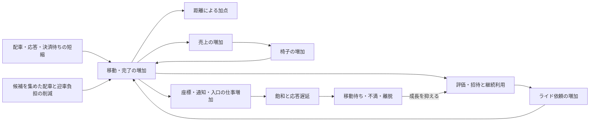

# Codex conversation

- Session: 01a1282c-717f-73b1-b2ed-00c60b39d531

<!-- codex-hook-format: 10; tool results and reasoning content omitted -->

- REASONING durations are estimates from the preceding message or tool event to reasoning completion and may include model/network waits.

---

## USER (2026-10-11 08:36:37 +0900)

$isucon-agent  docs/analysis/benchmark-score-structure.md を直近の複数のRUNやスコア結果から更新してください

## ASSISTANT

isucon-agentスキルを使い、直近の保存済みRUNとスコア結果を確認して文書を更新します。集計には既存のDuckDB基盤を使います。

## TOOL

```sh
pwd; git status --short; cat .agents/skills/isucon-agent/SKILL.md; cat docs/analysis/benchmark-score-structure.md
```

## TOOL

```sh
rg -n '(^  (q|artifacts-run)|analysis|RUN|run-list)' Taskfile.yml Taskfile.contest.yml; rg --files tools/analysis tools/contest/analysis-schema docs/analysis | head -100
```

## TOOL

```sh
sed -n '938,958p' Taskfile.yml; cat runs/scores.tsv; cat tools/analysis/sources.yaml; cat tools/contest/analysis-schema/bench-progress.sql; cat tools/contest/analysis-schema/bench-summary.sql
```

## TOOL

```sh
task q -- "SELECT * FROM bench_results ORDER BY run_id; SELECT table_name FROM information_schema.tables ORDER BY table_name"
```

## REASONING (Estimated 4s; 2026-10-11 08:36:49 +0900)

## TOOL

```sh
cat tools/analysis/schema/manifest.sql; cat tools/analysis/schema/semantic.sql; cat tools/contest/analysis-schema/ride-metrics.sql
```

## TOOL

```sh
python3 - <<'PY'
import json,pathlib
for p in sorted(pathlib.Path('runs').glob('*/run.json')):
 if p.parent.name<'20261011-070058': continue
 r=json.loads(p.read_text()); print(p.parent.name,json.dumps({k:v for k,v in r.items() if k not in ['artifacts','collectors','hosts','measurements']},ensure_ascii=False)[:3500])
PY
sed -n '230,290p' docs/analysis/benchmark-score-structure.md; rg -n 'スコアの計算|負荷テスト|60秒|座標|次の' docs/official/manual.md docs/official/ISURIDE.md
```

## REASONING (Estimated 3s; 2026-10-11 08:36:54 +0900)

## TOOL

```sh
python3 - <<'PY'
import json,pathlib
for p in sorted(pathlib.Path('runs').glob('*/run.json')):
 if p.parent.name<'20261011-070058': continue
 r=json.loads(p.read_text()); print(p.parent.name,json.dumps({k:r.get(k) for k in ['phase','source','roles','score','passed','missing','load_window']},ensure_ascii=False))
PY
rg -n 'view ride_|series|dispatch_|pickup_|evaluation_|valid|histogram' tools/contest/analysis-schema/ride-metrics.sql; rg -n 'cpu|pressure|cpus' tools/analysis/schema/proc.sql tools/analysis/schema/service.sql tools/analysis/schema/semantic.sql
```

## TOOL

```sh
task q -- "DESCRIBE ride_metric_histograms; DESCRIBE ride_metric_gauges; DESCRIBE http_traffic_series; SELECT DISTINCT source,entity,metric FROM metrics WHERE run_id='20261011-082354' AND (contains(metric,'cpu') OR contains(metric,'pressure')) ORDER BY ALL; SELECT DISTINCT series FROM ride_metric_histograms WHERE run_id>='20261011-070058' ORDER BY series"
```

## REASONING (Estimated 2s; 2026-10-11 08:37:00 +0900)

## ASSISTANT

保存済みの40 RUNを確認できました。最高のPASSスコアは572,775点、最新RUNは292,472点で、文書の基準だった510,296点から状況が変わっています。直近の変更差分と、同じ時間窓の配車・完了・CPU消費を照合し、スコア差とその原因の仮説を分けて更新します。

## TOOL

```sh
git log --all --oneline -28; cat tools/contest/analysis-schema/ride-metrics.sql; sed -n '45,125p' docs/official/ISURIDE.md; sed -n '362,375p' docs/official/manual.md
```

## TOOL

```sh
task q -- "SELECT b.run_id,b.score,b.passed, substr(m.commit,1,7) commit,m.branch,r.registered,r.active,o.chairs,o.sales,e.status_2xx evaluations,c.error_types_raw,d.matching_pct,d.pickup_pct,d.travel_pct FROM bench_results b JOIN manifests m USING(run_id) LEFT JOIN (SELECT run_id,sum(registered_users) registered,sum(active_users) active FROM bench_final_regions GROUP BY run_id) r USING(run_id) LEFT JOIN (SELECT run_id,sum(chairs) chairs,sum(sales) sales FROM bench_final_owners GROUP BY run_id) o USING(run_id) LEFT JOIN endpoints e ON e.run_id=b.run_id AND contains(e.uri,'/evaluation') LEFT JOIN bench_completion c ON c.run_id=b.run_id LEFT JOIN bench_latest_dissatisfaction d ON d.run_id=b.run_id WHERE b.run_id>='20261011-062549' ORDER BY b.run_id"
```

## REASONING (Estimated 6s; 2026-10-11 08:37:10 +0900)

## TOOL

```sh
python3 - <<'PY'
import subprocess,json,pathlib
queries={
'summary':'''SELECT b.run_id,b.score,b.passed, substr(m.commit,1,7) AS measured_commit,m.branch,r.registered,r.active,o.chairs,o.sales,e.status_2xx evaluations,c.error_types_raw,d.matching_pct,d.pickup_pct,d.travel_pct FROM bench_results b JOIN manifests m USING(run_id) LEFT JOIN (SELECT run_id,sum(registered_users) registered,sum(active_users) active FROM bench_final_regions GROUP BY run_id) r USING(run_id) LEFT JOIN (SELECT run_id,sum(chairs) chairs,sum(sales) sales FROM bench_final_owners GROUP BY run_id) o USING(run_id) LEFT JOIN endpoints e ON e.run_id=b.run_id AND contains(e.uri,'/evaluation') LEFT JOIN bench_completion c ON c.run_id=b.run_id LEFT JOIN bench_latest_dissatisfaction d ON d.run_id=b.run_id WHERE b.run_id BETWEEN '20261011-035537' AND '20261011-082354' ORDER BY b.run_id''',
'http':'''WITH a AS (SELECT run_id,min(reported_at) t0 FROM bench_log_lines WHERE contains(line,'負荷走行を開始') GROUP BY run_id) SELECT h.run_id,route,sum(status_2xx)/30.0 AS success_per_sec,sum(requests) requests,sum(response_time_sum_seconds)*1000/nullif(sum(requests),0) mean_ms,sum(sum_body_bytes)/1e6 body_mb FROM http_traffic_series h JOIN a USING(run_id) WHERE h.run_id BETWEEN '20261011-070058' AND '20261011-082354' AND ts>=t0+INTERVAL '30 seconds' AND ts<t0+INTERVAL '60 seconds' AND (route='/api/app/rides' OR contains(route,'/coordinate') OR route='/api/internal/matching' OR contains(route,'/evaluation')) GROUP BY h.run_id,route ORDER BY ALL''',
'app':'''WITH a AS (SELECT run_id,min(reported_at) t0 FROM bench_log_lines WHERE contains(line,'負荷走行を開始') GROUP BY run_id) SELECT h.run_id,h.series,sum(events) n,sum(total)/nullif(sum(events),0) mean_measure,sum(interval_ms) FILTER (WHERE events IS NOT NULL AND total IS NOT NULL)/1000.0 observed_seconds,sum(total)/nullif(sum(interval_ms) FILTER (WHERE events IS NOT NULL AND total IS NOT NULL)/1000.0,0) total_per_second,sum(le_inf-le_b3) over_b3 FROM ride_metric_histograms h JOIN a USING(run_id) WHERE h.run_id BETWEEN '20261011-070058' AND '20261011-082354' AND interval_start>=t0+INTERVAL '30 seconds' AND ts<=t0+INTERVAL '60 seconds' GROUP BY h.run_id,h.series ORDER BY ALL''',
'cpu':'''WITH a AS (SELECT run_id,min(reported_at) t0 FROM bench_log_lines WHERE contains(line,'負荷走行を開始') GROUP BY run_id), x AS (SELECT m.* FROM metrics m JOIN a USING(run_id) WHERE m.run_id BETWEEN '20261011-070058' AND '20261011-082354' AND ts>=t0+INTERVAL '30 seconds' AND ts<t0+INTERVAL '60 seconds') SELECT run_id,host,sum(value) FILTER(WHERE metric='cpu_busy_pct')/100*max(value) FILTER(WHERE metric='cpu_count') cpu_seconds,count(*) FILTER(WHERE metric='cpu_busy_pct') samples,max(value) FILTER(WHERE metric='cpu_count') cpus,quantile_cont(value,0.95) FILTER(WHERE metric='cpu_busy_pct') busy_p95,max(value) FILTER(WHERE metric='cpu_busy_pct') busy_max,avg(value) FILTER(WHERE metric='cpu_pressure_some_avg10') pressure FROM x WHERE source='proc' GROUP BY run_id,host ORDER BY ALL''',
'service':'''WITH a AS (SELECT run_id,min(reported_at) t0 FROM bench_log_lines WHERE contains(line,'負荷走行を開始') GROUP BY run_id) SELECT m.run_id,host,entity,sum(value)/100 cpu_seconds,count(*) samples FROM metrics m JOIN a USING(run_id) WHERE m.run_id BETWEEN '20261011-070058' AND '20261011-082354' AND ts>=t0+INTERVAL '30 seconds' AND ts<t0+INTERVAL '60 seconds' AND source='service' AND metric='cpu_pct' GROUP BY ALL ORDER BY ALL''',
'gauges':'''WITH a AS (SELECT run_id,min(reported_at) t0 FROM bench_log_lines WHERE contains(line,'負荷走行を開始') GROUP BY run_id) SELECT h.* FROM ride_metric_gauges h JOIN a USING(run_id) WHERE h.run_id BETWEEN '20261011-070058' AND '20261011-082354' AND ts>=t0+INTERVAL '30 seconds' AND ts<t0+INTERVAL '60 seconds' QUALIFY row_number() OVER(PARTITION BY h.run_id,h.host,h.metric ORDER BY ts DESC)=1 ORDER BY h.run_id,h.host,h.metric'''
}
for name,q in queries.items():
 path=f'/private/tmp/isucon-score-{name}.json'; p=subprocess.run(['task','--silent','q','--',f"COPY ({q}) TO '{path}' (FORMAT JSON, ARRAY true)"],capture_output=True,text=True)
 if p.returncode: print(name,p.stderr,p.stdout);continue
 rows=json.loads(pathlib.Path(path).read_text()); print(name)
 for r in rows:
  if name=='summary' and r['run_id']<'20261011-062549': continue
  if name=='app' and r['series'] not in ['dispatch_wait','dispatch_batch','eval_total_ok','eval_payment_ok','eval_sql_ok','eval_complete_ok','pickup_b9_plus']: continue
  if name=='service' and r['entity'] not in ['isuride-go.service','nginx.service','mysql.service','isuride-matcher.service']: continue
  print(r)
PY
```

## REASONING (Estimated 3s; 2026-10-11 08:37:30 +0900)

## TOOL

```sh
python3 - <<'PY'
import subprocess,json,pathlib
q="""SELECT b.run_id,b.score,b.passed,substr(m.commit,1,7) measured_commit,m.branch,r.registered,r.active,o.chairs,o.sales,e.status_2xx evaluations,c.error_types_raw,d.matching_pct,d.pickup_pct,d.travel_pct FROM bench_results b JOIN manifests m USING(run_id) LEFT JOIN (SELECT run_id,sum(registered_users) registered,sum(active_users) active FROM bench_final_regions GROUP BY run_id) r USING(run_id) LEFT JOIN (SELECT run_id,sum(chairs) chairs,sum(sales) sales FROM bench_final_owners GROUP BY run_id) o USING(run_id) LEFT JOIN endpoints e ON e.run_id=b.run_id AND contains(e.uri,'/evaluation') LEFT JOIN bench_completion c ON c.run_id=b.run_id LEFT JOIN bench_latest_dissatisfaction d ON d.run_id=b.run_id WHERE b.run_id BETWEEN '20261011-035537' AND '20261011-082354' ORDER BY b.run_id"""
p=subprocess.run(['task','--silent','q','--',f"SET threads=2; COPY ({q}) TO '/private/tmp/isucon-score-summary.json' (FORMAT JSON, ARRAY true)"],capture_output=True,text=True); print(p.stdout,p.stderr)
if p.returncode==0:
 for r in json.loads(pathlib.Path('/private/tmp/isucon-score-summary.json').read_text()):
  if r['run_id']>='20261011-062549': print(r)
PY
python3 - <<'PY'
import subprocess,json,pathlib
rs=[json.loads(p.read_text()) for p in sorted(pathlib.Path('runs').glob('*/run.json')) if p.parent.name>='20261011-070058']
prev=rs[0]
for r in rs[1:]:
 a,b=prev['source']['commit'],r['source']['commit']; print('\n',prev['run_id'],r['run_id'])
 p=subprocess.run(['git','log','--oneline',f'{a}..{b}','--','webapp/go','nginx','Taskfile.yml','Taskfile.contest.yml','tools/contest'],capture_output=True,text=True); print(p.stdout)
 p=subprocess.run(['git','diff','--stat',a,b,'--','webapp/go','nginx','Taskfile.yml','Taskfile.contest.yml','tools/contest'],capture_output=True,text=True); print(p.stdout)
 prev=r
PY
```

## REASONING (Estimated 5s; 2026-10-11 08:37:42 +0900)

## TOOL

```sh
python3 - <<'PY'
import subprocess,json,pathlib
queries={
'base':"SELECT b.*,substr(m.commit,1,7) measured_commit,m.branch FROM bench_results b JOIN manifests m USING(run_id) ORDER BY run_id",
'regions':"SELECT run_id,sum(registered_users) registered,sum(active_users) active FROM bench_final_regions GROUP BY run_id ORDER BY run_id",
'owners':"SELECT run_id,sum(chairs) chairs,sum(sales) sales FROM bench_final_owners GROUP BY run_id ORDER BY run_id",
'evaluations':"SELECT run_id,status_2xx evaluations FROM endpoints WHERE contains(uri,'/evaluation') ORDER BY run_id",
'completion':"SELECT run_id,error_types_raw FROM bench_completion ORDER BY run_id",
'dissatisfaction':"SELECT run_id,matching_pct,pickup_pct,travel_pct FROM bench_latest_dissatisfaction ORDER BY run_id"
}
for name,q in queries.items():
 path=f'/private/tmp/isucon-score-{name}.json'; p=subprocess.run(['task','--silent','q','--',f"SET threads=1; SET preserve_insertion_order=false; COPY ({q}) TO '{path}' (FORMAT JSON, ARRAY true)"],capture_output=True,text=True)
 print(name,p.returncode,p.stderr)
q="SELECT * FROM read_json_auto('/private/tmp/isucon-score-base.json') LEFT JOIN read_json_auto('/private/tmp/isucon-score-regions.json') USING(run_id) LEFT JOIN read_json_auto('/private/tmp/isucon-score-owners.json') USING(run_id) LEFT JOIN read_json_auto('/private/tmp/isucon-score-evaluations.json') USING(run_id) LEFT JOIN read_json_auto('/private/tmp/isucon-score-completion.json') USING(run_id) LEFT JOIN read_json_auto('/private/tmp/isucon-score-dissatisfaction.json') USING(run_id) ORDER BY run_id"
p=subprocess.run(['task','--silent','q','--',f"COPY ({q}) TO '/private/tmp/isucon-score-summary.json' (FORMAT JSON, ARRAY true)"],capture_output=True,text=True); print(p.returncode,p.stdout,p.stderr)
if p.returncode==0:
 for r in json.loads(pathlib.Path('/private/tmp/isucon-score-summary.json').read_text()):
  if r['run_id']>='20261011-062549': print(r)
PY
```

## TOOL

```sh
python3 - <<'PY'
import json,pathlib
for name in ['cpu','service']:
 print(name)
 for r in json.loads(pathlib.Path(f'/private/tmp/isucon-score-{name}.json').read_text()):
  if r['run_id']<'20261011-071543': continue
  if name=='service' and not r['cpu_seconds']: continue
  print(r)
PY
```

## REASONING (Estimated 5s; 2026-10-11 08:37:56 +0900)

## TOOL

```sh
task --silent q -- "SELECT run_id,sum(registered_users),sum(active_users) FROM bench_final_regions WHERE run_id='20261011-082354' GROUP BY run_id; SELECT run_id,sum(chairs),sum(sales) FROM bench_final_owners WHERE run_id='20261011-082354' GROUP BY run_id; SELECT error_types_raw FROM bench_completion WHERE run_id='20261011-082354'; SELECT matching_pct,pickup_pct,travel_pct FROM bench_latest_dissatisfaction WHERE run_id='20261011-082354'"
```

## TOOL

```sh
git diff 79017eb a85a1e5 --stat -- webapp/go nginx Taskfile.yml Taskfile.contest.yml tools/contest; git diff 0909770 cccca01 --stat -- webapp/go nginx Taskfile.yml Taskfile.contest.yml tools/contest; git show cccca01:webapp/go/runtime_scheduler.go; git diff cccca01 b5ca59d -- webapp/go/runtime_scheduler.go; git status --short
```

## REASONING (Estimated 2s; 2026-10-11 08:38:02 +0900)

## TOOL

```sh
git ls-tree -l HEAD runs/analysis.duckdb.tmp/duckdb_temp_storage_DEFAULT-0.tmp; rg 'msg=結果' runs/20261011-082354/bench.log; rg -n 'missing|phase' runs/20261011-082354/run.json | head; rg --files -g AGENTS.md docs .agents
```

## REASONING (Estimated 9s; 2026-10-11 08:38:12 +0900)

## TOOL

```sh
git show HEAD:runs/analysis.duckdb.tmp/duckdb_temp_storage_DEFAULT-0.tmp > runs/analysis.duckdb.tmp/duckdb_temp_storage_DEFAULT-0.tmp
python3 - <<'PY'
import subprocess,json,pathlib
base=json.loads(pathlib.Path('/private/tmp/isucon-score-base.json').read_text())
for r in base:
 run=r['run_id']
 if run<'20261011-062549':continue
 queries=[f"SELECT sum(registered_users) registered,sum(active_users) active FROM bench_final_regions WHERE run_id='{run}'",f"SELECT sum(chairs) chairs,sum(sales) sales FROM bench_final_owners WHERE run_id='{run}'",f"SELECT line result_line FROM bench_log_lines WHERE run_id='{run}' AND contains(line,'msg=結果')",f"SELECT matching_pct,pickup_pct,travel_pct FROM bench_latest_dissatisfaction WHERE run_id='{run}'"]
 sql="SET temp_directory='/private/tmp/isucon-score-duckdb-tmp'; "
 for i,q in enumerate(queries):sql+=f"COPY ({q}) TO '/private/tmp/isucon-score-part-{i}.json' (FORMAT JSON, ARRAY true); "
 p=subprocess.run(['task','--silent','q','--',sql],capture_output=True,text=True)
 if p.returncode: print(run,p.stderr); continue
 for i in range(4):
  data=json.loads(pathlib.Path(f'/private/tmp/isucon-score-part-{i}.json').read_text());r.update(data[0] if data else {})
 print(r)
pathlib.Path('/private/tmp/isucon-score-summary.json').write_text(json.dumps(base))
PY
```

## REASONING (Estimated 7s; 2026-10-11 08:38:25 +0900)

## ASSISTANT

配車待ちの短縮だけでは増点を説明できないことが、直近RUNで確認できました。500ms→100msのスケジューラ変更では、配車待ちが短くなる一方、平均バッチ件数と評価完了率が大きく減っています。TLS分散後はMySQLとnginxが同居する3号機の負荷も増えているため、この変化を比較に加えます。

## TOOL

```sh
python3 - <<'PY'
import json,pathlib
p=pathlib.Path('/private/tmp/isucon-score-summary.json')
if p.exists():
 for r in json.loads(p.read_text()):
  if r['run_id']>='20261011-062549':print(r)
PY
rg 'msg=結果|決済|ERROR|Error' runs/20261011-070813/bench.log | tail -12; git status --short
```

## TOOL

```sh
python3 - <<'PY'
import subprocess,json,pathlib
runs=['20261011-070058','20261011-071543','20261011-074032','20261011-074654','20261011-075546','20261011-080400','20261011-081239','20261011-081805','20261011-082354']
queries={
'http':"""WITH a AS (SELECT run_id,min(reported_at) t0 FROM bench_log_lines WHERE contains(line,'負荷走行を開始') GROUP BY run_id) SELECT h.run_id,route,sum(status_2xx)/30.0 success_per_sec,sum(requests) requests,sum(response_time_sum_seconds)*1000/nullif(sum(requests),0) mean_ms FROM http_traffic_series h JOIN a USING(run_id) WHERE h.run_id BETWEEN '20261011-070058' AND '20261011-082354' AND ts>=t0+INTERVAL '30 seconds' AND ts<t0+INTERVAL '60 seconds' AND (contains(route,'/coordinate') OR contains(route,'/evaluation') OR route='^/api/app/rides$' OR contains(route,'/internal/matching')) GROUP BY ALL ORDER BY ALL""",
'ingress':"""WITH a AS (SELECT run_id,min(reported_at) t0 FROM bench_log_lines WHERE contains(line,'負荷走行を開始') GROUP BY run_id) SELECT h.run_id,ingress_host,case when regexp_matches(route,'^\\^?/api/') then 'api' else 'static' end kind,sum(requests) requests,sum(sum_body_bytes)/1e6 body_mb FROM http_traffic_series h JOIN a USING(run_id) WHERE h.run_id BETWEEN '20261011-070058' AND '20261011-082354' AND ts>=t0+INTERVAL '30 seconds' AND ts<t0+INTERVAL '60 seconds' GROUP BY ALL ORDER BY ALL""",
'artifacts':"SELECT run_id,name,status,quality_status,quality_in_window_samples,quality_expected_samples,quality_window_coverage_pct,quality_max_gap_ms,reason FROM artifacts WHERE run_id BETWEEN '20261011-070058' AND '20261011-082354' AND (status<>'ok' OR quality_status='invalid' OR contains(name,'sql-pool')) ORDER BY ALL",
'windows':"SELECT run_id,started_at,ended_at,duration_seconds,reason FROM load_windows WHERE run_id BETWEEN '20261011-070058' AND '20261011-082354' ORDER BY run_id"
}
for name,q in queries.items():
 path=f'/private/tmp/isucon-score-{name}.json';p=subprocess.run(['task','--silent','q','--',f"SET temp_directory='/private/tmp/isucon-score-duckdb-tmp'; COPY ({q}) TO '{path}' (FORMAT JSON, ARRAY true)"],capture_output=True,text=True)
 print(name,p.returncode,p.stderr)
 if not p.returncode:
  for r in json.loads(pathlib.Path(path).read_text()):
   if name=='artifacts' or (name=='http' and r['run_id'] in runs and not 'coordinate' in r['route'] and not 'evaluation' in r['route']):print(r)
PY
```

## REASONING (Estimated 4s; 2026-10-11 08:38:39 +0900)

## TOOL

### `write_stdin`

```javascript
tools.write_stdin({session_id:load("querySession"),chars:"","max_output_tokens":4700,"yield_time_ms":1000})
```

## TOOL

```sh
rg '最終地域情報|最終オーナー情報|%のライド|新規登録しました|低評価なライド' runs/20261011-070813/bench.log | tail -12; git diff 79017eb 0909770 --stat -- webapp/go nginx Taskfile.yml Taskfile.contest.yml tools/contest; rg -n 'benchmark-score|071543|074654|082354' docs/conversation --glob '*.md' | head -15
```

## TOOL

```sh
python3 - <<'PY'
import subprocess,json,pathlib
results=[]
for p in sorted(pathlib.Path('runs').glob('*/run.json')):
 if p.parent.name<'20261011-062549':continue
 r=subprocess.run(['task','--silent','artifacts-run',f'RUN={p.parent}'],capture_output=True,text=True)
 results.append({'run_id':p.parent.name,'returncode':r.returncode,'output':r.stdout+r.stderr})
 print(p.parent.name,r.returncode,('\n'.join((r.stdout+r.stderr).splitlines()[-3:])),flush=True)
pathlib.Path('/private/tmp/isucon-score-artifact-checks.json').write_text(json.dumps(results))
PY
```

## REASONING (Estimated 9s; 2026-10-11 08:38:54 +0900)

## TOOL

```sh
python3 - <<'PY'
import subprocess,json,pathlib
q="""WITH a AS (SELECT run_id,min(reported_at) t0 FROM bench_log_lines WHERE contains(line,'負荷走行を開始') GROUP BY run_id) SELECT h.run_id,method,route,sum(status_2xx)/30.0 success_per_sec,sum(requests) requests,sum(response_time_sum_seconds)*1000/nullif(sum(requests),0) mean_ms FROM http_traffic_series h JOIN a USING(run_id) WHERE h.run_id BETWEEN '20261011-070058' AND '20261011-082354' AND ts>=t0+INTERVAL '30 seconds' AND ts<t0+INTERVAL '60 seconds' AND (method='POST' AND (contains(route,'/coordinate') OR contains(route,'/evaluation') OR route='^/api/app/rides$') OR contains(route,'/internal/matching')) GROUP BY ALL ORDER BY ALL"""
p=subprocess.run(['task','--silent','q','--',f"SET temp_directory='/private/tmp/isucon-score-duckdb-tmp'; COPY ({q}) TO '/private/tmp/isucon-score-http.json' (FORMAT JSON, ARRAY true)"],capture_output=True,text=True);print(p.returncode,p.stderr)
for r in json.loads(pathlib.Path('/private/tmp/isucon-score-http.json').read_text()):
 if r['route']=='^/api/app/rides$': print(r)
q="SELECT run_id,line_number,reported_at,line FROM bench_log_lines WHERE run_id BETWEEN '20261011-062549' AND '20261011-082354' AND regexp_matches(line,'^time=\\S+ level=INFO ') ORDER BY run_id,line_number"
p=subprocess.run(['task','--silent','q','--',f"SET temp_directory='/private/tmp/isucon-score-duckdb-tmp'; COPY ({q}) TO '/private/tmp/isucon-score-info.json' (FORMAT JSON, ARRAY true)"],capture_output=True,text=True);print('info',p.returncode,p.stderr)
PY
```

## TOOL

### `write_stdin`

```javascript
tools.write_stdin({session_id:load("artifactSession"),chars:"","yield_time_ms":1000,"max_output_tokens":2300})
```

## REASONING (Estimated 9s; 2026-10-11 08:39:14 +0900)

## TOOL

```sh
python3 - <<'PY'
import subprocess,json,pathlib
rows=[]
for run in ['20261011-070813','20261011-074654','20261011-081805','20261011-082354']:
 q=f"SELECT '{run}' run_id,line FROM (SELECT unnest(string_split(content,chr(10))) line FROM read_text('runs/{run}/bench.log')) WHERE regexp_matches(line,'^time=\\S+ level=INFO ')"
 path='/private/tmp/isucon-score-info-part.json';p=subprocess.run(['task','--silent','q','--',f"SET temp_directory='/private/tmp/isucon-score-duckdb-tmp'; COPY ({q}) TO '{path}' (FORMAT JSON, ARRAY true)"],capture_output=True,text=True)
 print(run,p.returncode,p.stderr)
 if p.returncode==0:rows+=json.loads(pathlib.Path(path).read_text())
pathlib.Path('/private/tmp/isucon-score-info.json').write_text(json.dumps(rows))
q="""WITH l AS (SELECT *,try_cast('2026-10-11T'||regexp_extract(line,'^time=([0-9:.]+)',1)||'+09:00' AS TIMESTAMPTZ) reported_at FROM read_json_auto('/private/tmp/isucon-score-info.json')), a AS (SELECT run_id,min(reported_at) FILTER(WHERE contains(line,'負荷走行を開始')) t0 FROM l GROUP BY run_id), r AS (SELECT l.run_id,reported_at,date_diff('millisecond',t0,reported_at)/1000.0 elapsed,try_cast(regexp_extract(line,'評判によって([0-9]+)人',1) AS BIGINT) reputation,try_cast(regexp_extract(line,'招待経由で([0-9]+)人',1) AS BIGINT) invitation FROM l JOIN a USING(run_id) WHERE contains(line,'新規登録しました')), d AS (SELECT run_id,reported_at,try_cast(regexp_extract(line,'低評価なライドによって([0-9]+)人',1) AS BIGINT) departed FROM l WHERE contains(line,'低評価なライド')), g AS (SELECT run_id,reported_at,try_cast(regexp_extract(line,'増加数=([0-9]+)',1) AS BIGINT) added FROM l WHERE contains(line,'椅子が増加')) SELECT r.*,d.departed,(SELECT sum(added) FROM g WHERE g.run_id=r.run_id AND g.reported_at<=r.reported_at) added_chairs FROM r LEFT JOIN d USING(run_id,reported_at) ORDER BY r.run_id,r.reported_at"""
p=subprocess.run(['task','--silent','q','--',f"COPY ({q}) TO '/private/tmp/isucon-score-progress.json' (FORMAT JSON, ARRAY true)"],capture_output=True,text=True);print(p.returncode,p.stderr)
for r in json.loads(pathlib.Path('/private/tmp/isucon-score-progress.json').read_text()):print(r)
q="SELECT run_id,sum(try_cast(regexp_extract(line,'ユーザー登録数=([0-9]+)',1) AS BIGINT)) registered,sum(try_cast(regexp_extract(line,'アクティブユーザー数=([0-9]+)',1) AS BIGINT)) active,sum(try_cast(regexp_extract(line,'売上=([0-9]+)',1) AS BIGINT)) sales,sum(try_cast(regexp_extract(line,'椅子数=([0-9]+)',1) AS BIGINT)) chairs FROM read_json_auto('/private/tmp/isucon-score-info.json') WHERE run_id='20261011-070813' GROUP BY run_id"
p=subprocess.run(['task','--silent','q','--',f"COPY ({q}) TO '/private/tmp/isucon-score-failed-summary.json' (FORMAT JSON, ARRAY true)"],capture_output=True,text=True);print(p.returncode,p.stderr);print(pathlib.Path('/private/tmp/isucon-score-failed-summary.json').read_text())
PY
```

## REASONING (Estimated 9s; 2026-10-11 08:39:33 +0900)

## TOOL

```sh
python3 - <<'PY'
import json,pathlib,subprocess
rows=[]
for p in sorted(pathlib.Path('runs').glob('*/bench.log')):
 if not '20261011-062549'<=p.parent.name<='20261011-082354':continue
 for n,line in enumerate(p.read_bytes().decode('utf-8',errors='replace').splitlines(),1):
  if ' level=INFO ' in line and line.startswith('time='):rows.append({'run_id':p.parent.name,'line_number':n,'line':line})
pathlib.Path('/private/tmp/isucon-score-info.json').write_text(json.dumps(rows))
queries={
'growth':"""WITH l AS (SELECT *,try_cast('2026-10-11T'||regexp_extract(line,'^time=([0-9:.]+)',1)||'+09:00' AS TIMESTAMPTZ) reported_at FROM read_json_auto('/private/tmp/isucon-score-info.json')), a AS (SELECT run_id,min(reported_at) FILTER(WHERE contains(line,'負荷走行を開始')) t0,max(reported_at) FILTER(WHERE contains(line,'負荷走行が終了')) t1 FROM l GROUP BY run_id) SELECT a.run_id,t0,t1,date_diff('millisecond',t0,t1)/1000.0 info_duration, min(date_diff('millisecond',t0,reported_at)/1000.0) FILTER(WHERE contains(line,'椅子が増加')) first_add_s,sum(try_cast(regexp_extract(line,'増加数=([0-9]+)',1) AS BIGINT)) added_chairs,max(try_cast(regexp_extract(line,'低評価なライドによって([0-9]+)人',1) AS BIGINT)) last_departed FROM a JOIN l USING(run_id) GROUP BY ALL ORDER BY a.run_id""",
'failed-summary':"SELECT run_id,sum(try_cast(regexp_extract(line,'ユーザー登録数=([0-9]+)',1) AS BIGINT)) registered,sum(try_cast(regexp_extract(line,'アクティブユーザー数=([0-9]+)',1) AS BIGINT)) active,sum(try_cast(regexp_extract(line,'売上=([0-9]+)',1) AS BIGINT)) sales,sum(try_cast(regexp_extract(line,'椅子数=([0-9]+)',1) AS BIGINT)) chairs FROM read_json_auto('/private/tmp/isucon-score-info.json') WHERE run_id='20261011-070813' GROUP BY run_id"
}
for name,q in queries.items():
 path=f'/private/tmp/isucon-score-{name}.json';p=subprocess.run(['task','--silent','q','--',f"COPY ({q}) TO '{path}' (FORMAT JSON, ARRAY true)"],capture_output=True,text=True);print(name,p.returncode,p.stderr)
 if p.returncode==0:
  for r in json.loads(pathlib.Path(path).read_text()):print(r)
PY
```

## TOOL

### `write_stdin`

```javascript
tools.write_stdin({session_id:load("artifactSession"),chars:"","yield_time_ms":1000,"max_output_tokens":2200})
```

## TOOL

```sh
python3 - <<'PY'
import json,pathlib
for r in json.loads(pathlib.Path('/private/tmp/isucon-score-ingress.json').read_text()):
 if r['run_id'] in ['20261011-070058','20261011-071543','20261011-074654','20261011-081805','20261011-082354']:print(r)
PY
rg -n 'matchingPlanLimit|matchingCoalesce' webapp/go/internal_handlers.go webapp/go/runtime_matching.go webapp/go/runtime_scheduler.go; git diff 0909770 3e95580 --stat -- webapp/go nginx Taskfile.yml Taskfile.contest.yml tools/contest; git diff 5c645cf b5ca59d --stat -- webapp/go nginx Taskfile.yml Taskfile.contest.yml tools/contest
```

## REASONING (Estimated 9s; 2026-10-11 08:39:51 +0900)

## TOOL

```sh
cat tools/contest/analysis-schema/bench-errors-semantic.sql; git diff b5ca59d HEAD --stat -- webapp/go nginx Taskfile.yml Taskfile.contest.yml tools/contest; git status --short; sed -n '1,90p' tools/analysis/schema/access-log.sql; head -3 runs/20261011-082354/isucon-1-sql-pool-metrics.tsv
```

## TOOL

```sh
python3 - <<'PY'
import json,pathlib
rs={r['run_id']:r for r in json.loads(pathlib.Path('/private/tmp/isucon-score-summary.json').read_text())}
e={r['run_id']:r for r in json.loads(pathlib.Path('/private/tmp/isucon-score-evaluations.json').read_text())}
for key in sorted(rs):
 if key<'20261011-062549':continue
 print(key,rs[key]['score'],e.get(key))
for name in ['windows']:
 for r in json.loads(pathlib.Path(f'/private/tmp/isucon-score-{name}.json').read_text()):print(r)
PY
```

## REASONING (Estimated 8s; 2026-10-11 08:40:02 +0900)

## TOOL

```sh
task --silent q -- "SELECT run_id,score,round(100*(score/lag(score) OVER(ORDER BY run_id)-1),1) change_pct FROM bench_results WHERE run_id BETWEEN '20261011-070058' AND '20261011-082354' ORDER BY run_id; SELECT run_id,kind,sum(requests) requests,round(sum(body_mb),2) body_mb FROM read_json_auto('/private/tmp/isucon-score-ingress.json') WHERE run_id IN ('20261011-070058','20261011-071543','20261011-074654','20261011-081805','20261011-082354') GROUP BY ALL ORDER BY ALL; SELECT e.run_id,e.evaluations*5 AS estimated_bonus,round(e.evaluations*500.0/b.score,1) AS bonus_pct FROM read_json_auto('/private/tmp/isucon-score-evaluations.json') e JOIN bench_results b USING(run_id) WHERE e.run_id IN ('20261011-074654','20261011-082354'); SELECT round(100.0*(572775.0/520066-1),1) nat_vs_relay_pct,round(100.0*(292472.0/540785-1),1) latest_change_pct"
```

## REASONING (Estimated 6s; 2026-10-11 08:40:11 +0900)

## ASSISTANT

比較の基準を整理できました。文書には最新RUN、最高スコアRUN、変更ごとの比較元を明記し、「配車待ち・座標応答の改善」と「完了・売上・椅子の成長」を併せて評価する形で反映します。成果物検査では、途中終了したFAIL RUNに負荷窓外のprofileがあり、PASS RUNでもsql-pool計測にtimeoutがあります。これらの制約も記載します。

## TOOL

```sh
cat > /private/tmp/update-isucon-score-doc.py <<'PY'
import json,pathlib,re
p=pathlib.Path('docs/analysis/benchmark-score-structure.md')
old=p.read_text()
summary=json.loads(pathlib.Path('/private/tmp/isucon-score-summary.json').read_text())
by_id={r['run_id']:r for r in summary}
evals={r['run_id']:r['evaluations'] for r in json.loads(pathlib.Path('/private/tmp/isucon-score-evaluations.json').read_text())}
failed=json.loads(pathlib.Path('/private/tmp/isucon-score-failed-summary.json').read_text())[0]
by_id[failed['run_id']].update(failed)
for line in old.splitlines():
 if not line.startswith('| [20261011-'):continue
 fields=[x.strip() for x in line.split('|')[1:-1]]
 run=re.search(r'20261011-\d+',fields[0]).group()
 if 'registered' not in by_id[run]:
  registered,active=fields[4].replace(',','').split('／')
  by_id[run].update(registered=int(registered),active=int(active),chairs=int(fields[5].replace(',','')))
rows=['| RUN | 得点 | 合否 | 評価API成功件数 | 最終登録／アクティブ人数 | 最終椅子数 |','| --- | ---: | --- | ---: | ---: | ---: |']
for run,r in sorted(by_id.items()):
 rows.append(f"| [{run}](../../runs/{run}/bench.log) | {r['score']:,} | {'PASS' if r['passed'] else 'FAIL'} | {evals[run]:,} | {r['registered']:,}／{r['active']:,} | {r['chairs']:,} |")
growth={r['run_id']:r for r in json.loads(pathlib.Path('/private/tmp/isucon-score-growth.json').read_text())}
app={(r['run_id'],r['series']):r for r in json.loads(pathlib.Path('/private/tmp/isucon-score-app.json').read_text())}
http={(r['run_id'],r['route']):r for r in json.loads(pathlib.Path('/private/tmp/isucon-score-http.json').read_text())}
gauges={(r['run_id'],r['metric']):r for r in json.loads(pathlib.Path('/private/tmp/isucon-score-gauges.json').read_text())}
cpu={(r['run_id'],r['host']):r for r in json.loads(pathlib.Path('/private/tmp/isucon-score-cpu.json').read_text())}
service={(r['run_id'],r['host'],r['entity']):r for r in json.loads(pathlib.Path('/private/tmp/isucon-score-service.json').read_text())}
selected=['070058','071543','072629','074032','074654','075546','080400','081239','081805','082354']
def full(run):return '20261011-'+run
def a(run,series):return app[(full(run),series)]
def h(run,route):return http[(full(run),route)]
dispatch=['| RUN | 依頼成功/秒（HTTP） | 割当件数／観測秒数 | 割当/秒 | バッチ数／平均件数 | 平均作成→割当 | 評価成功/秒（アプリ） |','| --- | ---: | ---: | ---: | ---: | ---: | ---: |']
for run in selected:
 b=a(run,'dispatch_batch'); w=a(run,'dispatch_wait'); e=a(run,'eval_total_ok')
 dispatch.append(f"| {run} | {h(run,'^/api/app/rides$')['success_per_sec']:.1f} | {int(w['n']):,}／{w['observed_seconds']:.3f} | {b['total_per_second']:.1f} | {int(b['n'])}／{b['mean_measure']:.1f} | {w['mean_measure']/1000:.2f}秒 | {e['n']/e['observed_seconds']:.1f} |")
snapshots=['| RUN | 窓内最後のサンプル（JST） | 未割当 | 配車可能椅子 | 最古待ち | 通知待ちによる椅子除外 |','| --- | --- | ---: | ---: | ---: | ---: |']
for run in ['074654','080400','081239','081805','082354']:
 g=lambda metric:gauges[(full(run),metric)]
 snapshots.append(f"| {run} | {g('dispatch_waiting')['ts'].split()[1].replace('+09','')} | {int(g('dispatch_waiting')['value']):,} | {int(g('dispatch_available')['value']):,} | {g('dispatch_oldest_ms')['value']/1000:.3f}秒 | {int(g('dispatch_notify_blocked')['value'])} |")
cpus=['| RUN | 1号機 CPU秒／容量 | busy p95／最大 | 2号機 CPU秒／容量 | busy p95／最大 | 3号機 CPU秒／容量 | busy p95／最大 |','| --- | ---: | ---: | ---: | ---: | ---: | ---: |']
for run in ['070058','071543','074654','075546','080400','081239','081805','082354']:
 fields=[run]
 for host in ['isucon-1','isucon-2','isucon-3']:
  c=cpu[(full(run),host)];assert c['samples']==30 and c['cpus']==2
  fields.extend([f"{c['cpu_seconds']:.2f}／60",f"{c['busy_p95']:.2f}／{c['busy_max']:.2f}%"])
 cpus.append('| '+' | '.join(fields)+' |')
services=['| サービスCPU秒 | 071543 | 074654 | 075546 | 081239 | 081805 | 082354 |','| --- | ---: | ---: | ---: | ---: | ---: | ---: |']
for label,host,entity in [('Go（1号機）','isucon-1','isuride-go.service'),('Go（3号機）','isucon-3','isuride-go.service'),('nginx（2号機）','isucon-2','nginx.service'),('nginx（3号機）','isucon-3','nginx.service'),('matcher（2号機）','isucon-2','isuride-matcher.service'),('TLS router（2号機）','isucon-2','isuride-tls-router.service'),('MySQL（3号機）','isucon-3','mysql.service')]:
 fields=[label]
 for run in ['071543','074654','075546','081239','081805','082354']:
  s=service.get((full(run),host,entity));fields.append(f"{s['cpu_seconds']:.2f}" if s else '計測なし')
 services.append('| '+' | '.join(fields)+' |')
move=['| RUN | 座標API成功/秒 | 座標API平均応答 | 依頼API平均応答 | 配車待ち不満率 | 迎車不満率 | 実移動不満率 |','| --- | ---: | ---: | ---: | ---: | ---: | ---: |']
for run in selected:
 c=h(run,'^/api/chair/coordinate$'); r=by_id[full(run)]
 move.append(f"| {run} | {c['success_per_sec']:,.1f} | {c['mean_ms']:.2f}ms | {h(run,'^/api/app/rides$')['mean_ms']:.2f}ms | {r['matching_pct']:.1f}% | {r['pickup_pct']:.1f}% | {r['travel_pct']:.1f}% |")
windows={r['run_id']:r for r in json.loads(pathlib.Path('/private/tmp/isucon-score-windows.json').read_text())}
artifacts={(r['run_id'],r['name']):r for r in json.loads(pathlib.Path('/private/tmp/isucon-score-artifacts.json').read_text())}
quality=['| RUN | INFO開始（JST）／開始〜終了 | manifest収集窓 | traffic-threshold分析窓 | 1号機sql-pool coverage／最大gap |','| --- | --- | ---: | ---: | ---: |']
for run in ['070058','070813','071543','074654','075546','080400','081239','081805','082354']:
 rid=full(run); g=growth[rid]; m=json.loads(pathlib.Path(f'runs/{rid}/run.json').read_text()); w=windows[rid]; art=artifacts[(rid,'isucon-1-sql-pool-metrics.tsv')]
 suffix='（収集末尾まで）' if 'collection end used' in w['reason'] else ''
 quality.append(f"| {run} | {g['t0'].split()[1].replace('+09','')}／{g['info_duration']:.3f}秒 | {m['load_window']['duration_ms']/1000:.3f}秒 | {w['duration_seconds']:.3f}秒{suffix} | {art['quality_window_coverage_pct']:.1f}%／{art['quality_max_gap_ms']:,}ms |")
text='''# ISURIDEベンチの得点構造分析

2026-10-11更新。対象は保存済み・分析DB収録済みの `20261011-035537`〜`20261011-082354`、40 finalized RUN。
最新は [082354](../../runs/20261011-082354/bench.log)、最高のPASSスコアは [074654](../../runs/20261011-074654/bench.log)。
他worktreeだけにあるRUNまで網羅した一覧ではない。以下、同日のRUNを時刻6桁で略記する。

## 結論

得点の中心は移動距離で、完了・売上・椅子増加による回転の成長が得点に効く。
最高は572,775点・PASS、最新は292,472点・PASS。最新は直前540,785点から45.9%減った。
最新の評価API成功は8,193→4,066件、売上は48,189,600→23,583,100円、椅子数は1,205→636台。
一方、最終アクティブ人数は2,031→2,229人に増えた。利用者数や配車待ちだけでは増減点を判断できない。

最新の比較 `081805→082354` は、同じイベント駆動スケジューラの待ちを500→100msに変えたもの。
INFO開始後30〜60秒の平均作成→割当は4.76→1.09秒へ短縮したが、
平均バッチ件数は137.3→11.5件、割当は231.9→108.8件/秒、評価成功は207.2→95.3件/秒へ減った。
最終配車待ち不満率は92.1→1.6%に下がり、迎車不満率は19.1→53.7%に上がった。
「早く少人数を割り当てる」ことで待ちが減っても、乗車・完了へ進む回転が増えるとは限らない。
迎車品質と候補の集まり方が有力な説明候補だが、実測迎車時間や採点距離の内訳は未復元である。

TLS分散後も資源制約は残る。GoのTLS中継をkernel NATに置き換えた `074654` は、
比較元 `071543` から10.1%増点。2号機のCPU消費は59.39→38.79／60 CPU秒へ減ったが、
Goの1号機は55.30／60、nginx・MySQL同居の3号機は53.67／60 CPU秒となった。
最高RUNでは入口分散をさらに増やす前に、Goの仕事と3号機の共有容量を評価する必要がある。
最新では静的リクエストも増えており、待ちの短縮・需要の変化・資源消費を一緒に追う。

最新RUNは `fri` の実験構成。更新時のmainにはイベント駆動スケジューラがなく、外部matcherと上限256の計画が残る。
最新RUNの退行を現行mainの性能と同一視しない。比較にはRUNの保存commit・配置を使う。

## 公式の得点式と直接の加点

[当日マニュアルの得点式](../official/manual.md#スコアの計算)は次のとおり。

```text
得点 = 迎車距離の合計 × 0.1
     + 乗車中の移動距離の合計
     + ライド完了数 × 5
```

同じ距離なら乗車中の移動は迎車の10倍の加点になる。
通知・検索の件数自体には加点がなく、未割当椅子の移動もこの距離加点には含まれない。
最高RUNの評価API成功8,684件を仮に採点対象完了数とすると、完了ボーナスは43,420点、約7.6%。
最新も4,066件×5＝20,330点、約7.0%にとどまる。
これはRUN全期間HTTP件数による概算で、採点対象完了数や得点内訳の確定値ではない。
距離加点が大部分を占める目安として使い、残りを迎車・乗車距離へ分解しない。

完了は直接の5点に加えて、次のライドへ進む、売上を発生させる、評価を確定する役割を持つ。
ユーザーも椅子も `COMPLETED` まで次のライドを要求・受理できない。
これらは[アプリケーションマニュアル](../official/ISURIDE.md#ライドride)の仕様である。
[最終スコア](../official/manual.md#最終スコア)は最後の負荷走行結果なので、過去最高点と区別する。

## RUN比較

得点・合否・最終人数・椅子数は `bench.log`、評価API成功件数は `alp.json` が出典。
評価APIは `POST /api/app/rides/{ride_id}/evaluation` の2xx件数。
人数は最終地域情報の2地域合計、椅子数は最終オーナー情報の5社合計。

@@RUNS@@

FAILの数値を有効な成功スコアとして扱わない。`scores.tsv` にもFAILの数値があるため、
`bench_results.passed` と原文の結果を併せて確認する。035537のTSV得点は空欄だが、原文では671点・PASS。
最新の結果行は `pass=true`、`種別エラー数="map[17:1 24:1 30:5]"`。PASSはエラーなしという意味ではない。

### 変更ごとの比較元を分ける

直前RUNは異なるworktreeの実験を含む。時刻順の得点差を、記載した変更単独の効果と解釈しない。
比較元は保存commitのGo・nginx・Taskfile・競技設定の差分で確認した。

| RUN | 測定commit／branch | 比較元 | 実装・配置の差分 | 得点差 |
| --- | --- | --- | --- | ---: |
| 061703 | `115fd36`／thu | 060837 | Go・入口nginx・MySQLの3台分離。配置以外の差分も含む | +21.0% |
| 062549 | `d7ed815`／sat | 061703 | 状態WALのMySQL投影を削除 | +3.7% |
| 064138 | `539a75d`／mon | 062549 | 飽和時に64件を最大2バッチ配車 | +54.5% |
| 064927 | `7aeda02`／tue | 064138 | 決済をライド単位の冪等POST再試行へ変更、履歴GET照合を削除 | +2.5% |
| 070058 | `4023fad`／wed | 064927 | FIFO計画上限256、solver置換・共通状態ロック外計算、追加計画の閾値変更 | +11.2% |
| 070813 | `1c61035`／mon | 070058 | Go中継でTLS終端を2・3号機へ分散 | FAIL・途中終了 |
| 071543 | `79017eb`／mon | 070058 | TLS分散と中継のFD圧力への対処を含む | +1.9% |
| 072629 | `ca61d8e`／tue | 071543 | 座標更新を共通ライド状態ロックから分離 | −9.2% |
| 074032 | `a85a1e5`／thu | 071543 | solverのCPU・作業領域確保を削減 | −5.6% |
| 074654 | `0909770`／tue | 071543 | Go TLS中継をkernel NAT分散へ置換。Goアプリ差分なし | +10.1% |
| 075546 | `0e7e871`／wed | 074654 | 座標所有を3号機へ移動、専用loopとbinary WAL batchingを導入 | −27.3% |
| 080400 | `5c645cf`／fri | 074654 | 外部matcherをイベント駆動・10msのスケジューラへ置換 | −55.6% |
| 081239 | `3e95580`／wed | 075546 | 座標所有を1号機へ戻し、専用loopとbinary WAL batchingは保持。配置・役割設定も変更 | +33.7% |
| 081805 | `cccca01`／fri | 080400 | スケジューラの待ちを10→500msへ変更 | +112.8% |
| 082354 | `b5ca59d`／fri | 081805 | 同じスケジューラの待ちを500→100msへ変更 | −45.9% |

`074032→074654` はsolver最適化の取り外しも含むため、その16.7%をNAT単独へ帰属させない。
`081239→081805` は座標loop・WALなども異なり、スケジューラだけの比較ではない。
`080400→081805→082354` のGo・nginx・Taskfile・競技設定の差分はスケジューラ定数だけ。
この3 RUNは待ち時間による挙動比較に使えるが、各設定1 RUNで需要・候補供給も変わるため、
500msが最適という結論や将来の期待倍率は確定しない。

`071543` 以降はnginxが2・3号機、MySQLが3号機。`075546` のみ座標処理用Goが3号機にもある。
スケジューラRUNでは外部matcherを停止し、Go内部で配車する。
最新の保存commitと[現在の配車処理](../../webapp/go/runtime_matching.go)を混同しない。

## 得点を増やす成長と、成長を抑える待ち

公式仕様と参加者INFOから確認できる経路は次のとおり。
評価・売上の判定閾値や増加量の内部式は未確認である。



図は得点と制約への経路を整理したもの。各変更が全経路の原因と確定したことを示すものではない。

### 供給側：椅子が増え始める時刻より、その後の完了・売上・増加量

| 指標 | 070058 | 074654 | 081239 | 081805 | 082354 |
| --- | ---: | ---: | ---: | ---: | ---: |
| 最初の椅子増加（INFO開始から） | 7.145秒 | 7.219秒 | 7.290秒 | 7.291秒 | 7.300秒 |
| 椅子増加イベントの追加台数合計 | 1,163 | 1,218 | 1,181 | 1,185 | 616 |
| 最終椅子数 | 1,183 | 1,238 | 1,201 | 1,205 | 636 |
| 最終売上合計（円） | 46,173,700 | 51,705,300 | 49,915,200 | 48,189,600 | 23,583,100 |
| 評価API成功件数（RUN全期間） | 7,830 | 8,684 | 8,477 | 8,193 | 4,066 |

直近の最初の椅子追加は約7.2〜7.3秒でほぼ同じ。最新の退行は開始時刻の遅れで説明できない。
一方、売上・評価成功・最終椅子数は大きく減っている。初期化短縮より負荷中の回転を優先する。
途中終了の `070813` は追加イベント428台に対して最終415台で一致せず、
イベントが全て登録・稼働へ進んだと仮定しない。

### 需要側：最終人数だけで成長速度を判断しない

同じRUNの登録・離脱を同じ報告時刻で結合し、椅子追加はその時刻までの累計とした。
経過時刻がRUN間で完全に一致するわけではないので、約36・47・63秒の推移として比較する。

| RUN | INFO経過 | 評判登録 | 招待登録 | 低評価離脱 | 椅子追加 |
| --- | ---: | ---: | ---: | ---: | ---: |
| 074654 | 36.046秒 | 67 | 1,420 | 12 | 405 |
| 074654 | 46.906秒 | 91 | 2,107 | 126 | 706 |
| 074654 | 63.106秒 | 144 | 2,282 | 304 | 1,183 |
| 081805 | 36.118秒 | 66 | 1,244 | 3 | 338 |
| 081805 | 46.917秒 | 89 | 1,982 | 98 | 621 |
| 081805 | 63.117秒 | 140 | 2,203 | 319 | 1,158 |
| 082354 | 36.607秒 | 68 | 872 | 3 | 250 |
| 082354 | 47.437秒 | 92 | 1,420 | 73 | 373 |
| 082354 | 63.637秒 | 126 | 2,166 | 215 | 616 |

最新は約36〜47秒の招待・椅子追加が遅れ、終盤まで招待が増える一方、椅子追加の差は埋まらない。
最終アクティブ人数が多くても、距離・完了が少ない状態がある。
離脱行がない報告時刻を0へ補わない。最後の離脱と最終登録−アクティブは別時点の値である。

## 配車量と割当品質を併せて評価する

### 比較する時間窓と母数

以下は各RUNのINFO「負荷走行を開始します」の時刻を起点に30〜60秒。
manifest収集開始や `load_windows.started_at` とは異なり、採点60秒の厳密な境界ではない。
起点と窓長は末尾の表に示す。

HTTPはバケット開始 `ts >= 窓開始 AND ts < 窓終了`、分母30秒、両nginxの値を合算する。
既存HTTP集計は5秒バケットなので、端のバケットはINFO基準の境界と最大約5秒ずれ得る。
依頼は `POST` のみ。`GET /api/app/rides` を依頼数へ足さない。
応答は窓内HTTP全件を母数にした加重平均、成功率は2xx件数/秒。

アプリは `interval_start >= 窓開始 AND ts <= 窓終了` に完全に収まる有効差分を使う。
イベント数・合計が存在する差分の実観測秒数で割り、各stageの観測秒数を横断して足さない。
HTTPと分母・端の扱いが異なるので、依頼−割当をそのまま待機増分としない。
`070813` は途中終了してこの30秒窓を満たさないため、以下の横断比較から除外する。

@@DISPATCH@@

配車待ちの短い `080400`・`082354` は、依頼・割当・評価成功も少ない。
500msの `081805` では大きな計画が戻り、540,785点へ回復した。
100msへ戻した最新では、275バッチ全てが64件以下、平均11.5件。
500msでは49バッチ中47が64件超、平均137.3件だった。
同じ「上限256」でも実際の候補集合と実行件数は大きく違う。

@@SNAPSHOTS@@

`dispatch_available` はactive・未完了ライドなし・椅子向け未送信通知なしの椅子数。
最新の待機350件・配車可能9台は、回転低下・需要低下を伴う状態である。
待機と空き椅子がともに少ないことを、供給処理が十分な証拠にしない。
高得点の `074654`・`081239`・`081805` にも待機と配車可能椅子が同時に残るサンプルがあり、
候補を集める待ちと割当の処理時間・通知・移動回転の関係が次の判断対象になる。

### 推定迎車は実測・得点内訳と区別する

| RUN | 9件以上の計画での推定迎車平均 | 観測ライド数 | 同窓の割当総数 |
| --- | ---: | ---: | ---: |
| 074654 | 8.49秒 | 6,981 | 6,981 |
| 080400 | 15.63秒 | 80 | 2,343 |
| 081239 | 9.31秒 | 6,558 | 6,566 |
| 081805 | 10.58秒 | 6,723 | 6,726 |
| 082354 | 24.28秒 | 2,439 | 3,154 |

位置・モデル速度からの推定値で、実測迎車時間ではない。
最新は9件以上の計画での推定迎車も長いが、小さなバッチの割合が変わり、全割当と同じ母数ではない。
`080400` は該当80件しかなく、9件以上の値を全体品質の代表値にしない。
旧v1の `pickup_b9_64` と現v2の `pickup_b9_plus` も対象件数が異なる。

最新の退行は「集合が小さくなり、乗車に進むまでの迎車負担が増え、供給の回転と売上の成長が鈍った」
という仮説に整合する。需要・椅子供給も変化しており、solver自体の品質劣化や距離失点量は確定しない。

### 評価待ち：決済時間だけでは回転を説明できない

同じ窓の成功評価を母数とする。各stageで件数・観測秒数が一致することを確認した。

| 平均時間／観測件数 | 074654（6,207件／28.999秒） | 081239（6,025件／29.009秒） | 081805（6,008件／29.002秒） | 082354（2,763件／29.001秒） |
| --- | ---: | ---: | ---: | ---: |
| 評価全体 | 420.43ms | 419.74ms | 418.27ms | 359.02ms |
| 同期SQL段階 | 22.43ms | 32.37ms | 18.64ms | 3.11ms |
| 決済段階 | 357.34ms | 368.03ms | 356.36ms | 349.60ms |
| 完了段階 | 25.33ms | 12.86ms | 25.68ms | 4.25ms |

最新は成功評価の待ちが短い一方、処理量は少ない。低負荷で短くなった待ちも含み得る。
段階の境界があり、厳密に足し合わせた内訳ではない。時間はCPU秒ではなく処理の経過時間。
決済を短縮した `064927` の増点は2.5%で、決済時間だけを得点の支配要因にしない。

## 資源の制約：Goと3号機の共有容量を追う

同じINFO開始後30〜60秒で各ホスト2 CPU・30サンプル、容量は60 CPU秒。
CPU秒は既存ビューと同じく1サンプルを1秒として積分した値。
ホストbusyは2 CPU全体の割合、serviceの `cpu_pct` は1 core＝100%なので割合を混ぜない。

@@CPU@@

@@SERVICE@@

サービスCPU秒はホスト消費の内訳で、ホスト値へ足さない。停止サービスの観測0と計測列なしを区別する。
`071543→074654` ではGo中継22.36 CPU秒がなくなり、2号機のbusy・pressureが下がった。
しかし両入口のnginxとGoの仕事は増え、3号機ではMySQLもCPUを使う。
NATで消えた仕事が、nginx・Go・MySQLを含む全体の余力へ同量で戻るわけではない。

最高RUNのpressure平均は1号機30.60%、2号機6.31%、3号機42.68%。
座標を3号機へ移した `075546` は、1・2号機に余力ができる一方、3号機が59.77／60 CPU秒、
pressure平均71.85%、416,282点へ低下した。配置変更は移動先の既存負荷と同じ母数で評価する。
`081239` は座標を1号機へ戻して556,671点に回復したが、専用loop・binary WAL・役割設定も含む比較である。

最新はGoのCPU消費が少なくても、入口2・3号機は51.24・56.97／60 CPU秒。
Go CPUの減少を効率改善だけで説明せず、配車・評価処理量の減少も見る。
pressureは待ちの指標なのでCPU消費へ足さない。成長前を含むRUN全体平均だけで後半容量を判断しない。

### 移動への応答と不満

椅子は座標更新の成功確認まで次の移動へ進まない。
[椅子の仕様](../official/ISURIDE.md#椅子chair)から、座標API遅延は距離加点と回転を抑える経路になる。

@@MOVE@@

最新は座標応答も短くなったのに得点が減った。座標成功件数は移動距離・乗車中距離の代用にはならない。
`080400` も座標5,423.5件/秒・平均17.34msで、得点は254,113点にとどまる。
迎車距離は乗車距離の0.1倍の加点なので、座標処理が増えても迎車中心なら得点が比例しない可能性がある。
ただし状態別座標件数・採点距離はこの集計から復元していない。
不満率は累積比率で母数不明、同窓平均待機の母数とも異なる。

### 入口の仕事：転送量だけで判断しない

両nginxの合算、同じ30秒窓。APIは正規化routeが `^/api/` または `/api/` で始まるもの、残りを静的として集計。
MBは1,000,000 bytes、本文サイズでTLS・header・接続の総転送量ではない。

| 入口HTTP集計 | 070058 | 071543 | 074654 | 081805 | 082354 |
| --- | ---: | ---: | ---: | ---: | ---: |
| APIリクエスト | 201,174 | 208,330 | 227,867 | 234,911 | 235,192 |
| API本文（MB） | 54.38 | 63.25 | 74.63 | 60.94 | 40.74 |
| 静的リクエスト | 414,482 | 438,115 | 487,913 | 487,664 | 1,295,318 |
| 静的本文（MB） | 547.10 | 847.53 | 842.30 | 899.69 | 935.71 |
| nginx CPU秒（2号機） | 52.89 | 33.67 | 31.88 | 30.92 | 48.31 |
| nginx CPU秒（3号機） | 計測なし | 24.16 | 31.03 | 31.01 | 44.52 |

最新は静的件数が約2.66倍、本文は約1.04倍。nginx CPUの増加を本文転送量だけでは説明できない。
API総件数がほぼ同じでも、依頼・評価・座標などの内訳は変わる。
TLS暗号化・接続・HTTP・proxyへのCPU帰属は、この表だけでは未確定。
保存された構成差分には事前圧縮の変更がないため、これらの増減を事前圧縮の効果としない。

## 次のRUNで追う指標

| 得点への経路 | 既存成果物で見る指標 | 判断上の注意 |
| --- | --- | --- |
| 距離と回転 | 得点、評価成功/秒、座標の同窓応答 | HTTP件数を採点距離・完了数へ置き換えない |
| 配車の量と質 | バッチ数・件数分布、割当/秒、推定迎車の母数、不満率 | 待ちの短縮と小さい候補集合の影響を併記する |
| 需要と待機 | POST依頼/秒、待機・最古待ち・配車可能椅子の同時刻ゲージ | 依頼率低下による待機短縮を能力増としない |
| 成長と継続 | 招待登録・離脱の同時刻推移、売上・椅子追加 | 最終人数・台数だけで成長速度を判断しない |
| 資源の配置 | 全3ホストの同窓CPU秒／容量、p95・最大、pressure | nginxとMySQL、座標Goの同居負荷を含める |
| 決済と再利用 | 成功評価の段階別時間、件数、完了後の椅子供給 | 待ちが短くても処理量が落ちる場合がある |
| 正当性 | PASS、原文エラー、通知順序、決済完了、通常再起動 | PASSと計測成果物の品質を別々に確認する |

現行mainを評価する基準には、同じ実装系列の `074654` を使い、最新 `082354` はスケジューラの退行例として使う。
500msの成功例と100ms・10msの退行例から、候補を集める時間を削れば常に増点するとはいえない。
入口だけを軽くする案も、GoとMySQLへ移る仕事・迎車品質・完了量まで併せて判定する。
SSEのHTTP件数・応答時間は通知件数・遅延ではなく、主に接続の長さである。

## 出典、再確認方法、未確定点

数値集計・時系列結合には `task q` の読み取り専用DuckDBを使用した。
分析DBは対象40 RUNを収録済み。同期・RUN成果物再生成・ベンチ実行・計測変更は行っていない。

- [参加者INFOの解釈](../../tools/contest/analysis-schema/bench-summary.sql)と[進捗](../../tools/contest/analysis-schema/bench-progress.sql)：人数・売上・登録・不満・椅子増加。
- [結果の解釈](../../tools/contest/analysis-schema/bench-errors-semantic.sql)：`bench_results` のscore・passed。DEBUG内部配列は解釈しない。
- [API集計](../../tools/analysis/schema/endpoints.sql)：`alp.json` のRUN全期間2xx件数。
- [HTTP・資源](../../tools/analysis/schema/semantic.sql)：`http_traffic_series`、`metrics`、`load_windows`。
- [アプリ計測](../../tools/contest/analysis-schema/ride-metrics.sql)：ready・epoch・version・単調増加などを満たす有効差分。
- 最高の [run.json](../../runs/20261011-074654/run.json)・[bench.log](../../runs/20261011-074654/bench.log)、最新の [run.json](../../runs/20261011-082354/run.json)・[bench.log](../../runs/20261011-082354/bench.log)・[alp.json](../../runs/20261011-082354/alp.json)。

基本情報は以下で再確認できる。範囲は後続RUNが増えても変えない。
INFO系の大きなビューはRUNを絞って照会する。

```shell
task q -- "SELECT run_id, score, passed FROM bench_results WHERE run_id BETWEEN '20261011-035537' AND '20261011-082354' ORDER BY run_id"
task q -- "SELECT run_id, commit, branch, app_hosts, nginx_hosts, mysql_host FROM manifests WHERE run_id BETWEEN '20261011-070058' AND '20261011-082354' ORDER BY run_id"
task q -- "SELECT sum(registered_users) registered, sum(active_users) active FROM bench_final_regions WHERE run_id='20261011-082354'"
task q -- "SELECT sum(chairs) chairs, sum(sales) sales FROM bench_final_owners WHERE run_id='20261011-082354'"
task q -- "SELECT run_id,status_2xx FROM endpoints WHERE contains(uri,'/evaluation') AND run_id BETWEEN '20261011-070058' AND '20261011-082354' ORDER BY run_id"
task q -- "SELECT line FROM bench_log_lines WHERE run_id='20261011-082354' AND (contains(line,'msg=結果') OR contains(line,'低評価なライド')) ORDER BY line_number"
task artifacts-run RUN=runs/20261011-074654
task artifacts-run RUN=runs/20261011-082354
```

配車・評価表の再現クエリ。seriesごとの件数・合計・観測秒数を出し、分母を横断して足さない。
`dispatch_batch` の `total` は割当件数、他の時間seriesではmsの合計である。

```sql
WITH a AS (
 SELECT run_id,min(reported_at) t0 FROM bench_log_lines
 WHERE run_id BETWEEN '20261011-070058' AND '20261011-082354'
   AND contains(line,'負荷走行を開始') GROUP BY run_id
)
SELECT h.run_id,h.series,sum(events) n,sum(total) total,
       sum(total)/nullif(sum(events),0) mean_measure,
       sum(interval_ms)/1000.0 observed_seconds,
       sum(le_inf-le_b3) over_last_finite_bucket
FROM ride_metric_histograms h JOIN a USING(run_id)
WHERE h.run_id <> '20261011-070813'
  AND interval_start >= t0+INTERVAL '30 seconds'
  AND ts <= t0+INTERVAL '60 seconds'
  AND events IS NOT NULL AND total IS NOT NULL
GROUP BY h.run_id,h.series ORDER BY h.run_id,h.series;
```

HTTPはmethod別・入口合算で集計する。

```sql
WITH a AS (
 SELECT run_id,min(reported_at) t0 FROM bench_log_lines
 WHERE run_id IN ('20261011-081805','20261011-082354')
   AND contains(line,'負荷走行を開始') GROUP BY run_id
)
SELECT h.run_id,h.method,h.route,sum(status_2xx)/30.0 success_per_second,
       sum(response_time_sum_seconds)*1000/nullif(sum(requests),0) mean_ms
FROM http_traffic_series h JOIN a USING(run_id)
WHERE ts >= t0+INTERVAL '30 seconds' AND ts < t0+INTERVAL '60 seconds'
  AND method='POST'
  AND route IN ('^/api/app/rides$','^/api/chair/coordinate$',
                '^/api/app/rides/[^/]+/evaluation$')
GROUP BY h.run_id,h.method,h.route ORDER BY h.run_id,h.route;
```

### 時間窓と成果物の限界

@@QUALITY@@

- `062549` 以降の16 RUNに `task artifacts-run` を実行。`070813` を除く15 RUNは必須capture検査成功。
  `070813` はallocs・heap・goroutineのsnapshotが負荷窓外で検査失敗、負荷途中の通知状態遷移エラーでFAIL。
  44.791秒のINFO窓・41秒の分析窓を、完走RUNと同じ60秒負荷として扱わない。
- 1号機sql-poolは全対象RUNで実体があるが `status=failed / quality=invalid`。
  新しい完走RUNのcoverageは97.1〜98.6%、最新はtimeout 2回、67／69サンプル。
  配車・評価表には残存する有効差分だけを使い、coverageの高さでartifact失敗を取り消さない。
  `075546` の3号機sql-poolは `ok / valid` だが、主要配車・評価表は1号機の値。
- 各manifestのトップレベル `missing` は未記録。実体・artifact status・必須capture検査結果を別々に確認した。
  capture検査成功は周期計測まで完全という意味ではない。
- 新しい結果行には引用符付き `種別エラー数="map[...]"` がある。
  既存 `bench_completion` はその形式を解析せずNULLを返すため、エラー0としない。
  score・passedは `bench_results` と原文で確認し、エラーmapは原文を引用した。
- INFO全文を複数RUNで展開する照会にはDuckDBのメモリ上限に当たるものがあったため、
  RUNを絞った既存ビューと、INFO原文だけを抽出した一時入力のDuckDB集計を使用した。
  `070813` の原文にはUTF-8として読めない箇所があり、可読なINFO行を使った。
  分析DB・schema・RUN成果物は変更していない。
- 公式負荷テストは60秒。INFO経過・manifest収集・traffic-threshold窓・alp全期間を採点区間と同一視しない。
  API件数には採点区間外や再試行が含まれ得る。評価成功を正確な完了加点へ置き換えない。
- 採点対象の迎車・乗車距離、進行中ライドの加点、端数処理は復元していない。
  座標件数・オーナー売上をそのまま距離へ換算しない。不満率の母数や成長・離脱の内部式も不明。
- solverの推定迎車、HTTP応答、CPU割合だけで共通ロック待ち・実測迎車・失点内訳を確定しない。
  個々の変更は原則1 RUNずつのため、同一構成のばらつきや期待改善率は未評価。
- アプリjournalの抑制ログから処理量や起動間隔を復元しない。配車・評価はカウンター、HTTPは保存済み集計を使った。
- ベンチマーカーのソース解析、インターネット調査、サーバー変更は行っていない。
'''
for key,val in [('RUNS',rows),('DISPATCH',dispatch),('SNAPSHOTS',snapshots),('CPU',cpus),('SERVICE',services),('MOVE',move),('QUALITY',quality)]:text=text.replace('@@'+key+'@@','\n'.join(val))
p.write_text(text)
print(f'Updated {p}: {len(text.splitlines())} lines, {len(rows)-2} RUNs')
PY
python3 /private/tmp/update-isucon-score-doc.py
 git diff --stat
```

## REASONING (Estimated 11s; 2026-10-11 08:42:30 +0900)

## TOOL

```sh
git diff --check; sed -n '1,155p' docs/analysis/benchmark-score-structure.md; sed -n '235,360p' docs/analysis/benchmark-score-structure.md; sed -n '435,490p' docs/analysis/benchmark-score-structure.md
```

## TOOL

```sh
task --silent q -- "SELECT run_id, commit, branch, app_hosts, nginx_hosts, mysql_host FROM manifests WHERE run_id BETWEEN '20261011-070058' AND '20261011-082354' ORDER BY run_id; SELECT run_id,name,status,quality_status FROM artifacts WHERE run_id BETWEEN '20261011-062549' AND '20261011-082354' AND name='isucon-1-sql-pool-metrics.tsv' ORDER BY run_id; SELECT b.run_id,b.score,round(100.0*(b.score/c.score-1),1) change_pct FROM bench_results b JOIN bench_results c ON (b.run_id='20261011-074032' AND c.run_id='20261011-071543') OR (b.run_id='20261011-080400' AND c.run_id='20261011-074654') OR (b.run_id='20261011-081239' AND c.run_id='20261011-075546') OR (b.run_id='20261011-081805' AND c.run_id='20261011-080400') ORDER BY b.run_id"
```

## REASONING (Estimated 11s; 2026-10-11 08:42:46 +0900)

## TOOL

### `apply_patch`

```javascript
tools.apply_patch("*** Begin Patch\n*** Update File: /Users/mineo/src/github.com/EkeMinusYou/isucon14-02/docs/analysis/benchmark-score-structure.md\n@@\n-| RUN | 座標API成功/秒 | 座標API平均応答 | 依頼API平均応答 | 配車待ち不満率 | 迎車不満率 | 実移動不満率 |\n+| RUN | 座標API成功/秒 | 座標API平均応答 | 依頼API平均応答 | 最終配車待ち不満率 | 最終迎車不満率 | 最終実移動不満率 |\n@@\n-- 1号機sql-poolは全対象RUNで実体があるが `status=failed / quality=invalid`。\n+- `062549` 以降の16 RUNの1号機sql-poolは実体があるが `status=failed / quality=invalid`。\n*** End Patch")
```

## TOOL

```sh
python3 - <<'PY'
import json,pathlib,re,subprocess
p=pathlib.Path('docs/analysis/benchmark-score-structure.md'); text=p.read_text()
missing=[]
for target in re.findall(r'\]\(([^)]+)\)',text):
 path=target.split('#',1)[0]
 if path and not (p.parent/path).exists():missing.append(target)
assert not missing,missing
rows=re.findall(r'^\| \[(20261011-\d+)\].*?\| ([\d,]+) \| (PASS|FAIL) \| ([\d,]+) \|',text,re.M)
base={r['run_id']:r for r in json.loads(pathlib.Path('/private/tmp/isucon-score-base.json').read_text())}
evaluations={r['run_id']:r['evaluations'] for r in json.loads(pathlib.Path('/private/tmp/isucon-score-evaluations.json').read_text())}
assert len(rows)==40
for run,score,status,n in rows:
 assert int(score.replace(',',''))==base[run]['score'],run
 assert (status=='PASS')==base[run]['passed'],run
 assert int(n.replace(',',''))==evaluations[run],run
for n,sql in enumerate(re.findall(r'```sql\n(.*?)\n```',text,re.S),1):
 r=subprocess.run(['task','--silent','q','--',"SET temp_directory='/private/tmp/isucon-score-duckdb-tmp'; "+sql],capture_output=True,text=True)
 assert r.returncode==0,(n,r.stderr)
 print(f'SQL example {n}: OK')
print('40 RUN scores, PASS/FAIL, evaluation counts, and local source links: OK')
PY
git diff --check
git status --short
```

## REASONING (Estimated 3s; 2026-10-11 08:42:55 +0900)

## ASSISTANT (Worked for 6m 20s; 2026-10-11 08:42:56 +0900)

[benchmark-score-structure.md](/Users/mineo/src/github.com/EkeMinusYou/isucon14-02/docs/analysis/benchmark-score-structure.md)を40 RUNの結果で更新しました。

- 最高572,775点・最新292,472点を反映
- 配車待ち短縮と回転低下、TLS分散後のCPU制約を比較
- 最新実験とmainの違い、欠損・計測品質、再現SQLを明記

数値・リンク・SQL・差分を確認済みです。ベンチ実行やデプロイは行っていません。

